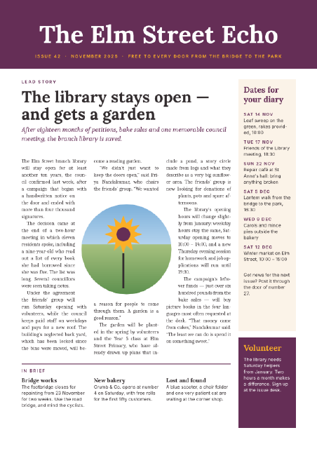

<!-- Generated by tools/gallery.mjs from showcase.yaml and build.json; do not edit. -->
# Neighbourhood Newsletter Front

[Layout](../README.md) › [Magazines & Books](../README.md#magazines--books) · `newsletter` `text-wrap` `columns` `paragraph-styles`

A community newsletter front page — masthead, a lead story in three columns flowing around a wrapped round picture, and a diary sidebar.



| | |
|---|---|
| Document | [neighbourhood-newsletter-front.klayout](neighbourhood-newsletter-front.klayout) (54 KB) |
| Contents | 1 page; 8 stories; 11 paragraph styles |
| Features | `layout.object.options`, `layout.text.frames`, `layout.type.styles`, `layout.object.fill-stroke`, `layout.color.swatches`, `layout.layout.pages-guides` |
| Built by | `kition-layout` @ `e2c4271dc0`: 118 commands in 187 ms |

## About

The lead story is one three-column frame; a round "photo" (a two-band gradient with a star
polygon sunflower) sits across the first two columns with a contour text wrap, so the lines of
the outer columns shorten around it. Headline, standfirst, body, diary and in-brief items are
paragraph styles; diary dates are found by GREP. The in-brief strip is a second three-column
frame split by column-break characters, and the masthead and sidebars use CMYK swatches.

## Checks

- `inspect.pageCount`: `1`
- `inspect.spreads.0.items`: `{"any":{"kind":"<text frame>","columns":3}}`
- `inspect.spreads.0.items.5`: `{"kind":"<ellipse>","fill":"Gradient","bounds":[150,380,324,554]}`
- `inspect.paragraphStyles`: `{"contains":"Standfirst"}`
- `inspect.stories`: `{"count":8,"all":{"overset":false}}`
- `results.wrap`: `{"changed":1}`
- `results.dates`: `{"count":6}`
- `results.briefHeads`: `{"count":3}`
- `results.fonts`: `{"all":{"missing":false,"styleMissing":false}}`
- diagnostics: none (the kit's check finds nothing wrong)
- the saved document opens again; the thumbnail matches `thumb.png` within the `render` tolerance

## Steps

<details><summary>118 commands (from <a href="showcase.yaml">showcase.yaml</a>)</summary>

```yaml
- command: layout.documentSetup
  params:
    bleed: 9
- command: layout.marginsAndColumns
  params:
    margins: 40
    columns: 4
    gutter: 14
- command: swatch.create
  params:
    name: Plum
    color:
      c: 55
      m: 90
      y: 30
      k: 30
- command: swatch.create
  params:
    name: Marigold
    color:
      c: 0
      m: 35
      y: 90
      k: 0
- command: swatch.create
  params:
    name: Sky
    color:
      c: 45
      m: 10
      y: 5
      k: 0
- command: swatch.create
  params:
    name: Paper Tint
    color:
      c: 2
      m: 4
      y: 8
      k: 0
- command: swatch.create
  params:
    name: Charcoal
    color:
      c: 60
      m: 55
      y: 50
      k: 70
- command: style.paragraph.create
  params:
    name: Kicker
    para:
      spaceAfter: 4
    chars:
      fontFamily: Inter
      fontStyle: SemiBold
      size: 8
      tracking: 200
      capitalization: allCaps
      fill: Plum
- command: style.paragraph.create
  params:
    name: Headline
    para:
      spaceAfter: 6
      hyphenate: false
    chars:
      fontFamily: Lora
      fontStyle: Bold
      size: 30
      leading:
        kind: points
        value: 32
      fill: Charcoal
- command: style.paragraph.create
  params:
    name: Standfirst
    para:
      spaceAfter: 8
    chars:
      fontFamily: Caladea
      fontStyle: Italic
      size: 13
      leading:
        kind: points
        value: 17
      fill: Plum
- command: style.paragraph.create
  params:
    name: Body
    para:
      align: leftJustified
      firstLineIndent: 10
      hyphenate: true
    chars:
      fontFamily: Caladea
      fontStyle: Regular
      size: 9.5
      leading:
        kind: points
        value: 13
      fill: Charcoal
- command: style.paragraph.create
  params:
    name: Body First
    basedOn: Body
    para:
      firstLineIndent: 0
- command: style.paragraph.create
  params:
    name: Brief Head
    chars:
      fontFamily: Lora
      fontStyle: Bold
      size: 10.5
      leading:
        kind: points
        value: 14
      fill: Charcoal
- command: style.paragraph.create
  params:
    name: Diary Head
    para:
      spaceAfter: 8
    chars:
      fontFamily: Lora
      fontStyle: Bold
      size: 15
      fill: Plum
- command: style.paragraph.create
  params:
    name: Diary Date
    para:
      spaceBefore: 8
    chars:
      fontFamily: Inter
      fontStyle: SemiBold
      size: 8
      tracking: 120
      capitalization: allCaps
      fill: Plum
- command: style.paragraph.create
  params:
    name: Diary Item
    chars:
      fontFamily: Inter
      fontStyle: Regular
      size: 8.5
      leading:
        kind: points
        value: 11.5
      fill: Charcoal
- command: frame.create
  params:
    rect:
      - -9
      - -9
      - 604
      - 128
    content: graphic
  as: mastBg
- command: object.fill
  params:
    ids:
      - $mastBg.id
    swatch: Plum
- command: frame.create
  params:
    rect:
      - 40
      - 34
      - 555
      - 96
    text: The Elm Street Echo
  as: mast
- command: text.select
  params:
    story: $mast.story
    anchor: 0
    focus: 1
- command: type.para
  params:
    attrs:
      align: center
- command: text.select
  params:
    story: $mast.story
    anchor: 0
    focus: 19
- command: type.char
  params:
    attrs:
      fontFamily: Lora
      fontStyle: Bold
      size: 46
      fill: "[Paper]"
- command: text.exitToFrame
  params: {}
- command: frame.create
  params:
    rect:
      - 40
      - 100
      - 555
      - 114
    text: Issue 42  ·  November 2026  ·  Free to every door from the bridge to the park
  as: issue
- command: text.select
  params:
    story: $issue.story
    anchor: 0
    focus: 1
- command: style.paragraph.apply
  params:
    name: Kicker
- command: type.para
  params:
    attrs:
      align: center
      spaceAfter: 0
- command: text.select
  params:
    story: $issue.story
    anchor: 0
    focus: 90
- command: type.char
  params:
    attrs:
      fill: Marigold
- command: text.exitToFrame
  params: {}
- command: frame.create
  params:
    rect:
      - 40
      - 148
      - 433
      - 290
    text: |-
      Lead story
      The library stays open — and gets a garden
      After eighteen months of petitions, bake sales and one memorable council meeting, the branch library is saved.
  as: lead
- command: text.select
  params:
    story: $lead.story
    anchor: 0
    focus: 1
- command: style.paragraph.apply
  params:
    name: Kicker
- command: text.select
  params:
    story: $lead.story
    anchor: 11
    focus: 12
- command: style.paragraph.apply
  params:
    name: Headline
- command: find.find
  params:
    find: After eighteen
    story: $lead.story
    scope: story
  as: standfirst
- command: text.select
  params:
    story: $lead.story
    anchor: $standfirst.0.start
    focus: $standfirst.0.end
- command: style.paragraph.apply
  params:
    name: Standfirst
- command: text.exitToFrame
  params: {}
- command: frame.create
  params:
    rect:
      - 40
      - 296
      - 433
      - 668
    text: |-
      The Elm Street branch library will stay open for at least another ten years, the council confirmed last week, after a campaign that began with a handwritten notice on the door and ended with more than four thousand signatures.
      The decision came at the end of a two-hour meeting in which eleven residents spoke, including a nine-year-old who read out a list of every book she had borrowed since she was five. The list was long. Several councillors were seen taking notes.
      Under the agreement the friends' group will run Saturday opening with volunteers, while the council keeps paid staff on weekdays and pays for a new roof. The building's neglected back yard, which has been locked since the bins were moved, will become a reading garden.
      “We didn't just want to keep the doors open,” said Priya Nandakumar, who chairs the friends' group. “We wanted a reason for people to come through them. A garden is a good reason.”
      The garden will be planted in the spring by volunteers and the Year 5 class at Elm Street Primary, who have already drawn up plans that include a pond, a story circle made from logs and what they describe as a very big sunflower area. The friends' group is now looking for donations of plants, pots and spare afternoons.
      The library's opening hours will change slightly from January: weekday hours stay the same, Saturday opening moves to 10:00 – 14:00, and a new Thursday evening session for homework and job applications will run until 19:30.
      The campaign's leftover funds — just over six hundred pounds from the bake sales — will buy picture books in the four languages most often requested at the desk. “That money came from cakes,” Nandakumar said. “The least we can do is spend it on something sweet.”
  as: body
- command: object.textFrameOptions
  params:
    ids:
      - $body.id
    columns: 3
    gutter: 14
- command: story.get
  params:
    frame: $body.id
  as: bodyText
- command: text.select
  params:
    story: $body.story
    anchor: 0
    focus: $bodyText.length
- command: style.paragraph.apply
  params:
    name: Body
- command: text.select
  params:
    story: $body.story
    anchor: 0
    focus: 1
- command: style.paragraph.apply
  params:
    name: Body First
- command: text.exitToFrame
  params: {}
- command: frame.create
  params:
    shape: ellipse
    rect:
      - 150
      - 380
      - 324
      - 554
    content: graphic
  as: photo
- command: object.gradient
  params:
    ids:
      - $photo.id
    kind: linear
    angle: 90
    stops:
      - location: 0
        color:
          c: 65
          m: 15
          y: 85
          k: 10
      - location: 55
        color:
          c: 40
          m: 5
          y: 60
          k: 0
      - location: 56
        color:
          c: 30
          m: 5
          y: 3
          k: 0
      - location: 100
        color:
          c: 50
          m: 15
          y: 5
          k: 0
- command: object.stroke
  params:
    ids:
      - $photo.id
    swatch: "[Paper]"
    weight: 5
- command: object.textWrap
  params:
    ids:
      - $photo.id
    mode: contour
    offset: 10
  as: wrap
- command: tool.polygonSettings
  params:
    sides: 12
    starInset: 40
- command: frame.create
  params:
    shape: polygon
    sides: 12
    rect:
      - 196
      - 404
      - 266
      - 474
    content: graphic
  as: sunflower
- command: object.fill
  params:
    ids:
      - $sunflower.id
    swatch: Marigold
- command: frame.create
  params:
    shape: ellipse
    rect:
      - 218
      - 426
      - 244
      - 452
    content: graphic
  as: seedhead
- command: object.fill
  params:
    ids:
      - $seedhead.id
    swatch: Plum
- command: path.create
  params:
    anchors:
      - p:
          - 231
          - 474
      - p:
          - 231
          - 540
  as: stem
- command: object.stroke
  params:
    ids:
      - $stem.id
    swatch: Charcoal
    weight: 3
- command: path.create
  params:
    anchors:
      - p:
          - 40
          - 682
      - p:
          - 433
          - 682
  as: briefRule
- command: object.stroke
  params:
    ids:
      - $briefRule.id
    swatch: Plum
    weight: 1.5
- command: frame.create
  params:
    rect:
      - 40
      - 706
      - 433
      - 802
    text: |-
      Bridge works
      The footbridge closes for repainting from 23 November for two weeks. Use the road bridge, and mind the cyclists.
      New bakery
      Crumb & Co. opens at number 4 on Saturday, with free rolls for the first fifty customers.
      Lost and found
      A blue scooter, a choir folder and one very patient cat are waiting at the corner shop.
  as: brief
- command: object.textFrameOptions
  params:
    ids:
      - $brief.id
    columns: 3
    gutter: 14
- command: frame.create
  params:
    rect:
      - 40
      - 690
      - 433
      - 702
    text: In brief
  as: briefLabel
- command: text.select
  params:
    story: $briefLabel.story
    anchor: 0
    focus: 1
- command: style.paragraph.apply
  params:
    name: Kicker
- command: text.exitToFrame
  params: {}
- command: story.get
  params:
    frame: $brief.id
  as: briefText
- command: text.select
  params:
    story: $brief.story
    anchor: 0
    focus: $briefText.length
- command: style.paragraph.apply
  params:
    name: Diary Item
- command: find.find
  params:
    find: ^(Bridge works|New bakery|Lost and found)$
    grep: true
    story: $brief.story
    scope: story
  as: briefHeads
- command: text.select
  params:
    story: $brief.story
    anchor: $briefHeads.0.start
    focus: $briefHeads.0.end
- command: style.paragraph.apply
  params:
    name: Brief Head
- command: text.select
  params:
    story: $brief.story
    anchor: $briefHeads.1.start
    focus: $briefHeads.1.end
- command: style.paragraph.apply
  params:
    name: Brief Head
- command: text.select
  params:
    story: $brief.story
    anchor: $briefHeads.2.start
    focus: $briefHeads.2.end
- command: style.paragraph.apply
  params:
    name: Brief Head
- command: text.exitToFrame
  params: {}
- command: frame.create
  params:
    rect:
      - 447
      - 148
      - 555
      - 620
    content: graphic
  as: sideBg
- command: object.fill
  params:
    ids:
      - $sideBg.id
    swatch: Paper Tint
- command: frame.create
  params:
    rect:
      - 447
      - 148
      - 555
      - 620
    text: |-
      Dates for your diary
      Sat 14 Nov
      Leaf sweep on the green, rakes provided, 10:00
      Tue 17 Nov
      Friends of the Library meeting, 18:30
      Sun 22 Nov
      Repair café at St Anne's hall: bring anything broken
      Sat 5 Dec
      Lantern walk from the bridge to the park, 16:30
      Wed 9 Dec
      Carols and mince pies outside the bakery
      Sat 12 Dec
      Winter market on Elm Street, 10:00 – 15:00
      Got news for the next issue? Post it through the door of number 27.
  as: diary
- command: object.textFrameOptions
  params:
    ids:
      - $diary.id
    inset: 10
- command: story.get
  params:
    frame: $diary.id
  as: diaryText
- command: text.select
  params:
    story: $diary.story
    anchor: 0
    focus: $diaryText.length
- command: style.paragraph.apply
  params:
    name: Diary Item
- command: text.select
  params:
    story: $diary.story
    anchor: 0
    focus: 1
- command: style.paragraph.apply
  params:
    name: Diary Head
- command: find.find
  params:
    find: ^(Sat|Sun|Tue|Wed) [0-9]+ [A-Z][a-z]+$
    grep: true
    story: $diary.story
    scope: story
  as: dates
- command: text.select
  params:
    story: $diary.story
    anchor: $dates.0.start
    focus: $dates.0.end
- command: style.paragraph.apply
  params:
    name: Diary Date
- command: text.select
  params:
    story: $diary.story
    anchor: $dates.1.start
    focus: $dates.1.end
- command: style.paragraph.apply
  params:
    name: Diary Date
- command: text.select
  params:
    story: $diary.story
    anchor: $dates.2.start
    focus: $dates.2.end
- command: style.paragraph.apply
  params:
    name: Diary Date
- command: text.select
  params:
    story: $diary.story
    anchor: $dates.3.start
    focus: $dates.3.end
- command: style.paragraph.apply
  params:
    name: Diary Date
- command: text.select
  params:
    story: $diary.story
    anchor: $dates.4.start
    focus: $dates.4.end
- command: style.paragraph.apply
  params:
    name: Diary Date
- command: text.select
  params:
    story: $diary.story
    anchor: $dates.5.start
    focus: $dates.5.end
- command: style.paragraph.apply
  params:
    name: Diary Date
- command: find.find
  params:
    find: Got news
    story: $diary.story
    scope: story
  as: gotNews
- command: text.select
  params:
    story: $diary.story
    anchor: $gotNews.0.start
    focus: $gotNews.0.end
- command: type.para
  params:
    attrs:
      spaceBefore: 18
- command: text.exitToFrame
  params: {}
- command: frame.create
  params:
    rect:
      - 447
      - 632
      - 555
      - 802
    text: |-
      Volunteer
      The library needs Saturday helpers from January. Two hours a month makes a difference. Sign up at the issue desk.
  as: volunteer
- command: object.fill
  params:
    ids:
      - $volunteer.id
    swatch: Plum
- command: object.textFrameOptions
  params:
    ids:
      - $volunteer.id
    inset: 10
- command: story.get
  params:
    frame: $volunteer.id
  as: volunteerText
- command: text.select
  params:
    story: $volunteer.story
    anchor: 0
    focus: $volunteerText.length
- command: style.paragraph.apply
  params:
    name: Diary Item
- command: type.char
  params:
    attrs:
      fill: "[Paper]"
- command: text.select
  params:
    story: $volunteer.story
    anchor: 0
    focus: 1
- command: style.paragraph.apply
  params:
    name: Diary Head
- command: text.select
  params:
    story: $volunteer.story
    anchor: 0
    focus: 9
- command: type.char
  params:
    attrs:
      fill: Marigold
- command: text.exitToFrame
  params: {}
- command: story.get
  params:
    frame: $body.id
  as: bodyAfter
- command: font.list
  params: {}
  as: fonts
```

</details>
