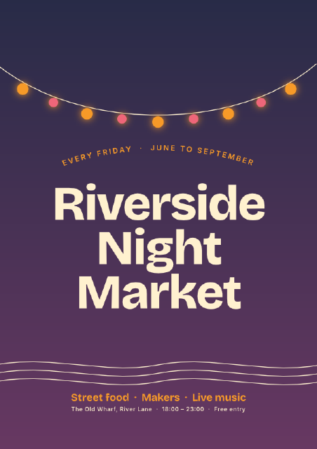

<!-- Generated by tools/gallery.mjs from showcase.yaml and build.json; do not edit. -->
# Riverside Night Market Poster

[Layout](../README.md) › [Posters](../README.md#posters) · `poster` `type-on-path` `gradient` `step-and-repeat`

A night-market poster with type set on a curved path, a garland of lanterns stepped along a swag and a gradient sky.



| | |
|---|---|
| Document | [riverside-night-market-poster.klayout](riverside-night-market-poster.klayout) (40 KB) |
| Contents | 1 page; 3 stories; 5 paragraph styles |
| Features | `layout.object.paths`, `layout.type.format`, `layout.object.fill-stroke`, `layout.object.effects`, `layout.color.swatches`, `layout.transform.objects` |
| Built by | `kition-layout` @ `e2c4271dc0`: 56 commands in 138 ms |

## About

The sky is a gradient frame, the garland a single curved path with nine round lanterns hung
along it, each with a lantern-coloured live drop shadow used as a glow. "Every Friday · June to
September" is set with `type.onPath` on a second, invisible arc and centred on it. The title is
Bricolage Grotesque ExtraBold in a paragraph style that never hyphenates; the river is one wavy
path moved down with a copy and repeated with Transform Again.

## Checks

- `inspect.pageCount`: `1`
- `inspect.spreads.0.items`: `{"count":17}`
- `inspect.stories`: `{"count":3,"all":{"overset":false}}`
- `inspect.stories.0`: `{"preview":"EVERY FRIDAY  ·  JUNE TO SEPTEMBER","lines":1}`
- `inspect.stories.1`: `{"lines":3,"paragraphs":3}`
- `inspect.paragraphStyles`: `{"contains":"Title"}`
- `results.arcText.story`: `{"min":1}`
- `results.fonts`: `{"count":4,"all":{"missing":false,"styleMissing":false}}`
- diagnostics: none (the kit's check finds nothing wrong)
- the saved document opens again; the thumbnail matches `thumb.png` within the `render` tolerance

## Steps

<details><summary>56 commands (from <a href="showcase.yaml">showcase.yaml</a>)</summary>

```yaml
- command: layout.documentSetup
  params:
    bleed: 9
- command: swatch.create
  params:
    name: Night
    color:
      c: 95
      m: 85
      y: 35
      k: 45
- command: swatch.create
  params:
    name: Lantern
    color:
      c: 0
      m: 45
      y: 90
      k: 0
- command: swatch.create
  params:
    name: Rose
    color:
      c: 0
      m: 70
      y: 30
      k: 0
- command: swatch.create
  params:
    name: Cream
    color:
      c: 0
      m: 5
      y: 20
      k: 0
- command: frame.create
  params:
    rect:
      - -9
      - -9
      - 609
      - 859
    content: graphic
  as: sky
- command: object.gradient
  params:
    ids:
      - $sky.id
    kind: linear
    angle: 90
    stops:
      - location: 0
        color:
          c: 60
          m: 85
          y: 30
          k: 20
      - location: 100
        color:
          c: 95
          m: 85
          y: 35
          k: 45
- command: path.create
  params:
    anchors:
      - p:
          - -9
          - 120
        out:
          - 150
          - 250
      - p:
          - 600
          - 120
        in:
          - 450
          - 250
  as: swag
- command: object.stroke
  params:
    ids:
      - $swag.id
    swatch: Cream
    weight: 1.5
- command: frame.create
  params:
    shape: ellipse
    rect:
      - 31.6
      - 157.1
      - 53.6
      - 179.1
    content: graphic
  as: lamp0
- command: object.fill
  params:
    ids:
      - $lamp0.id
    swatch: Lantern
- command: frame.create
  params:
    shape: ellipse
    rect:
      - 92
      - 184.4
      - 110
      - 202.4
    content: graphic
  as: lamp1
- command: object.fill
  params:
    ids:
      - $lamp1.id
    swatch: Rose
- command: frame.create
  params:
    shape: ellipse
    rect:
      - 153.3
      - 203.9
      - 175.3
      - 225.9
    content: graphic
  as: lamp2
- command: object.fill
  params:
    ids:
      - $lamp2.id
    swatch: Lantern
- command: frame.create
  params:
    shape: ellipse
    rect:
      - 221.9
      - 215.6
      - 239.9
      - 233.6
    content: graphic
  as: lamp3
- command: object.fill
  params:
    ids:
      - $lamp3.id
    swatch: Rose
- command: frame.create
  params:
    shape: ellipse
    rect:
      - 287.9
      - 219.5
      - 309.9
      - 241.5
    content: graphic
  as: lamp4
- command: object.fill
  params:
    ids:
      - $lamp4.id
    swatch: Lantern
- command: frame.create
  params:
    shape: ellipse
    rect:
      - 357.6
      - 215.6
      - 375.6
      - 233.6
    content: graphic
  as: lamp5
- command: object.fill
  params:
    ids:
      - $lamp5.id
    swatch: Rose
- command: frame.create
  params:
    shape: ellipse
    rect:
      - 421.4
      - 203.9
      - 443.4
      - 225.9
    content: graphic
  as: lamp6
- command: object.fill
  params:
    ids:
      - $lamp6.id
    swatch: Lantern
- command: frame.create
  params:
    shape: ellipse
    rect:
      - 485.3
      - 184.4
      - 503.3
      - 202.4
    content: graphic
  as: lamp7
- command: object.fill
  params:
    ids:
      - $lamp7.id
    swatch: Rose
- command: frame.create
  params:
    shape: ellipse
    rect:
      - 539.8
      - 157.1
      - 561.8
      - 179.1
    content: graphic
  as: lamp8
- command: object.fill
  params:
    ids:
      - $lamp8.id
    swatch: Lantern
- command: object.dropShadow
  params:
    ids:
      - $lamp0.id
      - $lamp1.id
      - $lamp2.id
      - $lamp3.id
      - $lamp4.id
      - $lamp5.id
      - $lamp6.id
      - $lamp7.id
      - $lamp8.id
    on: true
    distance: 0
    size: 14
    opacity: 85
    color: Lantern
- command: path.create
  params:
    anchors:
      - p:
          - 70
          - 330
        out:
          - 200
          - 262
      - p:
          - 530
          - 330
        in:
          - 400
          - 262
  as: arc
- command: type.onPath
  params:
    id: $arc.id
    text: EVERY FRIDAY  ·  JUNE TO SEPTEMBER
    align: center
  as: arcText
- command: story.get
  params:
    story: $arcText.story
  as: arcStory
- command: text.select
  params:
    story: $arcText.story
    anchor: 0
    focus: $arcStory.length
- command: type.char
  params:
    attrs:
      fontFamily: Inter
      fontStyle: SemiBold
      size: 14
      tracking: 220
      fill: Lantern
- command: type.alignCenter
  params: {}
- command: text.exitToFrame
  params: {}
- command: object.stroke
  params:
    ids:
      - $arc.id
    swatch: "[None]"
- command: frame.create
  params:
    rect:
      - 30
      - 330
      - 570
      - 650
    text: |-
      Riverside
      Night
      Market
  as: title
- command: text.select
  params:
    story: $title.story
    anchor: 0
    focus: 1
- command: style.paragraph.create
  params:
    name: Title
    para:
      align: center
      hyphenate: false
    chars:
      fontFamily: Bricolage Grotesque
      fontStyle: ExtraBold
      size: 92
      leading:
        kind: points
        value: 84
      tracking: -30
      fill: Cream
- command: text.select
  params:
    story: $title.story
    anchor: 0
    focus: 22
- command: style.paragraph.apply
  params:
    name: Title
- command: text.exitToFrame
  params: {}
- command: path.create
  params:
    anchors:
      - p:
          - -9
          - 690
        out:
          - 100
          - 670
      - p:
          - 300
          - 690
        in:
          - 200
          - 710
        out:
          - 400
          - 670
      - p:
          - 609
          - 690
        in:
          - 500
          - 710
  as: wave1
- command: object.stroke
  params:
    ids:
      - $wave1.id
    swatch: Cream
    weight: 1.5
- command: transform.move
  params:
    ids:
      - $wave1.id
    dx: 0
    dy: 16
    copy: true
- command: transform.again
  params: {}
- command: frame.create
  params:
    rect:
      - 40
      - 740
      - 560
      - 810
    text: |-
      Street food  ·  Makers  ·  Live music
      The Old Wharf, River Lane  ·  18:00 – 23:00  ·  Free entry
  as: info
- command: style.paragraph.create
  params:
    name: Info Lead
    para:
      align: center
      spaceAfter: 6
    chars:
      fontFamily: Bricolage Grotesque
      fontStyle: Bold
      size: 20
      fill: Lantern
- command: style.paragraph.create
  params:
    name: Info Line
    para:
      align: center
    chars:
      fontFamily: Inter
      fontStyle: Medium
      size: 11
      tracking: 60
      fill: Cream
- command: story.get
  params:
    frame: $info.id
  as: infoText
- command: text.select
  params:
    story: $info.story
    anchor: 0
    focus: $infoText.length
- command: style.paragraph.apply
  params:
    name: Info Line
- command: text.select
  params:
    story: $info.story
    anchor: 0
    focus: 1
- command: style.paragraph.apply
  params:
    name: Info Lead
- command: text.exitToFrame
  params: {}
- command: font.list
  params: {}
  as: fonts
```

</details>
