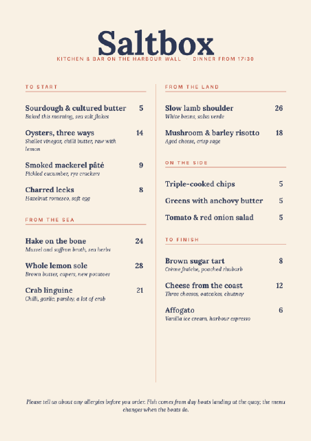

<!-- Generated by tools/gallery.mjs from showcase.yaml and build.json; do not edit. -->
# Saltbox Dinner Menu

[Layout](../README.md) › [Brochures & Flyers](../README.md#brochures--flyers) · `menu` `tabs` `columns` `paragraph-styles` `column-rule`

A two-column restaurant menu in one story — section heads, dishes with right-tabbed prices, italic descriptions and a column rule.



| | |
|---|---|
| Document | [saltbox-dinner-menu.klayout](saltbox-dinner-menu.klayout) (29 KB) |
| Contents | 1 page; 3 stories; 5 paragraph styles |
| Features | `layout.type.styles`, `layout.type.format`, `layout.text.frames`, `layout.object.fill-stroke`, `layout.color.swatches` |
| Built by | `kition-layout` @ `e2c4271dc0`: 73 commands in 126 ms |

## About

The whole menu is one story in a two-column frame with a half-tint brick column rule. Dishes use
a "Dish" paragraph style whose right tab stop puts each price on the column edge; descriptions
are Caladea Italic in "Dish Note", and section heads carry a paragraph rule below. Dishes and
sections are found with GREP (tabs and the five head lines) and styled by paragraph; a
column-break character sends "From the land" to the top of the second column. The page
background is an Oyster CMYK swatch.

## Checks

- `inspect.pageCount`: `1`
- `inspect.spreads.0.pages.0.background`: `"Oyster"`
- `inspect.spreads.0.items`: `{"any":{"kind":"<text frame>","columns":2,"columnRule":true}}`
- `inspect.paragraphStyles`: `{"contains":"Dish Note"}`
- `inspect.stories`: `{"count":3,"all":{"overset":false}}`
- `results.prices`: `{"count":15}`
- `results.sections`: `{"count":5}`
- `results.fonts`: `{"all":{"missing":false,"styleMissing":false}}`
- diagnostics: none (the kit's check finds nothing wrong)
- the saved document opens again; the thumbnail matches `thumb.png` within the `render` tolerance

## Steps

<details><summary>73 commands (from <a href="showcase.yaml">showcase.yaml</a>)</summary>

```yaml
- command: layout.documentSetup
  params:
    bleed: 9
- command: layout.marginsAndColumns
  params:
    margins:
      top: 48
      bottom: 48
      inside: 48
      outside: 48
    columns: 2
    gutter: 36
- command: swatch.create
  params:
    name: Ink Navy
    color:
      c: 90
      m: 75
      y: 35
      k: 35
- command: swatch.create
  params:
    name: Brick
    color:
      c: 10
      m: 75
      y: 75
      k: 15
- command: swatch.create
  params:
    name: Oyster
    color:
      c: 3
      m: 4
      y: 10
      k: 0
- command: page.background
  params:
    color: Oyster
- command: style.paragraph.create
  params:
    name: Section
    para:
      spaceBefore: 30
      spaceAfter: 10
      hyphenate: false
      ruleBelow:
        on: true
        weight: 0.75
        color: Brick
        offset: 5
        columnWidth: true
    chars:
      fontFamily: Inter
      fontStyle: SemiBold
      size: 9
      tracking: 260
      capitalization: allCaps
      fill: Brick
- command: style.paragraph.create
  params:
    name: Dish
    para:
      spaceBefore: 14
      tabs:
        - position: 225.5
          align: right
    chars:
      fontFamily: Lora
      fontStyle: Bold
      size: 14
      leading:
        kind: points
        value: 18
      fill: Ink Navy
- command: style.paragraph.create
  params:
    name: Dish Note
    para:
      rightIndent: 40
    chars:
      fontFamily: Caladea
      fontStyle: Italic
      size: 11.5
      leading:
        kind: points
        value: 15
      fill: Ink Navy
- command: frame.create
  params:
    rect:
      - 48
      - 40
      - 547
      - 150
    text: |-
      Saltbox
      Kitchen & bar on the harbour wall  ·  dinner from 17:30
  as: masthead
- command: text.select
  params:
    story: $masthead.story
    anchor: 0
    focus: 1
- command: type.para
  params:
    attrs:
      align: center
- command: type.char
  params:
    attrs:
      fontFamily: Lora
      fontStyle: Bold
      size: 64
      leading:
        kind: points
        value: 70
      fill: Ink Navy
- command: text.select
  params:
    story: $masthead.story
    anchor: 0
    focus: 7
- command: type.char
  params:
    attrs:
      fontFamily: Lora
      fontStyle: Bold
      size: 64
      leading:
        kind: points
        value: 70
      fill: Ink Navy
- command: text.select
  params:
    story: $masthead.story
    anchor: 8
    focus: 70
- command: type.para
  params:
    attrs:
      align: center
- command: type.char
  params:
    attrs:
      fontFamily: Inter
      fontStyle: Medium
      size: 9
      tracking: 200
      capitalization: allCaps
      fill: Brick
- command: text.exitToFrame
  params: {}
- command: frame.create
  params:
    rect:
      - 48
      - 160
      - 547
      - 730
    text: |-
      To start
      Sourdough & cultured butter	5
      Baked this morning, sea salt flakes
      Oysters, three ways	14
      Shallot vinegar, chilli butter, raw with lemon
      Smoked mackerel pâté	9
      Pickled cucumber, rye crackers
      Charred leeks	8
      Hazelnut romesco, soft egg
      From the sea
      Hake on the bone	24
      Mussel and saffron broth, sea herbs
      Whole lemon sole	28
      Brown butter, capers, new potatoes
      Crab linguine	21
      Chilli, garlic, parsley, a lot of crab
      From the land
      Slow lamb shoulder	26
      White beans, salsa verde
      Mushroom & barley risotto	18
      Aged cheese, crisp sage
      On the side
      Triple-cooked chips	5
      Greens with anchovy butter	5
      Tomato & red onion salad	5
      To finish
      Brown sugar tart	8
      Crème fraîche, poached rhubarb
      Cheese from the coast	12
      Three cheeses, oatcakes, chutney
      Affogato	6
      Vanilla ice cream, harbour espresso
  as: menu
- command: object.textFrameOptions
  params:
    ids:
      - $menu.id
    columns: 2
    gutter: 36
    columnRule: true
    columnRuleWeight: 0.5
    columnRuleColor: Brick
    columnRuleTint: 0.5
- command: story.get
  params:
    frame: $menu.id
  as: menuText
- command: text.select
  params:
    story: $menu.story
    anchor: 0
    focus: $menuText.length
- command: style.paragraph.apply
  params:
    name: Dish Note
- command: find.find
  params:
    find: \t
    grep: true
    story: $menu.story
    scope: story
  as: prices
- command: find.find
  params:
    find: ^(To start|From the sea|From the land|On the side|To finish)$
    grep: true
    story: $menu.story
    scope: story
  as: sections
- command: text.select
  params:
    story: $menu.story
    anchor: $prices.0.start
    focus: $prices.0.end
- command: style.paragraph.apply
  params:
    name: Dish
- command: text.select
  params:
    story: $menu.story
    anchor: $prices.1.start
    focus: $prices.1.end
- command: style.paragraph.apply
  params:
    name: Dish
- command: text.select
  params:
    story: $menu.story
    anchor: $prices.2.start
    focus: $prices.2.end
- command: style.paragraph.apply
  params:
    name: Dish
- command: text.select
  params:
    story: $menu.story
    anchor: $prices.3.start
    focus: $prices.3.end
- command: style.paragraph.apply
  params:
    name: Dish
- command: text.select
  params:
    story: $menu.story
    anchor: $prices.4.start
    focus: $prices.4.end
- command: style.paragraph.apply
  params:
    name: Dish
- command: text.select
  params:
    story: $menu.story
    anchor: $prices.5.start
    focus: $prices.5.end
- command: style.paragraph.apply
  params:
    name: Dish
- command: text.select
  params:
    story: $menu.story
    anchor: $prices.6.start
    focus: $prices.6.end
- command: style.paragraph.apply
  params:
    name: Dish
- command: text.select
  params:
    story: $menu.story
    anchor: $prices.7.start
    focus: $prices.7.end
- command: style.paragraph.apply
  params:
    name: Dish
- command: text.select
  params:
    story: $menu.story
    anchor: $prices.8.start
    focus: $prices.8.end
- command: style.paragraph.apply
  params:
    name: Dish
- command: text.select
  params:
    story: $menu.story
    anchor: $prices.9.start
    focus: $prices.9.end
- command: style.paragraph.apply
  params:
    name: Dish
- command: text.select
  params:
    story: $menu.story
    anchor: $prices.10.start
    focus: $prices.10.end
- command: style.paragraph.apply
  params:
    name: Dish
- command: text.select
  params:
    story: $menu.story
    anchor: $prices.11.start
    focus: $prices.11.end
- command: style.paragraph.apply
  params:
    name: Dish
- command: text.select
  params:
    story: $menu.story
    anchor: $prices.12.start
    focus: $prices.12.end
- command: style.paragraph.apply
  params:
    name: Dish
- command: text.select
  params:
    story: $menu.story
    anchor: $prices.13.start
    focus: $prices.13.end
- command: style.paragraph.apply
  params:
    name: Dish
- command: text.select
  params:
    story: $menu.story
    anchor: $prices.14.start
    focus: $prices.14.end
- command: style.paragraph.apply
  params:
    name: Dish
- command: text.select
  params:
    story: $menu.story
    anchor: $sections.0.start
    focus: $sections.0.end
- command: style.paragraph.apply
  params:
    name: Section
- command: text.select
  params:
    story: $menu.story
    anchor: $sections.1.start
    focus: $sections.1.end
- command: style.paragraph.apply
  params:
    name: Section
- command: text.select
  params:
    story: $menu.story
    anchor: $sections.2.start
    focus: $sections.2.end
- command: style.paragraph.apply
  params:
    name: Section
- command: text.select
  params:
    story: $menu.story
    anchor: $sections.3.start
    focus: $sections.3.end
- command: style.paragraph.apply
  params:
    name: Section
- command: text.select
  params:
    story: $menu.story
    anchor: $sections.4.start
    focus: $sections.4.end
- command: style.paragraph.apply
  params:
    name: Section
- command: text.exitToFrame
  params: {}
- command: frame.create
  params:
    rect:
      - 48
      - 760
      - 547
      - 800
    text: Please tell us about any allergies before you order. Fish comes from day boats landing at the quay; the menu changes when the boats do.
  as: footer
- command: text.select
  params:
    story: $footer.story
    anchor: 0
    focus: 1
- command: style.paragraph.apply
  params:
    name: Dish Note
- command: type.para
  params:
    attrs:
      align: center
      rightIndent: 0
- command: text.exitToFrame
  params: {}
- command: font.list
  params: {}
  as: fonts
```

</details>
