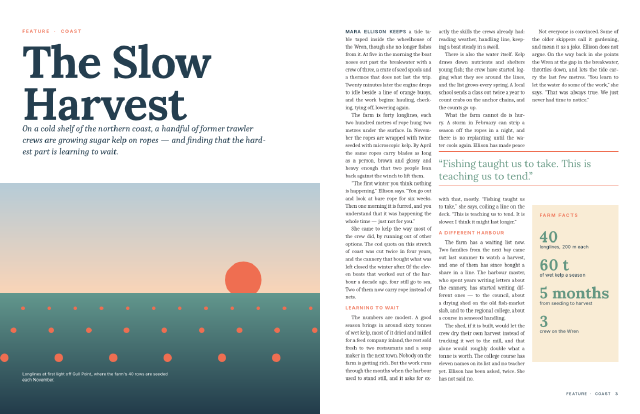

<!-- Generated by tools/gallery.mjs from showcase.yaml and build.json; do not edit. -->
# Tideline Magazine Feature

[Layout](../README.md) › [Magazines & Books](../README.md#magazines--books) · `magazine` `threaded-frames` `paragraph-styles` `parent-pages` `text-wrap`

A three-page magazine — cover and a feature spread whose story threads from one column into a two-column frame around a wrapped pull quote.



| | |
|---|---|
| Document | [tideline-magazine-feature.klayout](tideline-magazine-feature.klayout) (89 KB) |
| Contents | 3 pages; 9 stories; 16 paragraph styles |
| Features | `layout.text.threaded-frames`, `layout.type.styles`, `layout.layout.pages`, `layout.object.fill-stroke`, `layout.object.options`, `layout.color.swatches` |
| Built by | `kition-layout` @ `e2c4271dc0`: 114 commands in 140 ms |

## About

Facing pages after a single cover. The feature story starts in one column on page 3 and is
threaded (`frame.thread`) into a two-column frame beside it; a pull quote with paragraph rules
above and below sits across those columns with a bounding-box text wrap, and the story reflows
around it. Body, opener, crossheads (placed with `find.find`), pull quote, fact box and caption
are paragraph styles, the lead-in a character style. The running folios with the page-number
marker live on a two-page parent, B-Feature; the cover uses none. Colours are CMYK swatches; the
"photo" is two gradient frames, a sun and rows of buoys from `edit.stepAndRepeat`.

## Checks

- `inspect.pageCount`: `3`
- `inspect.spreads.1.pages`: `{"count":2,"all":{"parent":"B-Feature"}}`
- `inspect.spreads.0.pages.0.parent`: `null`
- `inspect.parents`: `{"any":{"label":"B-Feature","items":2}}`
- `inspect.paragraphStyles`: `{"contains":"Pull Quote","all":{"matches":"."}}`
- `inspect.characterStyles`: `{"contains":"Lead In"}`
- `inspect.swatches`: `{"contains":"Deep Sea"}`
- `inspect.stories`: `{"count":9,"all":{"overset":false},"any":{"frames":{"count":2},"paragraphs":12}}`
- `results.threaded`: `{"frames":{"count":2},"overset":false,"pagesAdded":0}`
- `results.cross1`: `{"count":1}`
- `results.figures`: `{"count":4}`
- `results.fonts`: `{"count":7,"all":{"missing":false,"styleMissing":false}}`
- diagnostics: none (the kit's check finds nothing wrong)
- the saved document opens again; the thumbnail matches `thumb.png` within the `render` tolerance

## Steps

<details><summary>114 commands (from <a href="showcase.yaml">showcase.yaml</a>)</summary>

```yaml
- command: layout.documentSetup
  params:
    pages: 3
    facingPages: true
    bleed: 9
- command: layout.marginsAndColumns
  params:
    margins:
      top: 54
      bottom: 60
      inside: 48
      outside: 42
    columns: 3
    gutter: 14
- command: swatch.create
  params:
    name: Deep Sea
    color:
      c: 92
      m: 62
      y: 45
      k: 38
- command: swatch.create
  params:
    name: Kelp
    color:
      c: 62
      m: 18
      y: 52
      k: 4
- command: swatch.create
  params:
    name: Coral
    color:
      c: 0
      m: 66
      y: 62
      k: 0
- command: swatch.create
  params:
    name: Sand
    color:
      c: 3
      m: 6
      y: 16
      k: 0
- command: style.paragraph.create
  params:
    name: Kicker
    para:
      spaceAfter: 6
      hyphenate: false
    chars:
      fontFamily: Inter
      fontStyle: SemiBold
      size: 9
      tracking: 200
      fill: Coral
      capitalization: allCaps
- command: style.paragraph.create
  params:
    name: Headline
    chars:
      fontFamily: Lora
      fontStyle: Bold
      size: 86
      leading:
        kind: points
        value: 80
      tracking: -20
      fill: Deep Sea
- command: style.paragraph.create
  params:
    name: Deck
    chars:
      fontFamily: Caladea
      fontStyle: Italic
      size: 17
      leading:
        kind: points
        value: 22
      fill: Deep Sea
- command: style.paragraph.create
  params:
    name: Body
    para:
      align: leftJustified
      firstLineIndent: 12
      hyphenate: true
    chars:
      fontFamily: Caladea
      fontStyle: Regular
      size: 10.5
      leading:
        kind: points
        value: 14.5
- command: style.paragraph.create
  params:
    name: Body Opener
    basedOn: Body
    para:
      firstLineIndent: 0
- command: style.paragraph.create
  params:
    name: Crosshead
    para:
      spaceBefore: 10
      spaceAfter: 4
    chars:
      fontFamily: Inter
      fontStyle: SemiBold
      size: 9
      tracking: 120
      fill: Coral
      capitalization: allCaps
- command: style.character.create
  params:
    name: Lead In
    chars:
      fontFamily: Inter
      fontStyle: SemiBold
      size: 9
      tracking: 80
      fill: Deep Sea
      capitalization: allCaps
- command: style.paragraph.create
  params:
    name: Pull Quote
    para:
      align: left
      ruleAbove:
        on: true
        weight: 2
        color: Coral
        offset: 10
      ruleBelow:
        on: true
        weight: 0.75
        color: Coral
        offset: 10
    chars:
      fontFamily: Lora
      fontStyle: Regular
      size: 19
      leading:
        kind: points
        value: 24
      fill: Kelp
- command: style.paragraph.create
  params:
    name: Fact Figure
    para:
      spaceBefore: 10
    chars:
      fontFamily: Lora
      fontStyle: Bold
      size: 30
      leading:
        kind: points
        value: 32
      fill: Kelp
- command: style.paragraph.create
  params:
    name: Fact Label
    chars:
      fontFamily: Inter
      fontStyle: Regular
      size: 9
      leading:
        kind: points
        value: 12
      fill: Deep Sea
- command: style.paragraph.create
  params:
    name: Caption
    chars:
      fontFamily: Inter
      fontStyle: Regular
      size: 8
      leading:
        kind: points
        value: 11
      fill: "[Paper]"
- command: style.paragraph.create
  params:
    name: Masthead
    chars:
      fontFamily: Lora
      fontStyle: Bold
      size: 64
      tracking: 40
      fill: Deep Sea
- command: style.paragraph.create
  params:
    name: Cover Line
    para:
      spaceAfter: 8
    chars:
      fontFamily: Lora
      fontStyle: Bold
      size: 44
      leading:
        kind: points
        value: 46
      fill: "[Paper]"
- command: style.paragraph.create
  params:
    name: Cover Deck
    chars:
      fontFamily: Caladea
      fontStyle: Italic
      size: 18
      leading:
        kind: points
        value: 23
      fill: Sand
- command: style.paragraph.create
  params:
    name: Folio
    chars:
      fontFamily: Inter
      fontStyle: Medium
      size: 7.5
      tracking: 120
      fill: Deep Sea
- command: layout.parents.new
  params:
    prefix: B
    name: Feature
  as: parentB
- command: frame.create
  params:
    spread: B
    rect:
      - 42
      - 748
      - 320
      - 760
    text:    THE TIDELINE  ·  SPRING 2026
  as: folioL
- command: text.select
  params:
    story: $folioL.story
    anchor: 0
    focus: 1
- command: style.paragraph.apply
  params:
    name: Folio
- command: frame.create
  params:
    spread: B
    rect:
      - 904
      - 748
      - 1182
      - 760
    text: FEATURE  ·  COAST   
  as: folioR
- command: text.select
  params:
    story: $folioR.story
    anchor: 0
    focus: 1
- command: style.paragraph.apply
  params:
    name: Folio
- command: type.alignRight
  params: {}
- command: text.exitToFrame
  params: {}
- command: layout.pages.applyParent
  params:
    pages:
      - 1
    parent: null
- command: layout.pages.applyParent
  params:
    pages:
      - 2
      - 3
    parent: B
- command: frame.create
  params:
    spread: 0
    rect:
      - -9
      - -9
      - 621
      - 801
    content: graphic
  as: coverArt
- command: object.gradient
  params:
    ids:
      - $coverArt.id
    kind: linear
    angle: 90
    stops:
      - location: 0
        color:
          c: 95
          m: 65
          y: 45
          k: 45
      - location: 45
        color:
          c: 70
          m: 20
          y: 35
          k: 0
      - location: 100
        color:
          c: 18
          m: 4
          y: 8
          k: 0
- command: frame.create
  params:
    spread: 0
    shape: ellipse
    rect:
      - 380
      - 150
      - 540
      - 310
    content: graphic
  as: sun
- command: object.fill
  params:
    ids:
      - $sun.id
    swatch: Coral
- command: frame.create
  params:
    spread: 0
    rect:
      - 42
      - 48
      - 570
      - 130
    text: THE TIDELINE
  as: mast
- command: text.select
  params:
    story: $mast.story
    anchor: 0
    focus: 1
- command: style.paragraph.apply
  params:
    name: Masthead
- command: frame.create
  params:
    spread: 0
    rect:
      - 42
      - 560
      - 470
      - 740
    text: |-
      The Slow Harvest
      Inside the kelp farms remaking a fishing town, one longline at a time
  as: coverLines
- command: text.select
  params:
    story: $coverLines.story
    anchor: 0
    focus: 1
- command: style.paragraph.apply
  params:
    name: Cover Line
- command: text.select
  params:
    story: $coverLines.story
    anchor: 20
    focus: 21
- command: style.paragraph.apply
  params:
    name: Cover Deck
- command: text.exitToFrame
  params: {}
- command: frame.create
  params:
    spread: 1
    rect:
      - -9
      - 350
      - 612
      - 560
    content: graphic
  as: sky
- command: object.gradient
  params:
    ids:
      - $sky.id
    kind: linear
    angle: 90
    stops:
      - location: 0
        color:
          c: 2
          m: 18
          y: 24
          k: 0
      - location: 100
        color:
          c: 30
          m: 8
          y: 12
          k: 0
- command: frame.create
  params:
    spread: 1
    rect:
      - -9
      - 560
      - 612
      - 801
    content: graphic
  as: photo
- command: object.gradient
  params:
    ids:
      - $photo.id
    kind: linear
    angle: 90
    stops:
      - location: 0
        color:
          c: 95
          m: 65
          y: 45
          k: 45
      - location: 100
        color:
          c: 62
          m: 18
          y: 45
          k: 4
- command: frame.create
  params:
    spread: 1
    shape: ellipse
    rect:
      - 430
      - 500
      - 500
      - 570
    content: graphic
  as: lowSun
- command: object.fill
  params:
    ids:
      - $lowSun.id
    swatch: Coral
- command: object.arrange
  params:
    to: backward
    ids:
      - $lowSun.id
- command: frame.create
  params:
    spread: 1
    shape: ellipse
    rect:
      - 40
      - 586
      - 47
      - 593
    content: graphic
  as: buoy1
- command: object.fill
  params:
    ids:
      - $buoy1.id
    swatch: Coral
- command: edit.stepAndRepeat
  params:
    ids:
      - $buoy1.id
    count: 11
    dx: 50
- command: frame.create
  params:
    spread: 1
    shape: ellipse
    rect:
      - 20
      - 626
      - 31
      - 637
    content: graphic
  as: buoy2
- command: object.fill
  params:
    ids:
      - $buoy2.id
    swatch: Coral
- command: edit.stepAndRepeat
  params:
    ids:
      - $buoy2.id
    count: 8
    dx: 72
- command: frame.create
  params:
    spread: 1
    shape: ellipse
    rect:
      - 0
      - 676
      - 16
      - 692
    content: graphic
  as: buoy3
- command: object.fill
  params:
    ids:
      - $buoy3.id
    swatch: Coral
- command: edit.stepAndRepeat
  params:
    ids:
      - $buoy3.id
    count: 5
    dx: 104
- command: frame.create
  params:
    spread: 1
    rect:
      - 42
      - 710
      - 330
      - 740
    text: Longlines at first light off Gull Point, where the farm's 40 rows are seeded each November.
  as: caption
- command: text.select
  params:
    story: $caption.story
    anchor: 0
    focus: 1
- command: style.paragraph.apply
  params:
    name: Caption
- command: frame.create
  params:
    spread: 1
    rect:
      - 42
      - 54
      - 520
      - 390
    text: |-
      Feature  ·  Coast
      The Slow Harvest
      On a cold shelf of the northern coast, a handful of former trawler crews are growing sugar kelp on ropes — and finding that the hardest part is learning to wait.
  as: opener
- command: text.select
  params:
    story: $opener.story
    anchor: 0
    focus: 1
- command: style.paragraph.apply
  params:
    name: Kicker
- command: text.select
  params:
    story: $opener.story
    anchor: 20
    focus: 21
- command: style.paragraph.apply
  params:
    name: Headline
- command: text.select
  params:
    story: $opener.story
    anchor: 40
    focus: 41
- command: style.paragraph.apply
  params:
    name: Deck
- command: text.exitToFrame
  params: {}
- command: frame.create
  params:
    spread: 1
    rect:
      - 660
      - 54
      - 824.67
      - 732
    text: |-
      Mara Ellison keeps a tide table taped inside the wheelhouse of the Wren, though she no longer fishes from it. At five in the morning the boat noses out past the breakwater with a crew of three, a crate of seed spools and a thermos that does not last the trip. Twenty minutes later the engine drops to idle beside a line of orange buoys, and the work begins: hauling, checking, tying off, lowering again.
      The farm is forty longlines, each two hundred metres of rope hung two metres under the surface. In November the ropes are wrapped with twine seeded with microscopic kelp. By April the same ropes carry blades as long as a person, brown and glossy and heavy enough that two people lean back against the winch to lift them.
      “The first winter you think nothing is happening,” Ellison says. “You go out and look at bare rope for six weeks. Then one morning it is furred, and you understand that it was happening the whole time — just not for you.”
      She came to kelp the way most of the crew did, by running out of other options. The cod quota on this stretch of coast was cut twice in four years, and the cannery that bought what was left closed the winter after. Of the eleven boats that worked out of the harbour a decade ago, four still go to sea. Two of them now carry rope instead of nets.
      Learning to wait
      The numbers are modest. A good season brings in around sixty tonnes of wet kelp, most of it dried and milled for a feed company inland, the rest sold fresh to two restaurants and a soap maker in the next town. Nobody on the farm is getting rich. But the work runs through the months when the harbour used to stand still, and it asks for exactly the skills the crews already had: reading weather, handling line, keeping a boat steady in a swell.
      There is also the water itself. Kelp draws down nutrients and shelters young fish; the crew have started logging what they see around the lines, and the list grows every spring. A local school sends a class out twice a year to count crabs on the anchor chains, and the counts go up.
      What the farm cannot do is hurry. A storm in February can strip a season off the ropes in a night, and there is no replanting until the water cools again. Ellison has made peace with that, mostly. “Fishing taught us to take,” she says, coiling a line on the deck. “This is teaching us to tend. It is slower. I think it might last longer.”
      A different harbour
      The farm has a waiting list now. Two families from the next bay came out last summer to watch a harvest, and one of them has since bought a share in a line. The harbour master, who spent years writing letters about the cannery, has started writing different ones — to the council, about a drying shed on the old fish-market slab, and to the regional college, about a course in seaweed handling.
      The shed, if it is built, would let the crew dry their own harvest instead of trucking it wet to the mill, and that alone would roughly double what a tonne is worth. The college course has eleven names on its list and no teacher yet. Ellison has been asked, twice. She has not said no.
      Not everyone is convinced. Some of the older skippers call it gardening, and mean it as a joke. Ellison does not argue. On the way back in she points the Wren at the gap in the breakwater, throttles down, and lets the tide carry the last few metres. “You learn to let the water do some of the work,” she says. “That was always true. We just never had time to notice.”
  as: body
- command: frame.thread
  params:
    from: $body.id
    spread: 1
    rect:
      - 838.67
      - 54
      - 1182
      - 732
  as: threaded
- command: story.get
  params:
    frame: $body.id
  as: bodyStory
- command: text.select
  params:
    story: $body.story
    anchor: 0
    focus: $bodyStory.length
- command: style.paragraph.apply
  params:
    name: Body
- command: text.select
  params:
    story: $body.story
    anchor: 0
    focus: 1
- command: style.paragraph.apply
  params:
    name: Body Opener
- command: text.select
  params:
    story: $body.story
    anchor: 0
    focus: 18
- command: style.character.apply
  params:
    name: Lead In
- command: find.find
  params:
    find: Learning to wait
    scope: story
    story: $body.story
  as: cross1
- command: text.select
  params:
    story: $body.story
    anchor: $cross1.0.start
    focus: $cross1.0.end
- command: style.paragraph.apply
  params:
    name: Crosshead
- command: find.find
  params:
    find: A different harbour
    scope: story
    story: $body.story
  as: cross2
- command: text.select
  params:
    story: $body.story
    anchor: $cross2.0.start
    focus: $cross2.0.end
- command: style.paragraph.apply
  params:
    name: Crosshead
- command: text.exitToFrame
  params: {}
- command: object.textFrameOptions
  params:
    ids:
      - $threaded.frame
    columns: 2
    gutter: 14
- command: frame.create
  params:
    spread: 1
    rect:
      - 838.67
      - 300
      - 1182
      - 362
    text: “Fishing taught us to take. This is teaching us to tend.”
  as: pull
- command: text.select
  params:
    story: $pull.story
    anchor: 0
    focus: 1
- command: style.paragraph.apply
  params:
    name: Pull Quote
- command: text.exitToFrame
  params: {}
- command: object.textWrap
  params:
    ids:
      - $pull.id
    mode: boundingBox
    offset:
      - 12
      - 0
      - 12
      - 0
- command: frame.create
  params:
    spread: 1
    rect:
      - 1017.33
      - 392
      - 1182
      - 692
    text: |-
      Farm facts
      40
      longlines, 200 m each
      60 t
      of wet kelp a season
      5 months
      from seeding to harvest
      3
      crew on the Wren
  as: facts
- command: object.fill
  params:
    ids:
      - $facts.id
    swatch: Sand
- command: object.textFrameOptions
  params:
    ids:
      - $facts.id
    inset: 14
- command: story.get
  params:
    frame: $facts.id
  as: factStory
- command: text.select
  params:
    story: $facts.story
    anchor: 0
    focus: $factStory.length
- command: style.paragraph.apply
  params:
    name: Fact Label
- command: text.select
  params:
    story: $facts.story
    anchor: 0
    focus: 1
- command: style.paragraph.apply
  params:
    name: Kicker
- command: find.find
  params:
    find: ^[0-9][0-9 a-z]*$
    grep: true
    scope: story
    story: $facts.story
  as: figures
- command: text.select
  params:
    story: $facts.story
    anchor: $figures.0.start
    focus: $figures.0.end
- command: style.paragraph.apply
  params:
    name: Fact Figure
- command: text.select
  params:
    story: $facts.story
    anchor: $figures.1.start
    focus: $figures.1.end
- command: style.paragraph.apply
  params:
    name: Fact Figure
- command: text.select
  params:
    story: $facts.story
    anchor: $figures.2.start
    focus: $figures.2.end
- command: style.paragraph.apply
  params:
    name: Fact Figure
- command: text.select
  params:
    story: $facts.story
    anchor: $figures.3.start
    focus: $figures.3.end
- command: style.paragraph.apply
  params:
    name: Fact Figure
- command: text.exitToFrame
  params: {}
- command: story.get
  params:
    frame: $body.id
  as: bodyAfter
- command: font.list
  params: {}
  as: fonts
```

</details>
