<!-- Generated by tools/gallery.mjs from showcase.yaml and build.json; do not edit. -->
# Motion showcase

Motion graphics and visual effects: layers, shapes, text animators, keyframes and effects. Saved as .kmotion. Every sample is built from `showcase.yaml` by the kit's own commands and drawn by its own engine (`kition-motion`).

**12 samples** · 5 categories · 9 features of `kition-motion/features.yaml` · [all kits](../README.md)

[Logo Reveals](#logo-reveals) (1) · [Lower Thirds](#lower-thirds) (1) · [Shape Animation](#shape-animation) (4) · [Titles & Typography](#titles--typography) (2) · [Visual Effects](#visual-effects) (4)

## Logo Reveals

<table>
<tr>
<td width="33%" valign="top">
<a href="lumen-studio-logo-reveal/">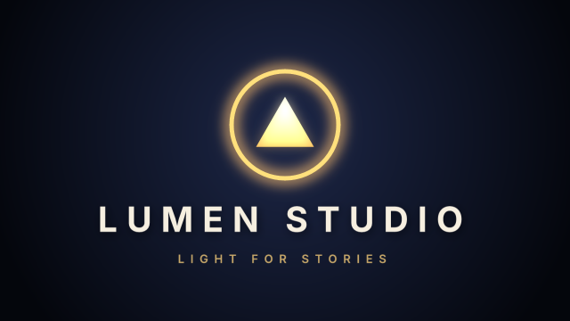</a> 
Motion · ▶ animated 
<b><a href="lumen-studio-logo-reveal/">Lumen Studio Logo Reveal</a></b> 
A gold ring draws itself on, the prism mark pops inside it and the wordmark wipes in under a sweep of light. 
<i>5 s at 30 fps; 5 layers; 4 animated layers</i> 
<code>logo</code> <code>trim-paths</code> <code>wipe</code> <code>glow</code> <code>sheen</code>
</td>
<td width="33%"></td>
<td width="33%"></td>
</tr>
</table>

## Lower Thirds

<table>
<tr>
<td width="33%" valign="top">
<a href="reef-interview-lower-third/">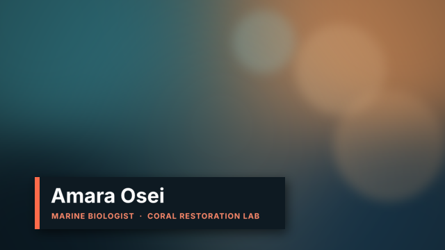</a> 
Motion · ▶ animated 
<b><a href="reef-interview-lower-third/">Reef Interview Lower Third</a></b> 
A name plate slides in over a soft bokeh backdrop, then the name and role rise into place word by word. 
<i>6 s at 30 fps; 9 layers; 2 animated layers</i> 
<code>lower-third</code> <code>keyframes</code> <code>easing</code> <code>text-presets</code> <code>layer-styles</code>
</td>
<td width="33%"></td>
<td width="33%"></td>
</tr>
</table>

## Shape Animation

<table>
<tr>
<td width="33%" valign="top">
<a href="festival-ticket-card-flip/">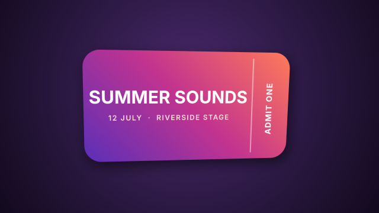</a> 
Motion · ▶ animated 
<b><a href="festival-ticket-card-flip/">Festival Ticket Card Flip</a></b> 
A 3D festival ticket swings round into view in front of a camera and settles at a slight angle. 
<i>6 s at 30 fps; 8 layers; 2 animated layers</i> 
<code>3d</code> <code>camera</code> <code>parenting</code> <code>card-flip</code> <code>easing</code>
</td>
<td width="33%" valign="top">
<a href="livestream-countdown-ring/">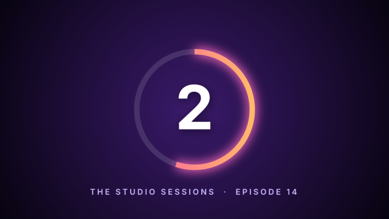</a> 
Motion · ▶ animated 
<b><a href="livestream-countdown-ring/">Livestream Countdown Ring</a></b> 
A three-second countdown for a live stream, each number punching in while a glowing ring drains around it. 
<i>4.5 s at 30 fps; 9 layers; 5 animated layers</i> 
<code>countdown</code> <code>trim-paths</code> <code>layer-timing</code> <code>keyframes</code> <code>glow</code>
</td>
<td width="33%" valign="top">
<a href="milestone-confetti-burst/">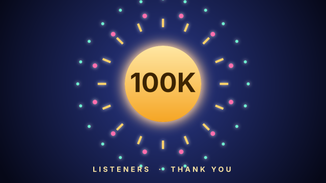</a> 
Motion · ▶ animated 
<b><a href="milestone-confetti-burst/">Milestone Confetti Burst</a></b> 
A gold badge pops in for a 100K-listener milestone while rays and two rings of dots burst outward around it. 
<i>4 s at 30 fps; 7 layers; 4 animated layers</i> 
<code>burst</code> <code>repeater</code> <code>shape-layers</code> <code>keyframes</code> <code>easing</code> <code>celebration</code>
</td>
</tr>
<tr>
<td width="33%" valign="top">
<a href="solar-output-bar-chart/">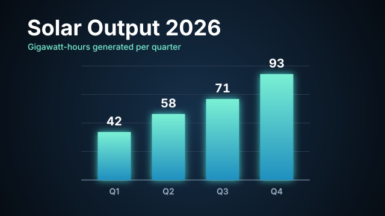</a> 
Motion · ▶ animated 
<b><a href="solar-output-bar-chart/">Solar Output Bar Chart</a></b> 
Four quarterly bars grow from the baseline with a small overshoot while their numbers count up to the final values. 
<i>6 s at 30 fps; 16 layers; 12 animated layers</i> 
<code>infographic</code> <code>chart</code> <code>counters</code> <code>keyframes</code> <code>easing</code>
</td>
<td width="33%"></td>
<td width="33%"></td>
</tr>
</table>

## Titles & Typography

<table>
<tr>
<td width="33%" valign="top">
<a href="mountain-tea-gathering-title/">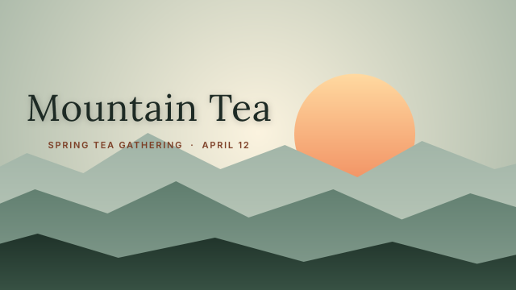</a> 
Motion · ▶ animated 
<b><a href="mountain-tea-gathering-title/">Mountain Tea Gathering Title</a></b> 
An event title rises letter by letter over layered ink mountains and a pale rising sun. 
<i>6 s at 30 fps; 7 layers; 5 animated layers</i> 
<code>parallax</code> <code>text-presets</code> <code>shape-paths</code>
</td>
<td width="33%" valign="top">
<a href="podcast-audiogram-captions/">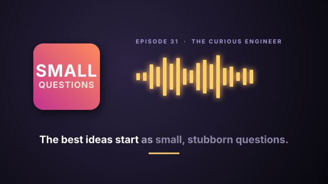</a> 
Motion · ▶ animated 
<b><a href="podcast-audiogram-captions/">Podcast Audiogram Captions</a></b> 
A podcast clip card with a pulsing waveform and a caption whose words light up as they are spoken. 
<i>6 s at 30 fps; 8 layers; 1 animated layer</i> 
<code>audiogram</code> <code>captions</code> <code>text-animators</code> <code>expressions</code> <code>shape-layers</code>
</td>
<td width="33%"></td>
</tr>
</table>

## Visual Effects

<table>
<tr>
<td width="33%" valign="top">
<a href="liquid-gradient-hero-loop/">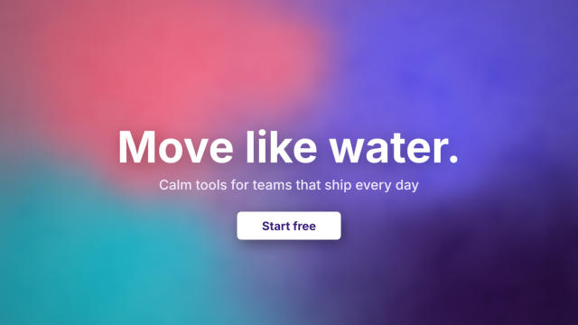</a> 
Motion · ▶ animated 
<b><a href="liquid-gradient-hero-loop/">Liquid Gradient Hero Loop</a></b> 
A looping liquid-colour background for a website hero, with a calm headline set over the moving gradient. 
<i>8 s at 30 fps; 5 layers; 3 animated layers</i> 
<code>gradient</code> <code>loop</code> <code>distortion</code> <code>expressions</code> <code>background</code>
</td>
<td width="33%" valign="top">
<a href="neon-sign-flicker/">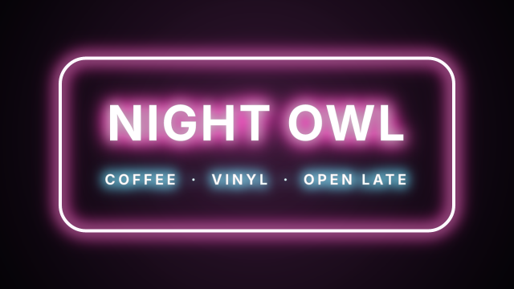</a> 
Motion · ▶ animated 
<b><a href="neon-sign-flicker/">Neon Sign Flicker</a></b> 
A late-night café sign buzzes to life, its tubes flickering before they hold a steady pink glow. 
<i>6 s at 30 fps; 4 layers; 2 animated layers</i> 
<code>neon</code> <code>glow</code> <code>expressions</code> <code>layer-styles</code>
</td>
<td width="33%" valign="top">
<a href="ringed-planet-3d-title/">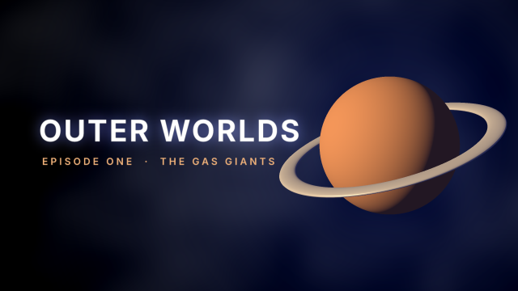</a> 
Motion · ▶ animated 
<b><a href="ringed-planet-3d-title/">Ringed Planet 3D Title</a></b> 
A lit 3D planet and its tilted ring turn slowly beside a science-documentary title, with a camera drifting round them. 
<i>6 s at 30 fps; 7 layers; 1 animated layer</i> 
<code>3d</code> <code>primitives</code> <code>lights</code> <code>camera</code> <code>titles</code>
</td>
</tr>
<tr>
<td width="33%" valign="top">
<a href="signal-lost-glitch-title/">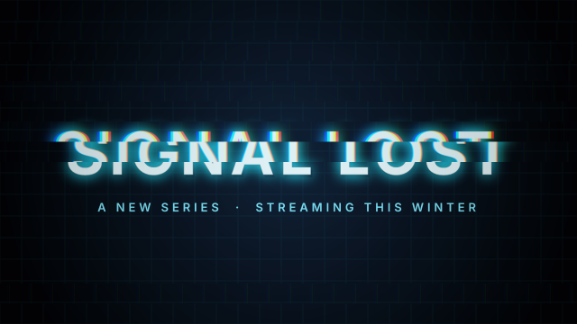</a> 
Motion · ▶ animated 
<b><a href="signal-lost-glitch-title/">Signal Lost Glitch Title</a></b> 
A cyber-thriller title scrambles in, then tears apart in bursts of digital glitch and RGB split over a scanline grid. 
<i>5 s at 30 fps; 4 layers; 3 animated layers</i> 
<code>glitch</code> <code>effects</code> <code>text-presets</code> <code>keyframes</code>
</td>
<td width="33%"></td>
<td width="33%"></td>
</tr>
</table>

## Tags

`3d` 2 · `audiogram` 1 · `background` 1 · `burst` 1 · `camera` 2 · `captions` 1 · `card-flip` 1 · `celebration` 1 · `chart` 1 · `countdown` 1 · `counters` 1 · `distortion` 1 · `easing` 4 · `effects` 1 · `expressions` 3 · `glitch` 1 · `glow` 3 · `gradient` 1 · `infographic` 1 · `keyframes` 5 · `layer-styles` 2 · `layer-timing` 1 · `lights` 1 · `logo` 1 · `loop` 1 · `lower-third` 1 · `neon` 1 · `parallax` 1 · `parenting` 1 · `primitives` 1 · `repeater` 1 · `shape-layers` 2 · `shape-paths` 1 · `sheen` 1 · `text-animators` 1 · `text-presets` 3 · `titles` 1 · `trim-paths` 2 · `wipe` 1
