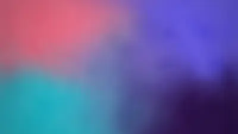

<!-- Generated by tools/gallery.mjs from showcase.yaml and build.json; do not edit. -->
# Liquid Gradient Hero Loop

[Motion](../README.md) › [Visual Effects](../README.md#visual-effects) · `gradient` `loop` `distortion` `expressions` `background`

A looping liquid-colour background for a website hero, with a calm headline set over the moving gradient.



<sub>Animated preview: 0–4 s, 40 frames rendered by Kition Motion. Still: [thumb.png](thumb.png)</sub>

| | |
|---|---|
| Document | [liquid-gradient-hero-loop.kmotion](liquid-gradient-hero-loop.kmotion) (282 KB) |
| Contents | 8 s at 30 fps; 5 layers; 3 animated layers |
| Features | `motion.effect.apply`, `motion.keys.properties`, `motion.text.animate`, `motion.layer.styles`, `motion.layer.basics` |
| Built by | `kition-motion` @ `95170ce1e8`: 24 commands in 28 ms |

## About

A background loop of the kind used behind a landing-page headline. A four-colour gradient is
folded by Turbulent Displace, whose Evolution is driven by an expression (`time * 60`), and its
colour points drift on keyframes; Fractal Noise in Soft Light adds a silky texture, and a
vignette keeps the edges dark. The headline and button arrive with Blur Slide.

## Checks

- `inspect.comp`: `{"name":"Hero Loop","duration":8}`
- `inspect.info.layers`: `{"count":5}`
- `inspect.info.layers.4`: `{"name":"Liquid","type":"Solid","animated":[{"name":"Point 1","times":[0,8]},{"name":"Point 2","times":[0,8]}]}`
- diagnostics: none (the kit's check finds nothing wrong)
- the saved document opens again; the thumbnail matches `thumb.png` within the `render` tolerance

## Steps

<details><summary>24 commands (from <a href="showcase.yaml">showcase.yaml</a>)</summary>

```yaml
- command: comp.settings
  params:
    name: Hero Loop
    duration: 8
    frameRate: 30
- command: layer.newSolid
  params:
    name: Liquid
    color: "#2a1a5e"
  as: liquid
- command: effect.apply
  params:
    layers:
      - $liquid.layer
    effect: 4-Color Gradient
    params:
      positionsColors/color1: "#ff6a88"
      positionsColors/color2: "#6a5cff"
      positionsColors/color3: "#1fc8db"
      positionsColors/color4: "#2b0f4c"
      positionsColors/point3:
        - 180
        - 640
      positionsColors/point4:
        - 1120
        - 650
- command: prop.addKey
  params:
    layer: $liquid.layer
    path: effects/#1/positionsColors/point1
    time: 0
    value:
      - 160
      - 120
- command: prop.addKey
  params:
    layer: $liquid.layer
    path: effects/#1/positionsColors/point1
    time: 8
    value:
      - 520
      - 260
- command: prop.addKey
  params:
    layer: $liquid.layer
    path: effects/#1/positionsColors/point2
    time: 0
    value:
      - 1150
      - 110
- command: prop.addKey
  params:
    layer: $liquid.layer
    path: effects/#1/positionsColors/point2
    time: 8
    value:
      - 880
      - 330
- command: effect.apply
  params:
    layers:
      - $liquid.layer
    effect: Turbulent Displace
    params:
      displacement: 3
      amount: 260
      size: 240
      complexity: 2
      pinning: 1
- command: prop.setExpression
  params:
    layer: $liquid.layer
    path: effects/#2/evolution
    expression: time * 60
- command: effect.apply
  params:
    layers:
      - $liquid.layer
    effect: Fractal Noise
    params:
      fractalType: 1
      contrast: 60
      complexity: 3
      opacity: 30
      blendingMode: 6
- command: prop.setExpression
  params:
    layer: $liquid.layer
    path: effects/#3/evolution
    expression: time * 40
- command: effect.apply
  params:
    layers:
      - $liquid.layer
    effect: CC Vignette
    params:
      amount: 65
      center:
        - 640
        - 360
- command: layer.newText
  params:
    text: Move like water.
    position:
      - 640
      - 360
    size: 96
    font: Inter
    style: Bold
    fill: "#ffffff"
    justify: center
  as: head
- command: layer.style.add
  params:
    layers:
      - $head.layer
    style: dropShadow
    params:
      opacity: 35
      size: 40
      distance: 10
- command: layer.applyTextPreset
  params:
    layer: $head.layer
    preset: blurSlide
    start: 0.3
  as: headIn
- command: layer.newText
  params:
    text: Calm tools for teams that ship every day
    position:
      - 640
      - 420
    size: 30
    font: Inter
    style: Medium
    fill: "#f2eaff"
    justify: center
  as: sub
- command: layer.applyTextPreset
  params:
    layer: $sub.layer
    preset: blurSlide
    variant: subtitle
    start: 0.9
- command: layer.newShape
  params:
    kind: rounded
    name: Button
    size:
      - 230
      - 62
    fill: "#ffffff"
    position:
      - 640
      - 500
  as: btn
- command: layer.style.add
  params:
    layers:
      - $btn.layer
    style: dropShadow
    params:
      opacity: 40
      size: 30
      distance: 10
- command: prop.addKey
  params:
    layer: $btn.layer
    path: transform/opacity
    time: 1.4
    value: 0
- command: prop.addKey
  params:
    layer: $btn.layer
    path: transform/opacity
    time: 1.8
    value: 100
- command: layer.newText
  params:
    text: Start free
    position:
      - 640
      - 510
    size: 26
    font: Inter
    style: Bold
    fill: "#3a1f7a"
    justify: center
  as: cta
- command: layer.applyTextPreset
  params:
    layer: $cta.layer
    preset: fadeUpCharacters
- command: layer.timing
  params:
    layers:
      - $cta.layer
    start: 1.5
```

</details>
