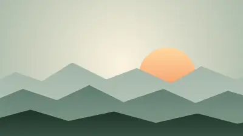

<!-- Generated by tools/gallery.mjs from showcase.yaml and build.json; do not edit. -->
# Mountain Tea Gathering Title

[Motion](../README.md) › [Titles & Typography](../README.md#titles--typography) · `parallax` `text-presets` `shape-paths`

An event title rises letter by letter over layered ink mountains and a pale rising sun.



<sub>Animated preview: 0–4 s, 40 frames rendered by Kition Motion. Still: [thumb.png](thumb.png)</sub>

| | |
|---|---|
| Document | [mountain-tea-gathering-title.kmotion](mountain-tea-gathering-title.kmotion) (315 KB) |
| Contents | 6 s at 30 fps; 7 layers; 5 animated layers |
| Features | `motion.text.animate`, `motion.shape.paths`, `motion.keys.basics`, `motion.layer.styles`, `motion.layer.basics` |
| Built by | `kition-motion` @ `16723b1274`: 20 commands in 9 ms |

## About

An opening title for a spring tea gathering, set in Lora from kition-fonts. The three mountain
ranges are bezier paths drawn with shape.newPath, each with its own gradient, and they drift
sideways at different speeds for a gentle parallax while the sun rises behind them. The title
uses the Blur Slide preset with `by: characters`, so each letter rises out of its own blur, and
the date line follows with Tracking In.

## Checks

- `inspect.comp`: `{"name":"Mountain Tea","duration":6}`
- `inspect.info.layers`: `{"count":7}`
- `inspect.info.layers.0.animated`: `{"any":{"name":"Tracking Amount","times":[1.6,3.2]}}`
- `inspect.info.layers.1`: `{"name":"Mountain Tea","type":"Text"}`
- `inspect.info.layers.2`: `{"name":"Near Range","type":"Shape","animated":[{"name":"Position","times":[0,6]}]}`
- `results.titleIn`: `{"preset":"blurSlide","units":"characters"}`
- diagnostics: none (the kit's check finds nothing wrong)
- the saved document opens again; the thumbnail matches `thumb.png` within the `render` tolerance

## Steps

<details><summary>20 commands (from <a href="showcase.yaml">showcase.yaml</a>)</summary>

```yaml
- command: comp.settings
  params:
    name: Mountain Tea
    duration: 6
    frameRate: 30
- command: layer.newSolid
  params:
    name: Sky
    color: "#e9e1cf"
  as: sky
- command: effect.apply
  params:
    layers:
      - $sky.layer
    effect: Gradient Ramp
    params:
      shape: 1
      start:
        - 640
        - 330
      end:
        - 640
        - 1100
      startColor: "#fbf3df"
      endColor: "#a9b8a8"
- command: layer.newShape
  params:
    kind: ellipse
    name: Sun
    size:
      - 300
      - 300
    fillGradient:
      - "#ffd9a0"
      - "#f08a5d"
    fillAngle: 90
    position:
      - 880
      - 330
  as: sun
- command: prop.addKey
  params:
    layer: $sun.layer
    path: transform/position
    time: 0
    value:
      - 880
      - 400
      - 0
- command: prop.addKey
  params:
    layer: $sun.layer
    path: transform/position
    time: 6
    value:
      - 880
      - 300
      - 0
- command: shape.newPath
  params:
    name: Far Range
    closed: true
    space: comp
    fillGradient:
      - "#9fb3a6"
      - "#c9d3c3"
    fillAngle: 90
    vertices:
      - - -100
        - 470
      - - 80
        - 380
      - - 220
        - 430
      - - 380
        - 330
      - - 560
        - 420
      - - 720
        - 360
      - - 900
        - 440
      - - 1060
        - 350
      - - 1240
        - 420
      - - 1400
        - 380
      - - 1400
        - 760
      - - -100
        - 760
  as: far
- command: shape.newPath
  params:
    name: Mid Range
    closed: true
    space: comp
    fillGradient:
      - "#5f7d6e"
      - "#8ea597"
    fillAngle: 90
    vertices:
      - - -100
        - 560
      - - 120
        - 470
      - - 300
        - 530
      - - 470
        - 450
      - - 650
        - 540
      - - 860
        - 470
      - - 1030
        - 545
      - - 1200
        - 480
      - - 1400
        - 540
      - - 1400
        - 760
      - - -100
        - 760
  as: mid
- command: shape.newPath
  params:
    name: Near Range
    closed: true
    space: comp
    fillGradient:
      - "#1f3229"
      - "#3e5a4b"
    fillAngle: 90
    vertices:
      - - -100
        - 650
      - - 160
        - 580
      - - 360
        - 640
      - - 600
        - 590
      - - 820
        - 650
      - - 1040
        - 600
      - - 1250
        - 655
      - - 1400
        - 620
      - - 1400
        - 760
      - - -100
        - 760
  as: near
- command: prop.addKey
  params:
    layer: $far.layer
    path: transform/position
    time: 0
    value:
      - 640
      - 360
      - 0
- command: prop.addKey
  params:
    layer: $far.layer
    path: transform/position
    time: 6
    value:
      - 620
      - 360
      - 0
- command: prop.addKey
  params:
    layer: $mid.layer
    path: transform/position
    time: 0
    value:
      - 640
      - 360
      - 0
- command: prop.addKey
  params:
    layer: $mid.layer
    path: transform/position
    time: 6
    value:
      - 590
      - 360
      - 0
- command: prop.addKey
  params:
    layer: $near.layer
    path: transform/position
    time: 0
    value:
      - 640
      - 360
      - 0
- command: prop.addKey
  params:
    layer: $near.layer
    path: transform/position
    time: 6
    value:
      - 540
      - 360
      - 0
- command: layer.newText
  params:
    text: Mountain Tea
    position:
      - 370
      - 300
    size: 92
    font: Lora
    style: SemiBold
    fill: "#1d2a24"
    justify: center
    tracking: 20
  as: title
- command: layer.style.add
  params:
    layers:
      - $title.layer
    style: dropShadow
    params:
      opacity: 25
      size: 16
      distance: 4
- command: layer.applyTextPreset
  params:
    layer: $title.layer
    preset: blurSlide
    by: characters
    start: 0.4
  as: titleIn
- command: layer.newText
  params:
    text: SPRING TEA GATHERING  ·  APRIL 12
    position:
      - 370
      - 368
    size: 22
    font: Inter
    style: SemiBold
    fill: "#7a3b22"
    justify: center
    tracking: 160
  as: sub
- command: layer.applyTextPreset
  params:
    layer: $sub.layer
    preset: trackingIn
    start: 1.6
```

</details>
