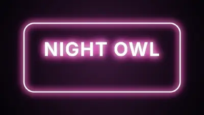

<!-- Generated by tools/gallery.mjs from showcase.yaml and build.json; do not edit. -->
# Neon Sign Flicker

[Motion](../README.md) › [Visual Effects](../README.md#visual-effects) · `neon` `glow` `expressions` `layer-styles`

A late-night café sign buzzes to life, its tubes flickering before they hold a steady pink glow.



<sub>Animated preview: 0–3 s, 30 frames rendered by Kition Motion. Still: [thumb.png](thumb.png)</sub>

| | |
|---|---|
| Document | [neon-sign-flicker.kmotion](neon-sign-flicker.kmotion) (285 KB) |
| Contents | 6 s at 30 fps; 4 layers; 2 animated layers |
| Features | `motion.layer.basics`, `motion.layer.styles`, `motion.effect.apply`, `motion.keys.properties` |
| Built by | `kition-motion` @ `95170ce1e8`: 16 commands in 17 ms |

## About

A neon sign over a dark wall. The two words and the frame are shape and text layers with a light
core colour; the tube look comes from an Outer Glow layer style plus the Glow effect. The flicker
is an expression on each layer's Opacity: it stutters for the first second and a half, then holds.

## Checks

- `inspect.comp`: `{"name":"Night Owl Sign","duration":6}`
- `inspect.info.layers`: `{"count":4}`
- `inspect.info.layers.0.animated`: `{"any":{"name":"Tracking Amount","times":[1.2,2.8]}}`
- `inspect.info.layers.1`: `{"name":"NIGHT OWL","type":"Text"}`
- `inspect.info.layers.1.animated`: `{"any":{"name":"Scale"}}`
- `inspect.info.layers.2`: `{"name":"Tube Frame","type":"Shape"}`
- `results.tracking.animators`: `{"count":1}`
- diagnostics: none (the kit's check finds nothing wrong)
- the saved document opens again; the thumbnail matches `thumb.png` within the `render` tolerance

## Steps

<details><summary>16 commands (from <a href="showcase.yaml">showcase.yaml</a>)</summary>

```yaml
- command: comp.settings
  params:
    name: Night Owl Sign
    duration: 6
    frameRate: 30
    background: "#07050c"
- command: layer.newSolid
  params:
    name: Wall
    color: "#160d1f"
  as: wall
- command: effect.apply
  params:
    layers:
      - $wall.layer
    effect: Gradient Ramp
    params:
      shape: 1
      start:
        - 640
        - 340
      end:
        - 640
        - 1100
      startColor: "#3a1838"
      endColor: "#050308"
- command: effect.apply
  params:
    layers:
      - $wall.layer
    effect: CC Vignette
    params:
      amount: 70
      center:
        - 640
        - 360
- command: layer.newShape
  params:
    kind: rounded
    name: Tube Frame
    size:
      - 980
      - 430
    fill: false
    stroke: "#ffd1f0"
    strokeWidth: 8
    position:
      - 640
      - 360
  as: frame
- command: layer.style.add
  params:
    layers:
      - $frame.layer
    style: outerGlow
    params:
      color: "#ff2fb4"
      opacity: 90
      size: 40
- command: layer.newText
  params:
    text: NIGHT OWL
    position:
      - 640
      - 350
    size: 124
    font: Inter
    style: Bold
    fill: "#ffe6f6"
    justify: center
    tracking: 40
  as: title
- command: layer.style.add
  params:
    layers:
      - $title.layer
    style: outerGlow
    params:
      color: "#ff2fb4"
      opacity: 95
      size: 48
- command: layer.newText
  params:
    text: COFFEE  ·  VINYL  ·  OPEN LATE
    position:
      - 640
      - 460
    size: 36
    font: Inter
    style: Bold
    fill: "#d9fbff"
    justify: center
    tracking: 200
  as: sub
- command: layer.style.add
  params:
    layers:
      - $sub.layer
    style: outerGlow
    params:
      color: "#21d4ff"
      opacity: 90
      size: 26
- command: effect.apply
  params:
    layers:
      - $title.layer
      - $sub.layer
      - $frame.layer
    effect: Glow
    params:
      threshold: 40
      radius: 30
      intensity: 1.2
- command: prop.setExpression
  params:
    layer: $title.layer
    path: transform/opacity
    expression: "t = time; (t < 1.6 && Math.sin(t * 47) + Math.sin(t * 13) > 0.6) ? 18 : 100"
- command: prop.setExpression
  params:
    layer: $frame.layer
    path: transform/opacity
    expression: "t = time; (t < 1.0 && Math.sin(t * 31) > 0.2) ? 10 : 100"
- command: layer.applyTextPreset
  params:
    layer: $sub.layer
    preset: trackingIn
    start: 1.2
  as: tracking
- command: prop.addKey
  params:
    layer: $title.layer
    path: transform/scale
    value:
      - 96
      - 96
      - 100
    time: 0
- command: prop.addKey
  params:
    layer: $title.layer
    path: transform/scale
    value:
      - 100
      - 100
      - 100
    time: 6
```

</details>
