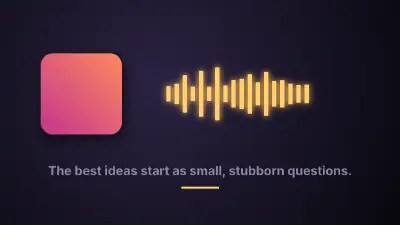

<!-- Generated by tools/gallery.mjs from showcase.yaml and build.json; do not edit. -->
# Podcast Audiogram Captions

[Motion](../README.md) › [Titles & Typography](../README.md#titles--typography) · `audiogram` `captions` `text-animators` `expressions` `shape-layers`

A podcast clip card with a pulsing waveform and a caption whose words light up as they are spoken.



<sub>Animated preview: 0–4.5 s, 45 frames rendered by Kition Motion. Still: [thumb.png](thumb.png)</sub>

| | |
|---|---|
| Document | [podcast-audiogram-captions.kmotion](podcast-audiogram-captions.kmotion) (655 KB) |
| Contents | 6 s at 30 fps; 8 layers; 1 animated layer |
| Features | `motion.text.animate`, `motion.keys.properties`, `motion.shape.paths`, `motion.layer.styles`, `motion.layer.basics` |
| Built by | `kition-motion` @ `95170ce1e8`: 55 commands in 41 ms |

## About

The kind of clip shared to promote an episode. The caption has a text animator with a Fill Color
property and a Range Selector based on words: keying the selector's End from 0 to 100 % lights
the words up in step with the speech. The waveform is eighteen rounded bars in one shape layer,
each with a Scale expression of its own speed and phase, and the cover art is a gradient tile
with a drop shadow.

## Checks

- `inspect.comp`: `{"name":"Audiogram","duration":6}`
- `inspect.info.layers`: `{"count":8,"any":{"name":"Caption","type":"Text","animated":[{"name":"End","times":[0.5,4.5]}]}}`
- `results.spoken.animator`: `{"min":1}`
- diagnostics: none (the kit's check finds nothing wrong)
- the saved document opens again; the thumbnail matches `thumb.png` within the `render` tolerance

## Steps

<details><summary>55 commands (from <a href="showcase.yaml">showcase.yaml</a>)</summary>

```yaml
- command: comp.settings
  params:
    name: Audiogram
    duration: 6
    frameRate: 30
- command: layer.newSolid
  params:
    name: Backdrop
    color: "#13111c"
  as: bg
- command: effect.apply
  params:
    layers:
      - $bg.layer
    effect: Gradient Ramp
    params:
      shape: 1
      start:
        - 500
        - 260
      end:
        - 640
        - 1150
      startColor: "#2b2342"
      endColor: "#08070d"
- command: layer.newShape
  params:
    kind: rounded
    name: Cover Art
    size:
      - 260
      - 260
    fillGradient:
      - "#ff8a5c"
      - "#c2338f"
    fillAngle: 135
    position:
      - 260
      - 300
  as: cover
- command: layer.style.add
  params:
    layers:
      - $cover.layer
    style: dropShadow
    params:
      opacity: 60
      size: 36
      distance: 14
- command: layer.newText
  params:
    text: SMALL
    name: Cover Line 1
    position:
      - 260
      - 300
    size: 66
    font: Inter
    style: Bold
    fill: "#ffffff"
    justify: center
    tracking: 40
  as: c1
- command: layer.newText
  params:
    text: QUESTIONS
    name: Cover Line 2
    position:
      - 260
      - 344
    size: 34
    font: Inter
    style: Bold
    fill: "#ffe3d6"
    justify: center
    tracking: 60
  as: c2
- command: layer.applyTextPreset
  params:
    layer: $c1.layer
    preset: letterpress
    start: 0
- command: layer.applyTextPreset
  params:
    layer: $c2.layer
    preset: letterpress
    start: 0.2
- command: shape.newShape
  params:
    name: Waveform
    kind: rounded
    size:
      - 14
      - 60
    position:
      - 539
      - 300
    fill: "#ffd166"
  as: wave
- command: shape.newShape
  params:
    layer: $wave.layer
    kind: rounded
    size:
      - 14
      - 90
    position:
      - 565
      - 300
    fill: "#ffd166"
- command: shape.newShape
  params:
    layer: $wave.layer
    kind: rounded
    size:
      - 14
      - 130
    position:
      - 591
      - 300
    fill: "#ffd166"
- command: shape.newShape
  params:
    layer: $wave.layer
    kind: rounded
    size:
      - 14
      - 80
    position:
      - 617
      - 300
    fill: "#ffd166"
- command: shape.newShape
  params:
    layer: $wave.layer
    kind: rounded
    size:
      - 14
      - 150
    position:
      - 643
      - 300
    fill: "#ffd166"
- command: shape.newShape
  params:
    layer: $wave.layer
    kind: rounded
    size:
      - 14
      - 110
    position:
      - 669
      - 300
    fill: "#ffd166"
- command: shape.newShape
  params:
    layer: $wave.layer
    kind: rounded
    size:
      - 14
      - 170
    position:
      - 695
      - 300
    fill: "#ffd166"
- command: shape.newShape
  params:
    layer: $wave.layer
    kind: rounded
    size:
      - 14
      - 120
    position:
      - 721
      - 300
    fill: "#ffd166"
- command: shape.newShape
  params:
    layer: $wave.layer
    kind: rounded
    size:
      - 14
      - 90
    position:
      - 747
      - 300
    fill: "#ffd166"
- command: shape.newShape
  params:
    layer: $wave.layer
    kind: rounded
    size:
      - 14
      - 160
    position:
      - 773
      - 300
    fill: "#ffd166"
- command: shape.newShape
  params:
    layer: $wave.layer
    kind: rounded
    size:
      - 14
      - 140
    position:
      - 799
      - 300
    fill: "#ffd166"
- command: shape.newShape
  params:
    layer: $wave.layer
    kind: rounded
    size:
      - 14
      - 100
    position:
      - 825
      - 300
    fill: "#ffd166"
- command: shape.newShape
  params:
    layer: $wave.layer
    kind: rounded
    size:
      - 14
      - 175
    position:
      - 851
      - 300
    fill: "#ffd166"
- command: shape.newShape
  params:
    layer: $wave.layer
    kind: rounded
    size:
      - 14
      - 95
    position:
      - 877
      - 300
    fill: "#ffd166"
- command: shape.newShape
  params:
    layer: $wave.layer
    kind: rounded
    size:
      - 14
      - 130
    position:
      - 903
      - 300
    fill: "#ffd166"
- command: shape.newShape
  params:
    layer: $wave.layer
    kind: rounded
    size:
      - 14
      - 70
    position:
      - 929
      - 300
    fill: "#ffd166"
- command: shape.newShape
  params:
    layer: $wave.layer
    kind: rounded
    size:
      - 14
      - 110
    position:
      - 955
      - 300
    fill: "#ffd166"
- command: shape.newShape
  params:
    layer: $wave.layer
    kind: rounded
    size:
      - 14
      - 60
    position:
      - 981
      - 300
    fill: "#ffd166"
- command: prop.setExpression
  params:
    layer: $wave.layer
    path: contents/group/transform/scale
    expression: s = 35 + 65 * Math.abs(Math.sin(time * 5 + 1.7)); [100, s]
- command: prop.setExpression
  params:
    layer: $wave.layer
    path: contents/group#2/transform/scale
    expression: s = 35 + 65 * Math.abs(Math.sin(time * 7 + 3.4)); [100, s]
- command: prop.setExpression
  params:
    layer: $wave.layer
    path: contents/group#3/transform/scale
    expression: s = 35 + 65 * Math.abs(Math.sin(time * 4 + 5.1)); [100, s]
- command: prop.setExpression
  params:
    layer: $wave.layer
    path: contents/group#4/transform/scale
    expression: s = 35 + 65 * Math.abs(Math.sin(time * 6 + 6.8)); [100, s]
- command: prop.setExpression
  params:
    layer: $wave.layer
    path: contents/group#5/transform/scale
    expression: s = 35 + 65 * Math.abs(Math.sin(time * 3 + 8.5)); [100, s]
- command: prop.setExpression
  params:
    layer: $wave.layer
    path: contents/group#6/transform/scale
    expression: s = 35 + 65 * Math.abs(Math.sin(time * 5 + 10.2)); [100, s]
- command: prop.setExpression
  params:
    layer: $wave.layer
    path: contents/group#7/transform/scale
    expression: s = 35 + 65 * Math.abs(Math.sin(time * 7 + 11.9)); [100, s]
- command: prop.setExpression
  params:
    layer: $wave.layer
    path: contents/group#8/transform/scale
    expression: s = 35 + 65 * Math.abs(Math.sin(time * 4 + 13.6)); [100, s]
- command: prop.setExpression
  params:
    layer: $wave.layer
    path: contents/group#9/transform/scale
    expression: s = 35 + 65 * Math.abs(Math.sin(time * 6 + 15.3)); [100, s]
- command: prop.setExpression
  params:
    layer: $wave.layer
    path: contents/group#10/transform/scale
    expression: s = 35 + 65 * Math.abs(Math.sin(time * 3 + 17.0)); [100, s]
- command: prop.setExpression
  params:
    layer: $wave.layer
    path: contents/group#11/transform/scale
    expression: s = 35 + 65 * Math.abs(Math.sin(time * 5 + 18.7)); [100, s]
- command: prop.setExpression
  params:
    layer: $wave.layer
    path: contents/group#12/transform/scale
    expression: s = 35 + 65 * Math.abs(Math.sin(time * 7 + 20.4)); [100, s]
- command: prop.setExpression
  params:
    layer: $wave.layer
    path: contents/group#13/transform/scale
    expression: s = 35 + 65 * Math.abs(Math.sin(time * 4 + 22.1)); [100, s]
- command: prop.setExpression
  params:
    layer: $wave.layer
    path: contents/group#14/transform/scale
    expression: s = 35 + 65 * Math.abs(Math.sin(time * 6 + 23.8)); [100, s]
- command: prop.setExpression
  params:
    layer: $wave.layer
    path: contents/group#15/transform/scale
    expression: s = 35 + 65 * Math.abs(Math.sin(time * 3 + 25.5)); [100, s]
- command: prop.setExpression
  params:
    layer: $wave.layer
    path: contents/group#16/transform/scale
    expression: s = 35 + 65 * Math.abs(Math.sin(time * 5 + 27.2)); [100, s]
- command: prop.setExpression
  params:
    layer: $wave.layer
    path: contents/group#17/transform/scale
    expression: s = 35 + 65 * Math.abs(Math.sin(time * 7 + 28.9)); [100, s]
- command: prop.setExpression
  params:
    layer: $wave.layer
    path: contents/group#18/transform/scale
    expression: s = 35 + 65 * Math.abs(Math.sin(time * 4 + 30.6)); [100, s]
- command: layer.style.add
  params:
    layers:
      - $wave.layer
    style: outerGlow
    params:
      color: "#ffb347"
      opacity: 55
      size: 22
- command: layer.newText
  params:
    text: EPISODE 31  ·  THE CURIOUS ENGINEER
    position:
      - 530
      - 170
    size: 22
    font: Inter
    style: Bold
    fill: "#a99bd6"
    justify: left
    tracking: 200
  as: ep
- command: layer.applyTextPreset
  params:
    layer: $ep.layer
    preset: blurSlide
    variant: subtitle
    start: 0.2
- command: layer.newText
  params:
    text: The best ideas start as small, stubborn questions.
    name: Caption
    position:
      - 640
      - 560
    size: 40
    font: Inter
    style: Bold
    fill: "#8d86a6"
    justify: center
  as: cap
- command: layer.addTextAnimator
  params:
    layer: $cap.layer
    properties:
      - fillColor
    name: Spoken Words
  as: spoken
- command: prop.set
  params:
    layer: $cap.layer
    path: text/animators/animator/properties/fillColor
    value: "#ffffff"
- command: prop.set
  params:
    layer: $cap.layer
    path: text/animators/animator/selectors/rangeSelector/advanced/basedOn
    value: 2
- command: prop.addKey
  params:
    layer: $cap.layer
    path: text/animators/animator/selectors/rangeSelector/end
    time: 0.5
    value: 0
- command: prop.addKey
  params:
    layer: $cap.layer
    path: text/animators/animator/selectors/rangeSelector/end
    time: 4.5
    value: 100
- command: layer.newShape
  params:
    kind: rounded
    name: Caption Underline
    size:
      - 120
      - 6
    fill: "#ffd166"
    position:
      - 640
      - 600
  as: line
```

</details>
