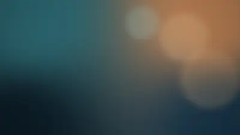

<!-- Generated by tools/gallery.mjs from showcase.yaml and build.json; do not edit. -->
# Reef Interview Lower Third

[Motion](../README.md) › [Lower Thirds](../README.md#lower-thirds) · `lower-third` `keyframes` `easing` `text-presets` `layer-styles`

A name plate slides in over a soft bokeh backdrop, then the name and role rise into place word by word.



<sub>Animated preview: 0–2.5 s, 25 frames rendered by Kition Motion. Still: [thumb.png](thumb.png)</sub>

| | |
|---|---|
| Document | [reef-interview-lower-third.kmotion](reef-interview-lower-third.kmotion) (326 KB) |
| Contents | 6 s at 30 fps; 9 layers; 2 animated layers |
| Features | `motion.layer.basics`, `motion.keys.basics`, `motion.text.animate`, `motion.layer.styles`, `motion.effect.apply` |
| Built by | `kition-motion` @ `95170ce1e8`: 23 commands in 10 ms |

## About

A documentary lower third. The dark plate and its coral accent bar slide in from the left on
Position keyframes eased with the `snappy` curve (keys.applyEase), and lift off the backdrop with
a soft drop shadow. The name and role use the Blur Slide text preset, timed to land just after the
plate. The backdrop stands in for the interview footage: a four-colour gradient, a few blurred
bokeh discs and a vignette.

## Checks

- `inspect.comp`: `{"name":"Lower Third","duration":6,"width":1280}`
- `inspect.info.layers`: `{"count":9}`
- `inspect.info.layers.0`: `{"name":"Role","type":"Text"}`
- `inspect.info.layers.1`: `{"name":"Amara Osei","type":"Text"}`
- `inspect.info.layers.3.animated`: `{"any":{"name":"Position","times":[0.3,1]}}`
- `results.nameIn`: `{"preset":"blurSlide","units":"words"}`
- diagnostics: none (the kit's check finds nothing wrong)
- the saved document opens again; the thumbnail matches `thumb.png` within the `render` tolerance

## Steps

<details><summary>23 commands (from <a href="showcase.yaml">showcase.yaml</a>)</summary>

```yaml
- command: comp.settings
  params:
    name: Lower Third
    duration: 6
    frameRate: 30
- command: layer.newSolid
  params:
    name: Footage Stand-in
    color: "#1d3b47"
  as: bg
- command: effect.apply
  params:
    layers:
      - $bg.layer
    effect: 4-Color Gradient
    params:
      positionsColors/point1:
        - 120
        - 80
      positionsColors/color1: "#2f6f7a"
      positionsColors/point2:
        - 1160
        - 60
      positionsColors/color2: "#c98a5a"
      positionsColors/point3:
        - 100
        - 700
      positionsColors/color3: "#0d1f2a"
      positionsColors/point4:
        - 1180
        - 680
      positionsColors/color4: "#1b3a4f"
- command: layer.newShape
  params:
    kind: ellipse
    name: Bokeh 1
    size:
      - 260
      - 260
    fill: "#ffd9a8"
    position:
      - 980
      - 200
  as: b1
- command: layer.newShape
  params:
    kind: ellipse
    name: Bokeh 2
    size:
      - 180
      - 180
    fill: "#9fe3e8"
    position:
      - 760
      - 120
  as: b2
- command: layer.newShape
  params:
    kind: ellipse
    name: Bokeh 3
    size:
      - 320
      - 320
    fill: "#ffc38a"
    position:
      - 1120
      - 420
  as: b3
- command: layer.setTransform
  params:
    layers:
      - $b1.layer
      - $b2.layer
      - $b3.layer
    prop: opacity
    value: 22
- command: effect.apply
  params:
    layers:
      - $b1.layer
      - $b2.layer
      - $b3.layer
    effect: Gaussian Blur
    params:
      blurriness: 30
- command: layer.newAdjustment
  params:
    name: Vignette
  as: vig
- command: effect.apply
  params:
    layers:
      - $vig.layer
    effect: CC Vignette
    params:
      amount: 60
      center:
        - 640
        - 360
- command: layer.newShape
  params:
    kind: rect
    name: Plate
    size:
      - 720
      - 150
    fill: "#0e1a22"
    position:
      - 460
      - 585
  as: plate
- command: layer.style.add
  params:
    layers:
      - $plate.layer
    style: dropShadow
    params:
      opacity: 60
      size: 30
      distance: 12
- command: layer.newShape
  params:
    kind: rect
    name: Accent
    size:
      - 14
      - 150
    fill: "#ff6b4a"
    position:
      - 107
      - 585
  as: accent
- command: prop.addKey
  params:
    layer: $plate.layer
    path: transform/position
    time: 0.3
    value:
      - -380
      - 585
      - 0
- command: prop.addKey
  params:
    layer: $plate.layer
    path: transform/position
    time: 1
    value:
      - 460
      - 585
      - 0
- command: keys.applyEase
  params:
    layer: $plate.layer
    path: transform/position
    preset: snappy
    from: 0.3
    to: 1
- command: prop.addKey
  params:
    layer: $accent.layer
    path: transform/position
    time: 0.2
    value:
      - -20
      - 585
      - 0
- command: prop.addKey
  params:
    layer: $accent.layer
    path: transform/position
    time: 0.8
    value:
      - 107
      - 585
      - 0
- command: keys.applyEase
  params:
    layer: $accent.layer
    path: transform/position
    preset: snappy
    from: 0.2
    to: 0.8
- command: layer.newText
  params:
    text: Amara Osei
    position:
      - 146
      - 584
    size: 58
    font: Inter
    style: Bold
    fill: "#ffffff"
    justify: left
  as: name
- command: layer.newText
  params:
    text: MARINE BIOLOGIST  ·  CORAL RESTORATION LAB
    name: Role
    position:
      - 148
      - 630
    size: 22
    font: Inter
    style: Bold
    fill: "#ff8a6b"
    justify: left
    tracking: 80
  as: role
- command: layer.applyTextPreset
  params:
    layer: $name.layer
    preset: blurSlide
    start: 0.7
  as: nameIn
- command: layer.applyTextPreset
  params:
    layer: $role.layer
    preset: blurSlide
    variant: subtitle
    start: 0.9
  as: roleIn
```

</details>
