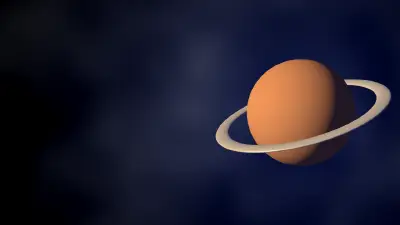

<!-- Generated by tools/gallery.mjs from showcase.yaml and build.json; do not edit. -->
# Ringed Planet 3D Title

[Motion](../README.md) › [Visual Effects](../README.md#visual-effects) · `3d` `primitives` `lights` `camera` `titles`

A lit 3D planet and its tilted ring turn slowly beside a science-documentary title, with a camera drifting round them.



<sub>Animated preview: 0–3 s, 30 frames rendered by Kition Motion. Still: [thumb.png](thumb.png)</sub>

| | |
|---|---|
| Document | [ringed-planet-3d-title.kmotion](ringed-planet-3d-title.kmotion) (210 KB) |
| Contents | 6 s at 30 fps; 7 layers; 1 animated layer |
| Features | `motion.view.3d`, `motion.camera.lights`, `motion.layer.basics`, `motion.keys.basics`, `motion.text.animate`, `motion.layer.styles` |
| Built by | `kition-motion` @ `95170ce1e8`: 18 commands in 8 ms |

## About

An opening for a space documentary made with the Advanced 3D renderer. The planet is a sphere
primitive and the ring a flattened torus, each with its own base colour, roughness and metallic
values; a warm parallel key light and a cool ambient fill shape them, and the planet's Y Rotation
turns over the shot. A soft Fractal Noise nebula in Screen mode lifts the deep-blue backdrop, and the
title rises in with Blur Slide.

## Checks

- `inspect.comp`: `{"name":"Outer Worlds","duration":6}`
- `inspect.info.layers`: `{"count":7}`
- `inspect.info.layers.3`: `{"name":"Sun Key","type":"Light"}`
- `inspect.info.layers.4`: `{"name":"Ring","type":"3D Primitive"}`
- `inspect.info.layers.5`: `{"name":"Planet","type":"3D Primitive","animated":[{"name":"Y Rotation","times":[0,6]}]}`
- diagnostics: none (the kit's check finds nothing wrong)
- the saved document opens again; the thumbnail matches `thumb.png` within the `render` tolerance

## Steps

<details><summary>18 commands (from <a href="showcase.yaml">showcase.yaml</a>)</summary>

```yaml
- command: comp.settings
  params:
    name: Outer Worlds
    duration: 6
    frameRate: 30
- command: layer.newSolid
  params:
    name: Space
    color: "#03040a"
  as: space
- command: effect.apply
  params:
    layers:
      - $space.layer
    effect: Gradient Ramp
    params:
      shape: 1
      start:
        - 960
        - 360
      end:
        - 200
        - 900
      startColor: "#1b2350"
      endColor: "#020308"
      blend: 0
- command: effect.apply
  params:
    layers:
      - $space.layer
    effect: Fractal Noise
    params:
      contrast: 140
      brightness: -45
      complexity: 4
      opacity: 35
      blendingMode: 4
      transform/scale: 420
- command: layer.new3dPrimitive
  params:
    kind: sphere
    name: Planet
    radius: 170
    segments: 64
    rings: 48
    position:
      - 960
      - 360
      - 0
    baseColor: "#d98a4e"
    roughness: 90
    metallic: 0
  as: planet
- command: layer.new3dPrimitive
  params:
    kind: torus
    name: Ring
    radius: 260
    tubeRadius: 22
    segments: 96
    rings: 16
    position:
      - 960
      - 360
      - 0
    baseColor: "#e9d3a8"
    roughness: 45
    metallic: 20
  as: ring
- command: prop.set
  params:
    layer: $ring.layer
    path: transform/scale
    value:
      - 100
      - 30
      - 100
- command: prop.set
  params:
    layer: $ring.layer
    path: transform/rotationX
    value: 16
- command: prop.set
  params:
    layer: $ring.layer
    path: transform/rotation
    value: -18
- command: prop.addKey
  params:
    layer: $planet.layer
    path: transform/rotationY
    time: 0
    value: 0
- command: prop.addKey
  params:
    layer: $planet.layer
    path: transform/rotationY
    time: 6
    value: 40
- command: layer.newLight
  params:
    kind: Parallel
    name: Sun Key
    color: "#fff1dc"
    intensity: 130
    position:
      - 60
      - 80
      - -420
    poi:
      - 960
      - 360
      - 0
  as: key
- command: layer.newLight
  params:
    kind: Ambient
    name: Fill
    color: "#5a6cff"
    intensity: 22
  as: fill
- command: layer.newText
  params:
    text: OUTER WORLDS
    position:
      - 96
      - 350
    size: 74
    font: Inter
    style: Bold
    fill: "#ffffff"
    justify: left
    tracking: 60
  as: title
- command: layer.applyTextPreset
  params:
    layer: $title.layer
    preset: blurSlide
    start: 0.5
- command: layer.newText
  params:
    text: EPISODE ONE  ·  THE GAS GIANTS
    position:
      - 104
      - 408
    size: 24
    font: Inter
    style: SemiBold
    fill: "#f2b37a"
    justify: left
    tracking: 260
  as: sub
- command: layer.applyTextPreset
  params:
    layer: $sub.layer
    preset: blurSlide
    variant: subtitle
    start: 1.1
- command: layer.style.add
  params:
    layers:
      - $title.layer
    style: outerGlow
    params:
      color: "#7d8cff"
      opacity: 35
      size: 30
```

</details>
