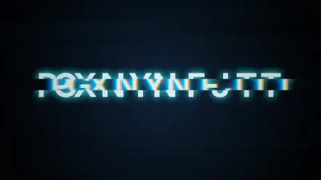

<!-- Generated by tools/gallery.mjs from showcase.yaml and build.json; do not edit. -->
# Signal Lost Glitch Title

[Motion](../README.md) › [Visual Effects](../README.md#visual-effects) · `glitch` `effects` `text-presets` `keyframes`

A cyber-thriller title scrambles in, then tears apart in bursts of digital glitch and RGB split over a scanline grid.



<sub>Animated preview: 0–4 s, 40 frames rendered by Kition Motion. Still: [thumb.png](thumb.png)</sub>

| | |
|---|---|
| Document | [signal-lost-glitch-title.kmotion](signal-lost-glitch-title.kmotion) (240 KB) |
| Contents | 5 s at 30 fps; 4 layers; 3 animated layers |
| Features | `motion.effect.apply`, `motion.text.animate`, `motion.keys.properties`, `motion.layer.styles`, `motion.layer.basics` |
| Built by | `kition-motion` @ `95170ce1e8`: 22 commands in 9 ms |

## About

A title card for a streaming thriller. The words decode with the Scramble preset; an adjustment
layer carries VR Digital Glitch, whose Master Amplitude is keyframed in short spikes so the frame
tears only for a few frames at a time. The backdrop is a Grid effect over a radial ramp, and a
cyan outer glow plus a hard red drop shadow give the chromatic fringe.

## Checks

- `inspect.comp`: `{"name":"Signal Lost","duration":5}`
- `inspect.info.layers`: `{"count":4}`
- `inspect.info.layers.0`: `{"name":"Glitch","animated":[{"name":"Master Amplitude"}]}`
- `inspect.info.layers.0.animated.0.times`: `{"count":8}`
- diagnostics: none (the kit's check finds nothing wrong)
- the saved document opens again; the thumbnail matches `thumb.png` within the `render` tolerance

## Steps

<details><summary>22 commands (from <a href="showcase.yaml">showcase.yaml</a>)</summary>

```yaml
- command: comp.settings
  params:
    name: Signal Lost
    duration: 5
    frameRate: 30
- command: layer.newSolid
  params:
    name: Backdrop
    color: "#05070c"
  as: bg
- command: effect.apply
  params:
    layers:
      - $bg.layer
    effect: Gradient Ramp
    params:
      shape: 1
      start:
        - 640
        - 360
      end:
        - 640
        - 1000
      startColor: "#10233a"
      endColor: "#020306"
- command: effect.apply
  params:
    layers:
      - $bg.layer
    effect: Grid
    params:
      width: 48
      border: 1
      color: "#1be3ff"
      opacity: 12
      blendingMode: 4
- command: layer.newText
  params:
    text: SIGNAL LOST
    position:
      - 640
      - 388
    size: 132
    font: Inter
    style: Bold
    fill: "#e8fbff"
    justify: center
    tracking: 80
  as: title
- command: layer.style.add
  params:
    layers:
      - $title.layer
    style: outerGlow
    params:
      color: "#1be3ff"
      opacity: 70
      size: 30
- command: layer.style.add
  params:
    layers:
      - $title.layer
    style: dropShadow
    params:
      color: "#ff2a5f"
      opacity: 80
      size: 0
      distance: 7
      angle: 160
- command: layer.applyTextPreset
  params:
    layer: $title.layer
    preset: scramble
  as: scramble
- command: layer.newText
  params:
    text: A NEW SERIES  ·  STREAMING THIS WINTER
    position:
      - 640
      - 470
    size: 26
    font: Inter
    style: SemiBold
    fill: "#7fe9ff"
    justify: center
    tracking: 300
  as: sub
- command: time.set
  params:
    time: 1.5
- command: layer.applyTextPreset
  params:
    layer: $sub.layer
    preset: fadeUpCharacters
- command: layer.newAdjustment
  params:
    name: Glitch
  as: glitch
- command: effect.apply
  params:
    layers:
      - $glitch.layer
    effect: VR Digital Glitch
    params:
      masterAmplitude: 0
      distortionRate: 12
      scanlines: 30
- command: prop.addKey
  params:
    layer: $glitch.layer
    path: effects/#1/masterAmplitude
    time: 0
    value: 80
- command: prop.addKey
  params:
    layer: $glitch.layer
    path: effects/#1/masterAmplitude
    time: 0.3
    value: 0
- command: prop.addKey
  params:
    layer: $glitch.layer
    path: effects/#1/masterAmplitude
    time: 2.2
    value: 0
- command: prop.addKey
  params:
    layer: $glitch.layer
    path: effects/#1/masterAmplitude
    time: 2.3
    value: 35
- command: prop.addKey
  params:
    layer: $glitch.layer
    path: effects/#1/masterAmplitude
    time: 2.5
    value: 0
- command: prop.addKey
  params:
    layer: $glitch.layer
    path: effects/#1/masterAmplitude
    time: 3.6
    value: 0
- command: prop.addKey
  params:
    layer: $glitch.layer
    path: effects/#1/masterAmplitude
    time: 3.7
    value: 60
- command: prop.addKey
  params:
    layer: $glitch.layer
    path: effects/#1/masterAmplitude
    time: 3.9
    value: 0
- command: effect.apply
  params:
    layers:
      - $glitch.layer
    effect: CC Vignette
    params:
      amount: 55
      center:
        - 640
        - 360
```

</details>
