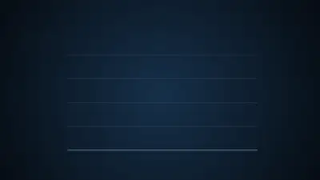

<!-- Generated by tools/gallery.mjs from showcase.yaml and build.json; do not edit. -->
# Solar Output Bar Chart

[Motion](../README.md) › [Shape Animation](../README.md#shape-animation) · `infographic` `chart` `counters` `keyframes` `easing`

Four quarterly bars grow from the baseline with a small overshoot while their numbers count up to the final values.



<sub>Animated preview: 0–3.5 s, 35 frames rendered by Kition Motion. Still: [thumb.png](thumb.png)</sub>

| | |
|---|---|
| Document | [solar-output-bar-chart.kmotion](solar-output-bar-chart.kmotion) (810 KB) |
| Contents | 6 s at 30 fps; 16 layers; 12 animated layers |
| Features | `motion.layer.basics`, `motion.keys.basics`, `motion.keys.properties`, `motion.text.animate`, `motion.shape.paths`, `motion.layer.styles` |
| Built by | `kition-motion` @ `95170ce1e8`: 61 commands in 20 ms |

## About

An animated chart for an energy report. Each bar is a shape layer whose Anchor Point sits on
the baseline, so a Scale keyframe pair (Y 0 to 100 %, eased with `settle`) grows it upward and
lets it land a touch past its height. The numbers use the Count Up text preset, timed to the
bars (with a short Opacity fade), and the gridlines are five rectangles in one shape layer.

## Checks

- `inspect.comp`: `{"name":"Solar Output Chart","duration":6}`
- `inspect.info.layers`: `{"count":16,"any":{"name":"Bar Q4","type":"Shape","animated":[{"name":"Scale","times":[1.5,2.4]}]}}`
- `results.count3`: `{"preset":"countUp"}`
- diagnostics: none (the kit's check finds nothing wrong)
- the saved document opens again; the thumbnail matches `thumb.png` within the `render` tolerance

## Steps

<details><summary>61 commands (from <a href="showcase.yaml">showcase.yaml</a>)</summary>

```yaml
- command: comp.settings
  params:
    name: Solar Output Chart
    duration: 6
    frameRate: 30
- command: layer.newSolid
  params:
    name: Backdrop
    color: "#0b1622"
  as: bg
- command: effect.apply
  params:
    layers:
      - $bg.layer
    effect: Gradient Ramp
    params:
      shape: 1
      start:
        - 640
        - 380
      end:
        - 640
        - 1150
      startColor: "#16304a"
      endColor: "#050a10"
- command: shape.newShape
  params:
    kind: rect
    size:
      - 760
      - 3
    position:
      - 650
      - 600
    fill: "#5d7389"
    name: Gridlines
  as: grid
- command: shape.newShape
  params:
    layer: $grid.layer
    kind: rect
    size:
      - 760
      - 2
    position:
      - 650
      - 505
    fill: "#2a3a4f"
- command: shape.newShape
  params:
    layer: $grid.layer
    kind: rect
    size:
      - 760
      - 2
    position:
      - 650
      - 410
    fill: "#2a3a4f"
- command: shape.newShape
  params:
    layer: $grid.layer
    kind: rect
    size:
      - 760
      - 2
    position:
      - 650
      - 315
    fill: "#2a3a4f"
- command: shape.newShape
  params:
    layer: $grid.layer
    kind: rect
    size:
      - 760
      - 2
    position:
      - 650
      - 220
    fill: "#2a3a4f"
- command: layer.newText
  params:
    text: Solar Output 2026
    position:
      - 90
      - 118
    size: 72
    font: Inter
    style: Bold
    fill: "#ffffff"
    justify: left
  as: title
- command: layer.applyTextPreset
  params:
    layer: $title.layer
    preset: blurSlide
    start: 0
- command: layer.newText
  params:
    text: Gigawatt-hours generated per quarter
    position:
      - 92
      - 166
    size: 28
    font: Inter
    style: Medium
    fill: "#7af0d4"
    justify: left
  as: sub
- command: layer.applyTextPreset
  params:
    layer: $sub.layer
    preset: blurSlide
    variant: subtitle
    start: 0.3
- command: layer.newShape
  params:
    kind: rect
    name: Bar Q1
    size:
      - 110
      - 160
    fillGradient:
      - "#7af0d4"
      - "#1f8fbf"
    fillAngle: 90
    position:
      - 380
      - 520
  as: bar0
- command: prop.set
  params:
    layer: $bar0.layer
    path: transform/anchor
    value:
      - 0
      - 80
      - 0
- command: prop.set
  params:
    layer: $bar0.layer
    path: transform/position
    value:
      - 380
      - 600
      - 0
- command: prop.addKey
  params:
    layer: $bar0.layer
    path: transform/scale
    time: 0.6
    value:
      - 100
      - 0
      - 100
- command: prop.addKey
  params:
    layer: $bar0.layer
    path: transform/scale
    time: 1.5
    value:
      - 100
      - 100
      - 100
- command: keys.applyEase
  params:
    layer: $bar0.layer
    path: transform/scale
    preset: settle
    from: 0.6
    to: 1.5
- command: layer.newText
  params:
    text: "42"
    name: Value Q1
    position:
      - 380
      - 418
    size: 40
    font: Inter
    style: Bold
    fill: "#ffffff"
    justify: center
  as: val0
- command: layer.applyTextPreset
  params:
    layer: $val0.layer
    preset: countUp
    from: 0
    to: 42
    start: 0.6
    duration: 0.9
  as: count0
- command: prop.addKey
  params:
    layer: $val0.layer
    path: transform/opacity
    time: 0.6
    value: 0
- command: prop.addKey
  params:
    layer: $val0.layer
    path: transform/opacity
    time: 0.9
    value: 100
- command: layer.newText
  params:
    text: Q1
    name: Label Q1
    position:
      - 380
      - 648
    size: 28
    font: Inter
    style: SemiBold
    fill: "#9fb3c8"
    justify: center
  as: lab0
- command: layer.applyTextPreset
  params:
    layer: $lab0.layer
    preset: fadeUpCharacters
- command: layer.newShape
  params:
    kind: rect
    name: Bar Q2
    size:
      - 110
      - 220
    fillGradient:
      - "#7af0d4"
      - "#1f8fbf"
    fillAngle: 90
    position:
      - 560
      - 490
  as: bar1
- command: prop.set
  params:
    layer: $bar1.layer
    path: transform/anchor
    value:
      - 0
      - 110
      - 0
- command: prop.set
  params:
    layer: $bar1.layer
    path: transform/position
    value:
      - 560
      - 600
      - 0
- command: prop.addKey
  params:
    layer: $bar1.layer
    path: transform/scale
    time: 0.9
    value:
      - 100
      - 0
      - 100
- command: prop.addKey
  params:
    layer: $bar1.layer
    path: transform/scale
    time: 1.8
    value:
      - 100
      - 100
      - 100
- command: keys.applyEase
  params:
    layer: $bar1.layer
    path: transform/scale
    preset: settle
    from: 0.9
    to: 1.8
- command: layer.newText
  params:
    text: "58"
    name: Value Q2
    position:
      - 560
      - 358
    size: 40
    font: Inter
    style: Bold
    fill: "#ffffff"
    justify: center
  as: val1
- command: layer.applyTextPreset
  params:
    layer: $val1.layer
    preset: countUp
    from: 0
    to: 58
    start: 0.9
    duration: 0.9
  as: count1
- command: prop.addKey
  params:
    layer: $val1.layer
    path: transform/opacity
    time: 0.9
    value: 0
- command: prop.addKey
  params:
    layer: $val1.layer
    path: transform/opacity
    time: 1.2
    value: 100
- command: layer.newText
  params:
    text: Q2
    name: Label Q2
    position:
      - 560
      - 648
    size: 28
    font: Inter
    style: SemiBold
    fill: "#9fb3c8"
    justify: center
  as: lab1
- command: layer.applyTextPreset
  params:
    layer: $lab1.layer
    preset: fadeUpCharacters
- command: layer.newShape
  params:
    kind: rect
    name: Bar Q3
    size:
      - 110
      - 270
    fillGradient:
      - "#7af0d4"
      - "#1f8fbf"
    fillAngle: 90
    position:
      - 740
      - 465
  as: bar2
- command: prop.set
  params:
    layer: $bar2.layer
    path: transform/anchor
    value:
      - 0
      - 135
      - 0
- command: prop.set
  params:
    layer: $bar2.layer
    path: transform/position
    value:
      - 740
      - 600
      - 0
- command: prop.addKey
  params:
    layer: $bar2.layer
    path: transform/scale
    time: 1.2
    value:
      - 100
      - 0
      - 100
- command: prop.addKey
  params:
    layer: $bar2.layer
    path: transform/scale
    time: 2.1
    value:
      - 100
      - 100
      - 100
- command: keys.applyEase
  params:
    layer: $bar2.layer
    path: transform/scale
    preset: settle
    from: 1.2
    to: 2.1
- command: layer.newText
  params:
    text: "71"
    name: Value Q3
    position:
      - 740
      - 308
    size: 40
    font: Inter
    style: Bold
    fill: "#ffffff"
    justify: center
  as: val2
- command: layer.applyTextPreset
  params:
    layer: $val2.layer
    preset: countUp
    from: 0
    to: 71
    start: 1.2
    duration: 0.9
  as: count2
- command: prop.addKey
  params:
    layer: $val2.layer
    path: transform/opacity
    time: 1.2
    value: 0
- command: prop.addKey
  params:
    layer: $val2.layer
    path: transform/opacity
    time: 1.5
    value: 100
- command: layer.newText
  params:
    text: Q3
    name: Label Q3
    position:
      - 740
      - 648
    size: 28
    font: Inter
    style: SemiBold
    fill: "#9fb3c8"
    justify: center
  as: lab2
- command: layer.applyTextPreset
  params:
    layer: $lab2.layer
    preset: fadeUpCharacters
- command: layer.newShape
  params:
    kind: rect
    name: Bar Q4
    size:
      - 110
      - 353
    fillGradient:
      - "#7af0d4"
      - "#1f8fbf"
    fillAngle: 90
    position:
      - 920
      - 423.5
  as: bar3
- command: prop.set
  params:
    layer: $bar3.layer
    path: transform/anchor
    value:
      - 0
      - 176.5
      - 0
- command: prop.set
  params:
    layer: $bar3.layer
    path: transform/position
    value:
      - 920
      - 600
      - 0
- command: prop.addKey
  params:
    layer: $bar3.layer
    path: transform/scale
    time: 1.5
    value:
      - 100
      - 0
      - 100
- command: prop.addKey
  params:
    layer: $bar3.layer
    path: transform/scale
    time: 2.4
    value:
      - 100
      - 100
      - 100
- command: keys.applyEase
  params:
    layer: $bar3.layer
    path: transform/scale
    preset: settle
    from: 1.5
    to: 2.4
- command: layer.newText
  params:
    text: "93"
    name: Value Q4
    position:
      - 920
      - 225
    size: 40
    font: Inter
    style: Bold
    fill: "#ffffff"
    justify: center
  as: val3
- command: layer.applyTextPreset
  params:
    layer: $val3.layer
    preset: countUp
    from: 0
    to: 93
    start: 1.5
    duration: 0.9
  as: count3
- command: prop.addKey
  params:
    layer: $val3.layer
    path: transform/opacity
    time: 1.5
    value: 0
- command: prop.addKey
  params:
    layer: $val3.layer
    path: transform/opacity
    time: 1.8
    value: 100
- command: layer.newText
  params:
    text: Q4
    name: Label Q4
    position:
      - 920
      - 648
    size: 28
    font: Inter
    style: SemiBold
    fill: "#9fb3c8"
    justify: center
  as: lab3
- command: layer.applyTextPreset
  params:
    layer: $lab3.layer
    preset: fadeUpCharacters
- command: layer.style.add
  params:
    layers:
      - $bar0.layer
      - $bar1.layer
      - $bar2.layer
      - $bar3.layer
    style: outerGlow
    params:
      color: "#3fd6c8"
      opacity: 45
      size: 24
```

</details>
