<!-- Generated by tools/gallery.mjs from showcase.yaml and build.json; do not edit. -->
# Note showcase

Markdown notes, Obsidian-flavoured: headings, lists, tasks, tables, callouts, links and code. Saved as .md. Every sample is built from `showcase.yaml` by the kit's own commands and drawn by its own engine (`kition-note`).

**11 samples** · 5 categories · 11 features of `kition-note/features.yaml` · [all kits](../README.md)

[Checklists & Tasks](#checklists--tasks) (1) · [Knowledge Base](#knowledge-base) (4) · [Notes & Journals](#notes--journals) (3) · [Project Docs](#project-docs) (2) · [Technical Writing](#technical-writing) (1)

## Checklists & Tasks

<table>
<tr>
<td width="33%" valign="top">
<a href="lakeside-camping-checklist/">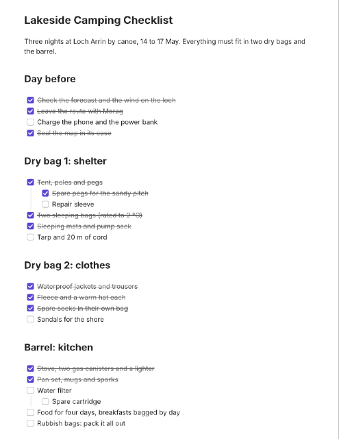</a> 
Note 
<b><a href="lakeside-camping-checklist/">Lakeside Camping Checklist</a></b> 
A packing checklist for a three-night canoe camping trip, with tasks nested under each bag, half of them already packed and one section moved to the top. 
<i>1 page; 155 words; 5 headings</i> 
<code>tasks</code> <code>nested-lists</code> <code>checklist</code> <code>sections</code>
</td>
<td width="33%"></td>
<td width="33%"></td>
</tr>
</table>

## Knowledge Base

<table>
<tr>
<td width="33%" valign="top">
<a href="mechanics-revision-formulas/">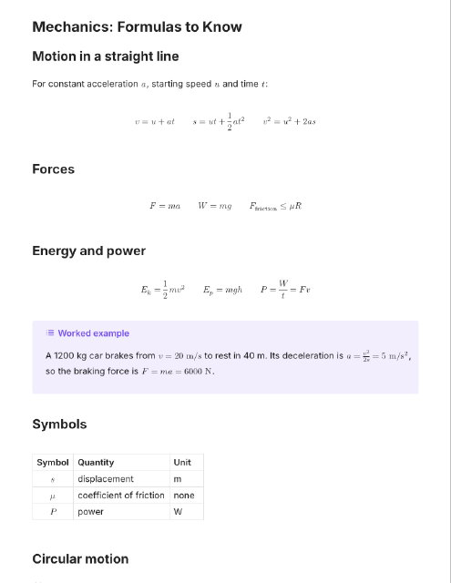</a> 
Note 
<b><a href="mechanics-revision-formulas/">Mechanics Revision Formulas</a></b> 
A revision sheet of mechanics formulas set as display and inline LaTeX math, with a worked example in a callout and a symbol table. 
<i>1 page; 134 words; 6 headings; 1 table</i> 
<code>math</code> <code>latex</code> <code>callouts</code> <code>revision</code> <code>tables</code>
</td>
<td width="33%" valign="top">
<a href="new-starter-wiki-page/">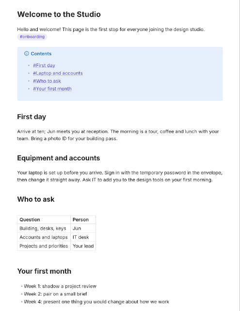</a> 
Note 
<b><a href="new-starter-wiki-page/">New Starter Wiki Page</a></b> 
A team wiki page for new starters whose contents list links to headings in the same note; one heading was renamed, so the kit's check reports the broken anchor. 
<i>1 page; 147 words; 5 headings; 1 table</i> 
<code>wikilinks</code> <code>anchors</code> <code>diagnostics</code> <code>onboarding</code>
</td>
<td width="33%" valign="top">
<a href="reading-list-tracker/">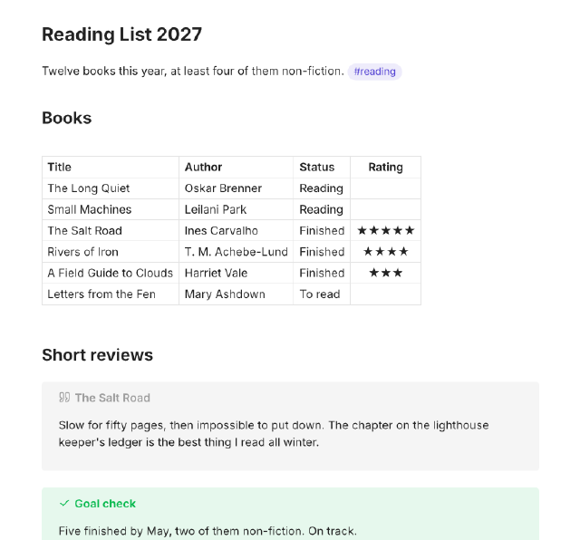</a> 
Note 
<b><a href="reading-list-tracker/">Reading List Tracker</a></b> 
A year's reading list kept as a Markdown table that grows row by row, with a status column, star ratings and a short reviews section. 
<i>1 page; 102 words; 3 headings; 1 table</i> 
<code>tables</code> <code>reading-list</code> <code>table-editing</code> <code>tags</code>
</td>
</tr>
<tr>
<td width="33%" valign="top">
<a href="sourdough-starter-guide/">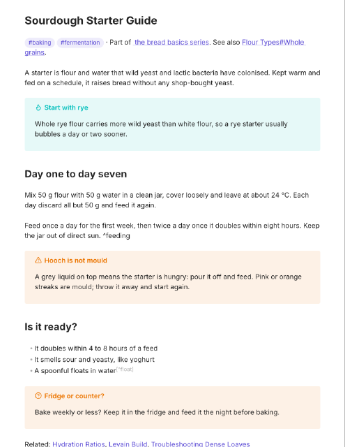</a> 
Note 
<b><a href="sourdough-starter-guide/">Sourdough Starter Guide</a></b> 
A knowledge-base article that links to neighbouring notes with wikilinks, warns and tips in callouts, cites a footnote and gives one paragraph a block id other notes can embed. 
<i>1 page; 236 words; 3 headings</i> 
<code>wikilinks</code> <code>callouts</code> <code>block-ids</code> <code>tags</code> <code>footnotes</code>
</td>
<td width="33%"></td>
<td width="33%"></td>
</tr>
</table>

## Notes & Journals

<table>
<tr>
<td width="33%" valign="top">
<a href="daily-journal-entry/">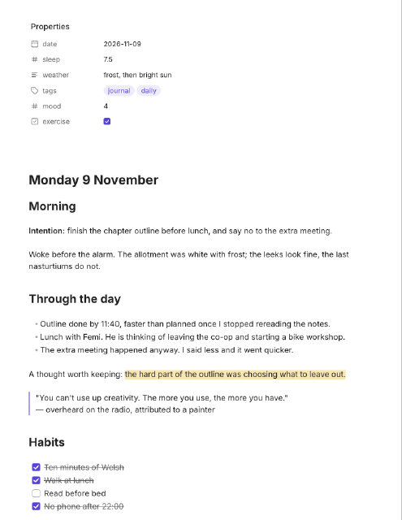</a> 
Note 
<b><a href="daily-journal-entry/">Daily Journal Entry</a></b> 
A daily note with typed properties for mood, sleep and weather, a morning intention, highlighted thoughts, a quote and a short habit tracker. 
<i>1 page; 148 words; 5 headings</i> 
<code>journal</code> <code>properties</code> <code>highlights</code> <code>tasks</code> <code>quotes</code>
</td>
<td width="33%" valign="top">
<a href="spanish-study-notes/">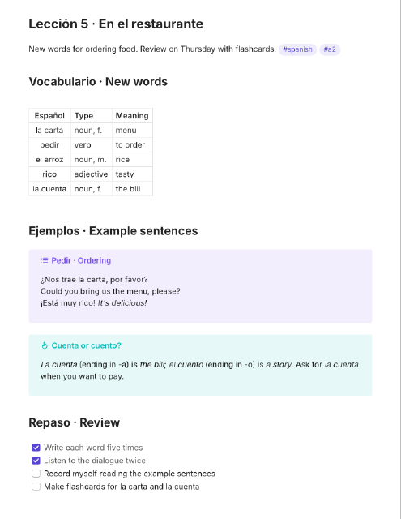</a> 
Note 
<b><a href="spanish-study-notes/">Spanish Study Notes</a></b> 
Spanish vocabulary notes for a beginner's course, with words, word types and meanings in a table, example sentences in callouts and a review task list. 
<i>1 page; 127 words; 4 headings; 1 table</i> 
<code>tables</code> <code>callouts</code> <code>study-notes</code>
</td>
<td width="33%" valign="top">
<a href="weekly-team-sync/">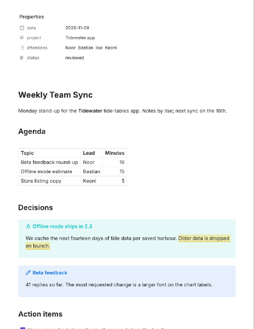</a> 
Note 
<b><a href="weekly-team-sync/">Weekly Team Sync</a></b> 
Meeting notes with front-matter properties, a decision callout, an agenda table and action items, two of them ticked off after the meeting and one decision commented on. 
<i>1 page; 147 words; 5 headings; 1 table</i> 
<code>meeting-notes</code> <code>properties</code> <code>tasks</code> <code>callouts</code> <code>comments</code>
</td>
</tr>
</table>

## Project Docs

<table>
<tr>
<td width="33%" valign="top">
<a href="release-plan-review/">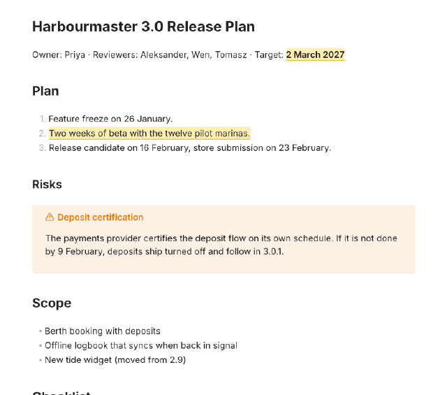</a> 
Note 
<b><a href="release-plan-review/">Release Plan Review</a></b> 
A release plan under review, with comment threads anchored to quoted text, replies from the team, one thread resolved, and a section restructured after the discussion. 
<i>1 page; 109 words; 5 headings</i> 
<code>comments</code> <code>review</code> <code>release-plan</code> <code>sections</code>
</td>
<td width="33%" valign="top">
<a href="tidewater-project-readme/">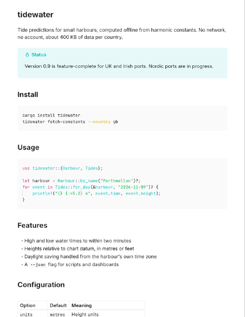</a> 
Note 
<b><a href="tidewater-project-readme/">Tidewater Project README</a></b> 
An open-source project README with install and usage code blocks, a configuration table, a feature list and a contributing section added afterwards. 
<i>2 pages; 171 words; 7 headings; 1 table</i> 
<code>readme</code> <code>code-blocks</code> <code>tables</code> <code>sections</code>
</td>
<td width="33%"></td>
</tr>
</table>

## Technical Writing

<table>
<tr>
<td width="33%" valign="top">
<a href="parcel-tracking-api-reference/">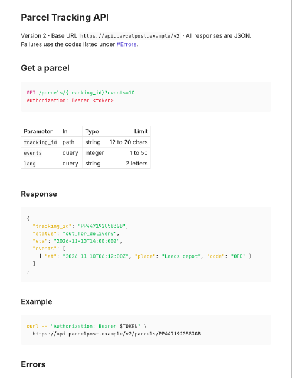</a> 
Note 
<b><a href="parcel-tracking-api-reference/">Parcel Tracking API Reference</a></b> 
Developer documentation for a small REST API, with request and response code fences, parameter and error tables, and an anchor link to the errors section. 
<i>2 pages; 125 words; 5 headings; 2 tables</i> 
<code>api-docs</code> <code>code-blocks</code> <code>tables</code> <code>anchors</code>
</td>
<td width="33%"></td>
<td width="33%"></td>
</tr>
</table>

## Tags

`anchors` 2 · `api-docs` 1 · `block-ids` 1 · `callouts` 4 · `checklist` 1 · `code-blocks` 2 · `comments` 2 · `diagnostics` 1 · `footnotes` 1 · `highlights` 1 · `journal` 1 · `latex` 1 · `math` 1 · `meeting-notes` 1 · `nested-lists` 1 · `onboarding` 1 · `properties` 2 · `quotes` 1 · `reading-list` 1 · `readme` 1 · `release-plan` 1 · `review` 1 · `revision` 1 · `sections` 3 · `study-notes` 1 · `table-editing` 1 · `tables` 5 · `tags` 2 · `tasks` 3 · `wikilinks` 2
