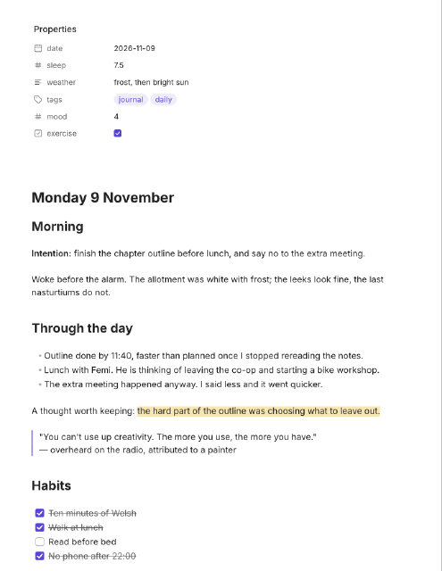

<!-- Generated by tools/gallery.mjs from showcase.yaml and build.json; do not edit. -->
# Daily Journal Entry

[Note](../README.md) › [Notes & Journals](../README.md#notes--journals) · `journal` `properties` `highlights` `tasks` `quotes`

A daily note with typed properties for mood, sleep and weather, a morning intention, highlighted thoughts, a quote and a short habit tracker.



| | |
|---|---|
| Document | [daily-journal-entry.md](daily-journal-entry.md) (1 KB) |
| Contents | 1 page; 148 words; 5 headings |
| Features | `note.properties`, `note.text.edit`, `note.format`, `note.tasks` |
| Built by | `kition-note` @ `095039512e`: 8 commands in 5 ms |

## About

The journal note keeps its data in front matter that the properties view types: a date, a
number for hours of sleep, a list of tags, a boolean for exercise. `property.set` fills in the
evening values (the mood and a workout) after the day, and `format.highlight` marks the line
worth finding again. The inspection reads the property types back.

## Checks

- `inspect.heading`: `"Monday 9 November"`
- `inspect.tasks`: `{"done":3,"open":1}`
- `inspect.properties`: `{"count":6}`
- `results.props.properties`: `{"any":{"key":"sleep","type":"number","value":7.5}}`
- `results.props.properties.-1`: `{"key":"exercise","type":"boolean","value":true}`
- `results.props.properties.-2`: `{"key":"mood","type":"number","value":4}`
- `results.marked.matches`: `{"count":1}`
- diagnostics: none (the kit's check finds nothing wrong)
- the saved document opens again; the thumbnail matches `thumb.png` within the `render` tolerance

## Steps

<details><summary>8 commands (from <a href="showcase.yaml">showcase.yaml</a>)</summary>

```yaml
- command: note.write
  params:
    markdown: |
      ---
      date: 2026-11-09
      sleep: 7.5
      weather: frost, then bright sun
      tags: [journal, daily]
      ---
      # Monday 9 November

      ## Morning

      **Intention:** finish the chapter outline before lunch, and say no to the extra meeting.

      Woke before the alarm. The allotment was white with frost; the leeks look fine, the last nasturtiums do not.

      ## Through the day

      - Outline done by 11:40, faster than planned once I stopped rereading the notes.
      - Lunch with Femi. He is thinking of leaving the co-op and starting a bike workshop.
      - The extra meeting happened anyway. I said less and it went quicker.

      A thought worth keeping: the hard part of the outline was choosing what to leave out.

      > "You can't use up creativity. The more you use, the more you have."
      > — overheard on the radio, attributed to a painter

      ## Habits

      - [x] Ten minutes of Welsh
      - [x] Walk at lunch
      - [ ] Read before bed
      - [x] No phone after 22:00

      ## Tomorrow

      Draft the first scene. Ring the plumber about the radiator.
- command: property.set
  params:
    key: mood
    value: 4
- command: property.set
  params:
    key: exercise
    value: true
- command: text.find
  params:
    find: the hard part of the outline was choosing what to leave out.
  as: thought
- command: selection.set
  params:
    anchor: $thought.matches.0.from
    focus: $thought.matches.0.to
- command: format.highlight
- command: property.list
  as: props
- command: text.find
  params:
    find: ==the hard part
  as: marked
```

</details>
