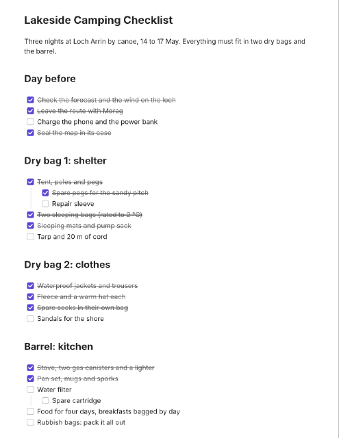

<!-- Generated by tools/gallery.mjs from showcase.yaml and build.json; do not edit. -->
# Lakeside Camping Checklist

[Note](../README.md) › [Checklists & Tasks](../README.md#checklists--tasks) · `tasks` `nested-lists` `checklist` `sections`

A packing checklist for a three-night canoe camping trip, with tasks nested under each bag, half of them already packed and one section moved to the top.



| | |
|---|---|
| Document | [lakeside-camping-checklist.md](lakeside-camping-checklist.md) (1 KB) |
| Contents | 1 page; 155 words; 5 headings |
| Features | `note.tasks`, `note.structure`, `note.text.edit` |
| Built by | `kition-note` @ `095039512e`: 16 commands in 8 ms |

## About

Tasks grouped by bag, some with sub-tasks. The packing happens with `task.toggle` on the lines
`tasks.list` answers, so the checklist ends with 12 of 20 items ticked; `section.move` then puts
the "Day before" section first, where it belongs on the morning of departure.

## Checks

- `inspect.headings`: `5`
- `inspect.tasks`: `{"done":12,"open":8}`
- `results.all.tasks`: `{"count":20}`
- `results.outline.headings.1`: `{"path":["Lakeside Camping Checklist","Day before"]}`
- diagnostics: none (the kit's check finds nothing wrong)
- the saved document opens again; the thumbnail matches `thumb.png` within the `render` tolerance

## Steps

<details><summary>16 commands (from <a href="showcase.yaml">showcase.yaml</a>)</summary>

```yaml
- command: note.write
  params:
    markdown: |
      # Lakeside Camping Checklist

      Three nights at Loch Arrin by canoe, 14 to 17 May. Everything must fit in two dry bags and the barrel.

      ## Dry bag 1: shelter

      - [ ] Tent, poles and pegs
          - [ ] Spare pegs for the sandy pitch
          - [ ] Repair sleeve
      - [ ] Two sleeping bags (rated to 2 °C)
      - [ ] Sleeping mats and pump sack
      - [ ] Tarp and 20 m of cord

      ## Dry bag 2: clothes

      - [ ] Waterproof jackets and trousers
      - [ ] Fleece and a warm hat each
      - [ ] Spare socks in their own bag
      - [ ] Sandals for the shore

      ## Barrel: kitchen

      - [ ] Stove, two gas canisters and a lighter
      - [ ] Pan set, mugs and sporks
      - [ ] Water filter
          - [ ] Spare cartridge
      - [ ] Food for four days, breakfasts bagged by day
      - [ ] Rubbish bags: pack it all out

      ## Day before

      - [ ] Check the forecast and the wind on the loch
      - [ ] Leave the route with Morag
      - [ ] Charge the phone and the power bank
      - [ ] Seal the map in its case
- command: tasks.list
  as: all
- command: task.toggle
  params:
    line: $all.tasks.0.line
    done: true
- command: task.toggle
  params:
    line: $all.tasks.1.line
    done: true
- command: task.toggle
  params:
    line: $all.tasks.3.line
    done: true
- command: task.toggle
  params:
    line: $all.tasks.4.line
    done: true
- command: task.toggle
  params:
    line: $all.tasks.6.line
    done: true
- command: task.toggle
  params:
    line: $all.tasks.7.line
    done: true
- command: task.toggle
  params:
    line: $all.tasks.8.line
    done: true
- command: task.toggle
  params:
    line: $all.tasks.10.line
    done: true
- command: task.toggle
  params:
    line: $all.tasks.11.line
    done: true
- command: task.toggle
  params:
    line: $all.tasks.16.line
    done: true
- command: task.toggle
  params:
    line: $all.tasks.17.line
    done: true
- command: task.toggle
  params:
    line: $all.tasks.19.line
    done: true
- command: section.move
  params:
    heading:
      - Lakeside Camping Checklist
      - Day before
    position: before
    toHeading:
      - Lakeside Camping Checklist
      - "Dry bag 1: shelter"
- command: outline.read
  as: outline
```

</details>
