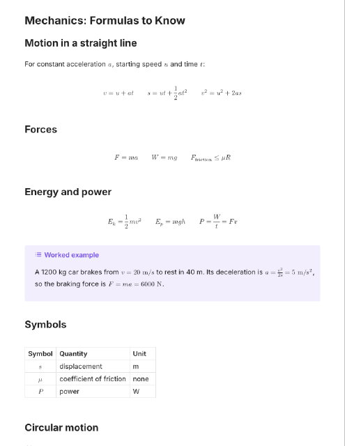

<!-- Generated by tools/gallery.mjs from showcase.yaml and build.json; do not edit. -->
# Mechanics Revision Formulas

[Note](../README.md) › [Knowledge Base](../README.md#knowledge-base) · `math` `latex` `callouts` `revision` `tables`

A revision sheet of mechanics formulas set as display and inline LaTeX math, with a worked example in a callout and a symbol table.



| | |
|---|---|
| Document | [mechanics-revision-formulas.md](mechanics-revision-formulas.md) (1 KB) |
| Contents | 1 page; 134 words; 6 headings; 1 table |
| Features | `note.code-diagrams`, `note.text.edit`, `note.tables`, `note.format` |
| Built by | `kition-note` @ `095039512e`: 5 commands in 8 ms |

## About

The Note kit typesets `$$ … $$` blocks and inline `$ … $` math with its bundled Latin Modern
Math face, so the formulas draw as real mathematics. `insert.mathBlock` wraps a selected line
in `$$` fences, the way the editor's Insert ▸ Math block does, for the last formula.

## Checks

- `inspect.headings`: `6`
- `inspect.callouts`: `1`
- `inspect.tables`: `{"count":1}`
- `results.source.text`: `{"contains":"$$\na = \\frac{v^{2}}{r} = \\omega^{2} r\n$$"}`
- diagnostics: none (the kit's check finds nothing wrong)
- the saved document opens again; the thumbnail matches `thumb.png` within the `render` tolerance

## Steps

<details><summary>5 commands (from <a href="showcase.yaml">showcase.yaml</a>)</summary>

```yaml
- command: note.write
  params:
    markdown: |
      # Mechanics: Formulas to Know

      ## Motion in a straight line

      For constant acceleration $a$, starting speed $u$ and time $t$:

      $$
      v = u + at \qquad s = ut + \frac{1}{2}at^{2} \qquad v^{2} = u^{2} + 2as
      $$

      ## Forces

      $$
      F = ma \qquad W = mg \qquad F_{\text{friction}} \le \mu R
      $$

      ## Energy and power

      $$
      E_k = \frac{1}{2}mv^{2} \qquad E_p = mgh \qquad P = \frac{W}{t} = Fv
      $$

      > [!EXAMPLE] Worked example
      > A 1200 kg car brakes from $v = 20\ \text{m/s}$ to rest in 40 m. Its deceleration is $a = \frac{v^2}{2s} = 5\ \text{m/s}^2$, so the braking force is $F = ma = 6000\ \text{N}$.

      ## Symbols

      | Symbol | Quantity | Unit |
      | :-: | --- | --- |
      | $s$ | displacement | m |
      | $\mu$ | coefficient of friction | none |
      | $P$ | power | W |

      ## Circular motion

      a = \frac{v^{2}}{r} = \omega^{2} r
- command: text.find
  params:
    find: a = \frac{v^{2}}{r} = \omega^{2} r
  as: last
- command: selection.set
  params:
    line: $last.matches.0.line
- command: insert.mathBlock
- command: text.read
  as: source
```

</details>
