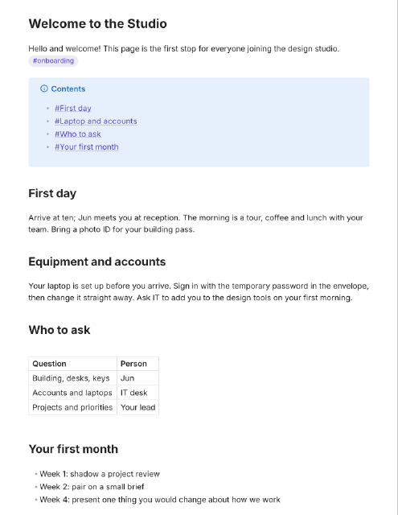

<!-- Generated by tools/gallery.mjs from showcase.yaml and build.json; do not edit. -->
# New Starter Wiki Page

[Note](../README.md) › [Knowledge Base](../README.md#knowledge-base) · `wikilinks` `anchors` `diagnostics` `onboarding`

A team wiki page for new starters whose contents list links to headings in the same note; one heading was renamed, so the kit's check reports the broken anchor.



| | |
|---|---|
| Document | [new-starter-wiki-page.md](new-starter-wiki-page.md) (1 KB) |
| Contents | 1 page; 147 words; 5 headings; 1 table |
| Features | `note.links`, `note.structure`, `note.text.edit`, `note.agent.observe` |
| Built by | `kition-note` @ `095039512e`: 3 commands in 11 ms |

## About

The contents list links to each section with same-note anchors (`[[#First day]]`). After the
last edit the "Laptop and accounts" heading was renamed with `text.findReplace`, but the
contents link still points at the old name: the kit's check reports `note.broken-anchor` on
that line, and `links.list` marks the link's state. A sample about the problem, so the code is
listed under `diagnostics`.

## Checks

- `inspect.headings`: `5`
- `inspect.links`: `{"wikilinks":4}`
- `results.links.links`: `{"count":4,"any":{"anchor":"#Laptop and accounts","line":7,"state":"missing-anchor"}}`
- `results.links.links.0`: `{"anchor":"#First day","state":"resolved"}`
- diagnostics: `note.broken-anchor`
- the saved document opens again; the thumbnail matches `thumb.png` within the `render` tolerance

## Steps

<details><summary>3 commands (from <a href="showcase.yaml">showcase.yaml</a>)</summary>

```yaml
- command: note.write
  params:
    markdown: |
      # Welcome to the Studio

      Hello and welcome! This page is the first stop for everyone joining the design studio. #onboarding

      > [!INFO] Contents
      > - [[#First day]]
      > - [[#Laptop and accounts]]
      > - [[#Who to ask]]
      > - [[#Your first month]]

      ## First day

      Arrive at ten; Jun meets you at reception. The morning is a tour, coffee and lunch with your team. Bring a photo ID for your building pass.

      ## Laptop and accounts

      Your laptop is set up before you arrive. Sign in with the temporary password in the envelope, then change it straight away. Ask IT to add you to the design tools on your first morning.

      ## Who to ask

      | Question | Person |
      | --- | --- |
      | Building, desks, keys | Jun |
      | Accounts and laptops | IT desk |
      | Projects and priorities | Your lead |

      ## Your first month

      - Week 1: shadow a project review
      - Week 2: pair on a small brief
      - Week 4: present one thing you would change about how we work
- command: text.findReplace
  params:
    find: "## Laptop and accounts"
    replace: "## Equipment and accounts"
- command: links.list
  params:
    kinds:
      - wikilink
  as: links
```

</details>
