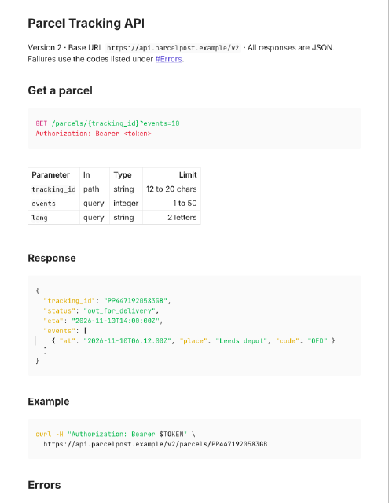

<!-- Generated by tools/gallery.mjs from showcase.yaml and build.json; do not edit. -->
# Parcel Tracking API Reference

[Note](../README.md) › [Technical Writing](../README.md#technical-writing) · `api-docs` `code-blocks` `tables` `anchors`

Developer documentation for a small REST API, with request and response code fences, parameter and error tables, and an anchor link to the errors section.



| | |
|---|---|
| Document | [parcel-tracking-api-reference.md](parcel-tracking-api-reference.md) (1 KB) |
| Contents | 2 pages; 125 words; 5 headings; 2 tables |
| Features | `note.text.edit`, `note.tables`, `note.code-diagrams`, `note.links`, `note.structure` |
| Built by | `kition-note` @ `095039512e`: 5 commands in 10 ms |

## About

Reference pages are mostly code and tables: an HTTP request, a JSON response and a curl
example in fenced blocks with their languages, a parameter table with aligned columns
(`table.align` right-aligns the limits column afterwards), and an error table that the text
links to with a same-note anchor (`[[#Errors]]`), which the kit's check resolves.

## Checks

- `inspect.heading`: `"Parcel Tracking API"`
- `inspect.headings`: `5`
- `inspect.tables`: `[{"columns":4,"rows":4},{"columns":3,"rows":4}]`
- `results.params.align`: `["none","none","none","right"]`
- `results.anchors.links`: `{"count":1,"all":{"anchor":"#Errors"}}`
- diagnostics: none (the kit's check finds nothing wrong)
- the saved document opens again; the thumbnail matches `thumb.png` within the `render` tolerance

## Steps

<details><summary>5 commands (from <a href="showcase.yaml">showcase.yaml</a>)</summary>

```yaml
- command: note.write
  params:
    markdown: |
      # Parcel Tracking API

      Version 2 · Base URL `https://api.parcelpost.example/v2` · All responses are JSON. Failures use the codes listed under [[#Errors]].

      ## Get a parcel

      ```http
      GET /parcels/{tracking_id}?events=10
      Authorization: Bearer <token>
      ```

      | Parameter | In | Type | Limit |
      | --- | --- | --- | --- |
      | `tracking_id` | path | string | 12 to 20 chars |
      | `events` | query | integer | 1 to 50 |
      | `lang` | query | string | 2 letters |

      ### Response

      ```json
      {
        "tracking_id": "PP4471920583GB",
        "status": "out_for_delivery",
        "eta": "2026-11-10T14:00:00Z",
        "events": [
          { "at": "2026-11-10T06:12:00Z", "place": "Leeds depot", "code": "OFD" }
        ]
      }
      ```

      ### Example

      ```sh
      curl -H "Authorization: Bearer $TOKEN" \
        https://api.parcelpost.example/v2/parcels/PP4471920583GB
      ```

      ## Errors

      | Status | Code | When |
      | --- | --- | --- |
      | 401 | `auth_missing` | No or expired token |
      | 404 | `not_found` | Unknown tracking id |
      | 429 | `rate_limited` | Over 60 requests a minute |

      > [!NOTE] Rate limits
      > The `Retry-After` header says how many seconds to wait.
- command: table.align
  params:
    table: 0
    column: 3
    align: right
- command: table.align
  params:
    table: 1
    column: 0
    align: center
- command: table.read
  params:
    table: 0
  as: params
- command: links.list
  params:
    kinds:
      - wikilink
  as: anchors
```

</details>
