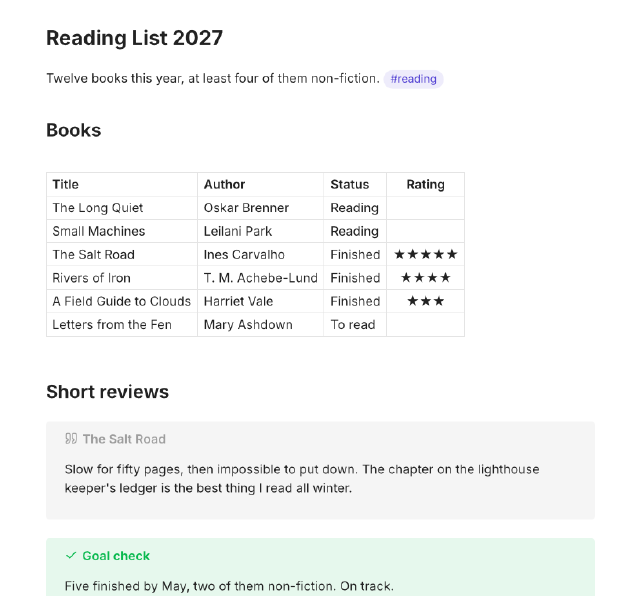

<!-- Generated by tools/gallery.mjs from showcase.yaml and build.json; do not edit. -->
# Reading List Tracker

[Note](../README.md) › [Knowledge Base](../README.md#knowledge-base) · `tables` `reading-list` `table-editing` `tags`

A year's reading list kept as a Markdown table that grows row by row, with a status column, star ratings and a short reviews section.



| | |
|---|---|
| Document | [reading-list-tracker.md](reading-list-tracker.md) (1 KB) |
| Contents | 1 page; 102 words; 3 headings; 1 table |
| Features | `note.tables`, `note.text.edit`, `note.structure` |
| Built by | `kition-note` @ `095039512e`: 15 commands in 7 ms |

## About

The table is built with the table commands rather than typed: `table.create` makes the header
alone (`rows: 0`), `table.insertRow` adds each book, `table.setCell` updates a status when a book
is finished, `table.moveRow` puts the current reads on top, and `table.format` pads the source so
the columns line up. The checks read the finished table back cell by cell.

## Checks

- `inspect.tables`: `{"count":1,"all":{"columns":4,"rows":7}}`
- `inspect.callouts`: `2`
- `results.books.header`: `["Title","Author","Status","Rating"]`
- `results.books.rows`: `{"count":6}`
- `results.books.rows.0`: `["The Long Quiet","Oskar Brenner","Reading",""]`
- `results.books.rows.1`: `["Small Machines","Leilani Park","Reading",""]`
- `results.books.align`: `["none","none","none","center"]`
- diagnostics: none (the kit's check finds nothing wrong)
- the saved document opens again; the thumbnail matches `thumb.png` within the `render` tolerance

## Steps

<details><summary>15 commands (from <a href="showcase.yaml">showcase.yaml</a>)</summary>

```yaml
- command: note.write
  params:
    markdown: |
      # Reading List 2027

      Twelve books this year, at least four of them non-fiction. #reading

      ## Books

      ## Short reviews

      > [!QUOTE] The Salt Road
      > Slow for fifty pages, then impossible to put down. The chapter on the lighthouse keeper's ledger is the best thing I read all winter.

      > [!SUCCESS] Goal check
      > Five finished by May, two of them non-fiction. On track.
- command: table.create
  params:
    heading:
      - Reading List 2027
      - Books
    position: start
    columns: 4
    rows: 0
    header:
      - Title
      - Author
      - Status
      - Rating
- command: table.insertRow
  params:
    table: 0
    at: 1
    cells:
      - The Salt Road
      - Ines Carvalho
      - Finished
      - ★★★★★
- command: table.insertRow
  params:
    table: 0
    at: 2
    cells:
      - Rivers of Iron
      - T. M. Achebe-Lund
      - Finished
      - ★★★★
- command: table.insertRow
  params:
    table: 0
    at: 3
    cells:
      - A Field Guide to Clouds
      - Harriet Vale
      - Finished
      - ★★★
- command: table.insertRow
  params:
    table: 0
    at: 4
    cells:
      - The Long Quiet
      - Oskar Brenner
      - Reading
      - ""
- command: table.insertRow
  params:
    table: 0
    at: 5
    cells:
      - Small Machines
      - Leilani Park
      - To read
      - ""
- command: table.insertRow
  params:
    table: 0
    at: 6
    cells:
      - Letters from the Fen
      - Mary Ashdown
      - To read
      - ""
- command: table.setCell
  params:
    table: 0
    row: 3
    column: 2
    text: Finished
    expected: Finished
- command: table.setCell
  params:
    table: 0
    row: 5
    column: 2
    text: Reading
    expected: To read
- command: table.moveRow
  params:
    table: 0
    from: 4
    to: 1
- command: table.moveRow
  params:
    table: 0
    from: 5
    to: 2
- command: table.align
  params:
    table: 0
    column: 3
    align: center
- command: table.format
  params:
    table: 0
- command: table.read
  params:
    table: 0
  as: books
```

</details>
