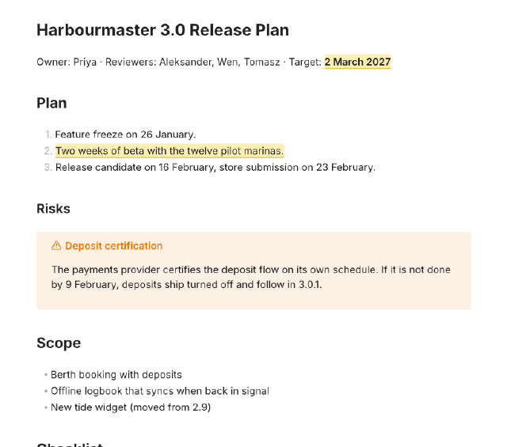

<!-- Generated by tools/gallery.mjs from showcase.yaml and build.json; do not edit. -->
# Release Plan Review

[Note](../README.md) › [Project Docs](../README.md#project-docs) · `comments` `review` `release-plan` `sections`

A release plan under review, with comment threads anchored to quoted text, replies from the team, one thread resolved, and a section restructured after the discussion.



| | |
|---|---|
| Document | [release-plan-review.md](release-plan-review.md) (1 KB) |
| Contents | 1 page; 109 words; 5 headings |
| Features | `note.comments`, `note.structure`, `note.text.edit`, `note.tasks` |
| Built by | `kition-note` @ `095039512e`: 12 commands in 14 ms |

## About

Comments live beside the note, anchored to the text they talk about. `comment.add` starts
three threads (on a quote, on a heading and on a date), `comment.reply` answers two of them and
`comment.resolve` closes the settled one. Acting on the review, `section.move` and
`heading.setLevel` make Risks a subsection of the Plan and `section.replace` rewrites its body. `comment.threads` reads
the threads back with the text each is anchored to.

## Checks

- `inspect.comments`: `{"open":2,"resolved":1}`
- `inspect.callouts`: `1`
- `inspect.tasks`: `{"done":1,"open":2}`
- `results.threads.threads`: `{"count":3}`
- `results.outline.headings.2`: `{"level":3,"path":["Harbourmaster 3.0 Release Plan","Plan","Risks"]}`
- diagnostics: none (the kit's check finds nothing wrong)
- the saved document opens again; the thumbnail matches `thumb.png` within the `render` tolerance

## Steps

<details><summary>12 commands (from <a href="showcase.yaml">showcase.yaml</a>)</summary>

```yaml
- command: note.write
  params:
    markdown: |
      # Harbourmaster 3.0 Release Plan

      Owner: Priya · Reviewers: Aleksander, Wen, Tomasz · Target: **2 March 2027**

      ## Plan

      1. Feature freeze on 26 January.
      2. Two weeks of beta with the twelve pilot marinas.
      3. Release candidate on 16 February, store submission on 23 February.

      ## Scope

      - Berth booking with deposits
      - Offline logbook that syncs when back in signal
      - New tide widget (moved from 2.9)

      ## Risks

      The payments provider certifies the deposit flow on its own schedule.

      ## Checklist

      - [x] Pilot marinas confirmed
      - [ ] Release notes drafted
      - [ ] Support team trained on deposits
- command: comment.add
  params:
    quote: Two weeks of beta with the twelve pilot marinas.
    body: Two weeks is tight if the deposit certification slips. Can we say two to three?
    author: Aleksander
    created: 2026-11-09T10:12:00Z
  as: beta
- command: comment.add
  params:
    heading:
      - Harbourmaster 3.0 Release Plan
      - Scope
    body: Is the tide widget really in? It was cut from 2.9 for battery use.
    author: Wen
    created: 2026-11-09T10:40:00Z
  as: scope
- command: comment.add
  params:
    quote: 2 March 2027
    body: Marketing needs the date fixed by the end of January.
    author: Tomasz
    created: 2026-11-09T11:05:00Z
  as: date
- command: comment.reply
  params:
    thread: $scope.thread
    body: "Yes: the battery fix landed in October. Measured at under 1% a day."
    author: Priya
    created: 2026-11-09T12:00:00Z
- command: comment.resolve
  params:
    thread: $scope.thread
- command: comment.reply
  params:
    thread: $beta.thread
    body: Agreed. I'll make it two to three weeks and move the candidate date with it.
    author: Priya
    created: 2026-11-09T12:05:00Z
- command: section.move
  params:
    heading:
      - Harbourmaster 3.0 Release Plan
      - Risks
    position: end
    toHeading:
      - Harbourmaster 3.0 Release Plan
      - Plan
- command: heading.setLevel
  params:
    heading:
      - Harbourmaster 3.0 Release Plan
      - Risks
    level: 3
- command: section.replace
  params:
    heading:
      - Harbourmaster 3.0 Release Plan
      - Plan
      - Risks
    markdown: |
      > [!WARNING] Deposit certification
      > The payments provider certifies the deposit flow on its own schedule. If it is not done by 9 February, deposits ship turned off and follow in 3.0.1.
- command: comment.threads
  as: threads
- command: outline.read
  as: outline
```

</details>
