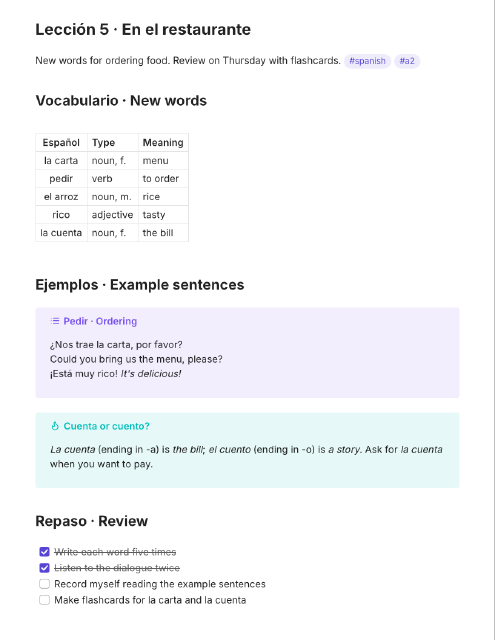

<!-- Generated by tools/gallery.mjs from showcase.yaml and build.json; do not edit. -->
# Spanish Study Notes

[Note](../README.md) › [Notes & Journals](../README.md#notes--journals) · `tables` `callouts` `study-notes`

Spanish vocabulary notes for a beginner's course, with words, word types and meanings in a table, example sentences in callouts and a review task list.



| | |
|---|---|
| Document | [spanish-study-notes.md](spanish-study-notes.md) (1 KB) |
| Contents | 1 page; 127 words; 4 headings; 1 table |
| Features | `note.text.edit`, `note.tables`, `note.tasks`, `note.format` |
| Built by | `kition-note` @ `b15cb40c08`: 2 commands in 4 ms |

## About

A study note mixing English and accented Spanish (á, é, ñ, ¿ and ¡). The vocabulary sits in a
three-column table with a centred first column, the example dialogue and a spelling tip are
callouts, and the review list keeps two tasks open. Searching for a word with `text.find` finds
it in the table, the example sentence and the review list.

## Checks

- `inspect.heading`: `"Lección 5 · En el restaurante"`
- `inspect.tables`: `{"count":1,"all":{"columns":3,"rows":6}}`
- `inspect.callouts`: `2`
- `inspect.tasks`: `{"done":2,"open":2}`
- `results.menu.matches`: `{"count":3}`
- diagnostics: none (the kit's check finds nothing wrong)
- the saved document opens again; the thumbnail matches `thumb.png` within the `render` tolerance

## Steps

<details><summary>2 commands (from <a href="showcase.yaml">showcase.yaml</a>)</summary>

```yaml
- command: note.write
  params:
    markdown: |
      # Lección 5 · En el restaurante

      New words for ordering food. Review on Thursday with flashcards. #spanish #a2

      ## Vocabulario · New words

      | Español | Type | Meaning |
      | :-: | --- | --- |
      | la carta | noun, f. | menu |
      | pedir | verb | to order |
      | el arroz | noun, m. | rice |
      | rico | adjective | tasty |
      | la cuenta | noun, f. | the bill |

      ## Ejemplos · Example sentences

      > [!EXAMPLE] Pedir · Ordering
      > ¿Nos trae la carta, por favor?
      > Could you bring us the menu, please?
      > ¡Está muy rico! *It's delicious!*

      > [!TIP] Cuenta or cuento?
      > *La cuenta* (ending in -a) is *the bill*; *el cuento* (ending in -o) is *a story*. Ask for *la cuenta* when you want to pay.

      ## Repaso · Review

      - [x] Write each word five times
      - [x] Listen to the dialogue twice
      - [ ] Record myself reading the example sentences
      - [ ] Make flashcards for la carta and la cuenta
- command: text.find
  params:
    find: la carta
  as: menu
```

</details>
