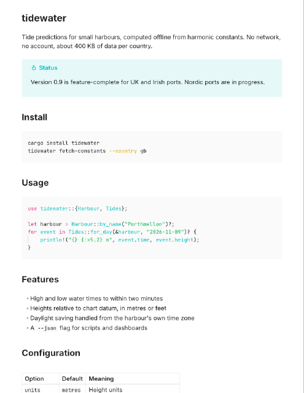

<!-- Generated by tools/gallery.mjs from showcase.yaml and build.json; do not edit. -->
# Tidewater Project README

[Note](../README.md) › [Project Docs](../README.md#project-docs) · `readme` `code-blocks` `tables` `sections`

An open-source project README with install and usage code blocks, a configuration table, a feature list and a contributing section added afterwards.



| | |
|---|---|
| Document | [tidewater-project-readme.md](tidewater-project-readme.md) (1 KB) |
| Contents | 2 pages; 171 words; 7 headings; 1 table |
| Features | `note.text.edit`, `note.structure`, `note.tables`, `note.code-diagrams`, `note.format` |
| Built by | `kition-note` @ `095039512e`: 6 commands in 16 ms |

## About

The README is written once with `note.write`; then the way a maintainer edits it: `section.insert`
adds a Contributing section after Configuration, `table.insertRow` adds an option to the
configuration table and `table.format` pads the table so its columns line up in the source.
Code blocks carry their languages (shell, Rust, TOML) for highlighting.

## Checks

- `inspect.heading`: `"tidewater"`
- `inspect.headings`: `7`
- `inspect.tables`: `{"count":1,"all":{"columns":3,"rows":4}}`
- `inspect.callouts`: `1`
- `results.outline.headings`: `{"count":7}`
- `results.outline.headings.5`: `{"path":["tidewater","Contributing"]}`
- `results.config.rows`: `{"count":3}`
- `results.config.rows.2.0`: `"`cache_days`"`
- diagnostics: none (the kit's check finds nothing wrong)
- the saved document opens again; the thumbnail matches `thumb.png` within the `render` tolerance

## Steps

<details><summary>6 commands (from <a href="showcase.yaml">showcase.yaml</a>)</summary>

```yaml
- command: note.write
  params:
    markdown: |
      # tidewater

      Tide predictions for small harbours, computed offline from harmonic constants. No network, no account, about 400 KB of data per country.

      > [!TIP] Status
      > Version 0.9 is feature-complete for UK and Irish ports. Nordic ports are in progress.

      ## Install

      ```sh
      cargo install tidewater
      tidewater fetch-constants --country gb
      ```

      ## Usage

      ```rust
      use tidewater::{Harbour, Tides};

      let harbour = Harbour::by_name("Porthmellon")?;
      for event in Tides::for_day(&harbour, "2026-11-09")? {
          println!("{} {:>5.2} m", event.time, event.height);
      }
      ```

      ## Features

      - High and low water times to within two minutes
      - Heights relative to chart datum, in metres or feet
      - Daylight saving handled from the harbour's own time zone
      - A `--json` flag for scripts and dashboards

      ## Configuration

      | Option | Default | Meaning |
      | --- | --- | --- |
      | `units` | `metres` | Height units |
      | `datum` | `chart` | Reference level |

      ```toml
      [tidewater]
      units = "feet"
      harbours = ["Porthmellon", "Kilrush"]
      ```

      ## Licence

      MIT or Apache-2.0, at your choice.
- command: table.insertRow
  params:
    table: 0
    at: 3
    cells:
      - "`cache_days`"
      - "`14`"
      - Days of predictions kept offline
- command: table.format
  params:
    table: 0
- command: section.insert
  params:
    heading:
      - tidewater
      - Configuration
    position: after
    markdown: |
      ## Contributing

      1. Open an issue before large changes.
      2. Run `cargo test` and `cargo clippy` before a pull request.
      3. New harbours need a source for their constants.
- command: outline.read
  as: outline
- command: table.read
  params:
    table: 0
  as: config
```

</details>
