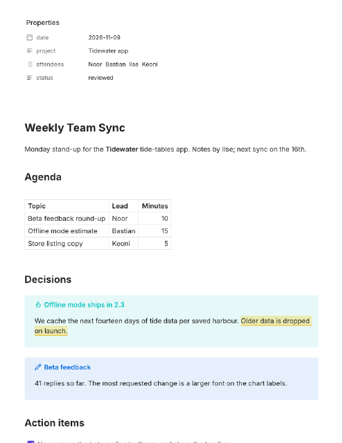

<!-- Generated by tools/gallery.mjs from showcase.yaml and build.json; do not edit. -->
# Weekly Team Sync

[Note](../README.md) › [Notes & Journals](../README.md#notes--journals) · `meeting-notes` `properties` `tasks` `callouts` `comments`

Meeting notes with front-matter properties, a decision callout, an agenda table and action items, two of them ticked off after the meeting and one decision commented on.



| | |
|---|---|
| Document | [weekly-team-sync.md](weekly-team-sync.md) (1 KB) |
| Contents | 1 page; 147 words; 5 headings; 1 table |
| Features | `note.text.edit`, `note.properties`, `note.tasks`, `note.tables`, `note.comments`, `note.format` |
| Built by | `kition-note` @ `095039512e`: 6 commands in 9 ms |

## About

`note.write` lays down the notes in Obsidian-flavoured Markdown: properties for the date,
attendees and project, an agenda table, a decision callout and a task list with owners. After
the meeting `task.toggle` ticks two actions, `property.set` marks the notes as reviewed and
`comment.add` starts a thread on the decision. The inspection counts the tasks, tables and
callouts and the open comment thread.

## Checks

- `inspect.heading`: `"Weekly Team Sync"`
- `inspect.headings`: `5`
- `inspect.tables`: `{"count":1,"all":{"columns":3,"rows":4}}`
- `inspect.callouts`: `2`
- `inspect.tasks`: `{"done":2,"open":3}`
- `inspect.properties`: `{"count":4,"any":{"key":"attendees","type":"list"}}`
- `inspect.comments`: `{"open":1}`
- `results.before.tasks`: `{"count":5}`
- diagnostics: none (the kit's check finds nothing wrong)
- the saved document opens again; the thumbnail matches `thumb.png` within the `render` tolerance

## Steps

<details><summary>6 commands (from <a href="showcase.yaml">showcase.yaml</a>)</summary>

```yaml
- command: note.write
  params:
    markdown: |
      ---
      date: 2026-11-09
      project: Tidewater app
      attendees: [Noor, Bastian, Ilse, Keoni]
      status: draft
      ---
      # Weekly Team Sync

      Monday stand-up for the **Tidewater** tide-tables app. Notes by Ilse; next sync on the 16th.

      ## Agenda

      | Topic | Lead | Minutes |
      | :-- | :-- | --: |
      | Beta feedback round-up | Noor | 10 |
      | Offline mode estimate | Bastian | 15 |
      | Store listing copy | Keoni | 5 |

      ## Decisions

      > [!IMPORTANT] Offline mode ships in 2.3
      > We cache the next fourteen days of tide data per saved harbour. Older data is dropped on launch.

      > [!NOTE] Beta feedback
      > 41 replies so far. The most requested change is a larger font on the chart labels.

      ## Action items

      - [ ] Noor: group the beta replies by theme and share the top five
      - [ ] Bastian: spike the cache size for 50 harbours
      - [ ] Keoni: draft the store listing in English and Welsh
      - [ ] Ilse: book the usability session with the sailing club
      - [ ] Everyone: try the nightly build on a real boat this weekend

      ## Parking lot

      - Dark mode for night sailing
      - Widget for the lock screen
- command: tasks.list
  as: before
- command: task.toggle
  params:
    line: $before.tasks.0.line
    done: true
  as: first
- command: task.toggle
  params:
    line: $before.tasks.3.line
    done: true
  as: second
- command: property.set
  params:
    key: status
    value: reviewed
- command: comment.add
  params:
    quote: Older data is dropped on launch.
    body: Should we keep the last viewed day so the app is never empty offline?
    author: Noor
  as: thread
```

</details>
