<!-- Generated by tools/gallery.mjs from showcase.yaml and build.json; do not edit. -->
# PDF showcase

PDF documents: pages, text, annotations, forms, bookmarks, links and redaction. Saved as PDF. Every sample is built from `showcase.yaml` by the kit's own commands and drawn by its own engine (`kition-pdf`).

**11 samples** · 5 categories · 19 features of `kition-pdf/features.yaml` · [all kits](../README.md)

[Annotations & Review](#annotations--review) (2) · [Bookmarks & Links](#bookmarks--links) (2) · [Forms](#forms) (3) · [Redaction](#redaction) (1) · [Reports & Documents](#reports--documents) (3)

## Annotations & Review

<table>
<tr>
<td width="33%" valign="top">
<a href="allotment-plot-measurements/">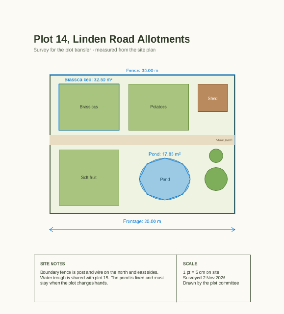</a> 
PDF 
<b><a href="allotment-plot-measurements/">Allotment Plot Measurements</a></b> 
A scaled plan of an allotment plot with a calibrated 1 pt = 5 cm viewport and measurement annotations for the frontage, the bed and pond areas and the fence line. 
<i>1 page</i> 
<code>measurements</code> <code>scale</code> <code>site-plan</code> <code>area</code>
</td>
<td width="33%" valign="top">
<a href="reviewed-quarterly-report/">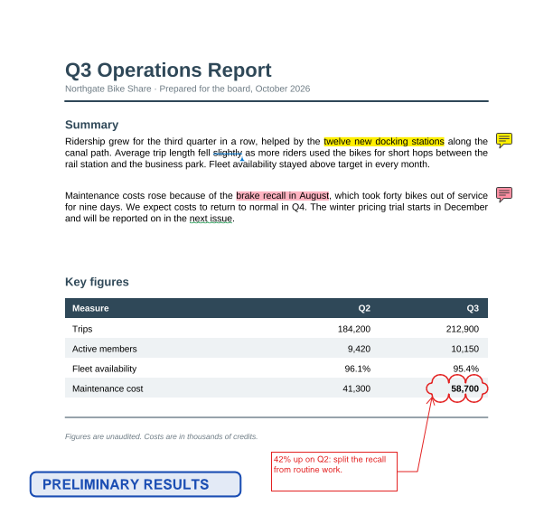</a> 
PDF 
<b><a href="reviewed-quarterly-report/">Reviewed Quarterly Report</a></b> 
A report page marked up by two reviewers with highlights, a strikeout and replacement, sticky notes with replies and statuses, a cloud, a callout and a status stamp. 
<i>1 page</i> 
<code>comments</code> <code>highlights</code> <code>sticky-notes</code> <code>stamps</code> <code>review-status</code>
</td>
<td width="33%"></td>
</tr>
</table>

## Bookmarks & Links

<table>
<tr>
<td width="33%" valign="top">
<a href="symposium-programme-links/">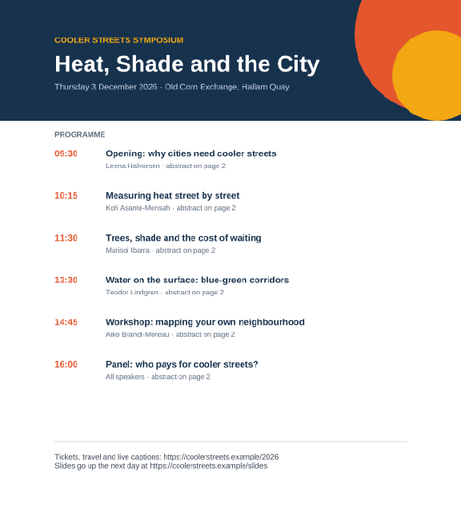</a> 
PDF 
<b><a href="symposium-programme-links/">Symposium Programme Links</a></b> 
A one-day symposium programme whose sessions link to their abstracts on page two, with web addresses turned into clickable links automatically. 
<i>2 pages</i> 
<code>internal-links</code> <code>web-links</code> <code>programme</code> <code>event</code>
</td>
<td width="33%" valign="top">
<a href="volunteer-handbook-outline/">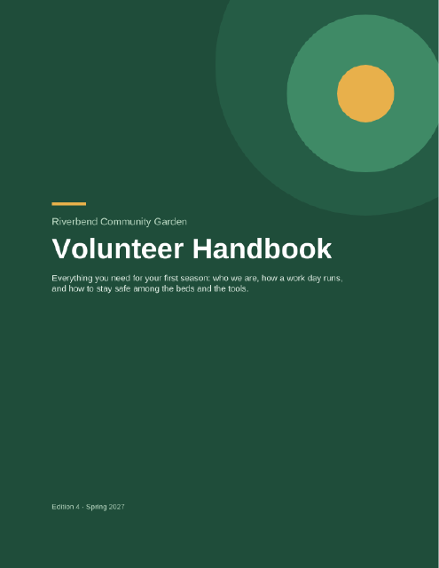</a> 
PDF 
<b><a href="volunteer-handbook-outline/">Volunteer Handbook Outline</a></b> 
A seven-page handbook with a nested bookmark outline, roman-numbered front matter, a contents page whose entries link to their pages, and an initial view that opens the bookmarks. 
<i>7 pages</i> 
<code>bookmarks</code> <code>page-labels</code> <code>internal-links</code> <code>initial-view</code> <code>header-footer</code>
</td>
<td width="33%"></td>
</tr>
</table>

## Forms

<table>
<tr>
<td width="33%" valign="top">
<a href="catering-order-form/">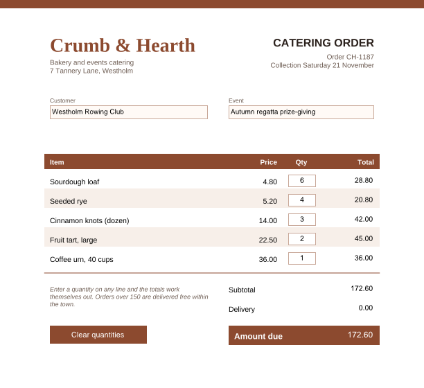</a> 
PDF 
<b><a href="catering-order-form/">Catering Order Form</a></b> 
A bakery's catering order form whose line totals, subtotal, delivery and grand total are calculated fields that update as quantities are entered. 
<i>1 page; 16 form fields</i> 
<code>form-fields</code> <code>calculated-fields</code> <code>number-format</code> <code>invoice</code>
</td>
<td width="33%" valign="top">
<a href="design-services-agreement/">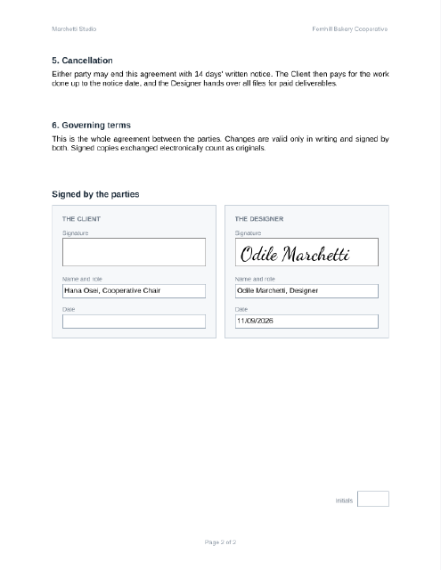</a> 
PDF 
<b><a href="design-services-agreement/">Design Services Agreement</a></b> 
A two-page freelance contract with numbered clauses, initials boxes on each page and a signature block, signed by the designer and waiting for the client. 
<i>2 pages; 8 form fields</i> 
<code>contract</code> <code>signature-field</code> <code>fill-and-sign</code> <code>header-footer</code>
</td>
<td width="33%" valign="top">
<a href="swim-club-registration-form/">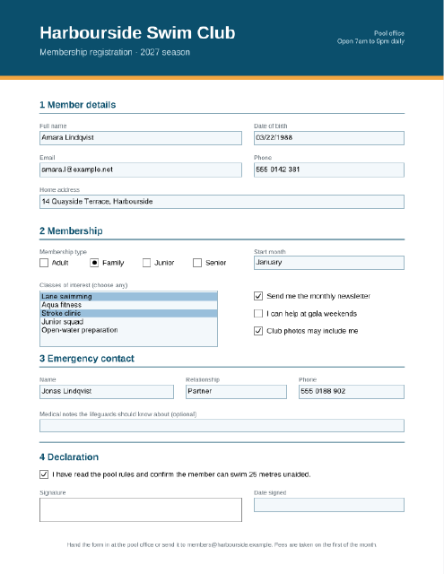</a> 
PDF 
<b><a href="swim-club-registration-form/">Swim Club Registration Form</a></b> 
A one-page membership form with text fields, a radio group, a drop-down, a multi-select list, check boxes and a signature field, filled in for one member. 
<i>1 page; 18 form fields</i> 
<code>form-fields</code> <code>radio-buttons</code> <code>dropdown</code> <code>checkboxes</code> <code>signature-field</code>
</td>
</tr>
</table>

## Redaction

<table>
<tr>
<td width="33%" valign="top">
<a href="redacted-incident-memo/">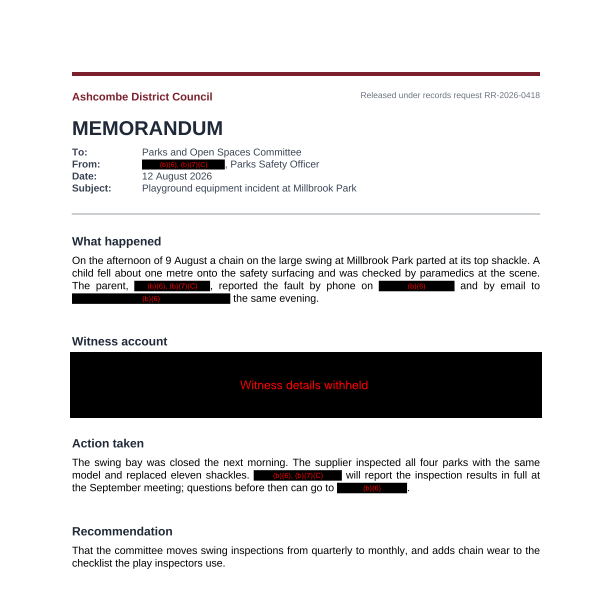</a> 
PDF 
<b><a href="redacted-incident-memo/">Redacted Incident Memo</a></b> 
A council memo released under a records request, with names, phone numbers, email addresses and one paragraph removed for good and labelled with exemption codes. 
<i>1 page</i> 
<code>redaction</code> <code>search-and-redact</code> <code>exemption-codes</code> <code>memo</code>
</td>
<td width="33%"></td>
<td width="33%"></td>
</tr>
</table>

## Reports & Documents

<table>
<tr>
<td width="33%" valign="top">
<a href="confidential-exhibit-bates/">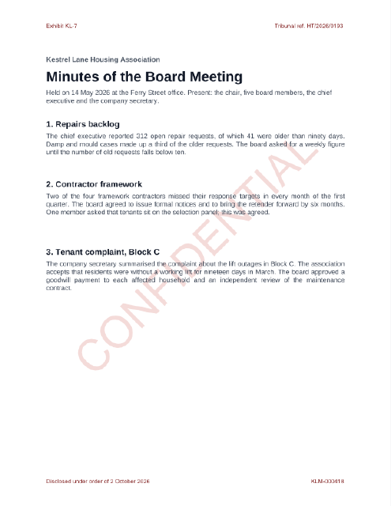</a> 
PDF 
<b><a href="confidential-exhibit-bates/">Confidential Exhibit Bates</a></b> 
A three-page tribunal exhibit stamped with a diagonal CONFIDENTIAL watermark, an exhibit header and Bates numbers that run from page to page. 
<i>3 pages</i> 
<code>watermark</code> <code>bates-numbering</code> <code>header-footer</code> <code>legal</code>
</td>
<td width="33%" valign="top">
<a href="course-completion-certificate/">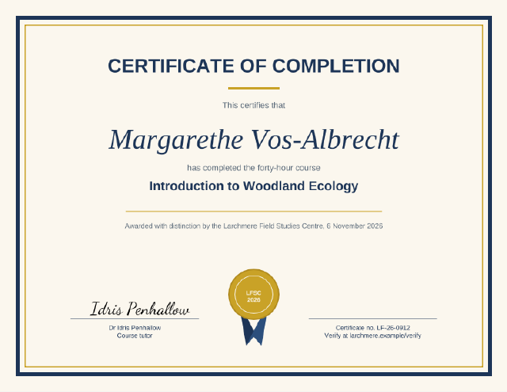</a> 
PDF 
<b><a href="course-completion-certificate/">Course Completion Certificate</a></b> 
A landscape certificate with a double border, a gold seal, the recipient's name in a large serif italic and a signed line for the course tutor. 
<i>1 page</i> 
<code>certificate</code> <code>landscape</code> <code>shapes</code> <code>fill-and-sign</code>
</td>
<td width="33%" valign="top">
<a href="library-winter-hours-notice/">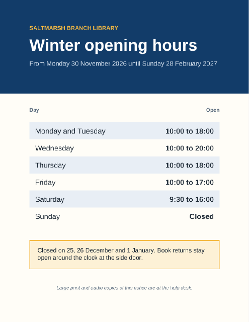</a> 
PDF 
<b><a href="library-winter-hours-notice/">Library Winter Hours Notice</a></b> 
A large-print notice of a branch library's winter opening hours, given a document title and language by the accessibility checker's own fixes. 
<i>1 page</i> 
<code>notice</code> <code>accessibility</code> <code>large-print</code> <code>table</code>
</td>
</tr>
</table>

## Tags

`accessibility` 1 · `area` 1 · `bates-numbering` 1 · `bookmarks` 1 · `calculated-fields` 1 · `certificate` 1 · `checkboxes` 1 · `comments` 1 · `contract` 1 · `dropdown` 1 · `event` 1 · `exemption-codes` 1 · `fill-and-sign` 2 · `form-fields` 2 · `header-footer` 3 · `highlights` 1 · `initial-view` 1 · `internal-links` 2 · `invoice` 1 · `landscape` 1 · `large-print` 1 · `legal` 1 · `measurements` 1 · `memo` 1 · `notice` 1 · `number-format` 1 · `page-labels` 1 · `programme` 1 · `radio-buttons` 1 · `redaction` 1 · `review-status` 1 · `scale` 1 · `search-and-redact` 1 · `shapes` 1 · `signature-field` 2 · `site-plan` 1 · `stamps` 1 · `sticky-notes` 1 · `table` 1 · `watermark` 1 · `web-links` 1
