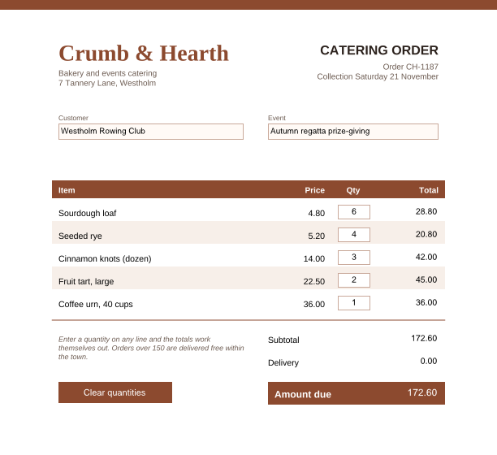

<!-- Generated by tools/gallery.mjs from showcase.yaml and build.json; do not edit. -->
# Catering Order Form

[PDF](../README.md) › [Forms](../README.md#forms) · `form-fields` `calculated-fields` `number-format` `invoice`

A bakery's catering order form whose line totals, subtotal, delivery and grand total are calculated fields that update as quantities are entered.



| | |
|---|---|
| Document | [catering-order-form.pdf](catering-order-form.pdf) (298 KB) |
| Contents | 1 page; 16 form fields |
| Features | `pdf.forms`, `pdf.forms.fill`, `pdf.javascript`, `pdf.content` |
| Built by | `kition-pdf` @ `f85fa4e4af`: 63 commands in 628 ms |

## About

Each line total is a read-only field calculated with simplified field notation (`qty1 * 4.80`),
the subtotal sums them (`op: sum`), and every money field uses Acrobat's number format with
two decimals. Filling the quantities with `form_fill` runs the calculations, so the saved
form already shows the totals; the checks read the calculated values back. A "Clear quantities"
button, its caption white on the bakery's brown, resets the five quantities.

## Checks

- `inspect.formFields`: `16`
- `results.form.fields`: `{"any":{"name":"total","read_only":true,"display":"172.60"}}`
- `results.form.fields.3`: `{"name":"line1","display":"28.80"}`
- `results.form.fields.12`: `{"name":"subtotal","display":"172.60"}`
- `results.form.fields.15`: `{"name":"clear","type":"button"}`
- diagnostics: none (the kit's check finds nothing wrong)
- the saved document opens again; the thumbnail matches `thumb.png` within the `render` tolerance

## Steps

<details><summary>63 commands (from <a href="showcase.yaml">showcase.yaml</a>)</summary>

```yaml
- command: comment_add
  params:
    page: 1
    type: rectangle
    rect:
      - 0
      - 0
      - 612
      - 12
    color: "#8c4a2f"
    fill: "#8c4a2f"
    width: 0
- command: comment_add
  params:
    page: 1
    type: rectangle
    rect:
      - 64
      - 222
      - 548
      - 244
    color: "#8c4a2f"
    fill: "#8c4a2f"
    width: 0
- command: comment_add
  params:
    page: 1
    type: rectangle
    rect:
      - 64
      - 272
      - 548
      - 300
    color: "#f7efe9"
    fill: "#f7efe9"
    width: 0
- command: comment_add
  params:
    page: 1
    type: rectangle
    rect:
      - 64
      - 328
      - 548
      - 356
    color: "#f7efe9"
    fill: "#f7efe9"
    width: 0
- command: comment_add
  params:
    page: 1
    type: line
    from:
      - 64
      - 394
    to:
      - 548
      - 394
    color: "#8c4a2f"
    width: 1
- command: comment_add
  params:
    page: 1
    type: rectangle
    rect:
      - 330
      - 470
      - 548
      - 498
    color: "#8c4a2f"
    fill: "#8c4a2f"
    width: 0
- command: doc_flatten
  params:
    comments: true
- command: page_add_text
  params:
    page: 1
    at:
      - 72
      - 48
    width: 300
    text: Crumb & Hearth
    size: 28
    bold: true
    font: times
    color: "#8c4a2f"
- command: page_add_text
  params:
    page: 1
    at:
      - 72
      - 84
    width: 300
    text: |-
      Bakery and events catering
      7 Tannery Lane, Westholm
    size: 10
    color: "#6b5a50"
- command: page_add_text
  params:
    page: 1
    at:
      - 340
      - 52
    width: 200
    text: CATERING ORDER
    size: 16
    bold: true
    color: "#2b211c"
    align: right
- command: page_add_text
  params:
    page: 1
    at:
      - 340
      - 76
    width: 200
    text: |-
      Order CH-1187
      Collection Saturday 21 November
    size: 10
    color: "#6b5a50"
    align: right
- command: page_add_text
  params:
    page: 1
    at:
      - 72
      - 140
    width: 200
    text: Customer
    size: 8.5
    color: "#6b5a50"
- command: page_add_text
  params:
    page: 1
    at:
      - 330
      - 140
    width: 200
    text: Event
    size: 8.5
    color: "#6b5a50"
- command: form_add_field
  params:
    page: 1
    type: text
    rect:
      - 72
      - 152
      - 300
      - 172
    name: customer
- command: form_add_field
  params:
    page: 1
    type: text
    rect:
      - 330
      - 152
      - 540
      - 172
    name: event
- command: page_add_text
  params:
    page: 1
    at:
      - 72
      - 228
    width: 250
    text: Item
    size: 10
    bold: true
    color: "#ffffff"
- command: page_add_text
  params:
    page: 1
    at:
      - 330
      - 228
    width: 70
    text: Price
    size: 10
    bold: true
    color: "#ffffff"
    align: right
- command: page_add_text
  params:
    page: 1
    at:
      - 410
      - 228
    width: 50
    text: Qty
    size: 10
    bold: true
    color: "#ffffff"
    align: center
- command: page_add_text
  params:
    page: 1
    at:
      - 468
      - 228
    width: 72
    text: Total
    size: 10
    bold: true
    color: "#ffffff"
    align: right
- command: page_add_text
  params:
    page: 1
    at:
      - 72
      - 256
    width: 250
    text: Sourdough loaf
    size: 10.5
- command: page_add_text
  params:
    page: 1
    at:
      - 330
      - 256
    width: 70
    text: "4.80"
    size: 10.5
    align: right
- command: form_add_field
  params:
    page: 1
    type: text
    rect:
      - 416
      - 252
      - 456
      - 270
    name: qty1
- command: form_add_field
  params:
    page: 1
    type: text
    rect:
      - 468
      - 252
      - 540
      - 270
    name: line1
- command: page_add_text
  params:
    page: 1
    at:
      - 72
      - 284
    width: 250
    text: Seeded rye
    size: 10.5
- command: page_add_text
  params:
    page: 1
    at:
      - 330
      - 284
    width: 70
    text: "5.20"
    size: 10.5
    align: right
- command: form_add_field
  params:
    page: 1
    type: text
    rect:
      - 416
      - 280
      - 456
      - 298
    name: qty2
- command: form_add_field
  params:
    page: 1
    type: text
    rect:
      - 468
      - 280
      - 540
      - 298
    name: line2
- command: page_add_text
  params:
    page: 1
    at:
      - 72
      - 312
    width: 250
    text: Cinnamon knots (dozen)
    size: 10.5
- command: page_add_text
  params:
    page: 1
    at:
      - 330
      - 312
    width: 70
    text: "14.00"
    size: 10.5
    align: right
- command: form_add_field
  params:
    page: 1
    type: text
    rect:
      - 416
      - 308
      - 456
      - 326
    name: qty3
- command: form_add_field
  params:
    page: 1
    type: text
    rect:
      - 468
      - 308
      - 540
      - 326
    name: line3
- command: page_add_text
  params:
    page: 1
    at:
      - 72
      - 340
    width: 250
    text: Fruit tart, large
    size: 10.5
- command: page_add_text
  params:
    page: 1
    at:
      - 330
      - 340
    width: 70
    text: "22.50"
    size: 10.5
    align: right
- command: form_add_field
  params:
    page: 1
    type: text
    rect:
      - 416
      - 336
      - 456
      - 354
    name: qty4
- command: form_add_field
  params:
    page: 1
    type: text
    rect:
      - 468
      - 336
      - 540
      - 354
    name: line4
- command: page_add_text
  params:
    page: 1
    at:
      - 72
      - 368
    width: 250
    text: Coffee urn, 40 cups
    size: 10.5
- command: page_add_text
  params:
    page: 1
    at:
      - 330
      - 368
    width: 70
    text: "36.00"
    size: 10.5
    align: right
- command: form_add_field
  params:
    page: 1
    type: text
    rect:
      - 416
      - 364
      - 456
      - 382
    name: qty5
- command: form_add_field
  params:
    page: 1
    type: text
    rect:
      - 468
      - 364
      - 540
      - 382
    name: line5
- command: page_add_text
  params:
    page: 1
    at:
      - 330
      - 412
    width: 120
    text: Subtotal
    size: 10.5
- command: form_add_field
  params:
    page: 1
    type: text
    rect:
      - 468
      - 408
      - 540
      - 426
    name: subtotal
- command: page_add_text
  params:
    page: 1
    at:
      - 330
      - 440
    width: 120
    text: Delivery
    size: 10.5
- command: form_add_field
  params:
    page: 1
    type: text
    rect:
      - 468
      - 436
      - 540
      - 454
    name: delivery
- command: page_add_text
  params:
    page: 1
    at:
      - 338
      - 478
    width: 120
    text: Amount due
    size: 12
    bold: true
    color: "#ffffff"
- command: form_add_field
  params:
    page: 1
    type: text
    rect:
      - 460
      - 474
      - 540
      - 494
    name: total
- command: page_add_text
  params:
    page: 1
    at:
      - 72
      - 412
    width: 230
    text: Enter a quantity on any line and the totals work themselves out. Orders over 150 are delivered free within the town.
    size: 9
    italic: true
    color: "#6b5a50"
- command: page_add_text
  params:
    page: 1
    at:
      - 72
      - 700
    width: 468
    text: Payment on collection by card or bank transfer. Please tell us about allergies when you order.
    size: 8.5
    color: "#6b5a50"
    align: center
- command: form_set_props
  params:
    fields:
      - qty1
      - qty2
      - qty3
      - qty4
      - qty5
    align: center
    font_size: 10.5
    format:
      type: number
      decimals: 0
    appearance:
      border: "#c9a99a"
      fill: "#ffffff"
      width: 1
- command: form_set_props
  params:
    fields:
      - line1
      - line2
      - line3
      - line4
      - line5
      - subtotal
      - delivery
    align: right
    read_only: true
    font_size: 10.5
    format:
      type: number
      decimals: 2
      separator: 0
    appearance:
      border: none
      fill: none
- command: form_set_props
  params:
    fields:
      - customer
      - event
    appearance:
      border: "#c9a99a"
      fill: "#fffaf6"
      width: 1
    font_size: 10
- command: form_set_props
  params:
    field: line1
    calculate:
      notation: qty1 * 4.80
- command: form_set_props
  params:
    field: line2
    calculate:
      notation: qty2 * 5.20
- command: form_set_props
  params:
    field: line3
    calculate:
      notation: qty3 * 14.00
- command: form_set_props
  params:
    field: line4
    calculate:
      notation: qty4 * 22.50
- command: form_set_props
  params:
    field: line5
    calculate:
      notation: qty5 * 36.00
- command: form_set_props
  params:
    field: subtotal
    calculate:
      op: sum
      fields:
        - line1
        - line2
        - line3
        - line4
        - line5
- command: form_set_props
  params:
    field: delivery
    calculate:
      notation: subtotal * 0
- command: form_set_props
  params:
    field: total
    read_only: true
    align: right
    font_size: 12
    calculate:
      notation: subtotal + delivery
    format:
      type: number
      decimals: 2
      separator: 0
    appearance:
      border: none
      fill: none
      text_color: "#ffffff"
- command: form_add_field
  params:
    page: 1
    type: button
    rect:
      - 72
      - 470
      - 212
      - 496
    name: clear
    caption: Clear quantities
- command: form_set_props
  params:
    field: clear
    font_size: 11
    appearance:
      border: none
      fill: "#8c4a2f"
      text_color: "#ffffff"
- command: form_set_actions
  params:
    field: clear
    actions:
      - trigger: mouse_up
        reset:
          - qty1
          - qty2
          - qty3
          - qty4
          - qty5
- command: form_fill
  params:
    values:
      customer: Westholm Rowing Club
      event: Autumn regatta prize-giving
      qty1: "6"
      qty2: "4"
      qty3: "3"
      qty4: "2"
      qty5: "1"
- command: form_fields
  as: form
```

</details>
