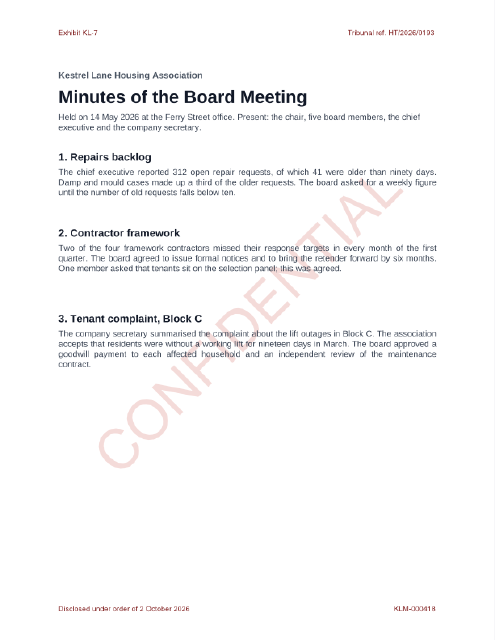

<!-- Generated by tools/gallery.mjs from showcase.yaml and build.json; do not edit. -->
# Confidential Exhibit Bates

[PDF](../README.md) › [Reports & Documents](../README.md#reports--documents) · `watermark` `bates-numbering` `header-footer` `legal`

A three-page tribunal exhibit stamped with a diagonal CONFIDENTIAL watermark, an exhibit header and Bates numbers that run from page to page.



| | |
|---|---|
| Document | [confidential-exhibit-bates.pdf](confidential-exhibit-bates.pdf) (341 KB) |
| Contents | 3 pages |
| Features | `pdf.page-marks`, `pdf.content`, `pdf.pages`, `pdf.text` |
| Built by | `kition-pdf` @ `f85fa4e4af`: 21 commands in 203 ms |

## About

Three pages of board minutes, then the marks a legal team adds before filing: `doc_watermark`
draws CONFIDENTIAL behind the text at 45 degrees, and `doc_header_footer` puts the exhibit
name in the header and a Bates number (`<<Bates Number#6#418#KLM-#>>`) in the footer, so the
pages read KLM-000418, KLM-000419 and KLM-000420. The checks find the numbers in the page text.

## Checks

- `inspect.pages`: `{"count":3}`
- `results.first.matches`: `{"count":1,"all":{"page":1}}`
- `results.last.matches`: `{"count":1,"all":{"page":3}}`
- diagnostics: `pdf.font-not-embedded`
- the saved document opens again; the thumbnail matches `thumb.png` within the `render` tolerance

## Steps

<details><summary>21 commands (from <a href="showcase.yaml">showcase.yaml</a>)</summary>

```yaml
- command: page_insert_blank
  params:
    at: 2
- command: page_insert_blank
  params:
    at: 3
- command: page_add_text
  params:
    page: 1
    at:
      - 72
      - 86
    width: 468
    text: Kestrel Lane Housing Association
    size: 11
    bold: true
    color: "#4b5563"
- command: page_add_text
  params:
    page: 1
    at:
      - 72
      - 106
    width: 468
    text: Minutes of the Board Meeting
    size: 22
    bold: true
    color: "#111827"
- command: page_add_text
  params:
    page: 1
    at:
      - 72
      - 138
    width: 468
    text: "Held on 14 May 2026 at the Ferry Street office. Present: the chair, five board members, the chief executive and the company secretary."
    size: 10.5
    color: "#374151"
- command: page_add_text
  params:
    page: 1
    at:
      - 72
      - 186
    width: 468
    text: 1.  Repairs backlog
    size: 13
    bold: true
    color: "#111827"
- command: page_add_text
  params:
    page: 1
    at:
      - 72
      - 206
    width: 468
    size: 10.5
    align: justify
    color: "#374151"
    text: The chief executive reported 312 open repair requests, of which 41 were older than ninety days. Damp and mould cases made up a third of the older requests. The board asked for a weekly figure until the number of old requests falls below ten.
- command: page_add_text
  params:
    page: 1
    at:
      - 72
      - 280
    width: 468
    text: 2.  Contractor framework
    size: 13
    bold: true
    color: "#111827"
- command: page_add_text
  params:
    page: 1
    at:
      - 72
      - 300
    width: 468
    size: 10.5
    align: justify
    color: "#374151"
    text: Two of the four framework contractors missed their response targets in every month of the first quarter. The board agreed to issue formal notices and to bring the retender forward by six months. One member asked that tenants sit on the selection panel; this was agreed.
- command: page_add_text
  params:
    page: 1
    at:
      - 72
      - 386
    width: 468
    text: 3.  Tenant complaint, Block C
    size: 13
    bold: true
    color: "#111827"
- command: page_add_text
  params:
    page: 1
    at:
      - 72
      - 406
    width: 468
    size: 10.5
    align: justify
    color: "#374151"
    text: The company secretary summarised the complaint about the lift outages in Block C. The association accepts that residents were without a working lift for nineteen days in March. The board approved a goodwill payment to each affected household and an independent review of the maintenance contract.
- command: page_add_text
  params:
    page: 2
    at:
      - 72
      - 86
    width: 468
    text: 4.  Finance
    size: 13
    bold: true
    color: "#111827"
- command: page_add_text
  params:
    page: 2
    at:
      - 72
      - 106
    width: 468
    size: 10.5
    align: justify
    color: "#374151"
    text: Rental income was on budget. Repair spending was eleven percent over budget because of the damp programme. The board noted the variance and asked for a revised forecast at the July meeting.
- command: page_add_text
  params:
    page: 2
    at:
      - 72
      - 176
    width: 468
    text: 5.  Any other business
    size: 13
    bold: true
    color: "#111827"
- command: page_add_text
  params:
    page: 2
    at:
      - 72
      - 196
    width: 468
    size: 10.5
    align: justify
    color: "#374151"
    text: None. The meeting closed at 20:40. The next meeting is on 9 July 2026.
- command: page_add_text
  params:
    page: 3
    at:
      - 72
      - 86
    width: 468
    text: "Appendix: action log"
    size: 13
    bold: true
    color: "#111827"
- command: page_add_text
  params:
    page: 3
    at:
      - 72
      - 110
    width: 468
    size: 10.5
    color: "#374151"
    text: |-
      A1  Weekly repairs figure to the board - chief executive - from 21 May
      A2  Formal notices to two contractors - head of assets - by 31 May
      A3  Tenant places on the selection panel - company secretary - by 30 June
      A4  Independent review of the Block C lift contract - chair - by 9 July
- command: doc_watermark
  params:
    text: CONFIDENTIAL
    color: "#c0392b"
    opacity: 0.18
    rotation: 45
    behind: true
- command: doc_header_footer
  params:
    header_left: Exhibit KL-7
    header_right: Tribunal ref. HT/2026/0193
    footer_right: <<Bates Number#6#418#KLM-#>>
    footer_left: Disclosed under order of 2 October 2026
    font_size: 9
    color: "#7f1d1d"
- command: text_find
  params:
    query: KLM-000418
  as: first
- command: text_find
  params:
    query: KLM-000420
  as: last
```

</details>
