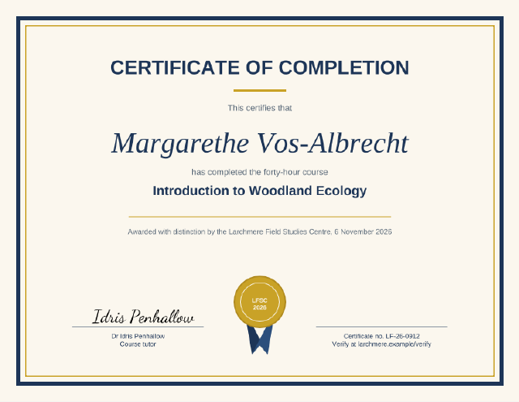

<!-- Generated by tools/gallery.mjs from showcase.yaml and build.json; do not edit. -->
# Course Completion Certificate

[PDF](../README.md) › [Reports & Documents](../README.md#reports--documents) · `certificate` `landscape` `shapes` `fill-and-sign`

A landscape certificate with a double border, a gold seal, the recipient's name in a large serif italic and a signed line for the course tutor.



| | |
|---|---|
| Document | [course-completion-certificate.pdf](course-completion-certificate.pdf) (356 KB) |
| Contents | 1 page |
| Features | `pdf.content`, `pdf.comments`, `pdf.fill-sign`, `pdf.page-marks` |
| Built by | `kition-pdf` @ `f85fa4e4af`: 23 commands in 141 ms |

## About

One landscape page (792 × 612 points) drawn entirely with the kit's own tools: rectangles and
ovals made as comments and flattened into the page, centred text in Arimo and Tinos (the
metrics of Helvetica and Times, embedded in the page), a cream page background, and the tutor's
signature added with Fill & Sign.

## Checks

- `inspect.pages`: `{"count":1}`
- `inspect.pages.0.area`: `{"width":792,"height":612}`
- `results.course.matches`: `{"count":1}`
- diagnostics: none (the kit's check finds nothing wrong)
- the saved document opens again; the thumbnail matches `thumb.png` within the `render` tolerance

## Steps

<details><summary>23 commands (from <a href="showcase.yaml">showcase.yaml</a>)</summary>

```yaml
- command: doc_background
  params:
    color: "#fbf7ee"
- command: comment_add
  params:
    page: 1
    type: rectangle
    rect:
      - 24
      - 24
      - 768
      - 588
    color: "#1d3557"
    width: 6
- command: comment_add
  params:
    page: 1
    type: rectangle
    rect:
      - 38
      - 38
      - 754
      - 574
    color: "#c9a227"
    width: 1.5
- command: comment_add
  params:
    page: 1
    type: rectangle
    rect:
      - 356
      - 136
      - 436
      - 139
    color: "#c9a227"
    fill: "#c9a227"
    width: 0
- command: comment_add
  params:
    page: 1
    type: line
    from:
      - 196
      - 330
    to:
      - 596
      - 330
    color: "#c9a227"
    width: 1
- command: comment_add
  params:
    page: 1
    type: line
    from:
      - 110
      - 498
    to:
      - 310
      - 498
    color: "#1d3557"
    width: 0.75
- command: comment_add
  params:
    page: 1
    type: line
    from:
      - 482
      - 498
    to:
      - 682
      - 498
    color: "#1d3557"
    width: 0.75
- command: comment_add
  params:
    page: 1
    type: polygon
    points:
      - - 372
        - 470
      - - 384
        - 540
      - - 396
        - 526
      - - 408
        - 540
    color: "#1d3557"
    fill: "#1d3557"
    width: 0
- command: comment_add
  params:
    page: 1
    type: polygon
    points:
      - - 420
        - 470
      - - 408
        - 540
      - - 396
        - 526
      - - 384
        - 540
    color: "#2c4f7c"
    fill: "#2c4f7c"
    width: 0
- command: comment_add
  params:
    page: 1
    type: oval
    rect:
      - 356
      - 420
      - 436
      - 500
    color: "#b08a1e"
    fill: "#c9a227"
    width: 2
- command: comment_add
  params:
    page: 1
    type: oval
    rect:
      - 366
      - 430
      - 426
      - 490
    color: "#fbf7ee"
    width: 1
- command: doc_flatten
  params:
    comments: true
- command: page_add_text
  params:
    page: 1
    at:
      - 96
      - 84
    width: 600
    text: CERTIFICATE OF COMPLETION
    size: 30
    bold: true
    color: "#1d3557"
    align: center
- command: page_add_text
  params:
    page: 1
    at:
      - 96
      - 156
    width: 600
    text: This certifies that
    size: 13
    color: "#5c6b7a"
    align: center
- command: page_add_text
  params:
    page: 1
    at:
      - 96
      - 190
    width: 600
    text: Margarethe Vos-Albrecht
    size: 44
    font: times
    italic: true
    color: "#1d3557"
    align: center
- command: page_add_text
  params:
    page: 1
    at:
      - 96
      - 254
    width: 600
    text: has completed the forty-hour course
    size: 13
    color: "#5c6b7a"
    align: center
- command: page_add_text
  params:
    page: 1
    at:
      - 96
      - 278
    width: 600
    text: Introduction to Woodland Ecology
    size: 20
    bold: true
    color: "#1d3557"
    align: center
- command: page_add_text
  params:
    page: 1
    at:
      - 96
      - 346
    width: 600
    text: Awarded with distinction by the Larchmere Field Studies Centre, 6 November 2026
    size: 11
    color: "#5c6b7a"
    align: center
- command: page_add_text
  params:
    page: 1
    at:
      - 374
      - 452
    width: 44
    text: |-
      LFSC
      2026
    size: 9
    bold: true
    color: "#fbf7ee"
    align: center
- command: page_add_text
  params:
    page: 1
    at:
      - 110
      - 506
    width: 200
    text: |-
      Dr Idris Penhallow
      Course tutor
    size: 10
    color: "#1d3557"
    align: center
- command: page_add_text
  params:
    page: 1
    at:
      - 482
      - 506
    width: 200
    text: |-
      Certificate no. LF-26-0912
      Verify at larchmere.example/verify
    size: 10
    color: "#1d3557"
    align: center
- command: fill_sign_add
  params:
    page: 1
    type: signature
    at:
      - 140
      - 482
    text: Idris Penhallow
    author: Idris Penhallow
  as: signature
- command: text_find
  params:
    query: Introduction to Woodland Ecology
  as: course
```

</details>
