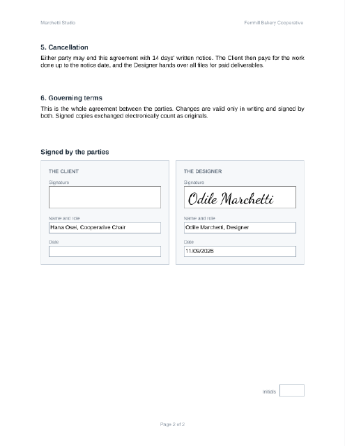

<!-- Generated by tools/gallery.mjs from showcase.yaml and build.json; do not edit. -->
# Design Services Agreement

[PDF](../README.md) › [Forms](../README.md#forms) · `contract` `signature-field` `fill-and-sign` `header-footer`

A two-page freelance contract with numbered clauses, initials boxes on each page and a signature block, signed by the designer and waiting for the client.



| | |
|---|---|
| Document | [design-services-agreement.pdf](design-services-agreement.pdf) (636 KB) |
| Contents | 2 pages; 8 form fields |
| Features | `pdf.forms`, `pdf.fill-sign`, `pdf.content`, `pdf.page-marks`, `pdf.pages` |
| Built by | `kition-pdf` @ `f85fa4e4af`: 44 commands in 483 ms |

## About

Two Letter pages of justified clauses written with `page_add_text`, a running header and a
"Page 1 of 2" footer from `doc_header_footer`, and signature, name and date fields for both
parties. The designer has signed with Fill & Sign (a typed signature drawn in a script face);
the client's signature field is still empty. The thumbnail shows the signature page.

## Checks

- `inspect.pages`: `{"count":2}`
- `inspect.formFields`: `8`
- `results.form.fields`: `{"any":{"name":"client_signature","type":"signature","value":null}}`
- `results.signed.pages`: `2`
- diagnostics: `pdf.font-not-embedded`
- the saved document opens again; the thumbnail matches `thumb.png` within the `render` tolerance

## Steps

<details><summary>44 commands (from <a href="showcase.yaml">showcase.yaml</a>)</summary>

```yaml
- command: page_insert_blank
  params:
    at: 2
- command: page_add_text
  params:
    page: 1
    at:
      - 72
      - 76
    width: 468
    text: DESIGN SERVICES AGREEMENT
    size: 18
    bold: true
    color: "#1c2b39"
    align: center
- command: page_add_text
  params:
    page: 1
    at:
      - 72
      - 102
    width: 468
    text: Agreement no. DSA-2026-031
    size: 10
    color: "#6b7785"
    align: center
- command: page_add_text
  params:
    page: 1
    at:
      - 72
      - 136
    width: 468
    size: 10.5
    align: justify
    text: This agreement is made between Fernhill Bakery Cooperative (the Client) and Odile Marchetti, trading as Marchetti Studio (the Designer). The Client engages the Designer to create a new visual identity for its three shops, and the Designer accepts on the terms below.
- command: page_add_text
  params:
    page: 1
    at:
      - 72
      - 206
    width: 468
    text: 1.  Scope of work
    size: 12
    bold: true
    color: "#1c2b39"
- command: page_add_text
  params:
    page: 1
    at:
      - 72
      - 226
    width: 468
    size: 10.5
    align: justify
    text: The Designer will deliver a logo in full colour and one colour, a palette of six colours, a type pairing, shop signage artwork for three frontages, and a twelve-page brand guide. Two rounds of revisions are included for each deliverable; further rounds are charged at the day rate in clause 3.
- command: page_add_text
  params:
    page: 1
    at:
      - 72
      - 310
    width: 468
    text: 2.  Timeline
    size: 12
    bold: true
    color: "#1c2b39"
- command: page_add_text
  params:
    page: 1
    at:
      - 72
      - 330
    width: 468
    size: 10.5
    align: justify
    text: Work starts on 16 November 2026. Logo concepts are presented on 4 December, signage artwork on 15 January, and the brand guide on 5 February 2027. The Client will give feedback within five working days of each presentation; a later reply moves the following dates by the same number of days.
- command: page_add_text
  params:
    page: 1
    at:
      - 72
      - 414
    width: 468
    text: 3.  Fees and payment
    size: 12
    bold: true
    color: "#1c2b39"
- command: page_add_text
  params:
    page: 1
    at:
      - 72
      - 434
    width: 468
    size: 10.5
    align: justify
    text: "The fixed fee is 7,800 in three instalments: 30 percent on signing, 40 percent on approval of the logo, and 30 percent on delivery of the brand guide. Extra work is charged at 520 per day. Invoices are due within 21 days."
- command: page_add_text
  params:
    page: 1
    at:
      - 72
      - 504
    width: 468
    text: 4.  Ownership
    size: 12
    bold: true
    color: "#1c2b39"
- command: page_add_text
  params:
    page: 1
    at:
      - 72
      - 524
    width: 468
    size: 10.5
    align: justify
    text: Once the final instalment is paid, the Client owns the approved artwork and may use it without limit. The Designer keeps the rights to rejected concepts and may show the finished work in a portfolio after the public launch.
- command: page_add_text
  params:
    page: 1
    at:
      - 400
      - 690
    width: 90
    text: Initials
    size: 8.5
    color: "#6b7785"
    align: right
- command: form_add_field
  params:
    page: 1
    type: text
    rect:
      - 496
      - 682
      - 540
      - 704
    name: initials_client_p1
- command: page_add_text
  params:
    page: 2
    at:
      - 72
      - 76
    width: 468
    text: 5.  Cancellation
    size: 12
    bold: true
    color: "#1c2b39"
- command: page_add_text
  params:
    page: 2
    at:
      - 72
      - 96
    width: 468
    size: 10.5
    align: justify
    text: Either party may end this agreement with 14 days' written notice. The Client then pays for the work done up to the notice date, and the Designer hands over all files for paid deliverables.
- command: page_add_text
  params:
    page: 2
    at:
      - 72
      - 166
    width: 468
    text: 6.  Governing terms
    size: 12
    bold: true
    color: "#1c2b39"
- command: page_add_text
  params:
    page: 2
    at:
      - 72
      - 186
    width: 468
    size: 10.5
    align: justify
    text: This is the whole agreement between the parties. Changes are valid only in writing and signed by both. Signed copies exchanged electronically count as originals.
- command: page_add_text
  params:
    page: 2
    at:
      - 72
      - 262
    width: 468
    text: Signed by the parties
    size: 12
    bold: true
    color: "#1c2b39"
- command: comment_add
  params:
    page: 2
    type: rectangle
    rect:
      - 72
      - 284
      - 300
      - 470
    color: "#c9d2db"
    fill: "#f6f8fa"
    width: 1
- command: comment_add
  params:
    page: 2
    type: rectangle
    rect:
      - 312
      - 284
      - 540
      - 470
    color: "#c9d2db"
    fill: "#f6f8fa"
    width: 1
- command: doc_flatten
  params:
    comments: true
- command: page_add_text
  params:
    page: 2
    at:
      - 86
      - 298
    width: 200
    text: THE CLIENT
    size: 9
    bold: true
    color: "#6b7785"
- command: page_add_text
  params:
    page: 2
    at:
      - 326
      - 298
    width: 200
    text: THE DESIGNER
    size: 9
    bold: true
    color: "#6b7785"
- command: page_add_text
  params:
    page: 2
    at:
      - 86
      - 318
    width: 200
    text: Signature
    size: 8.5
    color: "#6b7785"
- command: page_add_text
  params:
    page: 2
    at:
      - 326
      - 318
    width: 200
    text: Signature
    size: 8.5
    color: "#6b7785"
- command: form_add_field
  params:
    page: 2
    type: signature
    rect:
      - 86
      - 330
      - 286
      - 370
    name: client_signature
- command: form_add_field
  params:
    page: 2
    type: signature
    rect:
      - 326
      - 330
      - 526
      - 370
    name: designer_signature
- command: page_add_text
  params:
    page: 2
    at:
      - 86
      - 382
    width: 200
    text: Name and role
    size: 8.5
    color: "#6b7785"
- command: page_add_text
  params:
    page: 2
    at:
      - 326
      - 382
    width: 200
    text: Name and role
    size: 8.5
    color: "#6b7785"
- command: form_add_field
  params:
    page: 2
    type: text
    rect:
      - 86
      - 394
      - 286
      - 414
    name: client_name
- command: form_add_field
  params:
    page: 2
    type: text
    rect:
      - 326
      - 394
      - 526
      - 414
    name: designer_name
- command: page_add_text
  params:
    page: 2
    at:
      - 86
      - 424
    width: 200
    text: Date
    size: 8.5
    color: "#6b7785"
- command: page_add_text
  params:
    page: 2
    at:
      - 326
      - 424
    width: 200
    text: Date
    size: 8.5
    color: "#6b7785"
- command: form_add_field
  params:
    page: 2
    type: date
    rect:
      - 86
      - 436
      - 286
      - 456
    name: client_date
- command: form_add_field
  params:
    page: 2
    type: date
    rect:
      - 326
      - 436
      - 526
      - 456
    name: designer_date
- command: page_add_text
  params:
    page: 2
    at:
      - 400
      - 690
    width: 90
    text: Initials
    size: 8.5
    color: "#6b7785"
    align: right
- command: form_add_field
  params:
    page: 2
    type: text
    rect:
      - 496
      - 682
      - 540
      - 704
    name: initials_client_p2
- command: form_set_props
  params:
    fields:
      - client_name
      - designer_name
      - client_date
      - designer_date
      - initials_client_p1
      - initials_client_p2
    appearance:
      border: "#9aa8b6"
      fill: "#ffffff"
      width: 1
    font_size: 10
- command: form_set_props
  params:
    fields:
      - initials_client_p1
      - initials_client_p2
    align: center
- command: form_fill
  params:
    values:
      designer_name: Odile Marchetti, Designer
      designer_date: 11/09/2026
      client_name: Hana Osei, Cooperative Chair
- command: fill_sign_add
  params:
    page: 2
    type: signature
    at:
      - 334
      - 352
    text: Odile Marchetti
    author: Odile Marchetti
  as: signed
- command: doc_header_footer
  params:
    header_left: Marchetti Studio
    header_right: Fernhill Bakery Cooperative
    footer_center: <<Page 1 of n>>
    font_size: 8.5
    color: "#8a96a3"
- command: form_fields
  as: form
```

</details>
