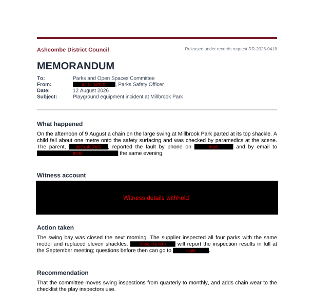

<!-- Generated by tools/gallery.mjs from showcase.yaml and build.json; do not edit. -->
# Redacted Incident Memo

[PDF](../README.md) › [Redaction](../README.md#redaction) · `redaction` `search-and-redact` `exemption-codes` `memo`

A council memo released under a records request, with names, phone numbers, email addresses and one paragraph removed for good and labelled with exemption codes.



| | |
|---|---|
| Document | [redacted-incident-memo.pdf](redacted-incident-memo.pdf) (272 KB) |
| Contents | 1 page |
| Features | `pdf.redact`, `pdf.redact.apply`, `pdf.content`, `pdf.text` |
| Built by | `kition-pdf` @ `f85fa4e4af`: 23 commands in 346 ms |

## About

Search & Redact marks every phone number and email address by pattern, `words` marks the
people's names with the FOIA exemption (b)(6), and a rectangle marks the witness paragraph with
an overlay. `redact_apply` then removes the text under every mark and draws the boxes; the
checks confirm that a name can no longer be found in the page text.

## Checks

- `inspect.pages`: `{"count":1}`
- `results.phones.marked`: `2`
- `results.emails.marked`: `1`
- `results.names.matched_words`: `[{"word":"Delphine Okoro","marked":1},{"word":"Rowan Achterberg","marked":2}]`
- `results.applied.applied`: `7`
- `results.search.matches`: `{"count":0}`
- `results.kept.matches`: `{"count":1}`
- diagnostics: `pdf.font-not-embedded`
- the saved document opens again; the thumbnail matches `thumb.png` within the `render` tolerance

## Steps

<details><summary>23 commands (from <a href="showcase.yaml">showcase.yaml</a>)</summary>

```yaml
- command: comment_add
  params:
    page: 1
    type: rectangle
    rect:
      - 72
      - 72
      - 540
      - 76
    color: "#7a1f2b"
    fill: "#7a1f2b"
    width: 0
- command: comment_add
  params:
    page: 1
    type: line
    from:
      - 72
      - 214
    to:
      - 540
      - 214
    color: "#9aa0a6"
    width: 0.75
- command: doc_flatten
  params:
    comments: true
- command: page_add_text
  params:
    page: 1
    at:
      - 72
      - 90
    width: 300
    text: Ashcombe District Council
    size: 11
    bold: true
    color: "#7a1f2b"
- command: page_add_text
  params:
    page: 1
    at:
      - 340
      - 90
    width: 200
    text: Released under records request RR-2026-0418
    size: 8.5
    color: "#6b7280"
    align: right
- command: page_add_text
  params:
    page: 1
    at:
      - 72
      - 116
    width: 468
    text: MEMORANDUM
    size: 20
    bold: true
    color: "#1f2937"
- command: page_add_text
  params:
    page: 1
    at:
      - 72
      - 146
    width: 70
    text: |-
      To:
      From:
      Date:
      Subject:
    size: 10
    bold: true
    color: "#374151"
- command: page_add_text
  params:
    page: 1
    at:
      - 142
      - 146
    width: 398
    text: |-
      Parks and Open Spaces Committee
      Rowan Achterberg, Parks Safety Officer
      12 August 2026
      Playground equipment incident at Millbrook Park
    size: 10
    color: "#374151"
- command: page_add_text
  params:
    page: 1
    at:
      - 72
      - 234
    width: 468
    text: What happened
    size: 12
    bold: true
    color: "#1f2937"
- command: page_add_text
  params:
    page: 1
    at:
      - 72
      - 254
    width: 468
    size: 10.5
    align: justify
    text: On the afternoon of 9 August a chain on the large swing at Millbrook Park parted at its top shackle. A child fell about one metre onto the safety surfacing and was checked by paramedics at the scene. The parent, Delphine Okoro, reported the fault by phone on 0161 555 0193 and by email to parks.safety@ashcombe.example the same evening.
- command: page_add_text
  params:
    page: 1
    at:
      - 72
      - 334
    width: 468
    text: Witness account
    size: 12
    bold: true
    color: "#1f2937"
- command: page_add_text
  params:
    page: 1
    at:
      - 72
      - 354
    width: 468
    size: 10.5
    align: justify
    text: A neighbour who was walking a dog nearby said the swing had been creaking for several days and that older children often swung it sideways. She gave her name and address to the duty officer and agreed to be contacted again if the committee needs a statement.
- command: page_add_text
  params:
    page: 1
    at:
      - 72
      - 436
    width: 468
    text: Action taken
    size: 12
    bold: true
    color: "#1f2937"
- command: page_add_text
  params:
    page: 1
    at:
      - 72
      - 456
    width: 468
    size: 10.5
    align: justify
    text: The swing bay was closed the next morning. The supplier inspected all four parks with the same model and replaced eleven shackles. Rowan Achterberg will report the inspection results in full at the September meeting; questions before then can go to 0161 555 0170.
- command: page_add_text
  params:
    page: 1
    at:
      - 72
      - 524
    width: 468
    text: Recommendation
    size: 12
    bold: true
    color: "#1f2937"
- command: page_add_text
  params:
    page: 1
    at:
      - 72
      - 544
    width: 468
    size: 10.5
    align: justify
    text: That the committee moves swing inspections from quarterly to monthly, and adds chain wear to the checklist the play inspectors use.
- command: redact_mark
  params:
    pattern: phone
    code_set: foia
    codes:
      - (b)(6)
  as: phones
- command: redact_mark
  params:
    pattern: email
    code_set: foia
    codes:
      - (b)(6)
  as: emails
- command: redact_mark
  params:
    words:
      - Delphine Okoro
      - Rowan Achterberg
    code_set: foia
    codes:
      - (b)(6)
      - (b)(7)(C)
  as: names
- command: redact_mark
  params:
    page: 1
    rect:
      - 70
      - 352
      - 542
      - 418
    overlay: Witness details withheld
  as: witness
- command: redact_apply
  as: applied
- command: text_find
  params:
    query: Okoro
  as: search
- command: text_find
  params:
    query: swing bay
  as: kept
```

</details>
