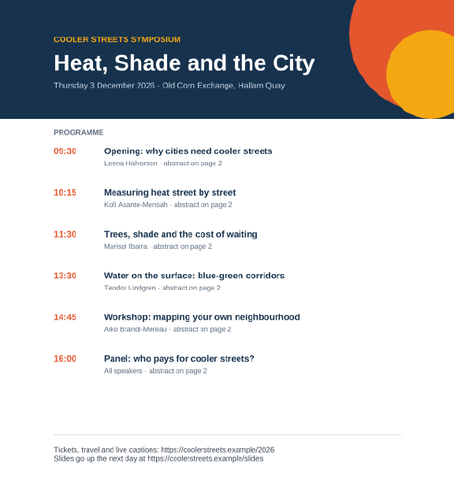

<!-- Generated by tools/gallery.mjs from showcase.yaml and build.json; do not edit. -->
# Symposium Programme Links

[PDF](../README.md) › [Bookmarks & Links](../README.md#bookmarks--links) · `internal-links` `web-links` `programme` `event`

A one-day symposium programme whose sessions link to their abstracts on page two, with web addresses turned into clickable links automatically.



| | |
|---|---|
| Document | [symposium-programme-links.pdf](symposium-programme-links.pdf) (678 KB) |
| Contents | 2 pages |
| Features | `pdf.links`, `pdf.links.edit`, `pdf.content`, `pdf.pages`, `pdf.comments` |
| Built by | `kition-pdf` @ `f85fa4e4af`: 52 commands in 640 ms |

## About

Every session on the programme page is covered by a link that goes to the abstracts page;
`links_from_urls` then finds the web addresses printed on both pages and makes them clickable.
`link_list` reads the result back: six page links and the URL links, each with its rectangle.

## Checks

- `inspect.pages`: `{"count":2}`
- `results.urls.created`: `{"count":3,"contains":"https://coolerstreets.example/2026"}`
- `results.links.count`: `9`
- `results.links.links`: `{"any":{"page":2,"url":"https://coolerstreets.example/speakers"}}`
- `results.links.links.0`: `{"page":1,"to_page":2}`
- diagnostics: none (the kit's check finds nothing wrong)
- the saved document opens again; the thumbnail matches `thumb.png` within the `render` tolerance

## Steps

<details><summary>52 commands (from <a href="showcase.yaml">showcase.yaml</a>)</summary>

```yaml
- command: page_insert_blank
  params:
    at: 2
- command: comment_add
  params:
    page: 1
    type: rectangle
    rect:
      - 0
      - 0
      - 612
      - 160
    color: "#17324d"
    fill: "#17324d"
    width: 0
- command: comment_add
  params:
    page: 1
    type: oval
    rect:
      - 470
      - -60
      - 680
      - 150
    color: "#e4572e"
    fill: "#e4572e"
    width: 0
- command: comment_add
  params:
    page: 1
    type: oval
    rect:
      - 520
      - 40
      - 640
      - 160
    color: "#f3a712"
    fill: "#f3a712"
    width: 0
- command: comment_add
  params:
    page: 1
    type: line
    from:
      - 72
      - 586
    to:
      - 540
      - 586
    color: "#d5dce3"
    width: 1
- command: comment_add
  params:
    page: 2
    type: rectangle
    rect:
      - 0
      - 0
      - 612
      - 12
    color: "#17324d"
    fill: "#17324d"
    width: 0
- command: doc_flatten
  params:
    comments: true
- command: page_add_text
  params:
    page: 1
    at:
      - 72
      - 46
    width: 400
    text: COOLER STREETS SYMPOSIUM
    size: 11
    bold: true
    color: "#f3a712"
- command: page_add_text
  params:
    page: 1
    at:
      - 72
      - 66
    width: 400
    text: Heat, Shade and the City
    size: 30
    bold: true
    color: "#ffffff"
- command: page_add_text
  params:
    page: 1
    at:
      - 72
      - 108
    width: 400
    text: Thursday 3 December 2026  ·  Old Corn Exchange, Hallam Quay
    size: 11
    color: "#c8d6e5"
- command: page_add_text
  params:
    page: 1
    at:
      - 72
      - 172
    width: 200
    text: PROGRAMME
    size: 10
    bold: true
    color: "#5d6d7e"
- command: page_add_text
  params:
    page: 1
    at:
      - 72
      - 196
    width: 60
    text: 09:30
    size: 12
    bold: true
    color: "#e4572e"
- command: page_add_text
  params:
    page: 1
    at:
      - 140
      - 196
    width: 400
    text: "Opening: why cities need cooler streets"
    size: 12
    bold: true
    color: "#17324d"
- command: page_add_text
  params:
    page: 1
    at:
      - 140
      - 214
    width: 400
    text: Leena Halvorsen  ·  abstract on page 2
    size: 9.5
    color: "#5d6d7e"
- command: link_add
  params:
    page: 1
    rect:
      - 136
      - 193
      - 540
      - 227
    to_page: 2
    highlight: outline
- command: page_add_text
  params:
    page: 1
    at:
      - 72
      - 252
    width: 60
    text: 10:15
    size: 12
    bold: true
    color: "#e4572e"
- command: page_add_text
  params:
    page: 1
    at:
      - 140
      - 252
    width: 400
    text: Measuring heat street by street
    size: 12
    bold: true
    color: "#17324d"
- command: page_add_text
  params:
    page: 1
    at:
      - 140
      - 270
    width: 400
    text: Kofi Asante-Mensah  ·  abstract on page 2
    size: 9.5
    color: "#5d6d7e"
- command: link_add
  params:
    page: 1
    rect:
      - 136
      - 249
      - 540
      - 283
    to_page: 2
    highlight: outline
- command: page_add_text
  params:
    page: 1
    at:
      - 72
      - 308
    width: 60
    text: 11:30
    size: 12
    bold: true
    color: "#e4572e"
- command: page_add_text
  params:
    page: 1
    at:
      - 140
      - 308
    width: 400
    text: Trees, shade and the cost of waiting
    size: 12
    bold: true
    color: "#17324d"
- command: page_add_text
  params:
    page: 1
    at:
      - 140
      - 326
    width: 400
    text: Marisol Ibarra  ·  abstract on page 2
    size: 9.5
    color: "#5d6d7e"
- command: link_add
  params:
    page: 1
    rect:
      - 136
      - 305
      - 540
      - 339
    to_page: 2
    highlight: outline
- command: page_add_text
  params:
    page: 1
    at:
      - 72
      - 364
    width: 60
    text: 13:30
    size: 12
    bold: true
    color: "#e4572e"
- command: page_add_text
  params:
    page: 1
    at:
      - 140
      - 364
    width: 400
    text: "Water on the surface: blue-green corridors"
    size: 12
    bold: true
    color: "#17324d"
- command: page_add_text
  params:
    page: 1
    at:
      - 140
      - 382
    width: 400
    text: Teodor Lindgren  ·  abstract on page 2
    size: 9.5
    color: "#5d6d7e"
- command: link_add
  params:
    page: 1
    rect:
      - 136
      - 361
      - 540
      - 395
    to_page: 2
    highlight: outline
- command: page_add_text
  params:
    page: 1
    at:
      - 72
      - 420
    width: 60
    text: 14:45
    size: 12
    bold: true
    color: "#e4572e"
- command: page_add_text
  params:
    page: 1
    at:
      - 140
      - 420
    width: 400
    text: "Workshop: mapping your own neighbourhood"
    size: 12
    bold: true
    color: "#17324d"
- command: page_add_text
  params:
    page: 1
    at:
      - 140
      - 438
    width: 400
    text: Aiko Brandt-Moreau  ·  abstract on page 2
    size: 9.5
    color: "#5d6d7e"
- command: link_add
  params:
    page: 1
    rect:
      - 136
      - 417
      - 540
      - 451
    to_page: 2
    highlight: outline
- command: page_add_text
  params:
    page: 1
    at:
      - 72
      - 476
    width: 60
    text: 16:00
    size: 12
    bold: true
    color: "#e4572e"
- command: page_add_text
  params:
    page: 1
    at:
      - 140
      - 476
    width: 400
    text: "Panel: who pays for cooler streets?"
    size: 12
    bold: true
    color: "#17324d"
- command: page_add_text
  params:
    page: 1
    at:
      - 140
      - 494
    width: 400
    text: All speakers  ·  abstract on page 2
    size: 9.5
    color: "#5d6d7e"
- command: link_add
  params:
    page: 1
    rect:
      - 136
      - 473
      - 540
      - 507
    to_page: 2
    highlight: outline
- command: page_add_text
  params:
    page: 2
    at:
      - 72
      - 120
    width: 468
    text: "09:30  Opening: why cities need cooler streets"
    size: 11.5
    bold: true
    color: "#17324d"
- command: page_add_text
  params:
    page: 2
    at:
      - 72
      - 138
    width: 468
    text: "The day opens with the numbers: how much hotter a dense block gets than the park beside it, and what that means for sleep, work and health."
    size: 10
    color: "#3b4652"
    align: justify
- command: page_add_text
  params:
    page: 2
    at:
      - 72
      - 206
    width: 468
    text: 10:15  Measuring heat street by street
    size: 11.5
    bold: true
    color: "#17324d"
- command: page_add_text
  params:
    page: 2
    at:
      - 72
      - 224
    width: 468
    text: Low-cost sensors on lamp posts showed a four-degree spread between neighbouring streets. How the data was gathered and cleaned.
    size: 10
    color: "#3b4652"
    align: justify
- command: page_add_text
  params:
    page: 2
    at:
      - 72
      - 292
    width: 468
    text: 11:30  Trees, shade and the cost of waiting
    size: 11.5
    bold: true
    color: "#17324d"
- command: page_add_text
  params:
    page: 2
    at:
      - 72
      - 310
    width: 468
    text: A street tree takes fifteen years to shade a pavement. The case for planting now, and for watering the trees we already have.
    size: 10
    color: "#3b4652"
    align: justify
- command: page_add_text
  params:
    page: 2
    at:
      - 72
      - 378
    width: 468
    text: "13:30  Water on the surface: blue-green corridors"
    size: 11.5
    bold: true
    color: "#17324d"
- command: page_add_text
  params:
    page: 2
    at:
      - 72
      - 396
    width: 468
    text: Swales, rain gardens and opened culverts cool the air and slow floods. Three pilot schemes and what they cost to maintain.
    size: 10
    color: "#3b4652"
    align: justify
- command: page_add_text
  params:
    page: 2
    at:
      - 72
      - 464
    width: 468
    text: "14:45  Workshop: mapping your own neighbourhood"
    size: 11.5
    bold: true
    color: "#17324d"
- command: page_add_text
  params:
    page: 2
    at:
      - 72
      - 482
    width: 468
    text: "Bring a phone: we walk two blocks, log surface temperatures and turn them into a shared map before the afternoon break."
    size: 10
    color: "#3b4652"
    align: justify
- command: page_add_text
  params:
    page: 2
    at:
      - 72
      - 550
    width: 468
    text: "16:00  Panel: who pays for cooler streets?"
    size: 11.5
    bold: true
    color: "#17324d"
- command: page_add_text
  params:
    page: 2
    at:
      - 72
      - 568
    width: 468
    text: Councils, landlords and residents argue it out. Questions from the floor are welcome.
    size: 10
    color: "#3b4652"
    align: justify
- command: page_add_text
  params:
    page: 1
    at:
      - 72
      - 600
    width: 468
    text: |-
      Tickets, travel and live captions: https://coolerstreets.example/2026
      Slides go up the next day at https://coolerstreets.example/slides
    size: 10
    color: "#3b4652"
- command: page_add_text
  params:
    page: 2
    at:
      - 72
      - 60
    width: 468
    text: Abstracts
    size: 24
    bold: true
    color: "#17324d"
- command: page_add_text
  params:
    page: 2
    at:
      - 72
      - 650
    width: 468
    text: "Speaker biographies: https://coolerstreets.example/speakers"
    size: 10
    color: "#3b4652"
- command: links_from_urls
  as: urls
- command: link_list
  as: links
```

</details>
