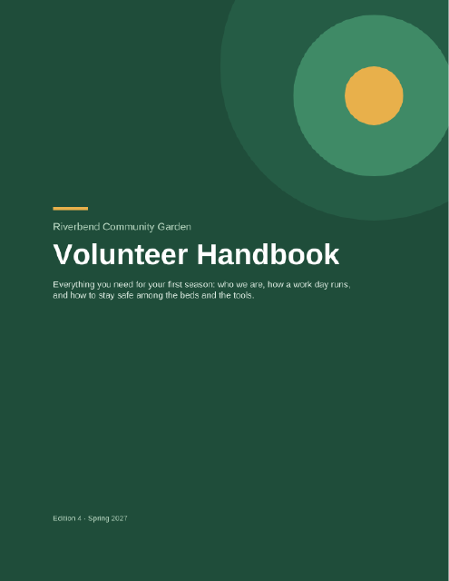

<!-- Generated by tools/gallery.mjs from showcase.yaml and build.json; do not edit. -->
# Volunteer Handbook Outline

[PDF](../README.md) › [Bookmarks & Links](../README.md#bookmarks--links) · `bookmarks` `page-labels` `internal-links` `initial-view` `header-footer`

A seven-page handbook with a nested bookmark outline, roman-numbered front matter, a contents page whose entries link to their pages, and an initial view that opens the bookmarks.



| | |
|---|---|
| Document | [volunteer-handbook-outline.pdf](volunteer-handbook-outline.pdf) (527 KB) |
| Contents | 7 pages |
| Features | `pdf.bookmarks`, `pdf.bookmarks.edit`, `pdf.links`, `pdf.links.edit`, `pdf.pages`, `pdf.pages.organize`, `pdf.page-marks`, `pdf.document` |
| Built by | `kition-pdf` @ `f85fa4e4af`: 66 commands in 554 ms |

## About

Blank pages are inserted and written with added text, then organised the way a reader meets
them: the cover and contents are labelled i and ii and the chapters start again at 1
(`page_number`), every contents entry is a link to its page, and `bookmark_add` builds a
two-level outline (chapters with their sections). `doc_initial_view` makes the file open with
the bookmarks panel showing. The thumbnail is the cover.

## Checks

- `inspect.pages`: `{"count":7}`
- `inspect.pages.0.label`: `"i"`
- `inspect.pages.1.label`: `"ii"`
- `inspect.pages.2.label`: `"1"`
- `inspect.pages.-1.label`: `"5"`
- `results.outline.bookmarks`: `{"count":5}`
- `results.outline.bookmarks.2`: `{"title":"1 Welcome to the garden","page":3,"children":{"count":2}}`
- `results.outline.bookmarks.4.children.1`: `{"title":"First aid and emergencies","page":7}`
- `results.links.count`: `3`
- `results.links.links`: `{"all":{"page":2}}`
- `results.view.initial_view`: `{"navigation":"Bookmarks","magnification":"FitPage"}`
- diagnostics: `pdf.font-not-embedded`
- the saved document opens again; the thumbnail matches `thumb.png` within the `render` tolerance

## Steps

<details><summary>66 commands (from <a href="showcase.yaml">showcase.yaml</a>)</summary>

```yaml
- command: page_insert_blank
  params:
    at: 2
- command: page_insert_blank
  params:
    at: 3
- command: page_insert_blank
  params:
    at: 4
- command: page_insert_blank
  params:
    at: 5
- command: page_insert_blank
  params:
    at: 6
- command: page_insert_blank
  params:
    at: 7
- command: doc_background
  params:
    pages:
      - 1
    color: "#1f4d3a"
- command: page_add_text
  params:
    page: 1
    at:
      - 72
      - 300
    width: 468
    text: Riverbend Community Garden
    size: 14
    color: "#b9d8c2"
- command: page_add_text
  params:
    page: 1
    at:
      - 72
      - 322
    width: 468
    text: Volunteer Handbook
    size: 40
    bold: true
    color: "#ffffff"
- command: page_add_text
  params:
    page: 1
    at:
      - 72
      - 380
    width: 420
    text: "Everything you need for your first season: who we are, how a work day runs, and how to stay safe among the beds and the tools."
    size: 12
    color: "#dcebe1"
- command: page_add_text
  params:
    page: 1
    at:
      - 72
      - 700
    width: 468
    text: Edition 4  ·  Spring 2027
    size: 10
    color: "#b9d8c2"
- command: page_add_text
  params:
    page: 2
    at:
      - 72
      - 80
    width: 468
    text: Contents
    size: 26
    bold: true
    color: "#1f4d3a"
- command: comment_add
  params:
    page: 1
    type: oval
    rect:
      - 300
      - -120
      - 720
      - 300
    color: "#255c45"
    fill: "#255c45"
    width: 0
- command: comment_add
  params:
    page: 1
    type: oval
    rect:
      - 400
      - 20
      - 620
      - 240
    color: "#3f8a66"
    fill: "#3f8a66"
    width: 0
- command: comment_add
  params:
    page: 1
    type: oval
    rect:
      - 470
      - 90
      - 550
      - 170
    color: "#e8b04b"
    fill: "#e8b04b"
    width: 0
- command: comment_add
  params:
    page: 1
    type: rectangle
    rect:
      - 72
      - 282
      - 120
      - 286
    color: "#e8b04b"
    fill: "#e8b04b"
    width: 0
- command: comment_add
  params:
    page: 2
    type: line
    from:
      - 72
      - 122
    to:
      - 540
      - 122
    color: "#1f4d3a"
    width: 1.5
- command: doc_flatten
  params:
    comments: true
- command: page_add_text
  params:
    page: 2
    at:
      - 72
      - 146
    width: 400
    text: 1   Welcome to the garden
    size: 13
    bold: true
    color: "#1f4d3a"
- command: page_add_text
  params:
    page: 2
    at:
      - 480
      - 146
    width: 60
    text: "1"
    size: 13
    bold: true
    color: "#1f4d3a"
    align: right
- command: page_add_text
  params:
    page: 2
    at:
      - 96
      - 172
    width: 380
    text: |-
      Our story
      Who does what
    size: 11
    color: "#3d4a43"
- command: page_add_text
  params:
    page: 2
    at:
      - 480
      - 172
    width: 60
    text: |-
      1
      2
    size: 11
    color: "#3d4a43"
    align: right
- command: page_add_text
  params:
    page: 2
    at:
      - 72
      - 226
    width: 400
    text: 2   A work day
    size: 13
    bold: true
    color: "#1f4d3a"
- command: page_add_text
  params:
    page: 2
    at:
      - 480
      - 226
    width: 60
    text: "3"
    size: 13
    bold: true
    color: "#1f4d3a"
    align: right
- command: page_add_text
  params:
    page: 2
    at:
      - 96
      - 252
    width: 380
    text: |-
      Signing in and the job board
      Compost and watering rotas
    size: 11
    color: "#3d4a43"
- command: page_add_text
  params:
    page: 2
    at:
      - 480
      - 252
    width: 60
    text: |-
      3
      4
    size: 11
    color: "#3d4a43"
    align: right
- command: page_add_text
  params:
    page: 2
    at:
      - 72
      - 306
    width: 400
    text: 3   Safety and tools
    size: 13
    bold: true
    color: "#1f4d3a"
- command: page_add_text
  params:
    page: 2
    at:
      - 480
      - 306
    width: 60
    text: "5"
    size: 13
    bold: true
    color: "#1f4d3a"
    align: right
- command: page_add_text
  params:
    page: 2
    at:
      - 96
      - 332
    width: 380
    text: |-
      Tool shed rules
      First aid and emergencies
    size: 11
    color: "#3d4a43"
- command: page_add_text
  params:
    page: 2
    at:
      - 480
      - 332
    width: 60
    text: |-
      5
      5
    size: 11
    color: "#3d4a43"
    align: right
- command: page_add_text
  params:
    page: 2
    at:
      - 72
      - 400
    width: 468
    text: Select an entry to jump to it, or open the bookmarks panel for the full outline.
    size: 9.5
    italic: true
    color: "#7a8a80"
- command: link_add
  params:
    page: 2
    rect:
      - 70
      - 142
      - 542
      - 162
    to_page: 3
    highlight: outline
- command: link_add
  params:
    page: 2
    rect:
      - 70
      - 222
      - 542
      - 242
    to_page: 5
    highlight: outline
- command: link_add
  params:
    page: 2
    rect:
      - 70
      - 302
      - 542
      - 322
    to_page: 7
    highlight: outline
- command: page_add_text
  params:
    page: 3
    at:
      - 72
      - 80
    width: 468
    text: 1  Welcome to the garden
    size: 22
    bold: true
    color: "#1f4d3a"
- command: page_add_text
  params:
    page: 3
    at:
      - 72
      - 126
    width: 468
    text: Our story
    size: 14
    bold: true
    color: "#1f4d3a"
- command: page_add_text
  params:
    page: 3
    at:
      - 72
      - 148
    width: 468
    size: 11
    align: justify
    text: The garden began in 2014 on a strip of railway land nobody wanted. Twelve neighbours cleared it in a summer; today it has forty raised beds, an orchard of heritage apples and a pond that frogs found before we did.
- command: page_add_text
  params:
    page: 4
    at:
      - 72
      - 80
    width: 468
    text: Who does what
    size: 14
    bold: true
    color: "#1f4d3a"
- command: page_add_text
  params:
    page: 4
    at:
      - 72
      - 102
    width: 468
    size: 11
    align: justify
    text: "Bed holders tend their own plot. Volunteers look after the shared spaces: paths, compost, the orchard and the polytunnel. The steering group of five meets on the first Monday of each month and its notes go on the shed door."
- command: page_add_text
  params:
    page: 5
    at:
      - 72
      - 80
    width: 468
    text: 2  A work day
    size: 22
    bold: true
    color: "#1f4d3a"
- command: page_add_text
  params:
    page: 5
    at:
      - 72
      - 126
    width: 468
    text: Signing in and the job board
    size: 14
    bold: true
    color: "#1f4d3a"
- command: page_add_text
  params:
    page: 5
    at:
      - 72
      - 148
    width: 468
    size: 11
    align: justify
    text: Work days run from ten until one on Saturdays. Sign the book in the shed, then take a card from the job board; each card says what to do, which tools to use and who to ask.
- command: page_add_text
  params:
    page: 6
    at:
      - 72
      - 80
    width: 468
    text: Compost and watering rotas
    size: 14
    bold: true
    color: "#1f4d3a"
- command: page_add_text
  params:
    page: 6
    at:
      - 72
      - 102
    width: 468
    size: 11
    align: justify
    text: The three compost bays are turned in order, left to right, every second week. In dry spells the watering rota covers evenings; swap a slot on the board rather than leaving it empty.
- command: page_add_text
  params:
    page: 7
    at:
      - 72
      - 80
    width: 468
    text: 3  Safety and tools
    size: 22
    bold: true
    color: "#1f4d3a"
- command: page_add_text
  params:
    page: 7
    at:
      - 72
      - 126
    width: 468
    text: Tool shed rules
    size: 14
    bold: true
    color: "#1f4d3a"
- command: page_add_text
  params:
    page: 7
    at:
      - 72
      - 148
    width: 468
    size: 11
    align: justify
    text: Clean tools before they go back, blades down and handles out. Power tools are for trained volunteers only; ask a steering group member before using the strimmer.
- command: page_add_text
  params:
    page: 7
    at:
      - 72
      - 220
    width: 468
    text: First aid and emergencies
    size: 14
    bold: true
    color: "#1f4d3a"
- command: page_add_text
  params:
    page: 7
    at:
      - 72
      - 242
    width: 468
    size: 11
    align: justify
    text: The first-aid box hangs inside the shed door. Report every injury, however small, in the accident book. In an emergency call for help first, then send someone to meet the ambulance at the main gate.
- command: bookmark_add
  params:
    page: 1
    title: Cover
- command: bookmark_add
  params:
    page: 2
    title: Contents
- command: bookmark_add
  params:
    page: 3
    title: 1 Welcome to the garden
- command: bookmark_add
  params:
    page: 3
    title: Our story
    parent:
      - 3
- command: bookmark_add
  params:
    page: 4
    title: Who does what
    parent:
      - 3
- command: bookmark_add
  params:
    page: 5
    title: 2 A work day
- command: bookmark_add
  params:
    page: 5
    title: Signing in and the job board
    parent:
      - 4
- command: bookmark_add
  params:
    page: 6
    title: Compost and watering rotas
    parent:
      - 4
- command: bookmark_add
  params:
    page: 7
    title: 3 Safety and tools
- command: bookmark_add
  params:
    page: 7
    title: Tool shed rules
    parent:
      - 5
- command: bookmark_add
  params:
    page: 7
    title: First aid and emergencies
    parent:
      - 5
- command: page_number
  params:
    from: 1
    to: 2
    style: lower-roman
- command: page_number
  params:
    from: 3
    to: 7
    style: decimal
- command: doc_header_footer
  params:
    pages:
      - 3
      - 4
      - 5
      - 6
      - 7
    footer_left: Volunteer Handbook
    footer_right: <<1>>
    font_size: 9
    color: "#7a8a80"
- command: doc_initial_view
  params:
    navigation: bookmarks
    magnification: fit_page
  as: view
- command: bookmark_list
  as: outline
- command: link_list
  as: links
```

</details>
