<!-- Generated by tools/gallery.mjs from showcase.yaml and build.json; do not edit. -->
# Photo showcase

Layered images: shapes, type, adjustment and fill layers, styles, masks, filters. Saved as PSD. Every sample is built from `showcase.yaml` by the kit's own commands and drawn by its own engine (`kition-photo`).

**60 samples** · 10 categories · 23 features of `kition-photo/features.yaml` · [all kits](../README.md)

[Adjustments & Color](#adjustments--color) (7) · [Filters & Textures](#filters--textures) (4) · [Layer Styles](#layer-styles) (6) · [Masks & Compositing](#masks--compositing) (4) · [Posters & Marketing](#posters--marketing) (7) · [Print & Stationery](#print--stationery) (9) · [Shapes & Illustration](#shapes--illustration) (4) · [Social Media](#social-media) (5) · [Typography](#typography) (8) · [UI & Web Design](#ui--web-design) (6)

## Adjustments & Color

<table>
<tr>
<td width="33%" valign="top">
<a href="black-white-red-filter/">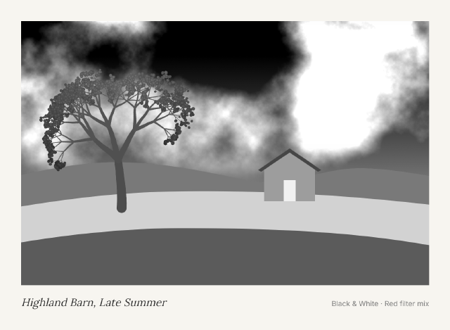</a> 
Photo 
<b><a href="black-white-red-filter/">Black &amp; White Red Filter Print</a></b> 
A colorful farm landscape turned into a dramatic monochrome print with a Black &amp; White layer mixed like a red lens filter. 
<i>1500 × 1100 px; 14 layers; 2 type layers; 7 shape layers; 1 adjustment layer; 1 fill layer; 2 masks</i> 
<code>adjustment-layers</code> <code>black-and-white</code> <code>render-filters</code> <code>landscape</code> <code>print</code>
</td>
<td width="33%" valign="top">
<a href="cinematic-color-grade/">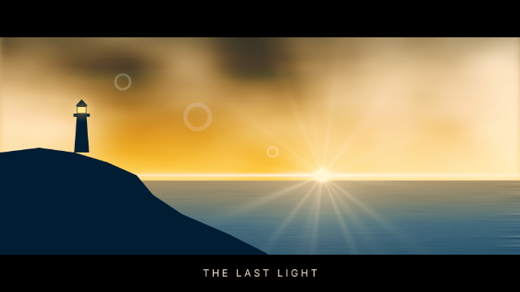</a> 
Photo 
<b><a href="cinematic-color-grade/">Cinematic Teal &amp; Orange Grade</a></b> 
A dusk seascape graded like a film still with a stack of curves, color balance, selective color and vibrance layers. 
<i>1600 × 900 px; 16 layers; 1 type layer; 5 shape layers; 4 adjustment layers; 2 fill layers; 1 styled layer; 5 masks</i> 
<code>adjustment-layers</code> <code>color-grading</code> <code>curves</code> <code>render-filters</code> <code>landscape</code>
</td>
<td width="33%" valign="top">
<a href="duotone-gradient-map-poster/">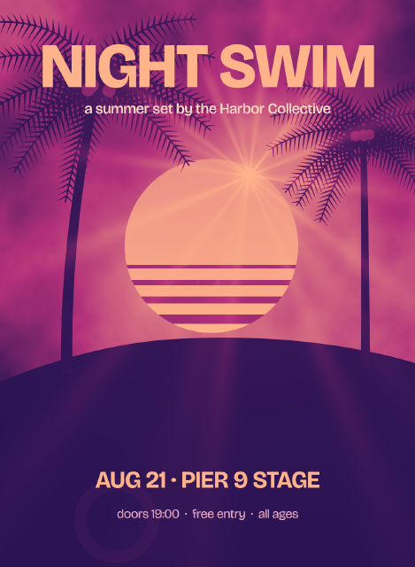</a> 
Photo 
<b><a href="duotone-gradient-map-poster/">Duotone Gig Poster</a></b> 
A palm-and-sun scene mapped to a two-color indigo and coral duotone with a Gradient Map layer, under bold gig typography. 
<i>1100 × 1500 px; 16 layers; 4 type layers; 6 shape layers; 1 adjustment layer; 1 fill layer; 1 mask</i> 
<code>adjustment-layers</code> <code>gradient-map</code> <code>duotone</code> <code>type</code> <code>render-filters</code>
</td>
</tr>
<tr>
<td width="33%" valign="top">
<a href="fabric-colorway-variants/">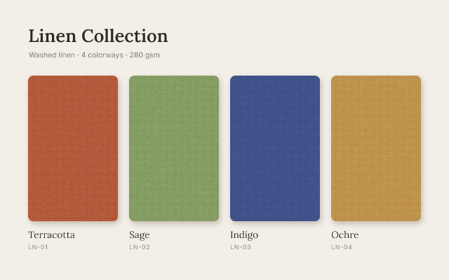</a> 
Photo 
<b><a href="fabric-colorway-variants/">Linen Colorway Swatches</a></b> 
One woven texture shown in four colorways, each made by a Hue/Saturation layer masked to its own swatch. 
<i>1600 × 1000 px; 16 layers; 10 type layers; 1 shape layer; 3 adjustment layers; 1 styled layer; 3 masks</i> 
<code>adjustment-layers</code> <code>hue-saturation</code> <code>masks</code> <code>textures</code> <code>clipping-mask</code>
</td>
<td width="33%" valign="top">
<a href="levels-curves-before-after/">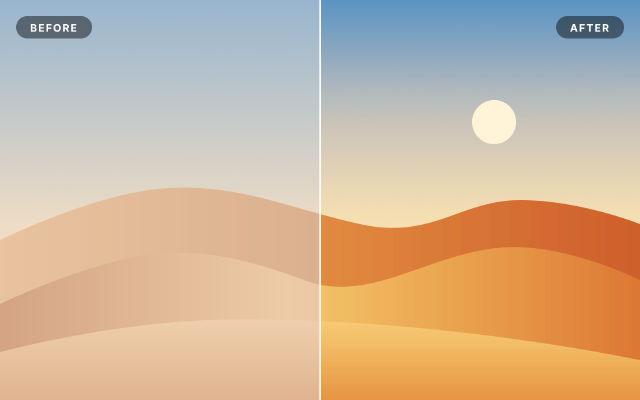</a> 
Photo 
<b><a href="levels-curves-before-after/">Levels &amp; Curves Before / After</a></b> 
A hazy desert scene corrected with Levels, Curves and Vibrance layers masked to the right half, for a split comparison. 
<i>1600 × 1000 px; 15 layers; 2 type layers; 7 shape layers; 3 adjustment layers; 2 fill layers; 4 masks</i> 
<code>adjustment-layers</code> <code>levels</code> <code>curves</code> <code>masks</code> <code>before-after</code>
</td>
<td width="33%" valign="top">
<a href="photo-filter-warm-cool/">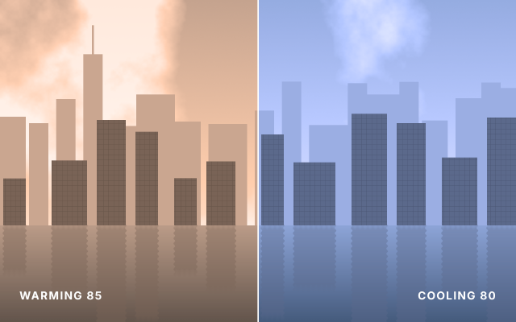</a> 
Photo 
<b><a href="photo-filter-warm-cool/">Warm vs Cool Photo Filter</a></b> 
One riverside skyline shown twice, through a warming 85 filter on the left and a cooling 80 filter on the right. 
<i>1600 × 1000 px; 13 layers; 2 type layers; 4 shape layers; 2 adjustment layers; 2 fill layers; 3 masks</i> 
<code>adjustment-layers</code> <code>photo-filter</code> <code>masks</code> <code>before-after</code> <code>cityscape</code>
</td>
</tr>
<tr>
<td width="33%" valign="top">
<a href="pop-art-posterize-quad/">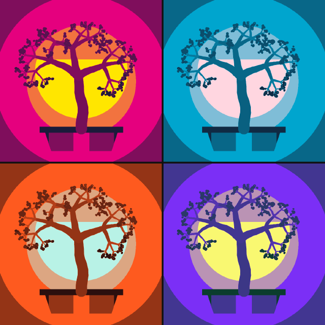</a> 
Photo 
<b><a href="pop-art-posterize-quad/">Pop Art Posterize Quad</a></b> 
A bonsai study repeated four times as smart objects, posterized and recolored per panel with masked Gradient Map layers. 
<i>1400 × 1400 px; 11 layers; 1 shape layer; 5 adjustment layers; 4 smart objects; 5 masks</i> 
<code>adjustment-layers</code> <code>posterize</code> <code>gradient-map</code> <code>smart-objects</code> <code>masks</code>
</td>
<td width="33%"></td>
<td width="33%"></td>
</tr>
</table>

## Filters & Textures

<table>
<tr>
<td width="33%" valign="top">
<a href="filter-strip-comparison/">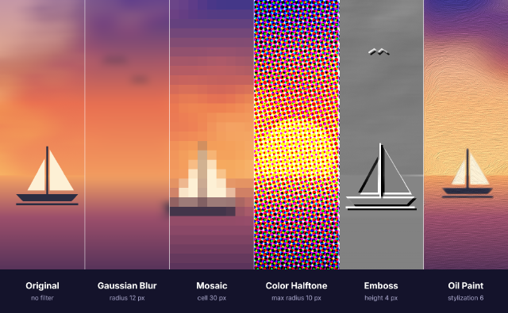</a> 
Photo 
<b><a href="filter-strip-comparison/">Filter Strip Comparison</a></b> 
One harbor scene cut into six bands, each run through a different filter, from Gaussian Blur and Mosaic to Color Halftone, Emboss and Oil Paint. 
<i>1620 × 1000 px; 15 layers; 12 type layers; 2 shape layers</i> 
<code>filters</code> <code>render-filters</code> <code>selections</code> <code>reference</code>
</td>
<td width="33%" valign="top">
<a href="fire-title-flames/">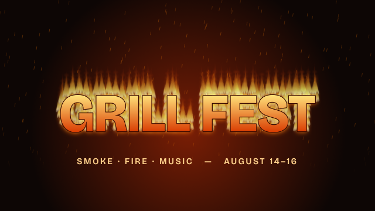</a> 
Photo 
<b><a href="fire-title-flames/">Fire Title with Flame Filter</a></b> 
A barbecue festival title set ablaze with the Flame render filter run along the type's own outline. 
<i>1600 × 900 px; 6 layers; 2 type layers; 1 fill layer; 1 styled layer; 1 mask</i> 
<code>render-filters</code> <code>type</code> <code>layer-styles</code> <code>poster</code>
</td>
<td width="33%" valign="top">
<a href="material-texture-swatches/">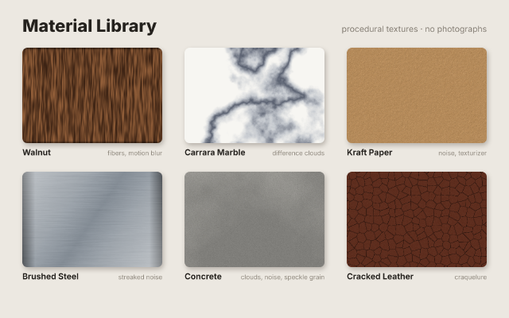</a> 
Photo 
<b><a href="material-texture-swatches/">Material Texture Swatches</a></b> 
Six procedural materials (walnut, marble, kraft paper, brushed steel, concrete, cracked leather), each built from render, noise and gallery filters. 
<i>1600 × 1000 px; 28 layers; 14 type layers; 6 shape layers; 1 fill layer; 6 styled layers</i> 
<code>filters</code> <code>textures</code> <code>render-filters</code> <code>clipping-mask</code> <code>reference</code>
</td>
</tr>
<tr>
<td width="33%" valign="top">
<a href="painted-lavender-postcard/">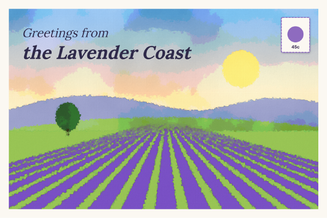</a> 
Photo 
<b><a href="painted-lavender-postcard/">Painted Lavender Postcard</a></b> 
A vector landscape turned into a gouache-style postcard by three smart filters on one smart object. 
<i>1500 × 1000 px; 8 layers; 3 type layers; 3 shape layers; 1 smart object; 1 styled layer</i> 
<code>smart-filters</code> <code>smart-objects</code> <code>filters</code> <code>illustration</code> <code>print</code>
</td>
<td width="33%"></td>
<td width="33%"></td>
</tr>
</table>

## Layer Styles

<table>
<tr>
<td width="33%" valign="top">
<a href="brushed-gold-anniversary-badge/">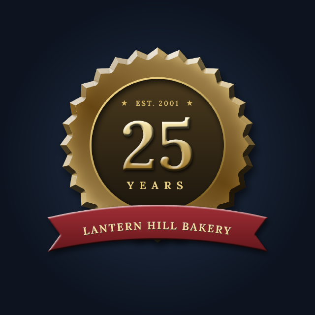</a> 
Photo 
<b><a href="brushed-gold-anniversary-badge/">Gold Anniversary Badge</a></b> 
A metal anniversary emblem whose gold comes entirely from stacked Gradient Overlay, Bevel &amp; Emboss and Satin effects. 
<i>1000 × 1000 px; 9 layers; 4 type layers; 3 shape layers; 1 fill layer; 5 styled layers; 1 mask</i> 
<code>layer-styles</code> <code>bevel</code> <code>gradient</code> <code>badge</code>
</td>
<td width="33%" valign="top">
<a href="die-cut-sticker-sheet/">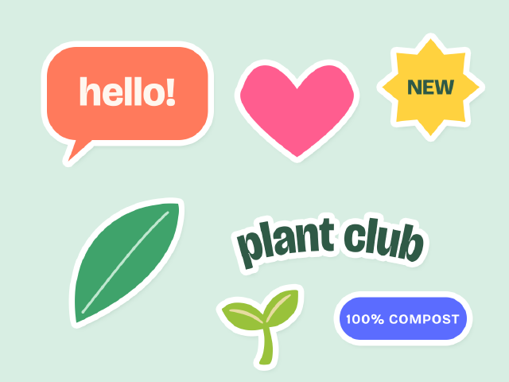</a> 
Photo 
<b><a href="die-cut-sticker-sheet/">Die-Cut Sticker Sheet</a></b> 
A plant-shop sticker sheet where every sticker gets the same white die-cut border and soft shadow by copying one layer style. 
<i>1200 × 900 px; 13 layers; 5 type layers; 6 shape layers; 1 fill layer; 7 styled layers; 1 mask</i> 
<code>layer-styles</code> <code>stroke</code> <code>drop-shadow</code> <code>shapes</code> <code>type</code> <code>emoji</code>
</td>
<td width="33%" valign="top">
<a href="glassmorphism-weather-widget/">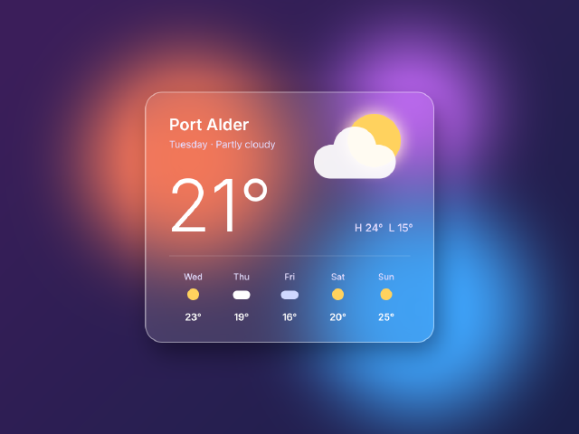</a> 
Photo 
<b><a href="glassmorphism-weather-widget/">Glassmorphism Weather Widget</a></b> 
A frosted-glass weather card over blurred colour blobs, made with a clipped blur copy, low fill opacity and a hairline stroke. 
<i>1200 × 900 px; 28 layers; 14 type layers; 9 shape layers; 2 fill layers; 2 styled layers; 2 masks</i> 
<code>layer-styles</code> <code>glass</code> <code>blur</code> <code>ui</code> <code>clipping-mask</code>
</td>
</tr>
<tr>
<td width="33%" valign="top">
<a href="long-shadow-flat-icons/">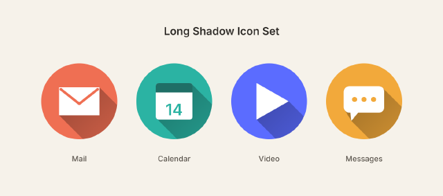</a> 
Photo 
<b><a href="long-shadow-flat-icons/">Long Shadow Flat Icons</a></b> 
Four flat app icons with fading 45° long shadows, each a Multiply shape with a Gradient Overlay clipped to its circle. 
<i>1400 × 620 px; 25 layers; 6 type layers; 17 shape layers; 1 fill layer; 4 styled layers; 1 mask</i> 
<code>shapes</code> <code>clipping-mask</code> <code>icons</code> <code>flat-design</code>
</td>
<td width="33%" valign="top">
 
Photo 
<b><a href="neon-noodle-bar-sign/">Neon Noodle Bar Sign</a></b> 
A glowing neon sign on a brick wall, built from type and stroked shapes with outer and inner glow styles. 
<i>1400 × 900 px; 8 layers; 2 type layers; 3 shape layers; 2 fill layers; 5 styled layers; 2 masks</i> 
<code>layer-styles</code> <code>glow</code> <code>type</code> <code>shapes</code>
</td>
<td width="33%" valign="top">
<a href="retro-80s-extruded-title/">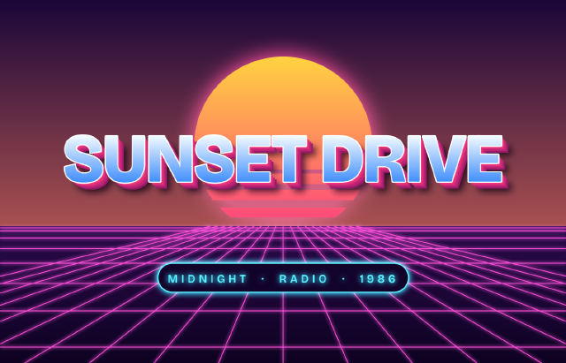</a> 
Photo 
<b><a href="retro-80s-extruded-title/">Retro 80s Extruded Title</a></b> 
A synthwave title card whose 3D extrusion is five stacked Drop Shadows on one live text layer. 
<i>1400 × 900 px; 8 layers; 2 type layers; 4 shape layers; 1 fill layer; 5 styled layers; 1 mask</i> 
<code>layer-styles</code> <code>drop-shadow</code> <code>type</code> <code>retro</code>
</td>
</tr>
</table>

## Masks & Compositing

<table>
<tr>
<td width="33%" valign="top">
<a href="blend-modes-sampler/">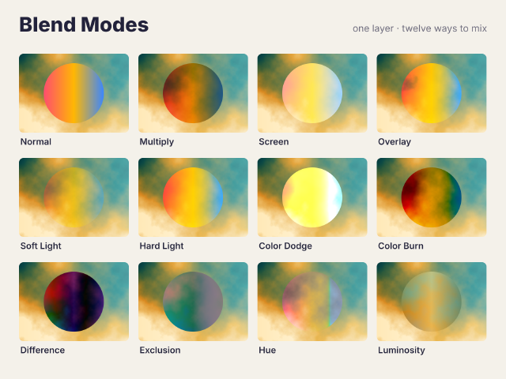</a> 
Photo 
<b><a href="blend-modes-sampler/">Blend Modes Sampler</a></b> 
The same gradient disc over the same texture in twelve blend modes, from Multiply and Screen to Difference and Luminosity. 
<i>1600 × 1200 px; 29 layers; 14 type layers; 13 shape layers; 1 fill layer; 1 mask</i> 
<code>blend-modes</code> <code>shapes</code> <code>render-filters</code> <code>reference</code>
</td>
<td width="33%" valign="top">
<a href="double-exposure-portrait/">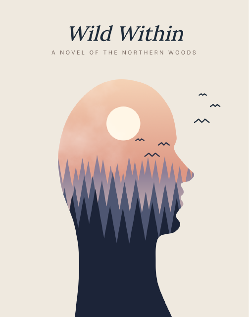</a> 
Photo 
<b><a href="double-exposure-portrait/">Double Exposure Portrait</a></b> 
A forest at dusk seen through a profile silhouette, built from layers clipped to one head-shaped path. 
<i>1100 × 1400 px; 13 layers; 2 type layers; 7 shape layers; 2 fill layers</i> 
<code>clipping-mask</code> <code>blend-modes</code> <code>shapes</code> <code>render-filters</code> <code>poster</code>
</td>
<td width="33%" valign="top">
<a href="moonlit-night-vignette/">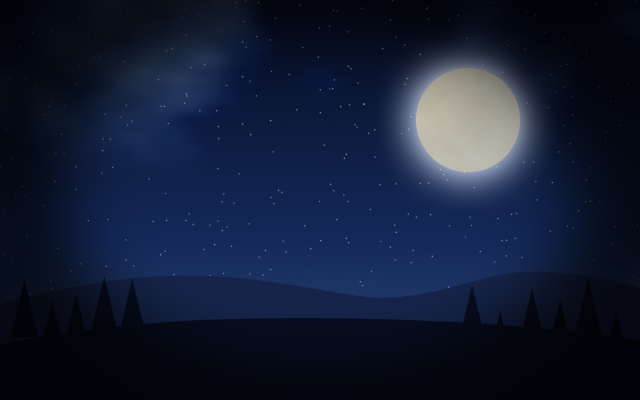</a> 
Photo 
<b><a href="moonlit-night-vignette/">Moonlit Night Vignette</a></b> 
A full moon over a pine ridge, with rendered stars and clouds, framed by a vignette layer whose mask is a feathered ellipse. 
<i>1600 × 1000 px; 10 layers; 4 shape layers; 2 fill layers; 1 styled layer; 2 masks</i> 
<code>masks</code> <code>render-filters</code> <code>blend-modes</code> <code>clipping-mask</code> <code>landscape</code>
</td>
</tr>
<tr>
<td width="33%" valign="top">
<a href="wood-grain-type-clipping/">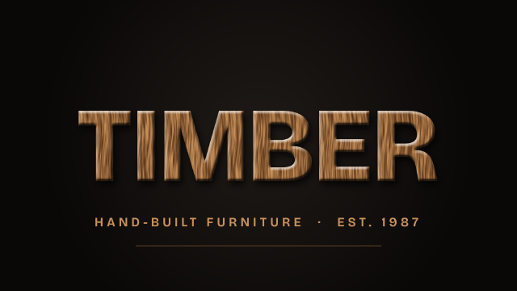</a> 
Photo 
<b><a href="wood-grain-type-clipping/">Wood Grain Type Clipping</a></b> 
A workshop sign whose letters show a wood texture through a clipping mask; the wood is a smart object with editable smart filters. 
<i>1600 × 900 px; 6 layers; 2 type layers; 1 shape layer; 1 fill layer; 1 smart object; 1 styled layer</i> 
<code>clipping-mask</code> <code>smart-filters</code> <code>smart-objects</code> <code>type</code> <code>textures</code>
</td>
<td width="33%"></td>
<td width="33%"></td>
</tr>
</table>

## Posters & Marketing

<table>
<tr>
<td width="33%" valign="top">
<a href="autumn-sale-poster/">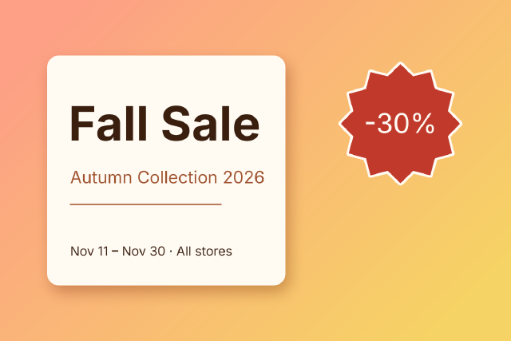</a> 
Photo 
<b><a href="autumn-sale-poster/">Autumn Sale Poster</a></b> 
A retail poster with a gradient fill layer, a shadowed card, a star badge and type. 
<i>1200 × 800 px; 9 layers; 4 type layers; 3 shape layers; 1 fill layer; 2 styled layers; 1 mask</i> 
<code>gradient</code> <code>shapes</code> <code>layer-styles</code> <code>type</code>
</td>
<td width="33%" valign="top">
<a href="black-friday-web-banner/">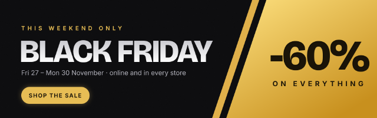</a> 
Photo 
<b><a href="black-friday-web-banner/">Black Friday Web Banner</a></b> 
A wide hero banner for a weekend sale, with a slanted gold panel, a gradient-filled discount and a call-to-action button. 
<i>1600 × 500 px; 13 layers; 6 type layers; 3 shape layers; 1 fill layer; 1 group; 3 styled layers; 1 mask</i> 
<code>banner</code> <code>web</code> <code>gradient</code> <code>shapes</code> <code>layer-styles</code> <code>type</code> <code>noise</code>
</td>
<td width="33%" valign="top">
<a href="concert-poster/">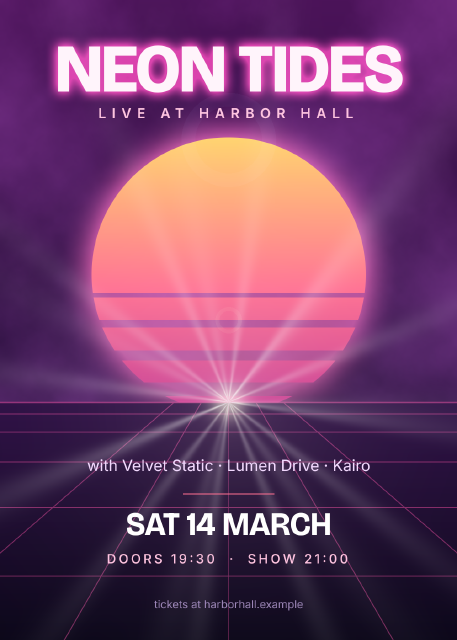</a> 
Photo 
<b><a href="concert-poster/">Synthwave Concert Poster</a></b> 
A retro night-concert poster with a striped gradient sun, smoky clouds, a lens flare and glowing headline type. 
<i>1000 × 1400 px; 18 layers; 6 type layers; 6 shape layers; 1 fill layer; 2 groups; 2 styled layers; 1 mask</i> 
<code>poster</code> <code>gradient</code> <code>shapes</code> <code>layer-styles</code> <code>type</code> <code>render-filters</code> <code>groups</code>
</td>
</tr>
<tr>
<td width="33%" valign="top">
 
Photo 
<b><a href="film-festival-poster/">Film Festival Poster</a></b> 
An outdoor film festival poster with a gold film reel, crossing spotlight beams, a perforated film strip and film grain. 
<i>1000 × 1400 px; 13 layers; 6 type layers; 4 shape layers; 1 fill layer; 1 styled layer; 1 mask</i> 
<code>poster</code> <code>shapes</code> <code>layer-styles</code> <code>blend-modes</code> <code>noise</code> <code>type</code>
</td>
<td width="33%" valign="top">
<a href="real-estate-flyer/">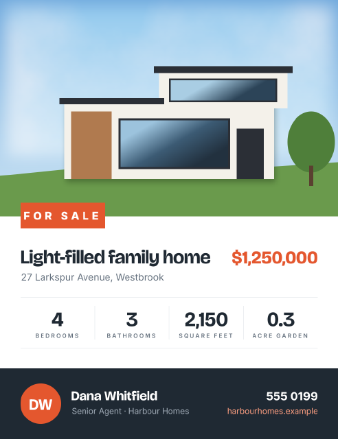</a> 
Photo 
<b><a href="real-estate-flyer/">Real Estate Flyer</a></b> 
A for-sale property flyer with an illustrated modern house hero, a price, a four-figure spec row and an agent contact bar. 
<i>1000 × 1300 px; 38 layers; 17 type layers; 16 shape layers; 3 groups; 1 styled layer</i> 
<code>flyer</code> <code>print</code> <code>shapes</code> <code>render-filters</code> <code>gradient</code> <code>type</code> <code>groups</code>
</td>
<td width="33%" valign="top">
<a href="summer-sale-wave-banner/">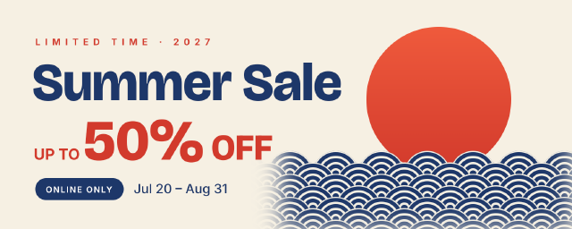</a> 
Photo 
<b><a href="summer-sale-wave-banner/">Summer Sale Wave Banner</a></b> 
A wide e-commerce banner with a red rising sun over a pattern of overlapping waves and a mixed-font discount headline. 
<i>1500 × 600 px; 17 layers; 5 type layers; 9 shape layers; 1 fill layer; 1 group; 2 masks</i> 
<code>banner</code> <code>web</code> <code>shapes</code> <code>pattern</code> <code>masks</code> <code>type</code>
</td>
</tr>
<tr>
<td width="33%" valign="top">
<a href="swiss-lecture-poster/">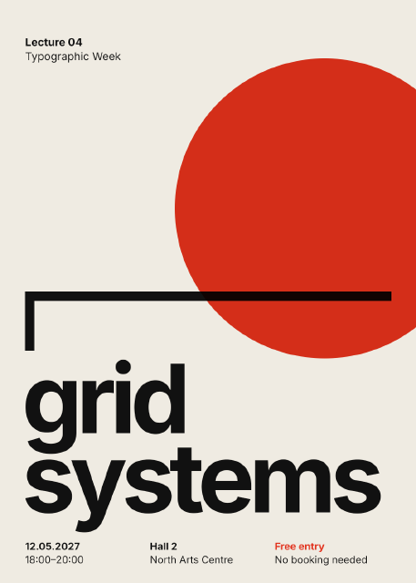</a> 
Photo 
<b><a href="swiss-lecture-poster/">Swiss Style Lecture Poster</a></b> 
A minimalist International Typographic Style poster with a red circle, a strict grid and tight sans-serif type. 
<i>1000 × 1400 px; 16 layers; 10 type layers; 3 shape layers; 1 fill layer; 1 group; 1 mask</i> 
<code>poster</code> <code>minimal</code> <code>shapes</code> <code>type</code> <code>groups</code> <code>blend-modes</code>
</td>
<td width="33%"></td>
<td width="33%"></td>
</tr>
</table>

## Print & Stationery

<table>
<tr>
<td width="33%" valign="top">
<a href="bistro-menu/">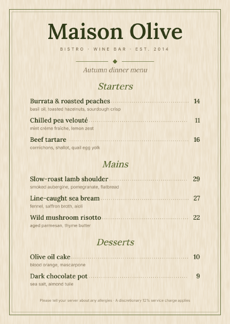</a> 
Photo 
<b><a href="bistro-menu/">Bistro Dinner Menu</a></b> 
A printed dinner menu on fibre-textured paper, with serif headings, dotted price leaders and a double-rule border. 
<i>1000 × 1414 px; 51 layers; 31 type layers; 13 shape layers; 1 fill layer; 4 groups; 1 mask</i> 
<code>print</code> <code>menu</code> <code>typography</code> <code>shapes</code> <code>groups</code> <code>render-filters</code>
</td>
<td width="33%" valign="top">
<a href="business-card-front/">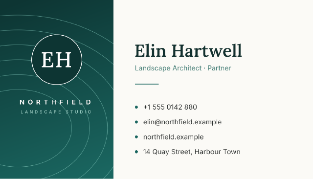</a> 
Photo 
<b><a href="business-card-front/">Business Card Front</a></b> 
A landscape architect's business card with a teal monogram panel, clipped contour lines and a clean contact column. 
<i>1050 × 600 px; 17 layers; 9 type layers; 5 shape layers; 1 fill layer; 1 group; 1 mask</i> 
<code>print</code> <code>business-card</code> <code>shapes</code> <code>clipping-mask</code> <code>type</code> <code>gradient</code>
</td>
<td width="33%" valign="top">
<a href="cafe-loyalty-card/">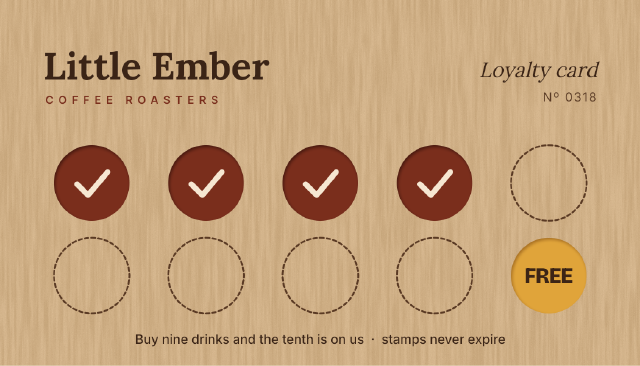</a> 
Photo 
<b><a href="cafe-loyalty-card/">Café Loyalty Card</a></b> 
A kraft-paper coffee loyalty card with ten stamp spots, four already stamped and a gold free-drink circle. 
<i>1050 × 600 px; 14 layers; 6 type layers; 4 shape layers; 1 fill layer; 1 group; 2 styled layers; 1 mask</i> 
<code>print</code> <code>loyalty-card</code> <code>shapes</code> <code>render-filters</code> <code>noise</code> <code>type</code> <code>groups</code>
</td>
</tr>
<tr>
<td width="33%" valign="top">
<a href="certificate-of-achievement/">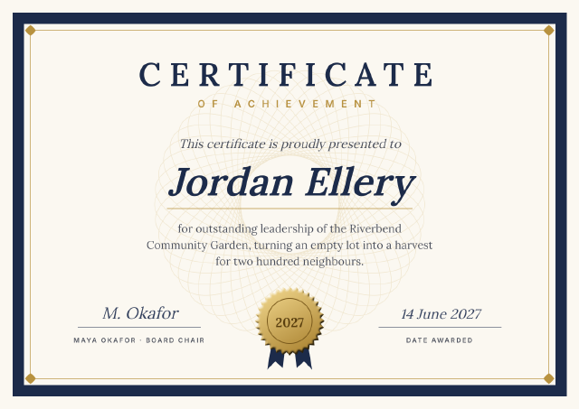</a> 
Photo 
<b><a href="certificate-of-achievement/">Certificate of Achievement</a></b> 
A formal landscape certificate with a navy frame, a guilloche rosette watermark, a gold seal with ribbons and signature lines. 
<i>1414 × 1000 px; 26 layers; 10 type layers; 10 shape layers; 1 fill layer; 4 groups; 1 styled layer; 1 mask</i> 
<code>print</code> <code>certificate</code> <code>typography</code> <code>shapes</code> <code>ornaments</code> <code>layer-styles</code> <code>groups</code>
</td>
<td width="33%" valign="top">
<a href="conference-ticket/">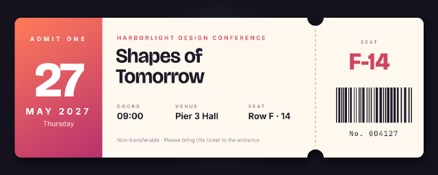</a> 
Photo 
<b><a href="conference-ticket/">Conference Ticket</a></b> 
An admit-one conference ticket with notched edges, a dashed perforation, a tear-off stub and a barcode. 
<i>1500 × 600 px; 26 layers; 17 type layers; 4 shape layers; 1 fill layer; 3 groups; 1 styled layer; 1 mask</i> 
<code>print</code> <code>ticket</code> <code>shapes</code> <code>clipping-mask</code> <code>layer-styles</code> <code>type</code>
</td>
<td width="33%" valign="top">
<a href="kids-birthday-card/">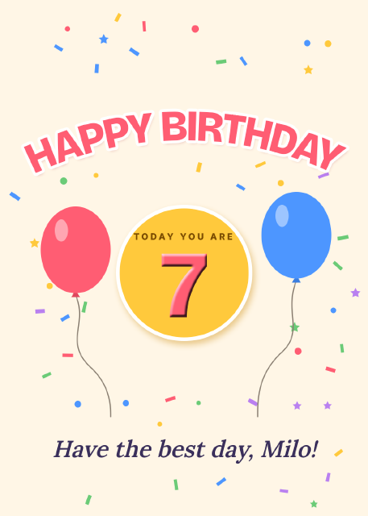</a> 
Photo 
<b><a href="kids-birthday-card/">Kids Birthday Card</a></b> 
A cheerful seventh-birthday card front with arched headline type, balloons, a big number badge and scattered confetti. 
<i>1000 × 1400 px; 23 layers; 4 type layers; 14 shape layers; 1 fill layer; 3 groups; 3 styled layers; 1 mask</i> 
<code>print</code> <code>greeting-card</code> <code>warp-text</code> <code>shapes</code> <code>layer-styles</code> <code>groups</code> <code>illustration</code>
</td>
</tr>
<tr>
<td width="33%" valign="top">
<a href="lunar-new-year-card/">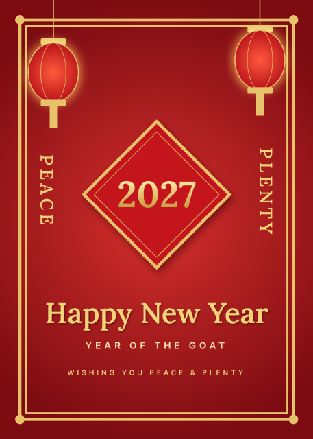</a> 
Photo 
<b><a href="lunar-new-year-card/">Lunar New Year Greeting Card</a></b> 
A red-and-gold Lunar New Year card with hanging lanterns, a diamond year panel, vertical couplet words and a gold double-rule frame. 
<i>1000 × 1400 px; 26 layers; 6 type layers; 14 shape layers; 1 fill layer; 3 groups; 5 styled layers; 1 mask</i> 
<code>print</code> <code>greeting-card</code> <code>vertical-type</code> <code>layer-styles</code> <code>shapes</code> <code>render-filters</code>
</td>
<td width="33%" valign="top">
<a href="novel-book-cover/">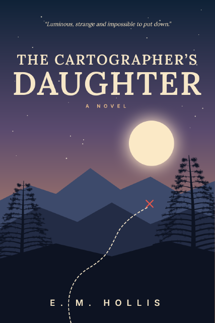</a> 
Photo 
<b><a href="novel-book-cover/">Novel Book Cover</a></b> 
A literary novel cover with a dusk sky, a glowing moon, layered ridges, silhouetted pines and a dotted map route. 
<i>1000 × 1500 px; 17 layers; 5 type layers; 7 shape layers; 1 fill layer; 2 groups; 2 styled layers; 1 mask</i> 
<code>print</code> <code>book-cover</code> <code>gradient</code> <code>shapes</code> <code>render-filters</code> <code>layer-styles</code> <code>typography</code>
</td>
<td width="33%" valign="top">
<a href="wedding-invitation/">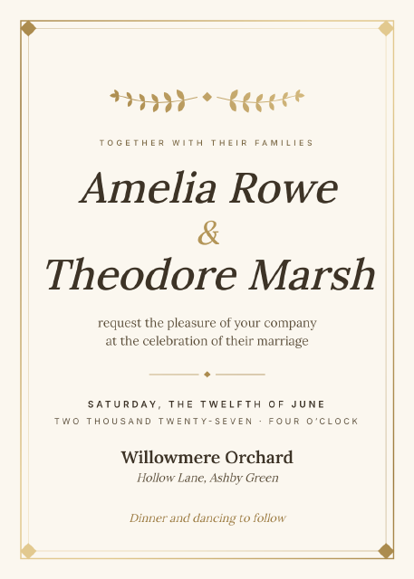</a> 
Photo 
<b><a href="wedding-invitation/">Wedding Invitation</a></b> 
A formal ivory invitation in Lora with a gold double frame, corner diamonds and a laurel sprig drawn from bezier paths. 
<i>1000 × 1400 px; 22 layers; 11 type layers; 7 shape layers; 1 fill layer; 2 groups; 1 styled layer; 1 mask</i> 
<code>print</code> <code>wedding</code> <code>invitation</code> <code>typography</code> <code>shapes</code> <code>ornaments</code> <code>layer-styles</code>
</td>
</tr>
</table>

## Shapes & Illustration

<table>
<tr>
<td width="33%" valign="top">
<a href="four-seasons-tree-prints/">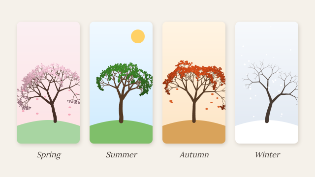</a> 
Photo 
<b><a href="four-seasons-tree-prints/">Four Seasons Tree Prints</a></b> 
A set of four art prints, spring blossom to bare winter branches, each tree drawn by the Tree render filter. 
<i>1600 × 900 px; 21 layers; 4 type layers; 12 shape layers; 4 styled layers</i> 
<code>render-filters</code> <code>illustration</code> <code>shapes</code> <code>print</code>
</td>
<td width="33%" valign="top">
<a href="geometric-pattern-wrap/">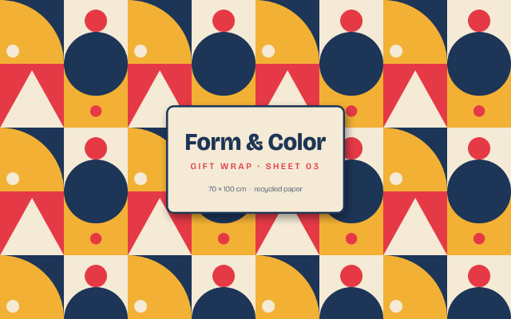</a> 
Photo 
<b><a href="geometric-pattern-wrap/">Geometric Gift Wrap Pattern</a></b> 
Four mid-century motifs drawn as shapes, saved with Define Pattern and repeated across the sheet by a pattern fill layer. 
<i>1600 × 1000 px; 6 layers; 3 type layers; 1 shape layer; 1 fill layer; 1 styled layer; 1 mask</i> 
<code>shapes</code> <code>patterns</code> <code>illustration</code> <code>print</code>
</td>
<td width="33%" valign="top">
<a href="isometric-city-block/">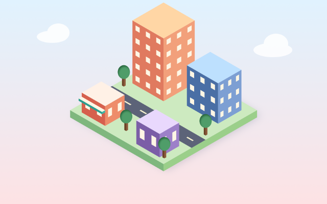</a> 
Photo 
<b><a href="isometric-city-block/">Isometric City Block</a></b> 
A tiny isometric town of towers, a cafe, a shop, trees and a road, every face a flat-shaded shape in true 30° projection. 
<i>1600 × 1000 px; 55 layers; 42 shape layers; 1 fill layer; 11 groups; 5 styled layers</i> 
<code>shapes</code> <code>illustration</code> <code>isometric</code> <code>layer-styles</code>
</td>
</tr>
<tr>
<td width="33%" valign="top">
<a href="mountain-sunset-illustration/">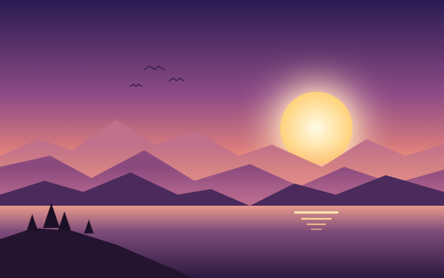</a> 
Photo 
<b><a href="mountain-sunset-illustration/">Mountain Sunset Illustration</a></b> 
A flat-style landscape of layered ridges, a glowing sun, drifting mist and a still lake, all live shapes. 
<i>1600 × 1000 px; 16 layers; 12 shape layers; 3 fill layers; 1 styled layer</i> 
<code>shapes</code> <code>gradient</code> <code>illustration</code> <code>landscape</code> <code>layer-styles</code>
</td>
<td width="33%"></td>
<td width="33%"></td>
</tr>
</table>

## Social Media

<table>
<tr>
<td width="33%" valign="top">
<a href="instagram-quote-post/">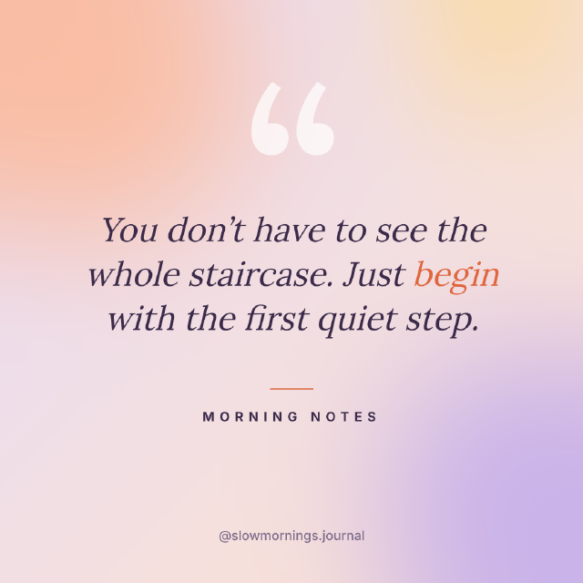</a> 
Photo 
<b><a href="instagram-quote-post/">Instagram Quote Post</a></b> 
A square quote card with soft blurred colour blobs, oversized quotation marks and a centred serif paragraph. 
<i>1080 × 1080 px; 8 layers; 4 type layers; 1 shape layer; 1 fill layer; 1 mask</i> 
<code>social</code> <code>instagram</code> <code>paragraph-text</code> <code>typography</code> <code>blur</code> <code>gradient</code>
</td>
<td width="33%" valign="top">
<a href="instagram-story-plant-market/">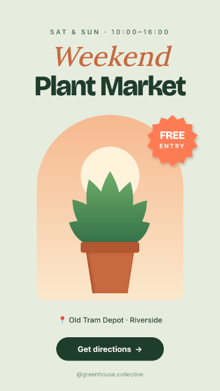</a> 
Photo 
<b><a href="instagram-story-plant-market/">Instagram Story Plant Market</a></b> 
A vertical story for a weekend plant market, with an arched window, a bezier-leaf plant illustration and a sticker badge. 
<i>900 × 1600 px; 19 layers; 8 type layers; 7 shape layers; 1 fill layer; 2 groups; 2 styled layers; 1 mask</i> 
<code>social</code> <code>instagram</code> <code>story</code> <code>shapes</code> <code>illustration</code> <code>layer-styles</code> <code>type</code> <code>emoji</code>
</td>
<td width="33%" valign="top">
 
Photo 
<b><a href="linkedin-profile-banner/">LinkedIn Profile Banner</a></b> 
A 4:1 profile header for a product designer, with screen-blended circles, a dot grid and right-aligned headline type. 
<i>1584 × 396 px; 16 layers; 4 type layers; 8 shape layers; 1 fill layer; 2 groups; 1 mask</i> 
<code>social</code> <code>linkedin</code> <code>banner</code> <code>gradient</code> <code>shapes</code> <code>blend-modes</code> <code>type</code>
</td>
</tr>
<tr>
<td width="33%" valign="top">
<a href="podcast-cover-art/">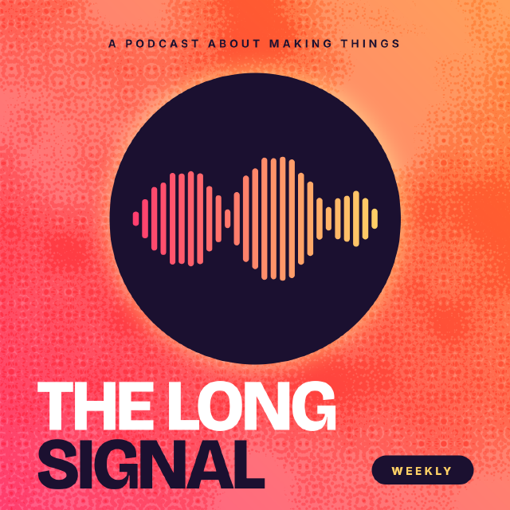</a> 
Photo 
<b><a href="podcast-cover-art/">Podcast Cover Art</a></b> 
Square podcast artwork with a halftone-textured gradient, a dark disc, a gradient waveform and a stacked bold title. 
<i>1400 × 1400 px; 10 layers; 4 type layers; 3 shape layers; 1 fill layer; 2 styled layers; 1 mask</i> 
<code>social</code> <code>podcast</code> <code>cover-art</code> <code>gradient</code> <code>shapes</code> <code>halftone</code> <code>layer-styles</code>
</td>
<td width="33%" valign="top">
<a href="youtube-thumbnail/">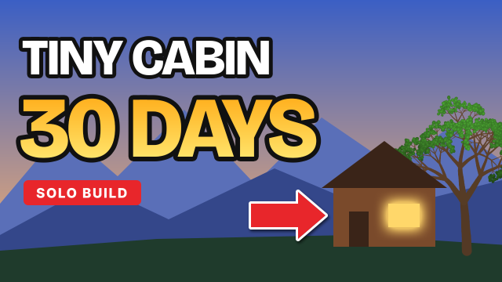</a> 
Photo 
<b><a href="youtube-thumbnail/">YouTube Video Thumbnail</a></b> 
A bold build-vlog thumbnail with outlined headline type, a rendered tree, a glowing cabin and a red call-out arrow. 
<i>1280 × 720 px; 16 layers; 3 type layers; 9 shape layers; 1 fill layer; 1 group; 4 styled layers; 1 mask</i> 
<code>social</code> <code>youtube</code> <code>thumbnail</code> <code>layer-styles</code> <code>type</code> <code>shapes</code> <code>render-filters</code>
</td>
<td width="33%"></td>
</tr>
</table>

## Typography

<table>
<tr>
<td width="33%" valign="top">
<a href="book-launch-rich-text/">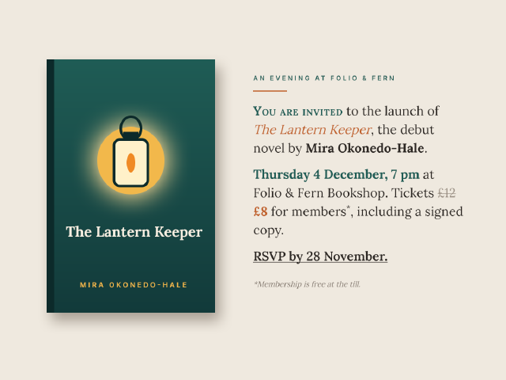</a> 
Photo 
<b><a href="book-launch-rich-text/">Book Launch Rich Text</a></b> 
A bookshop invitation whose whole message is one text layer with bold, italic, colour, strikethrough, superscript and small-caps runs. 
<i>1200 × 900 px; 14 layers; 4 type layers; 8 shape layers; 1 fill layer; 2 styled layers; 1 mask</i> 
<code>type</code> <code>paragraph-text</code> <code>character-styles</code> <code>shapes</code>
</td>
<td width="33%" valign="top">
<a href="code-snippet-share-card/">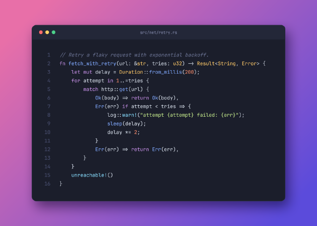</a> 
Photo 
<b><a href="code-snippet-share-card/">Code Snippet Share Card</a></b> 
A syntax-highlighted Rust snippet in a dark editor window, set in JetBrains Mono for sharing on social media. 
<i>1400 × 1000 px; 10 layers; 3 type layers; 5 shape layers; 1 fill layer; 1 styled layer; 1 mask</i> 
<code>type</code> <code>monospace</code> <code>character-styles</code> <code>layer-styles</code>
</td>
<td width="33%" valign="top">
<a href="coffee-roaster-arc-badge/">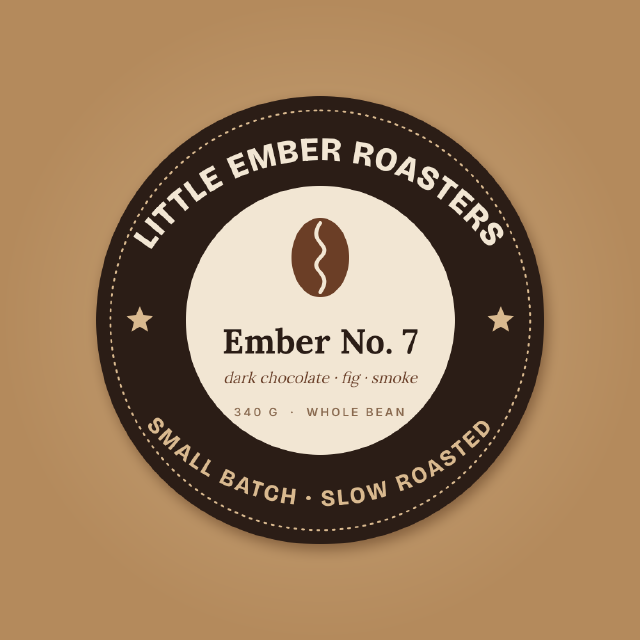</a> 
Photo 
<b><a href="coffee-roaster-arc-badge/">Coffee Roaster Arc Badge</a></b> 
A round packaging badge whose top and bottom lines are live type bent with arc warps. 
<i>1000 × 1000 px; 14 layers; 5 type layers; 7 shape layers; 1 fill layer; 1 styled layer; 1 mask</i> 
<code>type</code> <code>warp-text</code> <code>badge</code> <code>shapes</code>
</td>
</tr>
<tr>
<td width="33%" valign="top">
<a href="lora-type-specimen/">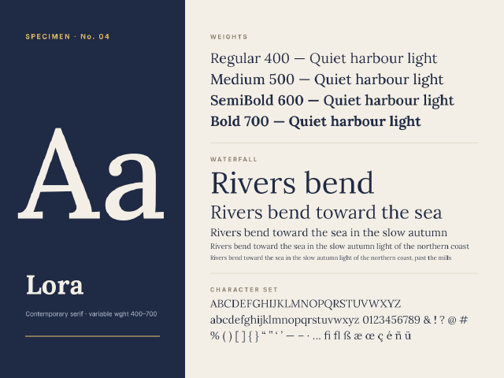</a> 
Photo 
<b><a href="lora-type-specimen/">Lora Type Specimen</a></b> 
A one-page specimen for a serif family, with a display glyph, a weight ladder, a size waterfall and the character set. 
<i>1200 × 900 px; 23 layers; 17 type layers; 4 shape layers; 1 fill layer; 1 mask</i> 
<code>type</code> <code>specimen</code> <code>variable-font</code>
</td>
<td width="33%" valign="top">
<a href="magazine-feature-spread/">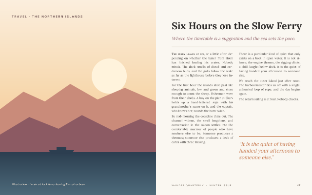</a> 
Photo 
<b><a href="magazine-feature-spread/">Magazine Feature Spread</a></b> 
A travel feature with an illustrated opener, a serif headline and two justified, hyphenated text columns. 
<i>1600 × 1000 px; 19 layers; 9 type layers; 8 shape layers; 1 fill layer; 1 mask</i> 
<code>type</code> <code>paragraph-text</code> <code>layout</code> <code>shapes</code>
</td>
<td width="33%" valign="top">
<a href="night-walk-poem-card/">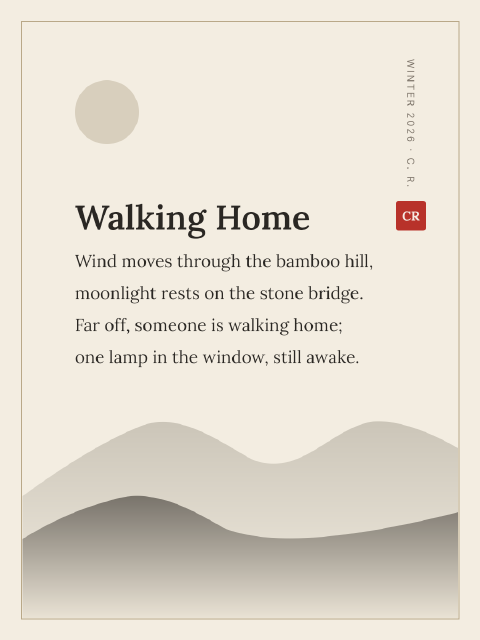</a> 
Photo 
<b><a href="night-walk-poem-card/">Night Walk Poem Card</a></b> 
A short poem set in Lora on a paragraph text box, with an ink-wash hill, a pale moon and a red seal. 
<i>900 × 1200 px; 11 layers; 4 type layers; 5 shape layers; 1 fill layer; 1 mask</i> 
<code>type</code> <code>vertical-text</code> <code>shapes</code>
</td>
</tr>
<tr>
<td width="33%" valign="top">
<a href="recipe-card-fractions/">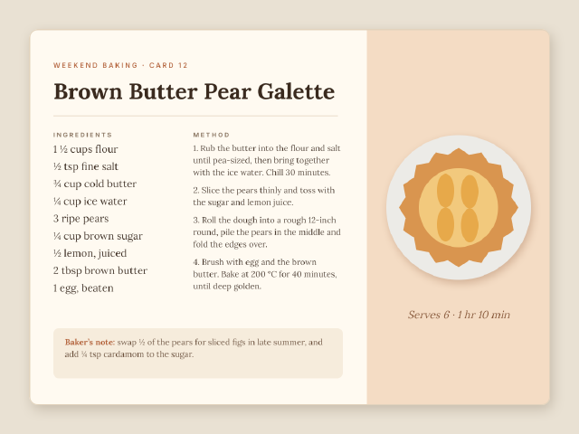</a> 
Photo 
<b><a href="recipe-card-fractions/">Recipe Card Fractions</a></b> 
A pear galette recipe card where typed 1/2 and 3/4 become true fractions with the OpenType fractions feature. 
<i>1200 × 900 px; 22 layers; 8 type layers; 12 shape layers; 1 fill layer; 2 styled layers; 1 mask</i> 
<code>type</code> <code>opentype</code> <code>paragraph-text</code> <code>shapes</code>
</td>
<td width="33%" valign="top">
 
Photo 
<b><a href="variable-font-axes-poster/">Variable Font Axes Poster</a></b> 
A design-week poster that steps one word through the weight and width axes of a variable font. 
<i>900 × 1200 px; 22 layers; 18 type layers; 2 shape layers; 1 fill layer; 1 mask</i> 
<code>type</code> <code>variable-font</code> <code>poster</code>
</td>
<td width="33%"></td>
</tr>
</table>

## UI & Web Design

<table>
<tr>
<td width="33%" valign="top">
 
Photo 
<b><a href="app-icon-grid/">App Icon Grid</a></b> 
Twelve rounded-square app icons for a fictional suite, with gradient fills, soft shadows and simple vector glyphs on a home-screen grid. 
<i>1200 × 900 px; 55 layers; 14 type layers; 39 shape layers; 1 fill layer; 12 styled layers; 1 mask</i> 
<code>ui</code> <code>icons</code> <code>gradient</code> <code>shapes</code> <code>layer-styles</code>
</td>
<td width="33%" valign="top">
 
Photo 
<b><a href="button-states-component-sheet/">Button States Component Sheet</a></b> 
A design-system sheet of four button variants in five interaction states, with the states made from layer styles. 
<i>1400 × 920 px; 58 layers; 33 type layers; 23 shape layers; 1 fill layer; 12 styled layers; 1 mask</i> 
<code>ui</code> <code>design-system</code> <code>layer-styles</code> <code>shapes</code>
</td>
<td width="33%" valign="top">
 
Photo 
<b><a href="dark-mode-settings-screen/">Dark Mode Settings Screen</a></b> 
A dark-theme phone settings screen at 375 × 812 pt (@2x), with grouped list cards, toggles, values and chevrons. 
<i>750 × 1624 px; 65 layers; 20 type layers; 43 shape layers; 1 fill layer; 5 styled layers; 1 mask</i> 
<code>ui</code> <code>mobile</code> <code>dark-mode</code> <code>shapes</code> <code>layer-styles</code>
</td>
</tr>
<tr>
<td width="33%" valign="top">
 
Photo 
<b><a href="mobile-app-login-screen/">Mobile App Login Screen</a></b> 
A sign-in screen for a fictional budgeting app at 375 × 812 pt (@2x), with fields, a gradient button and grouped sections. 
<i>750 × 1624 px; 38 layers; 14 type layers; 16 shape layers; 1 fill layer; 6 groups; 3 styled layers; 1 mask</i> 
<code>ui</code> <code>mobile</code> <code>shapes</code> <code>layer-styles</code> <code>groups</code>
</td>
<td width="33%" valign="top">
 
Photo 
<b><a href="saas-pricing-table/">SaaS Pricing Table</a></b> 
A three-tier pricing section for a web page, with a highlighted middle plan, a billing toggle and checkmark feature lists. 
<i>1600 × 1000 px; 49 layers; 32 type layers; 15 shape layers; 1 fill layer; 4 styled layers; 1 mask</i> 
<code>ui</code> <code>web</code> <code>shapes</code> <code>layer-styles</code> <code>type</code>
</td>
<td width="33%" valign="top">
 
Photo 
<b><a href="sales-analytics-dashboard/">Sales Analytics Dashboard</a></b> 
A store analytics dashboard with KPI tiles, a grouped weekly revenue chart and channel share bars, all live shapes and type. 
<i>1600 × 1000 px; 78 layers; 51 type layers; 25 shape layers; 1 fill layer; 6 styled layers; 1 mask</i> 
<code>ui</code> <code>dashboard</code> <code>chart</code> <code>shapes</code> <code>layer-styles</code>
</td>
</tr>
</table>

## Tags

`adjustment-layers` 7 · `badge` 2 · `banner` 3 · `before-after` 2 · `bevel` 1 · `black-and-white` 1 · `blend-modes` 6 · `blur` 2 · `book-cover` 1 · `business-card` 1 · `certificate` 1 · `character-styles` 2 · `chart` 1 · `cityscape` 1 · `clipping-mask` 9 · `color-grading` 1 · `cover-art` 1 · `curves` 2 · `dark-mode` 1 · `dashboard` 1 · `design-system` 1 · `drop-shadow` 2 · `duotone` 1 · `emoji` 2 · `filters` 3 · `flat-design` 1 · `flyer` 1 · `glass` 1 · `glow` 1 · `gradient` 12 · `gradient-map` 2 · `greeting-card` 2 · `groups` 8 · `halftone` 1 · `hue-saturation` 1 · `icons` 2 · `illustration` 7 · `instagram` 2 · `invitation` 1 · `isometric` 1 · `landscape` 4 · `layer-styles` 28 · `layout` 1 · `levels` 1 · `linkedin` 1 · `loyalty-card` 1 · `masks` 6 · `menu` 1 · `minimal` 1 · `mobile` 2 · `monospace` 1 · `noise` 3 · `opentype` 1 · `ornaments` 2 · `paragraph-text` 4 · `pattern` 1 · `patterns` 1 · `photo-filter` 1 · `podcast` 1 · `poster` 6 · `posterize` 1 · `print` 14 · `reference` 3 · `render-filters` 17 · `retro` 1 · `selections` 1 · `shapes` 40 · `smart-filters` 2 · `smart-objects` 3 · `social` 5 · `specimen` 1 · `story` 1 · `stroke` 1 · `textures` 3 · `thumbnail` 1 · `ticket` 1 · `type` 28 · `typography` 5 · `ui` 7 · `variable-font` 2 · `vertical-text` 1 · `vertical-type` 1 · `warp-text` 2 · `web` 3 · `wedding` 1 · `youtube` 1
