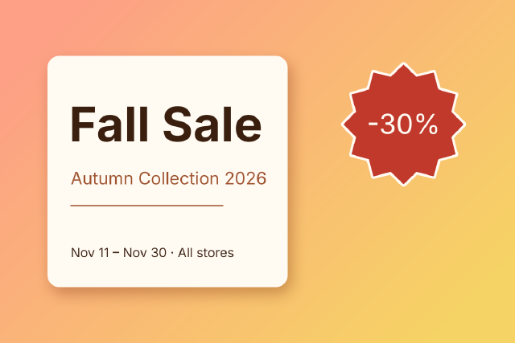

<!-- Generated by tools/gallery.mjs from showcase.yaml and build.json; do not edit. -->
# Autumn Sale Poster

[Photo](../README.md) › [Posters & Marketing](../README.md#posters--marketing) · `gradient` `shapes` `layer-styles` `type`

A retail poster with a gradient fill layer, a shadowed card, a star badge and type.



| | |
|---|---|
| Document | [autumn-sale-poster.psd](autumn-sale-poster.psd) (566 KB) |
| Contents | 1200 × 800 px; 9 layers; 4 type layers; 3 shape layers; 1 fill layer; 2 styled layers; 1 mask |
| Features | `photo.paint.gradients`, `photo.path.shapes`, `photo.layer.style-basics`, `photo.type.point-text` |
| Built by | `kition-photo` @ `3fe24b1662`: 10 commands in 44 ms |

## About

Every element stays editable: the background is a gradient fill layer, the card and the badge are
live shapes, the shadow and stroke are layer styles, and every line of text is a type layer.

## Checks

- `inspect.layers`: `{"count":9,"any":{"name":"Headline","kind":"Type","text":{"text":"Fall Sale"}}}`
- `inspect.layers.0`: `{"kind":"Type","name":"Dates"}`
- diagnostics: none (the kit's check finds nothing wrong)
- the saved document opens again; the thumbnail matches `thumb.png` within the `render` tolerance

## Steps

<details><summary>10 commands (from <a href="showcase.yaml">showcase.yaml</a>)</summary>

```yaml
- command: layer.newFillLayer.gradient
  params:
    from: "#f6d365"
    to: "#fda085"
    angle: 135
    style: linear
  as: background
- command: shape.create
  params:
    kind: roundedRect
    rect:
      - 110
      - 130
      - 560
      - 540
    radii: 28
    fill: "#fffaf2"
    name: Card
  as: card
- command: layer.layerStyle.dropShadow
  params:
    layer: $card.layer
    color: "#7a3410"
    opacity: 35
    distance: 18
    size: 40
    angle: 120
- command: shape.create
  params:
    kind: star
    rect:
      - 800
      - 150
      - 280
      - 280
    sides: 12
    starRatio: 0.82
    fill: "#c0392b"
    name: Badge
  as: badge
- command: layer.layerStyle.stroke
  params:
    layer: $badge.layer
    size: 6
    position: outside
    color: "#fffaf2"
- command: type.create
  params:
    x: 940
    y: 312
    text: -30%
    font: Inter
    size: 64
    color: "#fffaf2"
    align: center
    name: Discount
- command: type.create
  params:
    x: 160
    y: 330
    text: Fall Sale
    font: Inter
    size: 112
    weight: 700
    color: "#3b1f0e"
    name: Headline
- command: type.create
  params:
    x: 164
    y: 430
    text: Autumn Collection 2026
    font: Inter
    size: 40
    color: "#a0522d"
    name: Subtitle
- command: shape.create
  params:
    kind: line
    from:
      - 164
      - 480
    to:
      - 520
      - 480
    weight: 3
    fill: "#a0522d"
    name: Rule
- command: type.create
  params:
    x: 164
    y: 600
    text: Nov 11 – Nov 30 · All stores
    font: Inter
    size: 30
    color: "#3b1f0e"
    name: Dates
```

</details>
