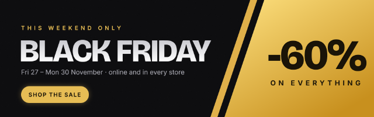

<!-- Generated by tools/gallery.mjs from showcase.yaml and build.json; do not edit. -->
# Black Friday Web Banner

[Photo](../README.md) › [Posters & Marketing](../README.md#posters--marketing) · `banner` `web` `gradient` `shapes` `layer-styles` `type` `noise`

A wide hero banner for a weekend sale, with a slanted gold panel, a gradient-filled discount and a call-to-action button.



| | |
|---|---|
| Document | [black-friday-web-banner.psd](black-friday-web-banner.psd) (4.0 MB) |
| Contents | 1600 × 500 px; 13 layers; 6 type layers; 3 shape layers; 1 fill layer; 1 group; 3 styled layers; 1 mask |
| Features | `photo.path.shapes`, `photo.layer.styles`, `photo.type.point-text`, `photo.filter.noise-sharpen`, `photo.layer.manage` |
| Built by | `kition-photo` @ `7abaa42e9a`: 19 commands in 384 ms |

## About

A 1600 × 500 site header. The slanted panel and its accent stripe are custom path shapes with
gradient fills, the discount gets a Gradient Overlay and an Inner Shadow, and the button is a
rounded rectangle with a Drop Shadow, grouped with its label. Monochrome noise on an Overlay
layer gives the black background a printed grain.

## Checks

- `inspect.layers`: `{"count":11}`
- `inspect.layers.0`: `{"name":"Button","kind":"Group","children":{"count":2}}`
- `inspect.layers.0.children.1`: `{"name":"Button Shape","kind":"Shape","effects":{"items":{"any":{"key":"dropShadow"}}}}`
- `inspect.layers.2`: `{"name":"Headline","kind":"Type","text":{"text":"BLACK FRIDAY"},"effects":{"items":{"any":{"key":"gradientOverlay"}}}}`
- `inspect.layers.5`: `{"name":"Discount","text":{"text":"-60%"},"effects":{"items":{"any":{"key":"innerShadow"}}}}`
- `inspect.layers.8`: `{"name":"Grain","blend":"Overlay","opacity":{"approx":0.5,"tol":0.01}}`
- diagnostics: none (the kit's check finds nothing wrong)
- the saved document opens again; the thumbnail matches `thumb.png` within the `render` tolerance

## Steps

<details><summary>19 commands (from <a href="showcase.yaml">showcase.yaml</a>)</summary>

```yaml
- command: layer.newFillLayer.solidColor
  params:
    color: "#0e0e10"
  as: bg
- command: layer.setProps
  params:
    layer: $bg.layer
    name: Night
- command: layer.new.layer
  params:
    name: Grain
  as: grain
- command: edit.fill
  params:
    contents: color
    color: "#808080"
- command: filter.noise.addNoise
  params:
    amount: 18
    distribution: gaussian
    monochromatic: true
    seed: 11
- command: layer.setProps
  params:
    layer: $grain.layer
    blend: Overlay
    opacity: 0.5
- command: shape.create
  params:
    kind: path
    path:
      subpaths:
        - closed: true
          knots:
            - - 1130
              - 0
            - - 1600
              - 0
            - - 1600
              - 500
            - - 960
              - 500
    fill:
      gradient:
        stops:
          - - 0
            - "#f7d774"
          - - 1
            - "#c8901e"
        angle: -60
    name: Gold Panel
  as: panel
- command: shape.create
  params:
    kind: path
    path:
      subpaths:
        - closed: true
          knots:
            - - 1070
              - 0
            - - 1100
              - 0
            - - 930
              - 500
            - - 900
              - 500
    fill: "#e0b04a"
    name: Accent Stripe
  as: stripe
- command: type.create
  params:
    x: 1355
    y: 295
    text: -60%
    font: Bricolage Grotesque
    weight: 800
    size: 180
    tracking: -30
    color: "#1a1408"
    align: center
    name: Discount
  as: discount
- command: layer.layerStyle.innerShadow
  params:
    layer: $discount.layer
    color: "#000000"
    opacity: 35
    distance: 4
    size: 6
    angle: 90
- command: type.create
  params:
    x: 1355
    y: 365
    text: ON EVERYTHING
    font: Inter
    weight: 700
    size: 30
    tracking: 380
    color: "#1a1408"
    align: center
    name: Discount Note
- command: type.create
  params:
    x: 90
    y: 128
    text: THIS WEEKEND ONLY
    font: Inter
    weight: 600
    size: 24
    tracking: 450
    color: "#e7bd55"
    name: Kicker
- command: type.create
  params:
    x: 84
    y: 262
    text: BLACK FRIDAY
    font: Bricolage Grotesque
    weight: 800
    size: 136
    tracking: -20
    color: "#ffffff"
    name: Headline
  as: headline
- command: layer.layerStyle.gradientOverlay
  params:
    layer: $headline.layer
    from: "#ffffff"
    to: "#c9c9cf"
    angle: 90
- command: type.create
  params:
    x: 90
    y: 318
    text: Fri 27 – Mon 30 November · online and in every store
    font: Inter
    size: 28
    color: "#a9a9b2"
    name: Dates
- command: layer.new.group
  params:
    name: Button
  as: button
- command: shape.create
  params:
    kind: roundedRect
    rect:
      - 90
      - 368
      - 290
      - 72
    radii: 36
    fill: "#e7bd55"
    name: Button Shape
  as: btn
- command: layer.layerStyle.dropShadow
  params:
    layer: $btn.layer
    color: "#e7bd55"
    opacity: 35
    distance: 0
    size: 24
    blend: screen
- command: type.create
  params:
    x: 235
    y: 413
    text: SHOP THE SALE
    font: Inter
    weight: 700
    size: 24
    tracking: 120
    color: "#1a1408"
    align: center
    name: Button Label
  as: label
```

</details>
