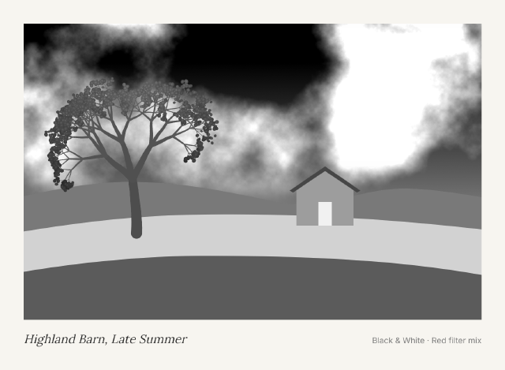

<!-- Generated by tools/gallery.mjs from showcase.yaml and build.json; do not edit. -->
# Black & White Red Filter Print

[Photo](../README.md) › [Adjustments & Color](../README.md#adjustments--color) · `adjustment-layers` `black-and-white` `render-filters` `landscape` `print`

A colorful farm landscape turned into a dramatic monochrome print with a Black & White layer mixed like a red lens filter.



| | |
|---|---|
| Document | [black-white-red-filter.psd](black-white-red-filter.psd) (5.2 MB) |
| Contents | 1500 × 1100 px; 14 layers; 2 type layers; 7 shape layers; 1 adjustment layer; 1 fill layer; 2 masks |
| Features | `photo.layer.adjustment`, `photo.filter.blur`, `photo.path.shapes` |
| Built by | `kition-photo` @ `7abaa42e9a`: 24 commands in 1406 ms |

## About

Under the print is a full-color scene: a blue sky with rendered clouds in Screen mode, green hills,
a golden field, a red barn and a rendered oak. One Black & White adjustment layer converts it,
with the channel mix of a red filter: reds and yellows lifted, blues and cyans pulled down, so the
sky goes deep and the clouds and the field glow. Hide the adjustment layer to see the colors. A
shape with an even-odd hole makes the white mat and the caption sits underneath.

## Checks

- `inspect.layers`: `{"count":14,"any":{"name":"Barn","kind":"Shape"}}`
- `inspect.layers.3`: `{"name":"Red Filter Mix","kind":"Adjustment","adjustmentKind":"blackWhite","adjustmentParams":{"reds":80,"yellows":95,"blues":-50,"cyans":-30,"tint":false}}`
- `inspect.layers.2`: `{"name":"Mat","kind":"Shape"}`
- `inspect.layers.-3`: `{"name":"Clouds","blend":"Screen","hasMask":true}`
- diagnostics: none (the kit's check finds nothing wrong)
- the saved document opens again; the thumbnail matches `thumb.png` within the `render` tolerance

## Steps

<details><summary>24 commands (from <a href="showcase.yaml">showcase.yaml</a>)</summary>

```yaml
- command: gradient.fill.create
  params:
    from:
      - 0
      - 70
    to:
      - 0
      - 640
    stops:
      - - 0
        - "#1f5fb8"
      - - 1
        - "#9fd0f2"
  as: sky
- command: layer.renameLayer
  params:
    layer: $sky.layer
    name: Sky
- command: layer.new.layer
  params:
    name: Clouds
  as: clouds
- command: tools.setColors
  params:
    foreground: "#000000"
    background: "#ffffff"
- command: filter.render.clouds
  params:
    seed: 21
- command: image.adjustments.levels
  params:
    inBlack: 140
    inWhite: 250
    gamma: 0.8
- command: layer.setProps
  params:
    layer: $clouds.layer
    blend: Screen
- command: select.rect
  params:
    x: 0
    y: 0
    width: 1500
    height: 560
    feather: 60
- command: layer.layerMask.revealSelection
  params:
    layer: $clouds.layer
- command: select.deselect
- command: shape.create
  params:
    kind: path
    name: Far Hills
    fill: "#5f9a5a"
    path:
      subpaths:
        - knots:
            - - 0
              - 600
            - anchor:
                - 380
                - 540
              in:
                - 220
                - 540
              out:
                - 540
                - 540
              smooth: true
            - anchor:
                - 820
                - 600
              in:
                - 680
                - 570
              out:
                - 960
                - 630
              smooth: true
            - anchor:
                - 1200
                - 560
              in:
                - 1060
                - 560
              out:
                - 1320
                - 560
              smooth: true
            - - 1500
              - 600
            - - 1500
              - 1100
            - - 0
              - 1100
- command: shape.create
  params:
    kind: path
    name: Golden Field
    fill: "#e2b23a"
    path:
      subpaths:
        - knots:
            - - 0
              - 700
            - anchor:
                - 500
                - 640
              in:
                - 260
                - 650
              out:
                - 740
                - 630
              smooth: true
            - anchor:
                - 1500
                - 690
              in:
                - 1100
                - 640
              out:
                - 1500
                - 690
            - - 1500
              - 1100
            - - 0
              - 1100
- command: shape.create
  params:
    kind: path
    name: Near Meadow
    fill: "#3f7d3a"
    path:
      subpaths:
        - knots:
            - - 0
              - 820
            - anchor:
                - 600
                - 760
              in:
                - 300
                - 760
              out:
                - 900
                - 760
              smooth: true
            - anchor:
                - 1500
                - 830
              in:
                - 1200
                - 770
              out:
                - 1500
                - 830
            - - 1500
              - 1100
            - - 0
              - 1100
- command: shape.create
  params:
    kind: rect
    rect:
      - 880
      - 560
      - 170
      - 110
    fill: "#b8322a"
    name: Barn
  as: barn
- command: shape.create
  params:
    kind: path
    fill: "#b8322a"
    addTo: $barn.layer
    op: combine
    path:
      subpaths:
        - knots:
            - - 870
              - 562
            - - 965
              - 500
            - - 1060
              - 562
- command: shape.create
  params:
    kind: path
    name: Barn Roof
    fill: "#4a3a33"
    path:
      subpaths:
        - knots:
            - - 860
              - 566
            - - 965
              - 494
            - - 1070
              - 566
            - - 1060
              - 572
            - - 965
              - 508
            - - 870
              - 572
- command: shape.create
  params:
    kind: rect
    rect:
      - 945
      - 600
      - 40
      - 70
    fill: "#f2efe6"
    name: Barn Door
- command: layer.new.layer
  params:
    name: Oak
  as: oak
- command: filter.render.tree
  params:
    baseTreeType: 1
    x: 0.27
    y: 0.63
    size: 0.42
    seed: 5
- command: layer.newAdjustmentLayer.blackWhite
  params:
    reds: 80
    yellows: 95
    greens: 45
    cyans: -30
    blues: -50
    magentas: 60
  as: bw
- command: layer.renameLayer
  params:
    layer: $bw.layer
    name: Red Filter Mix
- command: shape.create
  params:
    kind: path
    name: Mat
    fill: "#f7f5f0"
    path:
      subpaths:
        - knots:
            - - 0
              - 0
            - - 1500
              - 0
            - - 1500
              - 1100
            - - 0
              - 1100
        - op: subtract
          knots:
            - - 70
              - 70
            - - 1430
              - 70
            - - 1430
              - 950
            - - 70
              - 950
- command: type.create
  params:
    x: 70
    y: 1020
    text: Highland Barn, Late Summer
    font: Lora
    size: 36
    italic: true
    color: "#2b2b2b"
    name: Caption
- command: type.create
  params:
    x: 1430
    y: 1020
    text: Black & White · Red filter mix
    font: Inter
    size: 24
    color: "#7a7a7a"
    align: right
    name: Note
```

</details>
