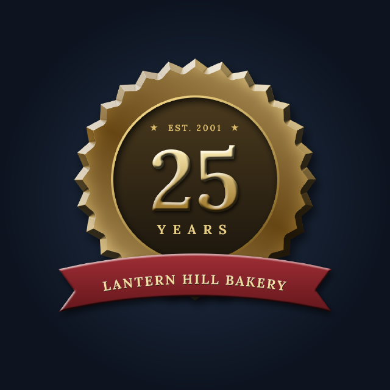

<!-- Generated by tools/gallery.mjs from showcase.yaml and build.json; do not edit. -->
# Gold Anniversary Badge

[Photo](../README.md) › [Layer Styles](../README.md#layer-styles) · `layer-styles` `bevel` `gradient` `badge`

A metal anniversary emblem whose gold comes entirely from stacked Gradient Overlay, Bevel & Emboss and Satin effects.



| | |
|---|---|
| Document | [brushed-gold-anniversary-badge.psd](brushed-gold-anniversary-badge.psd) (970 KB) |
| Contents | 1000 × 1000 px; 9 layers; 4 type layers; 3 shape layers; 1 fill layer; 5 styled layers; 1 mask |
| Features | `photo.layer.styles`, `photo.path.shapes`, `photo.type.point-text` |
| Built by | `kition-photo` @ `7abaa42e9a`: 23 commands in 134 ms |

## About

The shapes are flat colours; the metal is the layer style. The scalloped rim stacks a gold
Gradient Overlay, a chiselled Bevel & Emboss, a Satin for the brushed sheen and a Drop Shadow.
The inner disc is sunk with an Inner Shadow, the numerals are raised with their own bevel and
gradient, and the ribbon has a darker bevel with embossed lettering.

## Checks

- `inspect.layers`: `{"count":9}`
- `inspect.layers.-3`: `{"name":"Rim","kind":"Shape","effects":{"enabled":true,"items":{"count":4,"all":{"enabled":true}}}}`
- `inspect.layers.-3.effects.items.0.key`: `"gradientOverlay"`
- `inspect.layers.-3.effects.items.1.key`: `"bevelEmboss"`
- `inspect.layers.-3.effects.items.2.key`: `"satin"`
- `inspect.layers.-3.effects.items.3.key`: `"dropShadow"`
- `inspect.layers.-4`: `{"name":"Inner Disc","effects":{"items":{"any":{"key":"innerShadow"}}}}`
- `inspect.layers.3`: `{"name":"Numerals","kind":"Type","text":{"text":"25","font":"Lora"}}`
- `inspect.layers.0`: `{"name":"Ribbon Text","effects":{"items":{"count":1,"all":{"key":"bevelEmboss"}}}}`
- diagnostics: none (the kit's check finds nothing wrong)
- the saved document opens again; the thumbnail matches `thumb.png` within the `render` tolerance

## Steps

<details><summary>23 commands (from <a href="showcase.yaml">showcase.yaml</a>)</summary>

```yaml
- command: layer.newFillLayer.gradient
  params:
    from: "#23324a"
    to: "#0d1420"
    angle: 90
    style: radial
  as: backdrop
- command: shape.create
  params:
    kind: star
    rect:
      - 190
      - 150
      - 620
      - 620
    sides: 28
    starRatio: 0.93
    fill: "#c9a24a"
    name: Rim
  as: rim
- command: layer.layerStyle.gradientOverlay
  params:
    layer: $rim.layer
    from: "#8a6420"
    to: "#ffe9a8"
    angle: 60
    style: reflected
    scale: 120
- command: layer.layerStyle.bevelEmboss
  params:
    layer: $rim.layer
    style: inner
    technique: chiselHard
    size: 16
    depth: 220
    angle: 120
    altitude: 35
- command: layer.layerStyle.satin
  params:
    layer: $rim.layer
    color: "#5a3e10"
    opacity: 40
    distance: 26
    size: 40
    angle: 20
- command: layer.layerStyle.dropShadow
  params:
    layer: $rim.layer
    color: "#000000"
    opacity: 60
    distance: 16
    size: 30
    angle: 110
- command: shape.create
  params:
    kind: ellipse
    rect:
      - 290
      - 250
      - 420
      - 420
    fill: "#2a2216"
    name: Inner Disc
  as: disc
- command: layer.layerStyle.gradientOverlay
  params:
    layer: $disc.layer
    from: "#1c160d"
    to: "#4a3a1e"
    angle: 90
- command: layer.layerStyle.innerShadow
  params:
    layer: $disc.layer
    color: "#000000"
    opacity: 75
    distance: 10
    size: 22
    angle: 120
- command: layer.layerStyle.stroke
  params:
    layer: $disc.layer
    size: 6
    position: outside
    from: "#7a5a1c"
    to: "#f4d98a"
    angle: 120
- command: type.create
  params:
    x: 500
    y: 335
    text: ★  EST. 2001  ★
    font: Lora
    size: 22
    weight: 700
    tracking: 200
    color: "#d9b867"
    align: center
    name: Est Line
- command: type.create
  params:
    x: 500
    y: 540
    text: "25"
    font: Lora
    size: 220
    weight: 700
    color: "#d4af37"
    align: center
    name: Numerals
  as: numerals
- command: layer.layerStyle.gradientOverlay
  params:
    layer: $numerals.layer
    from: "#9a7224"
    to: "#fff1b8"
    angle: 90
    style: linear
- command: layer.layerStyle.bevelEmboss
  params:
    layer: $numerals.layer
    style: inner
    technique: smooth
    size: 8
    depth: 180
    angle: 120
    altitude: 40
- command: layer.layerStyle.dropShadow
  params:
    layer: $numerals.layer
    color: "#000000"
    opacity: 70
    distance: 6
    size: 10
    angle: 120
- command: type.create
  params:
    x: 500
    y: 600
    text: YEARS
    font: Lora
    size: 34
    weight: 700
    tracking: 500
    color: "#e8cf87"
    align: center
    name: Years
- command: shape.create
  params:
    kind: path
    fill: "#7d1f24"
    name: Ribbon
    path:
      subpaths:
        - knots:
            - - 150
              - 690
            - anchor:
                - 500
                - 650
              in:
                - 300
                - 650
              out:
                - 700
                - 650
            - - 850
              - 690
            - - 810
              - 745
            - - 850
              - 800
            - anchor:
                - 500
                - 760
              in:
                - 700
                - 760
              out:
                - 300
                - 760
            - - 150
              - 800
            - - 190
              - 745
  as: ribbon
- command: layer.layerStyle.bevelEmboss
  params:
    layer: $ribbon.layer
    style: inner
    technique: smooth
    size: 6
    depth: 120
    angle: 120
    altitude: 30
- command: layer.layerStyle.gradientOverlay
  params:
    layer: $ribbon.layer
    from: "#5c1418"
    to: "#a8323a"
    angle: 90
    opacity: 80
- command: layer.layerStyle.dropShadow
  params:
    layer: $ribbon.layer
    color: "#000000"
    opacity: 55
    distance: 10
    size: 18
    angle: 110
- command: type.create
  params:
    x: 500
    y: 728
    text: LANTERN HILL BAKERY
    font: Lora
    size: 34
    weight: 700
    tracking: 120
    color: "#f6dfa0"
    align: center
    name: Ribbon Text
  as: ribbonText
- command: type.warpText
  params:
    layer: $ribbonText.layer
    style: arc
    bend: 10
- command: layer.layerStyle.bevelEmboss
  params:
    layer: $ribbonText.layer
    style: emboss
    technique: smooth
    size: 2
    depth: 100
    angle: 120
    altitude: 30
```

</details>
