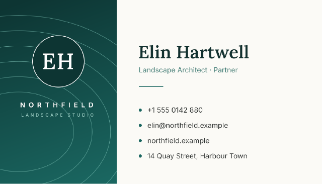

<!-- Generated by tools/gallery.mjs from showcase.yaml and build.json; do not edit. -->
# Business Card Front

[Photo](../README.md) › [Print & Stationery](../README.md#print--stationery) · `print` `business-card` `shapes` `clipping-mask` `type` `gradient`

A landscape architect's business card with a teal monogram panel, clipped contour lines and a clean contact column.



| | |
|---|---|
| Document | [business-card-front.psd](business-card-front.psd) (459 KB) |
| Contents | 1050 × 600 px; 17 layers; 9 type layers; 5 shape layers; 1 fill layer; 1 group; 1 mask |
| Features | `photo.path.shapes`, `photo.layer.mask-basics`, `photo.type.point-text`, `photo.layer.manage` |
| Built by | `kition-photo` @ `7abaa42e9a`: 26 commands in 262 ms |

## About

The front of a 3.5 × 2 inch card at 300 ppi. The left panel is a gradient-filled rectangle; the
topographic contour lines are one shape layer of combined, stroke-only ellipses clipped to the
panel with a clipping mask, so they never spill onto the white side. The contact details are a
group of type layers with small teal markers.

## Checks

- `inspect.layers`: `{"count":12}`
- `inspect.layers.0`: `{"name":"Contact","kind":"Group","children":{"count":5}}`
- `inspect.layers.3`: `{"name":"Name","kind":"Type","text":{"text":"Elin Hartwell","font":"Lora"}}`
- `inspect.layers.-4`: `{"name":"Contours","kind":"Shape","clipped":true}`
- `inspect.layers.-3`: `{"name":"Panel","kind":"Shape","clipped":false}`
- diagnostics: none (the kit's check finds nothing wrong)
- the saved document opens again; the thumbnail matches `thumb.png` within the `render` tolerance

## Steps

<details><summary>26 commands (from <a href="showcase.yaml">showcase.yaml</a>)</summary>

```yaml
- command: layer.newFillLayer.solidColor
  params:
    color: "#fbfaf6"
  as: card
- command: layer.setProps
  params:
    layer: $card.layer
    name: Card Stock
- command: shape.create
  params:
    kind: rect
    rect:
      - 0
      - 0
      - 380
      - 600
    fill:
      gradient:
        stops:
          - - 0
            - "#0d3533"
          - - 1
            - "#1a6660"
        angle: -70
    name: Panel
  as: panel
- command: shape.create
  params:
    kind: ellipse
    rect:
      - -120
      - 300
      - 360
      - 260
    fill: null
    stroke:
      width: 1.5
      color: "#7fc4b8"
      opacity: 60
    name: Contours
  as: contours
- command: shape.create
  params:
    kind: ellipse
    rect:
      - -180
      - 250
      - 480
      - 360
    addTo: $contours.layer
- command: shape.create
  params:
    kind: ellipse
    rect:
      - -240
      - 200
      - 600
      - 460
    addTo: $contours.layer
- command: shape.create
  params:
    kind: ellipse
    rect:
      - -300
      - 150
      - 720
      - 560
    addTo: $contours.layer
- command: shape.create
  params:
    kind: ellipse
    rect:
      - -360
      - 100
      - 840
      - 660
    addTo: $contours.layer
- command: shape.create
  params:
    kind: ellipse
    rect:
      - -420
      - 50
      - 960
      - 760
    addTo: $contours.layer
- command: layer.createClippingMask
  params:
    layer: $contours.layer
- command: shape.create
  params:
    kind: ellipse
    rect:
      - 105
      - 115
      - 170
      - 170
    fill: "#0d3533"
    stroke:
      width: 2
      color: "#ffffff"
      align: inside
    name: Monogram Ring
  as: ring
- command: type.create
  params:
    x: 190
    y: 225
    text: EH
    font: Lora
    weight: 500
    size: 72
    tracking: 40
    color: "#ffffff"
    align: center
    name: Monogram
- command: type.create
  params:
    x: 190
    y: 350
    text: NORTHFIELD
    font: Inter
    weight: 600
    size: 22
    tracking: 500
    color: "#ffffff"
    align: center
    name: Studio
- command: type.create
  params:
    x: 190
    y: 380
    text: LANDSCAPE STUDIO
    font: Inter
    size: 14
    tracking: 450
    color: "#9fd3c9"
    align: center
    name: Studio Line
- command: type.create
  params:
    x: 450
    y: 190
    text: Elin Hartwell
    font: Lora
    weight: 600
    size: 58
    color: "#12312f"
    name: Name
- command: type.create
  params:
    x: 452
    y: 236
    text: Landscape Architect · Partner
    font: Inter
    size: 23
    color: "#3f7d75"
    name: Role
- command: shape.create
  params:
    kind: line
    from:
      - 452
      - 282
    to:
      - 532
      - 282
    weight: 3
    fill: "#1a6660"
    name: Rule
- command: layer.new.group
  params:
    name: Contact
  as: contact
- command: shape.create
  params:
    kind: ellipse
    rect:
      - 452
      - 354
      - 10
      - 10
    fill: "#1a6660"
    name: Markers
  as: markers
- command: shape.create
  params:
    kind: ellipse
    rect:
      - 452
      - 404
      - 10
      - 10
    addTo: $markers.layer
- command: shape.create
  params:
    kind: ellipse
    rect:
      - 452
      - 454
      - 10
      - 10
    addTo: $markers.layer
- command: shape.create
  params:
    kind: ellipse
    rect:
      - 452
      - 504
      - 10
      - 10
    addTo: $markers.layer
- command: type.create
  params:
    x: 480
    y: 367
    text: +1 555 0142 880
    font: Inter
    size: 23
    color: "#2b2f2e"
    name: Phone
  as: c1
- command: type.create
  params:
    x: 480
    y: 417
    text: elin@northfield.example
    font: Inter
    size: 23
    color: "#2b2f2e"
    name: Email
  as: c2
- command: type.create
  params:
    x: 480
    y: 467
    text: northfield.example
    font: Inter
    size: 23
    color: "#2b2f2e"
    name: Website
  as: c3
- command: type.create
  params:
    x: 480
    y: 517
    text: 14 Quay Street, Harbour Town
    font: Inter
    size: 23
    color: "#2b2f2e"
    name: Address
  as: c4
```

</details>
