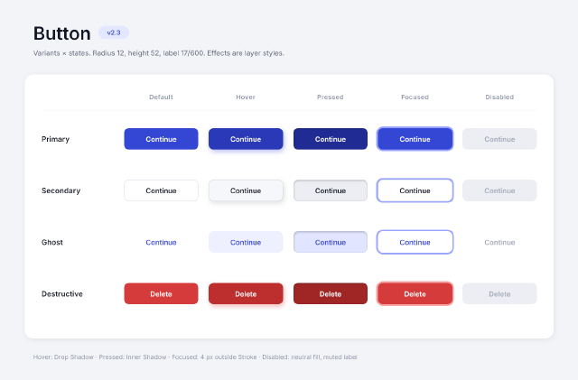

<!-- Generated by tools/gallery.mjs from showcase.yaml and build.json; do not edit. -->
# Button States Component Sheet

[Photo](../README.md) › [UI & Web Design](../README.md#ui--web-design) · `ui` `design-system` `layer-styles` `shapes`

A design-system sheet of four button variants in five interaction states, with the states made from layer styles.



| | |
|---|---|
| Document | [button-states-component-sheet.psd](button-states-component-sheet.psd) (785 KB) |
| Contents | 1400 × 920 px; 58 layers; 33 type layers; 23 shape layers; 1 fill layer; 12 styled layers; 1 mask |
| Features | `photo.layer.styles`, `photo.layer.style-basics`, `photo.path.shapes`, `photo.type.point-text` |
| Built by | `kition-photo` @ `7abaa42e9a`: 69 commands in 203 ms |

## About

Primary, secondary, ghost and destructive buttons across default, hover, pressed, focused and
disabled states. The states are styles, not new drawings: hover adds a tinted Drop Shadow,
pressed an Inner Shadow on a darker fill, and focused a 4 px outside Stroke as the focus ring.
Every button is a rounded-rectangle shape with a centred type layer.

## Checks

- `inspect.layers`: `{"any":{"name":"Primary Pressed","kind":"Shape","effects":{"items":[{"enabled":true,"key":"innerShadow","kind":"Inner Shadow"}]}}}`
- `inspect.layers`: `{"any":{"name":"Destructive Focused","kind":"Shape","effects":{"items":[{"enabled":true,"key":"stroke","kind":"Stroke"}]}}}`
- `inspect.layers`: `{"any":{"name":"Ghost Disabled","kind":"Shape","effects":{"exists":false}}}`
- `inspect.layers`: `{"any":{"name":"Secondary Hover Label","kind":"Type","text":{"text":"Continue"}}}`
- diagnostics: none (the kit's check finds nothing wrong)
- the saved document opens again; the thumbnail matches `thumb.png` within the `render` tolerance

## Steps

<details><summary>69 commands (from <a href="showcase.yaml">showcase.yaml</a>)</summary>

```yaml
- command: layer.newFillLayer.solidColor
  params:
    color: "#f3f4f7"
  as: page
- command: type.create
  params:
    x: 80
    y: 96
    text: Button
    font: Inter
    size: 44
    weight: 600
    color: "#101322"
    name: Title
- command: shape.create
  params:
    kind: roundedRect
    rect:
      - 238
      - 62
      - 74
      - 32
    radii: 16
    fill: "#e3e7ff"
    name: Version Pill
- command: type.create
  params:
    x: 275
    y: 84
    text: v2.3
    font: Inter
    size: 15
    weight: 600
    color: "#3446d4"
    align: center
    name: Version
- command: type.create
  params:
    x: 80
    y: 134
    text: Variants × states. Radius 12, height 52, label 17/600. Effects are layer styles.
    font: Inter
    size: 17
    color: "#5b6075"
    name: Spec Line
- command: shape.create
  params:
    kind: roundedRect
    rect:
      - 60
      - 180
      - 1280
      - 640
    radii: 20
    fill: "#ffffff"
    name: Board
  as: board
- command: layer.layerStyle.dropShadow
  params:
    layer: $board.layer
    color: "#1a1f36"
    opacity: 8
    distance: 4
    size: 16
    angle: 90
- command: type.create
  params:
    x: 390
    y: 240
    text: Default
    font: Inter
    size: 15
    weight: 600
    tracking: 50
    color: "#8a8fa3"
    align: center
    name: Column Default
- command: type.create
  params:
    x: 595
    y: 240
    text: Hover
    font: Inter
    size: 15
    weight: 600
    tracking: 50
    color: "#8a8fa3"
    align: center
    name: Column Hover
- command: type.create
  params:
    x: 800
    y: 240
    text: Pressed
    font: Inter
    size: 15
    weight: 600
    tracking: 50
    color: "#8a8fa3"
    align: center
    name: Column Pressed
- command: type.create
  params:
    x: 1005
    y: 240
    text: Focused
    font: Inter
    size: 15
    weight: 600
    tracking: 50
    color: "#8a8fa3"
    align: center
    name: Column Focused
- command: type.create
  params:
    x: 1210
    y: 240
    text: Disabled
    font: Inter
    size: 15
    weight: 600
    tracking: 50
    color: "#8a8fa3"
    align: center
    name: Column Disabled
- command: shape.create
  params:
    kind: line
    from:
      - 100
      - 266
    to:
      - 1300
      - 266
    weight: 1
    fill: "#eceef3"
    name: Header Rule
- command: type.create
  params:
    x: 100
    y: 343
    text: Primary
    font: Inter
    size: 18
    weight: 600
    color: "#101322"
    name: Row Primary
- command: shape.create
  params:
    kind: roundedRect
    rect:
      - 300
      - 310
      - 180
      - 52
    radii: 12
    fill: "#3446d4"
    name: Primary Default
  as: b00
- command: type.create
  params:
    x: 390
    y: 343
    text: Continue
    font: Inter
    size: 17
    weight: 600
    color: "#ffffff"
    align: center
    name: Primary Default Label
- command: shape.create
  params:
    kind: roundedRect
    rect:
      - 505
      - 310
      - 180
      - 52
    radii: 12
    fill: "#2a39b8"
    name: Primary Hover
  as: b01
- command: layer.layerStyle.dropShadow
  params:
    layer: $b01.layer
    color: "#3446d4"
    opacity: 35
    distance: 6
    size: 14
    angle: 90
- command: type.create
  params:
    x: 595
    y: 343
    text: Continue
    font: Inter
    size: 17
    weight: 600
    color: "#ffffff"
    align: center
    name: Primary Hover Label
- command: shape.create
  params:
    kind: roundedRect
    rect:
      - 710
      - 310
      - 180
      - 52
    radii: 12
    fill: "#202c94"
    name: Primary Pressed
  as: b02
- command: layer.layerStyle.innerShadow
  params:
    layer: $b02.layer
    color: "#000000"
    opacity: 25
    distance: 2
    size: 6
    angle: 90
- command: type.create
  params:
    x: 800
    y: 343
    text: Continue
    font: Inter
    size: 17
    weight: 600
    color: "#ffffff"
    align: center
    name: Primary Pressed Label
- command: shape.create
  params:
    kind: roundedRect
    rect:
      - 915
      - 310
      - 180
      - 52
    radii: 12
    fill: "#3446d4"
    name: Primary Focused
  as: b03
- command: layer.layerStyle.stroke
  params:
    layer: $b03.layer
    size: 4
    position: outside
    color: "#9aa6ff"
- command: type.create
  params:
    x: 1005
    y: 343
    text: Continue
    font: Inter
    size: 17
    weight: 600
    color: "#ffffff"
    align: center
    name: Primary Focused Label
- command: shape.create
  params:
    kind: roundedRect
    rect:
      - 1120
      - 310
      - 180
      - 52
    radii: 12
    fill: "#eceef3"
    name: Primary Disabled
  as: b04
- command: type.create
  params:
    x: 1210
    y: 343
    text: Continue
    font: Inter
    size: 17
    weight: 600
    color: "#a3a8b8"
    align: center
    name: Primary Disabled Label
- command: type.create
  params:
    x: 100
    y: 468
    text: Secondary
    font: Inter
    size: 18
    weight: 600
    color: "#101322"
    name: Row Secondary
- command: shape.create
  params:
    kind: roundedRect
    rect:
      - 300
      - 435
      - 180
      - 52
    radii: 12
    fill: "#ffffff"
    stroke:
      width: 1
      color: "#d5d8e2"
      align: inside
    name: Secondary Default
  as: b10
- command: type.create
  params:
    x: 390
    y: 468
    text: Continue
    font: Inter
    size: 17
    weight: 600
    color: "#101322"
    align: center
    name: Secondary Default Label
- command: shape.create
  params:
    kind: roundedRect
    rect:
      - 505
      - 435
      - 180
      - 52
    radii: 12
    fill: "#f6f7fa"
    stroke:
      width: 1
      color: "#d5d8e2"
      align: inside
    name: Secondary Hover
  as: b11
- command: layer.layerStyle.dropShadow
  params:
    layer: $b11.layer
    color: "#1a1f36"
    opacity: 14
    distance: 6
    size: 14
    angle: 90
- command: type.create
  params:
    x: 595
    y: 468
    text: Continue
    font: Inter
    size: 17
    weight: 600
    color: "#101322"
    align: center
    name: Secondary Hover Label
- command: shape.create
  params:
    kind: roundedRect
    rect:
      - 710
      - 435
      - 180
      - 52
    radii: 12
    fill: "#eceef3"
    stroke:
      width: 1
      color: "#d5d8e2"
      align: inside
    name: Secondary Pressed
  as: b12
- command: layer.layerStyle.innerShadow
  params:
    layer: $b12.layer
    color: "#000000"
    opacity: 25
    distance: 2
    size: 6
    angle: 90
- command: type.create
  params:
    x: 800
    y: 468
    text: Continue
    font: Inter
    size: 17
    weight: 600
    color: "#101322"
    align: center
    name: Secondary Pressed Label
- command: shape.create
  params:
    kind: roundedRect
    rect:
      - 915
      - 435
      - 180
      - 52
    radii: 12
    fill: "#ffffff"
    stroke:
      width: 1
      color: "#d5d8e2"
      align: inside
    name: Secondary Focused
  as: b13
- command: layer.layerStyle.stroke
  params:
    layer: $b13.layer
    size: 4
    position: outside
    color: "#9aa6ff"
- command: type.create
  params:
    x: 1005
    y: 468
    text: Continue
    font: Inter
    size: 17
    weight: 600
    color: "#101322"
    align: center
    name: Secondary Focused Label
- command: shape.create
  params:
    kind: roundedRect
    rect:
      - 1120
      - 435
      - 180
      - 52
    radii: 12
    fill: "#eceef3"
    name: Secondary Disabled
  as: b14
- command: type.create
  params:
    x: 1210
    y: 468
    text: Continue
    font: Inter
    size: 17
    weight: 600
    color: "#a3a8b8"
    align: center
    name: Secondary Disabled Label
- command: type.create
  params:
    x: 100
    y: 593
    text: Ghost
    font: Inter
    size: 18
    weight: 600
    color: "#101322"
    name: Row Ghost
- command: shape.create
  params:
    kind: roundedRect
    rect:
      - 300
      - 560
      - 180
      - 52
    radii: 12
    fill: "#ffffff"
    name: Ghost Default
  as: b20
- command: type.create
  params:
    x: 390
    y: 593
    text: Continue
    font: Inter
    size: 17
    weight: 600
    color: "#3446d4"
    align: center
    name: Ghost Default Label
- command: shape.create
  params:
    kind: roundedRect
    rect:
      - 505
      - 560
      - 180
      - 52
    radii: 12
    fill: "#eef0ff"
    name: Ghost Hover
  as: b21
- command: type.create
  params:
    x: 595
    y: 593
    text: Continue
    font: Inter
    size: 17
    weight: 600
    color: "#3446d4"
    align: center
    name: Ghost Hover Label
- command: shape.create
  params:
    kind: roundedRect
    rect:
      - 710
      - 560
      - 180
      - 52
    radii: 12
    fill: "#e1e5ff"
    name: Ghost Pressed
  as: b22
- command: layer.layerStyle.innerShadow
  params:
    layer: $b22.layer
    color: "#000000"
    opacity: 25
    distance: 2
    size: 6
    angle: 90
- command: type.create
  params:
    x: 800
    y: 593
    text: Continue
    font: Inter
    size: 17
    weight: 600
    color: "#3446d4"
    align: center
    name: Ghost Pressed Label
- command: shape.create
  params:
    kind: roundedRect
    rect:
      - 915
      - 560
      - 180
      - 52
    radii: 12
    fill: "#ffffff"
    name: Ghost Focused
  as: b23
- command: layer.layerStyle.stroke
  params:
    layer: $b23.layer
    size: 4
    position: outside
    color: "#9aa6ff"
- command: type.create
  params:
    x: 1005
    y: 593
    text: Continue
    font: Inter
    size: 17
    weight: 600
    color: "#3446d4"
    align: center
    name: Ghost Focused Label
- command: shape.create
  params:
    kind: roundedRect
    rect:
      - 1120
      - 560
      - 180
      - 52
    radii: 12
    fill: null
    name: Ghost Disabled
  as: b24
- command: type.create
  params:
    x: 1210
    y: 593
    text: Continue
    font: Inter
    size: 17
    weight: 600
    color: "#a3a8b8"
    align: center
    name: Ghost Disabled Label
- command: type.create
  params:
    x: 100
    y: 718
    text: Destructive
    font: Inter
    size: 18
    weight: 600
    color: "#101322"
    name: Row Destructive
- command: shape.create
  params:
    kind: roundedRect
    rect:
      - 300
      - 685
      - 180
      - 52
    radii: 12
    fill: "#d63b3b"
    name: Destructive Default
  as: b30
- command: type.create
  params:
    x: 390
    y: 718
    text: Delete
    font: Inter
    size: 17
    weight: 600
    color: "#ffffff"
    align: center
    name: Destructive Default Label
- command: shape.create
  params:
    kind: roundedRect
    rect:
      - 505
      - 685
      - 180
      - 52
    radii: 12
    fill: "#bd2f2f"
    name: Destructive Hover
  as: b31
- command: layer.layerStyle.dropShadow
  params:
    layer: $b31.layer
    color: "#d63b3b"
    opacity: 35
    distance: 6
    size: 14
    angle: 90
- command: type.create
  params:
    x: 595
    y: 718
    text: Delete
    font: Inter
    size: 17
    weight: 600
    color: "#ffffff"
    align: center
    name: Destructive Hover Label
- command: shape.create
  params:
    kind: roundedRect
    rect:
      - 710
      - 685
      - 180
      - 52
    radii: 12
    fill: "#a02626"
    name: Destructive Pressed
  as: b32
- command: layer.layerStyle.innerShadow
  params:
    layer: $b32.layer
    color: "#000000"
    opacity: 25
    distance: 2
    size: 6
    angle: 90
- command: type.create
  params:
    x: 800
    y: 718
    text: Delete
    font: Inter
    size: 17
    weight: 600
    color: "#ffffff"
    align: center
    name: Destructive Pressed Label
- command: shape.create
  params:
    kind: roundedRect
    rect:
      - 915
      - 685
      - 180
      - 52
    radii: 12
    fill: "#d63b3b"
    name: Destructive Focused
  as: b33
- command: layer.layerStyle.stroke
  params:
    layer: $b33.layer
    size: 4
    position: outside
    color: "#f5a3a3"
- command: type.create
  params:
    x: 1005
    y: 718
    text: Delete
    font: Inter
    size: 17
    weight: 600
    color: "#ffffff"
    align: center
    name: Destructive Focused Label
- command: shape.create
  params:
    kind: roundedRect
    rect:
      - 1120
      - 685
      - 180
      - 52
    radii: 12
    fill: "#eceef3"
    name: Destructive Disabled
  as: b34
- command: type.create
  params:
    x: 1210
    y: 718
    text: Delete
    font: Inter
    size: 17
    weight: 600
    color: "#a3a8b8"
    align: center
    name: Destructive Disabled Label
- command: type.create
  params:
    x: 80
    y: 870
    text: "Hover: Drop Shadow · Pressed: Inner Shadow · Focused: 4 px outside Stroke · Disabled: neutral fill, muted label"
    font: Inter
    size: 15
    color: "#8a8fa3"
    name: Legend
```

</details>
