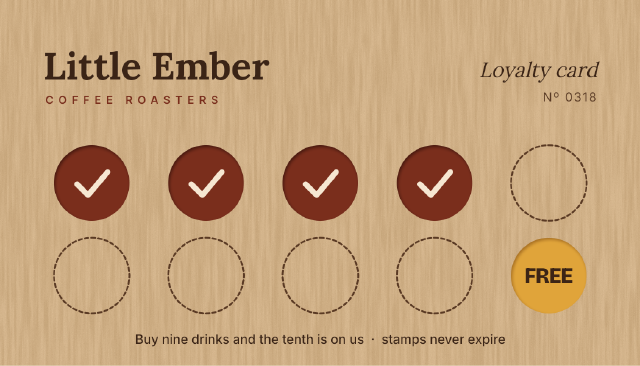

<!-- Generated by tools/gallery.mjs from showcase.yaml and build.json; do not edit. -->
# Café Loyalty Card

[Photo](../README.md) › [Print & Stationery](../README.md#print--stationery) · `print` `loyalty-card` `shapes` `render-filters` `noise` `type` `groups`

A kraft-paper coffee loyalty card with ten stamp spots, four already stamped and a gold free-drink circle.



| | |
|---|---|
| Document | [cafe-loyalty-card.psd](cafe-loyalty-card.psd) (3.7 MB) |
| Contents | 1050 × 600 px; 14 layers; 6 type layers; 4 shape layers; 1 fill layer; 1 group; 2 styled layers; 1 mask |
| Features | `photo.path.shapes`, `photo.filter.stylize`, `photo.filter.noise-sharpen`, `photo.type.point-text`, `photo.layer.manage` |
| Built by | `kition-photo` @ `7abaa42e9a`: 26 commands in 746 ms |

## About

A wallet-size card at 300 ppi. The kraft stock is rendered Fibers on an empty layer with
monochrome noise, warmed by a translucent colour fill layer. The five empty spots are one shape
layer of dashed, round-capped circles; the stamped ones are another, with their checkmarks drawn
as open paths; the stamp layers sit in a `Stamps` group with an Inner Shadow for a pressed-in
look.

## Checks

- `inspect.layers`: `{"count":9}`
- `inspect.layers.0`: `{"name":"Stamps","kind":"Group","children":{"count":5}}`
- `inspect.layers.0.children.3`: `{"name":"Stamps","kind":"Shape","shape":{"fill":"#7a2e1c"},"effects":{"items":{"any":{"key":"innerShadow"}}}}`
- `inspect.layers.0.children.4`: `{"name":"Empty Stamps","kind":"Shape","shape":{"fill":null,"stroke":{"fill":"#5a3a24","dashes":[2,1.5],"cap":"round"}}}`
- `inspect.layers.1`: `{"name":"Terms","kind":"Type"}`
- `inspect.layers.-2`: `{"name":"Kraft","kind":"Pixel"}`
- `inspect.layers.-3`: `{"name":"Tone","kind":"Fill","fillContent":"#d8bb92","opacity":{"approx":0.55,"tol":0.01}}`
- diagnostics: none (the kit's check finds nothing wrong)
- the saved document opens again; the thumbnail matches `thumb.png` within the `render` tolerance

## Steps

<details><summary>26 commands (from <a href="showcase.yaml">showcase.yaml</a>)</summary>

```yaml
- command: tools.setColors
  params:
    foreground: "#b48f63"
    background: "#d2b088"
- command: layer.new.layer
  params:
    name: Kraft
  as: kraft
- command: filter.render.fibers
  params:
    variance: 18
    strength: 10
    seed: 9
- command: filter.noise.addNoise
  params:
    amount: 6
    distribution: gaussian
    monochromatic: true
    seed: 2
- command: layer.newFillLayer.solidColor
  params:
    color: "#d8bb92"
  as: tone
- command: layer.setProps
  params:
    layer: $tone.layer
    name: Tone
    opacity: 0.55
- command: type.create
  params:
    x: 70
    y: 130
    text: Little Ember
    font: Lora
    weight: 700
    size: 62
    color: "#3b2416"
    name: Brand
- command: type.create
  params:
    x: 74
    y: 170
    text: COFFEE ROASTERS
    font: Inter
    weight: 600
    size: 18
    tracking: 450
    color: "#7a2e1c"
    name: Brand Line
- command: type.create
  params:
    x: 980
    y: 126
    text: Loyalty card
    font: Lora
    italic: true
    size: 34
    color: "#3b2416"
    align: right
    name: Card Type
- command: type.create
  params:
    x: 980
    y: 166
    text: Nº 0318
    font: Inter
    size: 20
    tracking: 100
    color: "#5a3a24"
    align: right
    name: Card Number
- command: type.create
  params:
    x: 525
    y: 564
    text: Buy nine drinks and the tenth is on us  ·  stamps never expire
    font: Inter
    weight: 500
    size: 21
    color: "#3b2416"
    align: center
    name: Terms
- command: layer.new.group
  params:
    name: Stamps
  as: stampgroup
- command: shape.create
  params:
    kind: ellipse
    rect:
      - 838
      - 238
      - 124
      - 124
    fill: null
    stroke:
      width: 3
      color: "#5a3a24"
      dashes:
        - 2
        - 1.5
      cap: round
    name: Empty Stamps
  as: empties
- command: shape.create
  params:
    kind: ellipse
    rect:
      - 88
      - 390
      - 124
      - 124
    addTo: $empties.layer
- command: shape.create
  params:
    kind: ellipse
    rect:
      - 275.5
      - 390
      - 124
      - 124
    addTo: $empties.layer
- command: shape.create
  params:
    kind: ellipse
    rect:
      - 463
      - 390
      - 124
      - 124
    addTo: $empties.layer
- command: shape.create
  params:
    kind: ellipse
    rect:
      - 650.5
      - 390
      - 124
      - 124
    addTo: $empties.layer
- command: shape.create
  params:
    kind: ellipse
    rect:
      - 88
      - 238
      - 124
      - 124
    fill: "#7a2e1c"
    name: Stamps
  as: stamps
- command: shape.create
  params:
    kind: ellipse
    rect:
      - 275.5
      - 238
      - 124
      - 124
    addTo: $stamps.layer
- command: shape.create
  params:
    kind: ellipse
    rect:
      - 463
      - 238
      - 124
      - 124
    addTo: $stamps.layer
- command: shape.create
  params:
    kind: ellipse
    rect:
      - 650.5
      - 238
      - 124
      - 124
    addTo: $stamps.layer
- command: shape.create
  params:
    kind: path
    path:
      subpaths:
        - closed: false
          knots:
            - - 126
              - 302
            - - 144
              - 320
            - - 176
              - 282
        - closed: false
          knots:
            - - 313.5
              - 302
            - - 331.5
              - 320
            - - 363.5
              - 282
        - closed: false
          knots:
            - - 501
              - 302
            - - 519
              - 320
            - - 551
              - 282
        - closed: false
          knots:
            - - 688.5
              - 302
            - - 706.5
              - 320
            - - 738.5
              - 282
    fill: null
    stroke:
      width: 9
      color: "#f6e7d2"
      cap: round
      join: round
    name: Checkmarks
  as: checks
- command: shape.create
  params:
    kind: ellipse
    rect:
      - 838
      - 390
      - 124
      - 124
    fill: "#e0a43a"
    name: Free Stamp
  as: free
- command: type.create
  params:
    x: 900
    y: 464
    text: FREE
    font: Bricolage Grotesque
    weight: 800
    size: 36
    color: "#3b2416"
    align: center
    name: Free Label
  as: freelabel
- command: layer.layerStyle.innerShadow
  params:
    layer: $stamps.layer
    color: "#2a120a"
    opacity: 50
    distance: 3
    size: 6
    angle: 120
- command: layer.layerStyle.innerShadow
  params:
    layer: $free.layer
    color: "#6b4510"
    opacity: 45
    distance: 3
    size: 6
    angle: 120
```

</details>
