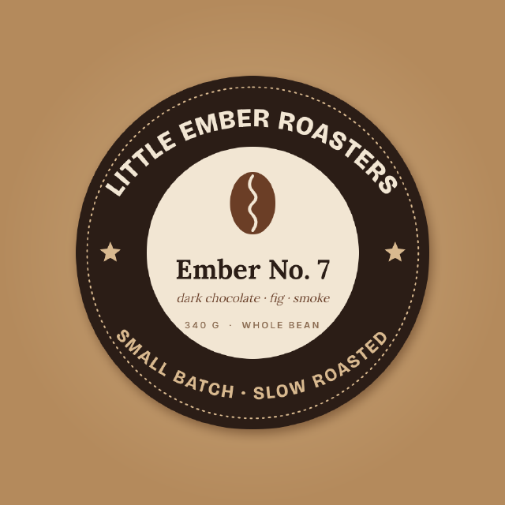

<!-- Generated by tools/gallery.mjs from showcase.yaml and build.json; do not edit. -->
# Coffee Roaster Arc Badge

[Photo](../README.md) › [Typography](../README.md#typography) · `type` `warp-text` `badge` `shapes`

A round packaging badge whose top and bottom lines are live type bent with arc warps.



| | |
|---|---|
| Document | [coffee-roaster-arc-badge.psd](coffee-roaster-arc-badge.psd) (817 KB) |
| Contents | 1000 × 1000 px; 14 layers; 5 type layers; 7 shape layers; 1 fill layer; 1 styled layer; 1 mask |
| Features | `photo.type.text`, `photo.path.shapes`, `photo.layer.style-basics` |
| Built by | `kition-photo` @ `7abaa42e9a`: 18 commands in 189 ms |

## About

The roaster's name follows the top of the ring with an Arc warp bent upward, and the line under
it uses the same warp bent the other way. Both stay editable text: change the words and the
curve follows. The ring, bean and stars are shapes on a kraft-paper fill.

## Checks

- `inspect.layers`: `{"count":14,"any":{"name":"Top Arc","kind":"Type","text":{"text":"LITTLE EMBER ROASTERS"}}}`
- `inspect.layers.-3`: `{"name":"Outer Ring","kind":"Shape","effects":{"items":{"any":{"key":"dropShadow"}}}}`
- `results.topInfo.warp`: `{"style":"warpArc","value":62,"horizontal":true}`
- `results.bottomInfo.warp`: `{"style":"warpArc","value":-55}`
- diagnostics: none (the kit's check finds nothing wrong)
- the saved document opens again; the thumbnail matches `thumb.png` within the `render` tolerance

## Steps

<details><summary>18 commands (from <a href="showcase.yaml">showcase.yaml</a>)</summary>

```yaml
- command: layer.newFillLayer.gradient
  params:
    from: "#c9a77c"
    to: "#b48a5c"
    angle: 120
    style: radial
  as: kraft
- command: shape.create
  params:
    kind: ellipse
    rect:
      - 150
      - 150
      - 700
      - 700
    fill: "#2b1d16"
    name: Outer Ring
  as: ring
- command: layer.layerStyle.dropShadow
  params:
    layer: $ring.layer
    color: "#5a3b20"
    opacity: 45
    distance: 10
    size: 24
    angle: 110
- command: shape.create
  params:
    kind: ellipse
    rect:
      - 290
      - 290
      - 420
      - 420
    fill: "#f2e6d3"
    name: Inner Disc
- command: shape.create
  params:
    kind: ellipse
    rect:
      - 172
      - 172
      - 656
      - 656
    fill: null
    stroke:
      width: 3
      color: "#d9b98f"
      dashes:
        - 1
        - 3
      cap: round
    name: Stitch Ring
- command: type.create
  params:
    x: 500
    y: 250
    text: LITTLE EMBER ROASTERS
    font: Bricolage Grotesque
    size: 52
    weight: 800
    tracking: 80
    color: "#f2e6d3"
    align: center
    name: Top Arc
  as: top
- command: type.warpText
  params:
    layer: $top.layer
    style: arc
    bend: 62
- command: type.create
  params:
    x: 500
    y: 790
    text: SMALL BATCH · SLOW ROASTED
    font: Bricolage Grotesque
    size: 36
    weight: 700
    tracking: 120
    color: "#d9b98f"
    align: center
    name: Bottom Arc
  as: bottom
- command: type.warpText
  params:
    layer: $bottom.layer
    style: arc
    bend: -55
- command: shape.create
  params:
    kind: star
    rect:
      - 196
      - 478
      - 44
      - 44
    sides: 5
    starRatio: 0.45
    fill: "#d9b98f"
    name: Star Left
- command: shape.create
  params:
    kind: star
    rect:
      - 760
      - 478
      - 44
      - 44
    sides: 5
    starRatio: 0.45
    fill: "#d9b98f"
    name: Star Right
- command: shape.create
  params:
    kind: ellipse
    rect:
      - 455
      - 340
      - 90
      - 124
    fill: "#6b3e26"
    name: Bean
  as: bean
- command: shape.create
  params:
    kind: path
    fill: null
    stroke:
      width: 6
      color: "#f2e6d3"
      cap: round
    name: Bean Crease
    path:
      subpaths:
        - closed: false
          knots:
            - anchor:
                - 500
                - 348
              out:
                - 478
                - 380
            - anchor:
                - 500
                - 402
              in:
                - 522
                - 380
              out:
                - 478
                - 424
            - anchor:
                - 500
                - 456
              in:
                - 522
                - 424
- command: type.create
  params:
    x: 500
    y: 552
    text: Ember No. 7
    font: Lora
    size: 54
    weight: 700
    color: "#2b1d16"
    align: center
    name: Blend Name
- command: type.create
  params:
    x: 500
    y: 598
    text: dark chocolate · fig · smoke
    font: Lora
    size: 24
    italic: true
    color: "#6b3e26"
    align: center
    name: Notes
- command: type.create
  params:
    x: 500
    y: 650
    text: 340 G  ·  WHOLE BEAN
    font: Inter
    size: 18
    weight: 600
    tracking: 200
    color: "#8a6a4f"
    align: center
    name: Weight
- command: type.info
  params:
    layer: $top.layer
  as: topInfo
- command: type.info
  params:
    layer: $bottom.layer
  as: bottomInfo
```

</details>
