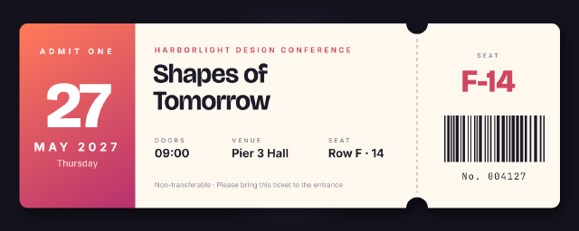

<!-- Generated by tools/gallery.mjs from showcase.yaml and build.json; do not edit. -->
# Conference Ticket

[Photo](../README.md) › [Print & Stationery](../README.md#print--stationery) · `print` `ticket` `shapes` `clipping-mask` `layer-styles` `type`

An admit-one conference ticket with notched edges, a dashed perforation, a tear-off stub and a barcode.



| | |
|---|---|
| Document | [conference-ticket.psd](conference-ticket.psd) (830 KB) |
| Contents | 1500 × 600 px; 26 layers; 17 type layers; 4 shape layers; 1 fill layer; 3 groups; 1 styled layer; 1 mask |
| Features | `photo.path.shapes`, `photo.layer.mask-basics`, `photo.layer.style-basics`, `photo.type.point-text`, `photo.layer.manage` |
| Built by | `kition-photo` @ `7abaa42e9a`: 59 commands in 303 ms |

## About

The ticket is one rounded-rectangle shape with two circles subtracted for the tear notches, and
it casts a Drop Shadow on a radial gradient backdrop. The coloured date block is clipped to the
ticket, the perforation is an open path with a dashed stroke, and the barcode is a single shape
layer of combined bars. The serial number is set in JetBrains Mono.

## Checks

- `inspect.layers`: `{"count":8}`
- `inspect.layers.0`: `{"name":"Stub","kind":"Group","children":{"count":4,"any":{"name":"Serial","text":{"font":"JetBrains Mono"}}}}`
- `inspect.layers.1`: `{"name":"Perforation","kind":"Shape","shape":{"fill":null,"stroke":{"fill":"#c9bfae","width":3,"dashes":[3,2.5]}}}`
- `inspect.layers.2`: `{"name":"Details","kind":"Group","children":{"count":10}}`
- `inspect.layers.3`: `{"name":"Date","kind":"Group","children":{"count":4}}`
- `inspect.layers.4`: `{"name":"Date Block","clipped":true,"shape":{"fill":{"gradient":{"stops":[[0,"#ff7a59"],[1,"#b8326e"]]}}}}`
- `inspect.layers.5`: `{"name":"Ticket","kind":"Shape","shape":{"fill":"#fff8ee"},"effects":{"items":{"any":{"key":"dropShadow"}}}}`
- `inspect.layers.6`: `{"name":"Backdrop","kind":"Fill","fillContent":{"gradient":{"style":"radial"}}}`
- `results.bars`: `{"name":"Barcode","path":{"subpaths":{"count":28}}}`
- diagnostics: none (the kit's check finds nothing wrong)
- the saved document opens again; the thumbnail matches `thumb.png` within the `render` tolerance

## Steps

<details><summary>59 commands (from <a href="showcase.yaml">showcase.yaml</a>)</summary>

```yaml
- command: layer.newFillLayer.gradient
  params:
    from: "#3a3550"
    to: "#14121d"
    style: radial
    angle: 90
  as: backdrop
- command: layer.setProps
  params:
    layer: $backdrop.layer
    name: Backdrop
- command: shape.create
  params:
    kind: roundedRect
    rect:
      - 50
      - 60
      - 1400
      - 480
    radii: 22
    fill: "#fff8ee"
    name: Ticket
  as: ticket
- command: shape.create
  params:
    kind: ellipse
    rect:
      - 1052
      - 32
      - 56
      - 56
    addTo: $ticket.layer
    op: subtract
- command: shape.create
  params:
    kind: ellipse
    rect:
      - 1052
      - 512
      - 56
      - 56
    addTo: $ticket.layer
    op: subtract
- command: layer.layerStyle.dropShadow
  params:
    layer: $ticket.layer
    color: "#000000"
    opacity: 55
    distance: 16
    size: 36
    angle: 90
- command: shape.create
  params:
    kind: rect
    rect:
      - 50
      - 60
      - 300
      - 480
    fill:
      gradient:
        stops:
          - - 0
            - "#ff7a59"
          - - 1
            - "#b8326e"
        angle: -60
    name: Date Block
  as: block
- command: layer.createClippingMask
  params:
    layer: $block.layer
- command: layer.new.group
  params:
    name: Date
  as: dategroup
- command: type.create
  params:
    x: 200
    y: 140
    text: ADMIT ONE
    font: Inter
    weight: 700
    size: 20
    tracking: 450
    color: "#ffffff"
    align: center
    name: Admit
  as: d1
- command: type.create
  params:
    x: 200
    y: 330
    text: "27"
    font: Bricolage Grotesque
    weight: 800
    size: 170
    tracking: -40
    color: "#ffffff"
    align: center
    name: Day
  as: d2
- command: type.create
  params:
    x: 200
    y: 392
    text: MAY 2027
    font: Inter
    weight: 700
    size: 30
    tracking: 300
    color: "#ffffff"
    align: center
    name: Month
  as: d3
- command: type.create
  params:
    x: 200
    y: 432
    text: Thursday
    font: Inter
    size: 24
    color: "#ffe1d6"
    align: center
    name: Weekday
  as: d4
- command: layer.new.group
  params:
    name: Details
  as: details
- command: layer.moveTo
  params:
    layer: $details.layer
    target: $dategroup.layer
    position: above
- command: type.create
  params:
    x: 400
    y: 136
    text: HARBORLIGHT DESIGN CONFERENCE
    font: Inter
    weight: 700
    size: 19
    tracking: 300
    color: "#d0455f"
    name: Event
  as: e1
- command: type.create
  params:
    x: 396
    y: 214
    text: Shapes of
    font: Bricolage Grotesque
    weight: 700
    size: 70
    tracking: -20
    color: "#1d1b2a"
    name: Title Line 1
  as: e2
- command: type.create
  params:
    x: 396
    y: 284
    text: Tomorrow
    font: Bricolage Grotesque
    weight: 700
    size: 70
    tracking: -20
    color: "#1d1b2a"
    name: Title Line 2
  as: e3
- command: type.create
  params:
    x: 400
    y: 370
    text: DOORS
    font: Inter
    weight: 600
    size: 16
    tracking: 300
    color: "#8a8296"
    name: Doors Label
  as: e4
- command: type.create
  params:
    x: 400
    y: 408
    text: 09:00
    font: Inter
    weight: 700
    size: 30
    color: "#1d1b2a"
    name: Doors
  as: e5
- command: type.create
  params:
    x: 600
    y: 370
    text: VENUE
    font: Inter
    weight: 600
    size: 16
    tracking: 300
    color: "#8a8296"
    name: Venue Label
  as: e6
- command: type.create
  params:
    x: 600
    y: 408
    text: Pier 3 Hall
    font: Inter
    weight: 700
    size: 30
    color: "#1d1b2a"
    name: Venue
  as: e7
- command: type.create
  params:
    x: 850
    y: 370
    text: SEAT
    font: Inter
    weight: 600
    size: 16
    tracking: 300
    color: "#8a8296"
    name: Seat Label
  as: e8
- command: type.create
  params:
    x: 850
    y: 408
    text: Row F · 14
    font: Inter
    weight: 700
    size: 30
    color: "#1d1b2a"
    name: Seat
  as: e9
- command: type.create
  params:
    x: 400
    y: 486
    text: Non-transferable · Please bring this ticket to the entrance
    font: Inter
    size: 18
    color: "#8a8296"
    name: Terms
  as: e10
- command: shape.create
  params:
    kind: path
    path:
      subpaths:
        - closed: false
          knots:
            - - 1080
              - 100
            - - 1080
              - 500
    fill: null
    stroke:
      width: 3
      color: "#c9bfae"
      dashes:
        - 3
        - 2.5
      cap: butt
    name: Perforation
  as: perf
- command: layer.moveTo
  params:
    layer: $perf.layer
    target: $details.layer
    position: above
- command: layer.new.group
  params:
    name: Stub
  as: stub
- command: type.create
  params:
    x: 1265
    y: 150
    text: SEAT
    font: Inter
    weight: 600
    size: 16
    tracking: 300
    color: "#8a8296"
    align: center
    name: Stub Label
  as: s1
- command: type.create
  params:
    x: 1265
    y: 238
    text: F-14
    font: Bricolage Grotesque
    weight: 800
    size: 84
    color: "#d0455f"
    align: center
    name: Stub Seat
  as: s2
- command: shape.create
  params:
    kind: rect
    rect:
      - 1150
      - 300
      - 4
      - 120
    fill: "#1d1b2a"
    name: Barcode
  as: barcode
- command: shape.create
  params:
    kind: rect
    rect:
      - 1158
      - 300
      - 6
      - 120
    addTo: $barcode.layer
- command: shape.create
  params:
    kind: rect
    rect:
      - 1167
      - 300
      - 3
      - 120
    addTo: $barcode.layer
- command: shape.create
  params:
    kind: rect
    rect:
      - 1173
      - 300
      - 4
      - 120
    addTo: $barcode.layer
- command: shape.create
  params:
    kind: rect
    rect:
      - 1180
      - 300
      - 8
      - 120
    addTo: $barcode.layer
- command: shape.create
  params:
    kind: rect
    rect:
      - 1192
      - 300
      - 3
      - 120
    addTo: $barcode.layer
- command: shape.create
  params:
    kind: rect
    rect:
      - 1198
      - 300
      - 6
      - 120
    addTo: $barcode.layer
- command: shape.create
  params:
    kind: rect
    rect:
      - 1211
      - 300
      - 3
      - 120
    addTo: $barcode.layer
- command: shape.create
  params:
    kind: rect
    rect:
      - 1218
      - 300
      - 3
      - 120
    addTo: $barcode.layer
- command: shape.create
  params:
    kind: rect
    rect:
      - 1228
      - 300
      - 3
      - 120
    addTo: $barcode.layer
- command: shape.create
  params:
    kind: rect
    rect:
      - 1234
      - 300
      - 3
      - 120
    addTo: $barcode.layer
- command: shape.create
  params:
    kind: rect
    rect:
      - 1240
      - 300
      - 8
      - 120
    addTo: $barcode.layer
- command: shape.create
  params:
    kind: rect
    rect:
      - 1255
      - 300
      - 3
      - 120
    addTo: $barcode.layer
- command: shape.create
  params:
    kind: rect
    rect:
      - 1262
      - 300
      - 3
      - 120
    addTo: $barcode.layer
- command: shape.create
  params:
    kind: rect
    rect:
      - 1269
      - 300
      - 4
      - 120
    addTo: $barcode.layer
- command: shape.create
  params:
    kind: rect
    rect:
      - 1280
      - 300
      - 3
      - 120
    addTo: $barcode.layer
- command: shape.create
  params:
    kind: rect
    rect:
      - 1286
      - 300
      - 8
      - 120
    addTo: $barcode.layer
- command: shape.create
  params:
    kind: rect
    rect:
      - 1299
      - 300
      - 8
      - 120
    addTo: $barcode.layer
- command: shape.create
  params:
    kind: rect
    rect:
      - 1311
      - 300
      - 3
      - 120
    addTo: $barcode.layer
- command: shape.create
  params:
    kind: rect
    rect:
      - 1318
      - 300
      - 4
      - 120
    addTo: $barcode.layer
- command: shape.create
  params:
    kind: rect
    rect:
      - 1325
      - 300
      - 8
      - 120
    addTo: $barcode.layer
- command: shape.create
  params:
    kind: rect
    rect:
      - 1336
      - 300
      - 8
      - 120
    addTo: $barcode.layer
- command: shape.create
  params:
    kind: rect
    rect:
      - 1347
      - 300
      - 8
      - 120
    addTo: $barcode.layer
- command: shape.create
  params:
    kind: rect
    rect:
      - 1359
      - 300
      - 6
      - 120
    addTo: $barcode.layer
- command: shape.create
  params:
    kind: rect
    rect:
      - 1372
      - 300
      - 4
      - 120
    addTo: $barcode.layer
- command: shape.create
  params:
    kind: rect
    rect:
      - 1383
      - 300
      - 8
      - 120
    addTo: $barcode.layer
- command: shape.create
  params:
    kind: rect
    rect:
      - 1398
      - 300
      - 4
      - 120
    addTo: $barcode.layer
- command: shape.create
  params:
    kind: rect
    rect:
      - 1407
      - 300
      - 3
      - 120
    addTo: $barcode.layer
  as: bars
- command: type.create
  params:
    x: 1280
    y: 466
    text: No. 004127
    font: JetBrains Mono
    size: 24
    tracking: 100
    color: "#1d1b2a"
    align: center
    name: Serial
  as: s3
```

</details>
