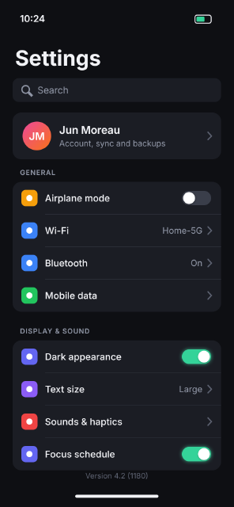

<!-- Generated by tools/gallery.mjs from showcase.yaml and build.json; do not edit. -->
# Dark Mode Settings Screen

[Photo](../README.md) › [UI & Web Design](../README.md#ui--web-design) · `ui` `mobile` `dark-mode` `shapes` `layer-styles`

A dark-theme phone settings screen at 375 × 812 pt (@2x), with grouped list cards, toggles, values and chevrons.



| | |
|---|---|
| Document | [dark-mode-settings-screen.psd](dark-mode-settings-screen.psd) (753 KB) |
| Contents | 750 × 1624 px; 65 layers; 20 type layers; 43 shape layers; 1 fill layer; 5 styled layers; 1 mask |
| Features | `photo.path.shapes`, `photo.layer.style-basics`, `photo.type.point-text` |
| Built by | `kition-photo` @ `7abaa42e9a`: 71 commands in 334 ms |

## About

A settings screen in a dark palette: near-black page, raised grey cards, muted secondary text
and one green accent kept for switched-on toggles, which also get a faint Outer Glow. The
toggle knobs carry a small Drop Shadow, the chevrons are open stroked paths, and the rows are
laid out on a 104 px rhythm.

## Checks

- `inspect.layers`: `{"any":{"name":"Dark appearance Toggle","kind":"Shape","effects":{"items":[{"enabled":true,"key":"outerGlow","kind":"Outer Glow"}]}}}`
- `inspect.layers`: `{"any":{"name":"Airplane mode Toggle","kind":"Shape","effects":{"exists":false}}}`
- `inspect.layers`: `{"any":{"name":"Wi-Fi Value","kind":"Type","text":{"text":"Home-5G"}}}`
- `results.t2.fill`: `"#34d399"`
- `results.t1.fill`: `"#3a3e4a"`
- diagnostics: none (the kit's check finds nothing wrong)
- the saved document opens again; the thumbnail matches `thumb.png` within the `render` tolerance

## Steps

<details><summary>71 commands (from <a href="showcase.yaml">showcase.yaml</a>)</summary>

```yaml
- command: layer.newFillLayer.solidColor
  params:
    color: "#0e0f13"
  as: screen
- command: layer.setProps
  params:
    layer: $screen.layer
    name: Screen
- command: type.create
  params:
    x: 64
    y: 70
    text: 10:24
    font: Inter
    size: 30
    weight: 600
    color: "#f2f3f7"
    name: Clock
- command: shape.create
  params:
    kind: roundedRect
    rect:
      - 626
      - 48
      - 52
      - 26
    radii: 7
    fill: null
    stroke:
      width: 3
      color: "#f2f3f7"
    name: Battery
- command: shape.create
  params:
    kind: roundedRect
    rect:
      - 631
      - 53
      - 26
      - 16
    radii: 3
    fill: "#34d399"
    name: Battery Level
- command: type.create
  params:
    x: 48
    y: 210
    text: Settings
    font: Inter
    size: 68
    weight: 700
    color: "#f2f3f7"
    name: Title
- command: shape.create
  params:
    kind: roundedRect
    rect:
      - 40
      - 250
      - 670
      - 76
    radii: 20
    fill: "#1b1d24"
    name: Search Field
- command: shape.create
  params:
    kind: ellipse
    rect:
      - 70
      - 274
      - 24
      - 24
    fill: null
    stroke:
      width: 4
      color: "#9096a6"
    name: Search Icon
  as: si
- command: shape.create
  params:
    kind: line
    from:
      - 92
      - 296
    to:
      - 102
      - 306
    weight: 4
    fill: "#9096a6"
    addTo: $si.layer
    op: combine
- command: type.create
  params:
    x: 120
    y: 299
    text: Search
    font: Inter
    size: 30
    color: "#9096a6"
    name: Search Placeholder
- command: shape.create
  params:
    kind: roundedRect
    rect:
      - 40
      - 360
      - 670
      - 150
    radii: 28
    fill: "#1b1d24"
    name: Profile Card
- command: shape.create
  params:
    kind: ellipse
    rect:
      - 72
      - 389
      - 92
      - 92
    fill:
      gradient:
        stops:
          - - 0
            - "#f97316"
          - - 1
            - "#ec4899"
        angle: 135
    name: Avatar
- command: type.create
  params:
    x: 118
    y: 448
    text: JM
    font: Inter
    size: 34
    weight: 600
    color: "#ffffff"
    align: center
    name: Avatar Initials
- command: type.create
  params:
    x: 190
    y: 428
    text: Jun Moreau
    font: Inter
    size: 34
    weight: 600
    color: "#f2f3f7"
    name: Profile Name
- command: type.create
  params:
    x: 190
    y: 468
    text: Account, sync and backups
    font: Inter
    size: 26
    color: "#9096a6"
    name: Profile Detail
- command: shape.create
  params:
    kind: path
    fill: null
    stroke:
      width: 4
      color: "#5c6170"
      cap: round
      join: round
    name: Profile Chevron
    path:
      subpaths:
        - closed: false
          knots:
            - - 668
              - 423
            - - 679
              - 435
            - - 668
              - 447
- command: type.create
  params:
    x: 64
    y: 560
    text: GENERAL
    font: Inter
    size: 22
    weight: 600
    tracking: 80
    color: "#9096a6"
    name: Section GENERAL
- command: shape.create
  params:
    kind: roundedRect
    rect:
      - 40
      - 582
      - 670
      - 416
    radii: 28
    fill: "#1b1d24"
    name: Card GENERAL
- command: shape.create
  params:
    kind: roundedRect
    rect:
      - 68
      - 608
      - 52
      - 52
    radii: 14
    fill: "#f59e0b"
    name: Airplane mode Icon
- command: shape.create
  params:
    kind: ellipse
    rect:
      - 84
      - 624
      - 20
      - 20
    fill: "#ffffff"
    name: Airplane mode Glyph
- command: type.create
  params:
    x: 144
    y: 645
    text: Airplane mode
    font: Inter
    size: 30
    weight: 500
    color: "#f2f3f7"
    name: Airplane mode Label
- command: shape.create
  params:
    kind: roundedRect
    rect:
      - 584
      - 611
      - 94
      - 46
    radii: 23
    fill: "#3a3e4a"
    name: Airplane mode Toggle
  as: t1
- command: shape.create
  params:
    kind: ellipse
    rect:
      - 588
      - 615
      - 38
      - 38
    fill: "#ffffff"
    name: Airplane mode Knob
  as: k1
- command: layer.layerStyle.dropShadow
  params:
    layer: $k1.layer
    color: "#000000"
    opacity: 35
    distance: 2
    size: 6
    angle: 90
- command: shape.create
  params:
    kind: line
    from:
      - 144
      - 686
    to:
      - 710
      - 686
    weight: 2
    fill: "#2a2d36"
    name: Airplane mode Separator
- command: shape.create
  params:
    kind: roundedRect
    rect:
      - 68
      - 712
      - 52
      - 52
    radii: 14
    fill: "#3b82f6"
    name: Wi-Fi Icon
- command: shape.create
  params:
    kind: ellipse
    rect:
      - 84
      - 728
      - 20
      - 20
    fill: "#ffffff"
    name: Wi-Fi Glyph
- command: type.create
  params:
    x: 144
    y: 749
    text: Wi-Fi
    font: Inter
    size: 30
    weight: 500
    color: "#f2f3f7"
    name: Wi-Fi Label
- command: type.create
  params:
    x: 650
    y: 748
    text: Home-5G
    font: Inter
    size: 28
    color: "#9096a6"
    align: right
    name: Wi-Fi Value
- command: shape.create
  params:
    kind: path
    fill: null
    stroke:
      width: 4
      color: "#5c6170"
      cap: round
      join: round
    name: Wi-Fi Chevron
    path:
      subpaths:
        - closed: false
          knots:
            - - 668
              - 726
            - - 679
              - 738
            - - 668
              - 750
- command: shape.create
  params:
    kind: line
    from:
      - 144
      - 790
    to:
      - 710
      - 790
    weight: 2
    fill: "#2a2d36"
    name: Wi-Fi Separator
- command: shape.create
  params:
    kind: roundedRect
    rect:
      - 68
      - 816
      - 52
      - 52
    radii: 14
    fill: "#3b82f6"
    name: Bluetooth Icon
- command: shape.create
  params:
    kind: ellipse
    rect:
      - 84
      - 832
      - 20
      - 20
    fill: "#ffffff"
    name: Bluetooth Glyph
- command: type.create
  params:
    x: 144
    y: 853
    text: Bluetooth
    font: Inter
    size: 30
    weight: 500
    color: "#f2f3f7"
    name: Bluetooth Label
- command: type.create
  params:
    x: 650
    y: 852
    text: On
    font: Inter
    size: 28
    color: "#9096a6"
    align: right
    name: Bluetooth Value
- command: shape.create
  params:
    kind: path
    fill: null
    stroke:
      width: 4
      color: "#5c6170"
      cap: round
      join: round
    name: Bluetooth Chevron
    path:
      subpaths:
        - closed: false
          knots:
            - - 668
              - 830
            - - 679
              - 842
            - - 668
              - 854
- command: shape.create
  params:
    kind: line
    from:
      - 144
      - 894
    to:
      - 710
      - 894
    weight: 2
    fill: "#2a2d36"
    name: Bluetooth Separator
- command: shape.create
  params:
    kind: roundedRect
    rect:
      - 68
      - 920
      - 52
      - 52
    radii: 14
    fill: "#22c55e"
    name: Mobile data Icon
- command: shape.create
  params:
    kind: ellipse
    rect:
      - 84
      - 936
      - 20
      - 20
    fill: "#ffffff"
    name: Mobile data Glyph
- command: type.create
  params:
    x: 144
    y: 957
    text: Mobile data
    font: Inter
    size: 30
    weight: 500
    color: "#f2f3f7"
    name: Mobile data Label
- command: shape.create
  params:
    kind: path
    fill: null
    stroke:
      width: 4
      color: "#5c6170"
      cap: round
      join: round
    name: Mobile data Chevron
    path:
      subpaths:
        - closed: false
          knots:
            - - 668
              - 934
            - - 679
              - 946
            - - 668
              - 958
- command: type.create
  params:
    x: 64
    y: 1068
    text: DISPLAY & SOUND
    font: Inter
    size: 22
    weight: 600
    tracking: 80
    color: "#9096a6"
    name: Section DISPLAY & SOUND
- command: shape.create
  params:
    kind: roundedRect
    rect:
      - 40
      - 1090
      - 670
      - 416
    radii: 28
    fill: "#1b1d24"
    name: Card DISPLAY & SOUND
- command: shape.create
  params:
    kind: roundedRect
    rect:
      - 68
      - 1116
      - 52
      - 52
    radii: 14
    fill: "#6366f1"
    name: Dark appearance Icon
- command: shape.create
  params:
    kind: ellipse
    rect:
      - 84
      - 1132
      - 20
      - 20
    fill: "#ffffff"
    name: Dark appearance Glyph
- command: type.create
  params:
    x: 144
    y: 1153
    text: Dark appearance
    font: Inter
    size: 30
    weight: 500
    color: "#f2f3f7"
    name: Dark appearance Label
- command: shape.create
  params:
    kind: roundedRect
    rect:
      - 584
      - 1119
      - 94
      - 46
    radii: 23
    fill: "#34d399"
    name: Dark appearance Toggle
  as: t2
- command: shape.create
  params:
    kind: ellipse
    rect:
      - 636
      - 1123
      - 38
      - 38
    fill: "#ffffff"
    name: Dark appearance Knob
  as: k2
- command: layer.layerStyle.dropShadow
  params:
    layer: $k2.layer
    color: "#000000"
    opacity: 35
    distance: 2
    size: 6
    angle: 90
- command: layer.layerStyle.outerGlow
  params:
    layer: $t2.layer
    color: "#34d399"
    opacity: 35
    size: 14
- command: shape.create
  params:
    kind: line
    from:
      - 144
      - 1194
    to:
      - 710
      - 1194
    weight: 2
    fill: "#2a2d36"
    name: Dark appearance Separator
- command: shape.create
  params:
    kind: roundedRect
    rect:
      - 68
      - 1220
      - 52
      - 52
    radii: 14
    fill: "#8b5cf6"
    name: Text size Icon
- command: shape.create
  params:
    kind: ellipse
    rect:
      - 84
      - 1236
      - 20
      - 20
    fill: "#ffffff"
    name: Text size Glyph
- command: type.create
  params:
    x: 144
    y: 1257
    text: Text size
    font: Inter
    size: 30
    weight: 500
    color: "#f2f3f7"
    name: Text size Label
- command: type.create
  params:
    x: 650
    y: 1256
    text: Large
    font: Inter
    size: 28
    color: "#9096a6"
    align: right
    name: Text size Value
- command: shape.create
  params:
    kind: path
    fill: null
    stroke:
      width: 4
      color: "#5c6170"
      cap: round
      join: round
    name: Text size Chevron
    path:
      subpaths:
        - closed: false
          knots:
            - - 668
              - 1234
            - - 679
              - 1246
            - - 668
              - 1258
- command: shape.create
  params:
    kind: line
    from:
      - 144
      - 1298
    to:
      - 710
      - 1298
    weight: 2
    fill: "#2a2d36"
    name: Text size Separator
- command: shape.create
  params:
    kind: roundedRect
    rect:
      - 68
      - 1324
      - 52
      - 52
    radii: 14
    fill: "#ef4444"
    name: Sounds & haptics Icon
- command: shape.create
  params:
    kind: ellipse
    rect:
      - 84
      - 1340
      - 20
      - 20
    fill: "#ffffff"
    name: Sounds & haptics Glyph
- command: type.create
  params:
    x: 144
    y: 1361
    text: Sounds & haptics
    font: Inter
    size: 30
    weight: 500
    color: "#f2f3f7"
    name: Sounds & haptics Label
- command: shape.create
  params:
    kind: path
    fill: null
    stroke:
      width: 4
      color: "#5c6170"
      cap: round
      join: round
    name: Sounds & haptics Chevron
    path:
      subpaths:
        - closed: false
          knots:
            - - 668
              - 1338
            - - 679
              - 1350
            - - 668
              - 1362
- command: shape.create
  params:
    kind: line
    from:
      - 144
      - 1402
    to:
      - 710
      - 1402
    weight: 2
    fill: "#2a2d36"
    name: Sounds & haptics Separator
- command: shape.create
  params:
    kind: roundedRect
    rect:
      - 68
      - 1428
      - 52
      - 52
    radii: 14
    fill: "#6366f1"
    name: Focus schedule Icon
- command: shape.create
  params:
    kind: ellipse
    rect:
      - 84
      - 1444
      - 20
      - 20
    fill: "#ffffff"
    name: Focus schedule Glyph
- command: type.create
  params:
    x: 144
    y: 1465
    text: Focus schedule
    font: Inter
    size: 30
    weight: 500
    color: "#f2f3f7"
    name: Focus schedule Label
- command: shape.create
  params:
    kind: roundedRect
    rect:
      - 584
      - 1431
      - 94
      - 46
    radii: 23
    fill: "#34d399"
    name: Focus schedule Toggle
  as: t3
- command: shape.create
  params:
    kind: ellipse
    rect:
      - 636
      - 1435
      - 38
      - 38
    fill: "#ffffff"
    name: Focus schedule Knob
  as: k3
- command: layer.layerStyle.dropShadow
  params:
    layer: $k3.layer
    color: "#000000"
    opacity: 35
    distance: 2
    size: 6
    angle: 90
- command: layer.layerStyle.outerGlow
  params:
    layer: $t3.layer
    color: "#34d399"
    opacity: 35
    size: 14
- command: type.create
  params:
    x: 375
    y: 1532
    text: Version 4.2 (1180)
    font: Inter
    size: 24
    color: "#5c6170"
    align: center
    name: Version
- command: shape.create
  params:
    kind: roundedRect
    rect:
      - 241
      - 1584
      - 268
      - 10
    radii: 5
    fill: "#f2f3f7"
    name: Home Indicator
```

</details>
