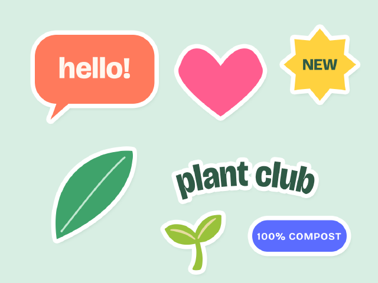

<!-- Generated by tools/gallery.mjs from showcase.yaml and build.json; do not edit. -->
# Die-Cut Sticker Sheet

[Photo](../README.md) › [Layer Styles](../README.md#layer-styles) · `layer-styles` `stroke` `drop-shadow` `shapes` `type` `emoji`

A plant-shop sticker sheet where every sticker gets the same white die-cut border and soft shadow by copying one layer style.



| | |
|---|---|
| Document | [die-cut-sticker-sheet.psd](die-cut-sticker-sheet.psd) (515 KB) |
| Contents | 1200 × 900 px; 13 layers; 5 type layers; 6 shape layers; 1 fill layer; 7 styled layers; 1 mask |
| Features | `photo.layer.styles`, `photo.layer.style-basics`, `photo.path.shapes`, `photo.type.point-text` |
| Built by | `kition-photo` @ `7abaa42e9a`: 23 commands in 151 ms |

## About

The speech bubble is styled once, with a thick outside Stroke in white for the die-cut edge and
a soft Drop Shadow, and that style is copied with `layer.layerStyle.copyLayerStyle` and pasted
onto the heart, the star, the leaf, the pill, the lettering and a sprout that is a colour emoji
from Noto Color Emoji on a type layer. Change the stroke on one and paste again to update the
sheet.

## Checks

- `inspect.layers`: `{"count":13}`
- `inspect.layers.0`: `{"name":"Lettering Sticker","kind":"Type","text":{"text":"plant club"}}`
- `inspect.layers.0.effects.items`: `{"count":2}`
- `inspect.layers.0.effects.items.0`: `{"key":"stroke"}`
- `inspect.layers.0.effects.items.1`: `{"key":"dropShadow"}`
- `inspect.layers.1`: `{"name":"Sprout Sticker","kind":"Type","text":{"text":"🌱"},"effects":{"items":{"count":2,"any":{"key":"stroke"}}}}`
- `inspect.layers.-3`: `{"name":"Bubble Sticker","effects":{"items":{"count":2}}}`
- `inspect.layers.-5`: `{"name":"Heart Sticker","effects":{"items":{"count":2,"any":{"key":"stroke"}}}}`
- diagnostics: none (the kit's check finds nothing wrong)
- the saved document opens again; the thumbnail matches `thumb.png` within the `render` tolerance

## Steps

<details><summary>23 commands (from <a href="showcase.yaml">showcase.yaml</a>)</summary>

```yaml
- command: layer.newFillLayer.solidColor
  params:
    color: "#d8eee3"
  as: backing
- command: shape.create
  params:
    kind: roundedRect
    rect:
      - 110
      - 110
      - 380
      - 220
    radii: 70
    fill: "#ff7a5c"
    name: Bubble Sticker
  as: bubble
- command: shape.create
  params:
    kind: path
    addTo: $bubble.layer
    op: combine
    path:
      subpaths:
        - knots:
            - - 190
              - 300
            - - 250
              - 300
            - - 160
              - 380
- command: layer.layerStyle.stroke
  params:
    layer: $bubble.layer
    size: 14
    position: outside
    color: "#ffffff"
- command: layer.layerStyle.dropShadow
  params:
    layer: $bubble.layer
    color: "#2f5a46"
    opacity: 30
    distance: 10
    size: 18
    angle: 110
    add: true
- command: type.create
  params:
    x: 300
    y: 248
    text: hello!
    font: Bricolage Grotesque
    size: 96
    variations:
      wght: 800
      wdth: 100
      opsz: 96
    color: "#fff7ef"
    align: center
    name: Bubble Text
- command: shape.create
  params:
    kind: path
    fill: "#ff5d8f"
    name: Heart Sticker
    path:
      subpaths:
        - knots:
            - anchor:
                - 700
                - 210
              in:
                - 660
                - 150
              out:
                - 740
                - 150
            - anchor:
                - 830
                - 210
              in:
                - 800
                - 120
              out:
                - 860
                - 260
            - - 700
              - 370
            - anchor:
                - 570
                - 210
              in:
                - 540
                - 260
              out:
                - 600
                - 120
  as: heart
- command: shape.create
  params:
    kind: star
    rect:
      - 900
      - 90
      - 230
      - 230
    sides: 8
    starRatio: 0.72
    fill: "#ffd23f"
    name: Star Sticker
  as: star
- command: type.create
  params:
    x: 1015
    y: 222
    text: NEW
    font: Bricolage Grotesque
    size: 52
    variations:
      wght: 800
      wdth: 100
      opsz: 96
    color: "#2f5a46"
    align: center
    name: Star Text
- command: shape.create
  params:
    kind: path
    fill: "#3fa36b"
    name: Leaf Sticker
    path:
      subpaths:
        - knots:
            - anchor:
                - 180
                - 760
              in:
                - 180
                - 760
              out:
                - 150
                - 560
            - anchor:
                - 420
                - 480
              in:
                - 300
                - 470
              out:
                - 420
                - 480
            - anchor:
                - 180
                - 760
              in:
                - 450
                - 640
              out:
                - 180
                - 760
  as: leaf
- command: shape.create
  params:
    kind: path
    fill: null
    stroke:
      width: 6
      color: "#bfe7cf"
      cap: round
    name: Leaf Vein
    path:
      subpaths:
        - closed: false
          knots:
            - anchor:
                - 195
                - 735
              out:
                - 270
                - 640
            - anchor:
                - 395
                - 500
              in:
                - 330
                - 560
- command: shape.create
  params:
    kind: roundedRect
    rect:
      - 800
      - 700
      - 300
      - 100
    radii: 50
    fill: "#5b6cff"
    name: Pill Sticker
  as: pill
- command: type.create
  params:
    x: 950
    y: 762
    text: 100% COMPOST
    font: Bricolage Grotesque
    size: 32
    variations:
      wght: 700
      wdth: 100
      opsz: 30
    tracking: 60
    color: "#ffffff"
    align: center
    name: Pill Text
- command: type.create
  params:
    x: 615
    y: 825
    text: 🌱
    font: Noto Color Emoji
    size: 165
    align: center
    name: Sprout Sticker
  as: sprout
- command: type.create
  params:
    x: 780
    y: 590
    text: plant club
    font: Bricolage Grotesque
    size: 120
    variations:
      wght: 800
      wdth: 85
      opsz: 96
    color: "#2f5a46"
    align: center
    name: Lettering Sticker
  as: lettering
- command: type.warpText
  params:
    layer: $lettering.layer
    style: arc
    bend: 18
- command: layer.layerStyle.copyLayerStyle
  params:
    layer: $bubble.layer
- command: layer.layerStyle.pasteLayerStyle
  params:
    layer: $heart.layer
- command: layer.layerStyle.pasteLayerStyle
  params:
    layer: $star.layer
- command: layer.layerStyle.pasteLayerStyle
  params:
    layer: $leaf.layer
- command: layer.layerStyle.pasteLayerStyle
  params:
    layer: $pill.layer
- command: layer.layerStyle.pasteLayerStyle
  params:
    layer: $lettering.layer
- command: layer.layerStyle.pasteLayerStyle
  params:
    layer: $sprout.layer
```

</details>
