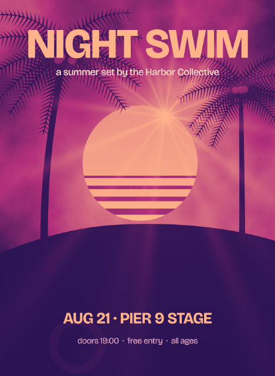

<!-- Generated by tools/gallery.mjs from showcase.yaml and build.json; do not edit. -->
# Duotone Gig Poster

[Photo](../README.md) › [Adjustments & Color](../README.md#adjustments--color) · `adjustment-layers` `gradient-map` `duotone` `type` `render-filters`

A palm-and-sun scene mapped to a two-color indigo and coral duotone with a Gradient Map layer, under bold gig typography.



| | |
|---|---|
| Document | [duotone-gradient-map-poster.psd](duotone-gradient-map-poster.psd) (6.9 MB) |
| Contents | 1100 × 1500 px; 16 layers; 4 type layers; 6 shape layers; 1 adjustment layer; 1 fill layer; 1 mask |
| Features | `photo.layer.adjustment`, `photo.type.point-text`, `photo.paint.gradients` |
| Built by | `kition-photo` @ `7abaa42e9a`: 28 commands in 1057 ms |

## About

The picture underneath is built in grays: rendered clouds, a radial sun, a lens flare in
Screen mode and two rendered palm trees on a dark hill; the sun's stripes are clipped to the sun. A single Gradient Map adjustment layer maps
its luminance from deep indigo through magenta to warm coral, which is all a duotone is. The type
sits above the map, so it keeps its own colors, picked from the same two ends.

## Checks

- `inspect.layers`: `{"count":16}`
- `inspect.layers.3`: `{"name":"Headline","kind":"Type","text":{"text":"NIGHT SWIM"}}`
- `inspect.layers.4`: `{"name":"Duotone Map","kind":"Adjustment","adjustmentKind":"gradientMap","adjustmentParams":{"stops":[[0,"#1d1150"],[0.5,"#b2307a"],[1,"#ffb38a"]]}}`
- `inspect.layers.5`: `{"name":"Flare","blend":"Screen"}`
- `inspect.layers.8`: `{"name":"Sun Stripe 4","clipped":true}`
- `inspect.layers.12`: `{"name":"Sun","kind":"Shape","clipped":false}`
- diagnostics: none (the kit's check finds nothing wrong)
- the saved document opens again; the thumbnail matches `thumb.png` within the `render` tolerance

## Steps

<details><summary>28 commands (from <a href="showcase.yaml">showcase.yaml</a>)</summary>

```yaml
- command: layer.new.layer
  params:
    name: Clouds
  as: clouds
- command: tools.setColors
  params:
    foreground: "#202020"
    background: "#9a9a9a"
- command: filter.render.clouds
  params:
    seed: 5
- command: gradient.fill.create
  params:
    from:
      - 560
      - 640
    to:
      - 560
      - 1160
    style: radial
    stops:
      - - 0
        - "#ffffff"
      - - 1
        - "#ffffff"
    transparency:
      - - 0
        - 85
      - - 1
        - 0
  as: glow
- command: layer.renameLayer
  params:
    layer: $glow.layer
    name: Sky Glow
- command: shape.create
  params:
    kind: ellipse
    rect:
      - 330
      - 420
      - 460
      - 460
    fill:
      gradient:
        stops:
          - - 0
            - "#ffffff"
          - - 1
            - "#d8d8d8"
        angle: 90
    name: Sun
  as: sun
- command: shape.create
  params:
    kind: rect
    rect:
      - 330
      - 700
      - 460
      - 10
    fill: "#6a6a6a"
    name: Sun Stripe 1
  as: stripe1
- command: layer.createClippingMask
  params:
    layer: $stripe1.layer
- command: shape.create
  params:
    kind: rect
    rect:
      - 330
      - 740
      - 460
      - 14
    fill: "#6a6a6a"
    name: Sun Stripe 2
  as: stripe2
- command: layer.createClippingMask
  params:
    layer: $stripe2.layer
- command: shape.create
  params:
    kind: rect
    rect:
      - 330
      - 784
      - 460
      - 18
    fill: "#6a6a6a"
    name: Sun Stripe 3
  as: stripe3
- command: layer.createClippingMask
  params:
    layer: $stripe3.layer
- command: shape.create
  params:
    kind: rect
    rect:
      - 330
      - 832
      - 460
      - 24
    fill: "#6a6a6a"
    name: Sun Stripe 4
  as: stripe4
- command: layer.createClippingMask
  params:
    layer: $stripe4.layer
- command: shape.create
  params:
    kind: path
    name: Hill
    fill: "#0c0c0c"
    path:
      subpaths:
        - knots:
            - - 0
              - 1010
            - anchor:
                - 420
                - 900
              in:
                - 200
                - 920
              out:
                - 640
                - 880
              smooth: true
            - anchor:
                - 1100
                - 960
              in:
                - 900
                - 900
              out:
                - 1100
                - 960
            - - 1100
              - 1500
            - - 0
              - 1500
- command: layer.new.layer
  params:
    name: Palms
  as: palms
- command: filter.render.tree
  params:
    baseTreeType: 31
    x: 0.16
    y: 0.65
    size: 0.58
    seed: 4
    leavesColor: "#101010"
    customBranchColor: true
    branchesColor: "#101010"
    flatShading: true
- command: filter.render.tree
  params:
    baseTreeType: 31
    x: 0.88
    y: 0.64
    size: 0.46
    seed: 8
    leavesColor: "#101010"
    customBranchColor: true
    branchesColor: "#101010"
    flatShading: true
- command: layer.new.layer
  params:
    name: Flare
  as: flare
- command: edit.fill
  params:
    contents: color
    color: "#000000"
- command: filter.render.lensFlare
  params:
    centerX: 0.6
    centerY: 0.31
    brightness: 75
    lens: prime105
- command: layer.setProps
  params:
    layer: $flare.layer
    blend: Screen
- command: layer.newAdjustmentLayer.gradientMap
  params:
    stops:
      - - 0
        - "#1d1150"
      - - 0.5
        - "#b2307a"
      - - 1
        - "#ffb38a"
  as: map
- command: layer.renameLayer
  params:
    layer: $map.layer
    name: Duotone Map
- command: type.create
  params:
    x: 550
    y: 230
    text: NIGHT SWIM
    font: Bricolage Grotesque
    size: 168
    weight: 800
    tracking: -20
    color: "#ffb38a"
    align: center
    name: Headline
- command: type.create
  params:
    x: 550
    y: 300
    text: a summer set by the Harbor Collective
    font: Bricolage Grotesque
    size: 40
    weight: 500
    color: "#ffd9c4"
    align: center
    name: Tagline
- command: type.create
  params:
    x: 550
    y: 1290
    text: AUG 21 · PIER 9 STAGE
    font: Bricolage Grotesque
    size: 64
    weight: 700
    color: "#ffb38a"
    align: center
    name: Date
- command: type.create
  params:
    x: 550
    y: 1370
    text: doors 19:00  ·  free entry  ·  all ages
    font: Bricolage Grotesque
    size: 34
    weight: 400
    color: "#e7a8c3"
    align: center
    name: Details
```

</details>
