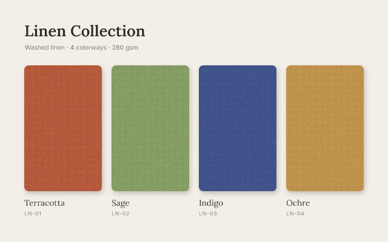

<!-- Generated by tools/gallery.mjs from showcase.yaml and build.json; do not edit. -->
# Linen Colorway Swatches

[Photo](../README.md) › [Adjustments & Color](../README.md#adjustments--color) · `adjustment-layers` `hue-saturation` `masks` `textures` `clipping-mask`

One woven texture shown in four colorways, each made by a Hue/Saturation layer masked to its own swatch.



| | |
|---|---|
| Document | [fabric-colorway-variants.psd](fabric-colorway-variants.psd) (7.2 MB) |
| Contents | 1600 × 1000 px; 16 layers; 10 type layers; 1 shape layer; 3 adjustment layers; 1 styled layer; 3 masks |
| Features | `photo.layer.adjustment`, `photo.layer.mask-basics`, `photo.filter.gallery` |
| Built by | `kition-photo` @ `7abaa42e9a`: 34 commands in 1349 ms |

## About

A product sheet for a linen line. The fabric is drawn once: a terracotta fill with gaussian noise,
a short motion blur for the weave direction and the Texturizer's canvas relief, clipped into four
rounded swatch shapes. Three Hue/Saturation adjustment layers, each made with one swatch
selected and clipped to the swatches, turn the copies into sage, indigo and ochre while the first keeps the original color;
change a layer's hue to try another colorway without touching the texture.

## Checks

- `inspect.layers`: `{"count":16}`
- `inspect.layers.8`: `{"name":"Ochre","kind":"Adjustment","adjustmentKind":"hueSaturation","clipped":true,"hasMask":true,"adjustmentParams":{"hue":22}}`
- `inspect.layers.9`: `{"name":"Indigo","kind":"Adjustment","adjustmentKind":"hueSaturation","clipped":true,"adjustmentParams":{"hue":-150}}`
- `inspect.layers.10`: `{"name":"Sage","kind":"Adjustment","adjustmentKind":"hueSaturation","clipped":true,"adjustmentParams":{"hue":70}}`
- `inspect.layers.11`: `{"name":"Linen Texture","kind":"Pixel","clipped":true}`
- `inspect.layers.12`: `{"name":"Swatches","kind":"Shape","clipped":false,"effects":{"items":{"any":{"kind":"Drop Shadow"}}}}`
- `results.terracotta.0`: `{"min":0.6}`
- `results.terracotta.2`: `{"max":0.3}`
- `results.indigoSample.0`: `{"max":0.35}`
- `results.indigoSample.2`: `{"min":0.45}`
- diagnostics: none (the kit's check finds nothing wrong)
- the saved document opens again; the thumbnail matches `thumb.png` within the `render` tolerance

## Steps

<details><summary>34 commands (from <a href="showcase.yaml">showcase.yaml</a>)</summary>

```yaml
- command: edit.fill
  params:
    contents: color
    color: "#f3efe8"
- command: type.create
  params:
    x: 100
    y: 150
    text: Linen Collection
    font: Lora
    size: 64
    weight: 600
    color: "#2d2a26"
    name: Title
- command: type.create
  params:
    x: 102
    y: 205
    text: Washed linen · 4 colorways · 280 gsm
    font: Inter
    size: 26
    color: "#7b746b"
    name: Subtitle
- command: shape.create
  params:
    kind: roundedRect
    rect:
      - 100
      - 270
      - 320
      - 520
    radii: 18
    fill: "#000000"
    name: Swatches
  as: swatches
- command: shape.create
  params:
    kind: roundedRect
    rect:
      - 460
      - 270
      - 320
      - 520
    radii: 18
    fill: "#000000"
    addTo: $swatches.layer
    op: combine
- command: shape.create
  params:
    kind: roundedRect
    rect:
      - 820
      - 270
      - 320
      - 520
    radii: 18
    fill: "#000000"
    addTo: $swatches.layer
    op: combine
- command: shape.create
  params:
    kind: roundedRect
    rect:
      - 1180
      - 270
      - 320
      - 520
    radii: 18
    fill: "#000000"
    addTo: $swatches.layer
    op: combine
- command: layer.layerStyle.dropShadow
  params:
    layer: $swatches.layer
    color: "#5a4a3a"
    opacity: 30
    distance: 10
    size: 24
    angle: 90
- command: layer.new.layer
  params:
    name: Linen Texture
  as: linen
- command: edit.fill
  params:
    contents: color
    color: "#b65a3c"
- command: filter.noise.addNoise
  params:
    amount: 18
    distribution: gaussian
    monochromatic: true
    seed: 12
- command: filter.blur.motionBlur
  params:
    angle: 0
    distance: 6
- command: filter.gallery.texturizer
  params:
    texture: canvas
    scaling: 120
    relief: 8
    light: topLeft
- command: layer.createClippingMask
  params:
    layer: $linen.layer
- command: select.rect
  params:
    x: 460
    y: 270
    width: 320
    height: 520
- command: layer.newAdjustmentLayer.hueSaturation
  params:
    hue: 70
    saturation: -50
    lightness: 6
  as: sage
- command: layer.setProps
  params:
    layer: $sage.layer
    name: Sage
    clipped: true
- command: select.rect
  params:
    x: 820
    y: 270
    width: 320
    height: 520
- command: layer.newAdjustmentLayer.hueSaturation
  params:
    hue: -150
    saturation: -28
    lightness: -16
  as: indigo
- command: layer.setProps
  params:
    layer: $indigo.layer
    name: Indigo
    clipped: true
- command: select.rect
  params:
    x: 1180
    y: 270
    width: 320
    height: 520
- command: layer.newAdjustmentLayer.hueSaturation
  params:
    hue: 22
    saturation: 5
    lightness: 10
  as: ochre
- command: layer.setProps
  params:
    layer: $ochre.layer
    name: Ochre
    clipped: true
- command: select.deselect
- command: type.create
  params:
    x: 100
    y: 850
    text: Terracotta
    font: Lora
    size: 34
    color: "#2d2a26"
    name: Name 1
- command: type.create
  params:
    x: 100
    y: 890
    text: LN-01
    font: Inter
    size: 22
    tracking: 80
    color: "#8a8279"
    name: Code 1
- command: type.create
  params:
    x: 460
    y: 850
    text: Sage
    font: Lora
    size: 34
    color: "#2d2a26"
    name: Name 2
- command: type.create
  params:
    x: 460
    y: 890
    text: LN-02
    font: Inter
    size: 22
    tracking: 80
    color: "#8a8279"
    name: Code 2
- command: type.create
  params:
    x: 820
    y: 850
    text: Indigo
    font: Lora
    size: 34
    color: "#2d2a26"
    name: Name 3
- command: type.create
  params:
    x: 820
    y: 890
    text: LN-03
    font: Inter
    size: 22
    tracking: 80
    color: "#8a8279"
    name: Code 3
- command: type.create
  params:
    x: 1180
    y: 850
    text: Ochre
    font: Lora
    size: 34
    color: "#2d2a26"
    name: Name 4
- command: type.create
  params:
    x: 1180
    y: 890
    text: LN-04
    font: Inter
    size: 22
    tracking: 80
    color: "#8a8279"
    name: Code 4
- command: document.sampleColor
  params:
    x: 260
    y: 530
    size: 31
  as: terracotta
- command: document.sampleColor
  params:
    x: 980
    y: 530
    size: 31
  as: indigoSample
```

</details>
