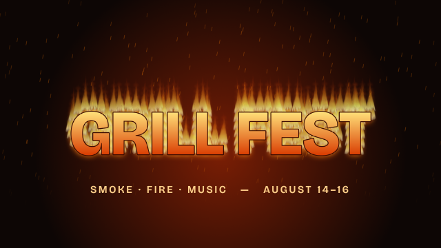

<!-- Generated by tools/gallery.mjs from showcase.yaml and build.json; do not edit. -->
# Fire Title with Flame Filter

[Photo](../README.md) › [Filters & Textures](../README.md#filters--textures) · `render-filters` `type` `layer-styles` `poster`

A barbecue festival title set ablaze with the Flame render filter run along the type's own outline.



| | |
|---|---|
| Document | [fire-title-flames.psd](fire-title-flames.psd) (4.1 MB) |
| Contents | 1600 × 900 px; 6 layers; 2 type layers; 1 fill layer; 1 styled layer; 1 mask |
| Features | `photo.filter.stylize`, `photo.type.point-text`, `photo.layer.style-basics`, `photo.paint.gradients` |
| Built by | `kition-photo` @ `7abaa42e9a`: 24 commands in 1519 ms |

## About

The headline is live type with a gradient overlay, a thin dark stroke and an orange outer glow. Its
outline becomes the work path (Create Work Path), and the Flame filter draws upward flames along
every letter onto a layer under the type, so the fire licks up from behind the glyphs. A radial
ember glow and sparks (thresholded noise, streaked, colorized and screened) finish it.

## Checks

- `inspect.layers`: `{"count":6}`
- `inspect.layers.0`: `{"name":"Headline","kind":"Type","text":{"text":"GRILL FEST"},"effects":{"items":{"count":3,"any":{"kind":"Gradient Overlay"}}}}`
- `inspect.layers.2`: `{"name":"Sparks","blend":"Screen","hasMask":true}`
- `inspect.layers.3`: `{"name":"Flames","kind":"Pixel"}`
- `results.fire.usedPath`: `true`
- `results.fire.truncated`: `false`
- `results.fire.bounds.0`: `{"max":260}`
- `results.fire.bounds.1`: `{"max":300}`
- `results.fire.bounds.2`: `{"min":1080}`
- diagnostics: none (the kit's check finds nothing wrong)
- the saved document opens again; the thumbnail matches `thumb.png` within the `render` tolerance

## Steps

<details><summary>24 commands (from <a href="showcase.yaml">showcase.yaml</a>)</summary>

```yaml
- command: edit.fill
  params:
    contents: color
    color: "#0d0605"
- command: gradient.fill.create
  params:
    from:
      - 800
      - 560
    to:
      - 800
      - 1300
    style: radial
    stops:
      - - 0
        - "#7a1e05"
      - - 1
        - "#0d0605"
  as: ember
- command: layer.renameLayer
  params:
    layer: $ember.layer
    name: Ember Glow
- command: type.create
  params:
    x: 800
    y: 560
    text: GRILL FEST
    font: Bricolage Grotesque
    size: 230
    weight: 800
    tracking: 0
    color: "#ffb02e"
    align: center
    name: Headline
  as: word
- command: type.createWorkPath
  params:
    layer: $word.layer
- command: layer.new.layer
  params:
    name: Flames
  as: flames
- command: layer.moveTo
  params:
    layer: $flames.layer
    target: $word.layer
    position: below
- command: layer.select
  params:
    layer: $flames.layer
- command: filter.render.flame
  params:
    flameType: multipleFlamesOneDirection
    length: 150
    width: 34
    interval: 30
    angle: 0
    turbulent: 40
    jag: 30
    flameLines: 12
    flameStyle: normal
    flameShape: pointed
    seed: 12
    quality: high
    path: work
  as: fire
- command: layer.layerStyle.gradientOverlay
  params:
    layer: $word.layer
    from: "#d93a00"
    to: "#ffe27a"
    angle: 90
- command: layer.layerStyle.stroke
  params:
    layer: $word.layer
    add: true
    size: 3
    position: outside
    color: "#3a0a00"
- command: layer.layerStyle.outerGlow
  params:
    layer: $word.layer
    add: true
    color: "#ff6a00"
    opacity: 55
    size: 28
    spread: 4
- command: layer.new.layer
  params:
    name: Sparks
  as: sparks
- command: edit.fill
  params:
    contents: color
    color: "#000000"
- command: filter.noise.addNoise
  params:
    amount: 112
    distribution: gaussian
    monochromatic: true
    seed: 66
- command: image.adjustments.threshold
  params:
    level: 254
- command: filter.other.maximum
  params:
    radius: 1
    preserve: roundness
- command: filter.blur.motionBlur
  params:
    angle: 80
    distance: 14
- command: image.adjustments.hueSaturation
  params:
    colorize: true
    hue: 28
    saturation: 100
    lightness: 0
- command: layer.setProps
  params:
    layer: $sparks.layer
    blend: Screen
- command: select.rect
  params:
    x: 0
    y: 0
    width: 1600
    height: 640
    feather: 120
- command: layer.layerMask.revealSelection
  params:
    layer: $sparks.layer
- command: select.deselect
- command: type.create
  params:
    x: 800
    y: 700
    text: SMOKE · FIRE · MUSIC   —   AUGUST 14–16
    font: Bricolage Grotesque
    size: 38
    weight: 600
    tracking: 200
    color: "#ffcf8a"
    align: center
    name: Details
```

</details>
