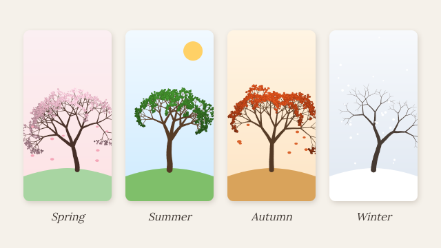

<!-- Generated by tools/gallery.mjs from showcase.yaml and build.json; do not edit. -->
# Four Seasons Tree Prints

[Photo](../README.md) › [Shapes & Illustration](../README.md#shapes--illustration) · `render-filters` `illustration` `shapes` `print`

A set of four art prints, spring blossom to bare winter branches, each tree drawn by the Tree render filter.



| | |
|---|---|
| Document | [four-seasons-tree-prints.psd](four-seasons-tree-prints.psd) (1.3 MB) |
| Contents | 1600 × 900 px; 21 layers; 4 type layers; 12 shape layers; 4 styled layers |
| Features | `photo.filter.stylize`, `photo.path.shapes`, `photo.paint.gradients`, `photo.type.point-text` |
| Built by | `kition-photo` @ `7abaa42e9a`: 81 commands in 871 ms |

## About

Four framed panels for a nursery wall. Each panel is a rounded rectangle with its own seasonal
gradient and a ground hill; the trees come from the Tree render filter (cherry blossom, oak,
autumn maple and a bare winter tree), each drawn onto its own layer with a fixed seed so the
branches are the same on every build. Small falling petals, leaves and snow are shapes.

## Checks

- `inspect.layers`: `{"count":21}`
- `inspect.layers.2`: `{"name":"Winter Tree","kind":"Pixel","clipped":true}`
- `inspect.layers.4`: `{"name":"Winter Panel","kind":"Shape","clipped":false,"effects":{"items":{"any":{"kind":"Drop Shadow"}}}}`
- `inspect.layers.17`: `{"name":"Spring Tree","kind":"Pixel","clipped":true}`
- `results.springRender.treeType`: `"Cherry Blossom"`
- `results.summerRender.treeType`: `"Oak"`
- `results.autumnRender.treeType`: `"Autumn Maple"`
- `results.winterRender.treeType`: `"Bare Winter Tree"`
- `results.winterRender.primitives`: `{"min":100}`
- diagnostics: none (the kit's check finds nothing wrong)
- the saved document opens again; the thumbnail matches `thumb.png` within the `render` tolerance

## Steps

<details><summary>81 commands (from <a href="showcase.yaml">showcase.yaml</a>)</summary>

```yaml
- command: edit.fill
  params:
    contents: color
    color: "#f5f1ea"
- command: shape.create
  params:
    kind: roundedRect
    rect:
      - 85
      - 110
      - 320
      - 620
    radii: 22
    fill:
      gradient:
        stops:
          - - 0
            - "#fde2e4"
          - - 1
            - "#fbeff2"
        angle: 90
    name: Spring Panel
  as: springPanel
- command: layer.layerStyle.dropShadow
  params:
    layer: $springPanel.layer
    color: "#6b5b4b"
    opacity: 22
    distance: 8
    size: 22
    angle: 90
- command: shape.create
  params:
    kind: path
    name: Spring Hill
    fill: "#a8d5a2"
    path:
      subpaths:
        - knots:
            - - 85
              - 640
            - anchor:
                - 245
                - 610
              in:
                - 165
                - 610
              out:
                - 325
                - 610
              smooth: true
            - - 405
              - 640
            - - 405
              - 730
            - - 85
              - 730
  as: springHill
- command: layer.setProps
  params:
    layer: $springHill.layer
    clipped: true
- command: layer.new.layer
  params:
    name: Spring Tree
  as: springTree
- command: filter.render.tree
  params:
    baseTreeType: 7
    x: 0.175
    y: 0.6844
    size: 0.32
    seed: 11
  as: springRender
- command: layer.setProps
  params:
    layer: $springTree.layer
    clipped: true
- command: shape.create
  params:
    kind: ellipse
    rect:
      - 383
      - 473
      - 10
      - 7
    fill: "#f4a6b8"
    name: Petals
  as: petals
- command: shape.create
  params:
    kind: ellipse
    rect:
      - 347
      - 456
      - 11
      - 7
    fill: "#f4a6b8"
    addTo: $petals.layer
    op: combine
- command: shape.create
  params:
    kind: ellipse
    rect:
      - 111
      - 560
      - 13
      - 9
    fill: "#f4a6b8"
    addTo: $petals.layer
    op: combine
- command: shape.create
  params:
    kind: ellipse
    rect:
      - 224
      - 489
      - 11
      - 7
    fill: "#f4a6b8"
    addTo: $petals.layer
    op: combine
- command: shape.create
  params:
    kind: ellipse
    rect:
      - 345
      - 578
      - 14
      - 9
    fill: "#f4a6b8"
    addTo: $petals.layer
    op: combine
- command: shape.create
  params:
    kind: ellipse
    rect:
      - 348
      - 541
      - 13
      - 9
    fill: "#f4a6b8"
    addTo: $petals.layer
    op: combine
- command: shape.create
  params:
    kind: ellipse
    rect:
      - 182
      - 499
      - 14
      - 9
    fill: "#f4a6b8"
    addTo: $petals.layer
    op: combine
- command: shape.create
  params:
    kind: ellipse
    rect:
      - 182
      - 573
      - 14
      - 9
    fill: "#f4a6b8"
    addTo: $petals.layer
    op: combine
- command: shape.create
  params:
    kind: ellipse
    rect:
      - 112
      - 456
      - 12
      - 8
    fill: "#f4a6b8"
    addTo: $petals.layer
    op: combine
- command: layer.setProps
  params:
    layer: $petals.layer
    clipped: true
- command: type.create
  params:
    x: 245
    y: 800
    text: Spring
    font: Lora
    size: 40
    italic: true
    color: "#3d3530"
    align: center
    name: Spring Label
- command: shape.create
  params:
    kind: roundedRect
    rect:
      - 455
      - 110
      - 320
      - 620
    radii: 22
    fill:
      gradient:
        stops:
          - - 0
            - "#cdeafe"
          - - 1
            - "#f1f9ff"
        angle: 90
    name: Summer Panel
  as: summerPanel
- command: layer.layerStyle.dropShadow
  params:
    layer: $summerPanel.layer
    color: "#6b5b4b"
    opacity: 22
    distance: 8
    size: 22
    angle: 90
- command: shape.create
  params:
    kind: path
    name: Summer Hill
    fill: "#7fbf6a"
    path:
      subpaths:
        - knots:
            - - 455
              - 640
            - anchor:
                - 615
                - 610
              in:
                - 535
                - 610
              out:
                - 695
                - 610
              smooth: true
            - - 775
              - 640
            - - 775
              - 730
            - - 455
              - 730
  as: summerHill
- command: layer.setProps
  params:
    layer: $summerHill.layer
    clipped: true
- command: layer.new.layer
  params:
    name: Summer Tree
  as: summerTree
- command: filter.render.tree
  params:
    baseTreeType: 1
    x: 0.3844
    y: 0.6844
    size: 0.34
    seed: 4
  as: summerRender
- command: layer.setProps
  params:
    layer: $summerTree.layer
    clipped: true
- command: shape.create
  params:
    kind: ellipse
    rect:
      - 665
      - 150
      - 70
      - 70
    fill: "#ffd166"
    name: Sun
  as: sun
- command: layer.setProps
  params:
    layer: $sun.layer
    clipped: true
- command: type.create
  params:
    x: 615
    y: 800
    text: Summer
    font: Lora
    size: 40
    italic: true
    color: "#3d3530"
    align: center
    name: Summer Label
- command: shape.create
  params:
    kind: roundedRect
    rect:
      - 825
      - 110
      - 320
      - 620
    radii: 22
    fill:
      gradient:
        stops:
          - - 0
            - "#fde4c4"
          - - 1
            - "#fff4e3"
        angle: 90
    name: Autumn Panel
  as: autumnPanel
- command: layer.layerStyle.dropShadow
  params:
    layer: $autumnPanel.layer
    color: "#6b5b4b"
    opacity: 22
    distance: 8
    size: 22
    angle: 90
- command: shape.create
  params:
    kind: path
    name: Autumn Hill
    fill: "#d9a35b"
    path:
      subpaths:
        - knots:
            - - 825
              - 640
            - anchor:
                - 985
                - 610
              in:
                - 905
                - 610
              out:
                - 1065
                - 610
              smooth: true
            - - 1145
              - 640
            - - 1145
              - 730
            - - 825
              - 730
  as: autumnHill
- command: layer.setProps
  params:
    layer: $autumnHill.layer
    clipped: true
- command: layer.new.layer
  params:
    name: Autumn Tree
  as: autumnTree
- command: filter.render.tree
  params:
    baseTreeType: 22
    x: 0.6156
    y: 0.6844
    size: 0.33
    seed: 9
  as: autumnRender
- command: layer.setProps
  params:
    layer: $autumnTree.layer
    clipped: true
- command: shape.create
  params:
    kind: ellipse
    rect:
      - 866
      - 517
      - 11
      - 7
    fill: "#d9622b"
    name: Falling Leaves
  as: leaves
- command: shape.create
  params:
    kind: ellipse
    rect:
      - 860
      - 508
      - 16
      - 11
    fill: "#d9622b"
    addTo: $leaves.layer
    op: combine
- command: shape.create
  params:
    kind: ellipse
    rect:
      - 1043
      - 549
      - 13
      - 9
    fill: "#d9622b"
    addTo: $leaves.layer
    op: combine
- command: shape.create
  params:
    kind: ellipse
    rect:
      - 1072
      - 474
      - 13
      - 9
    fill: "#d9622b"
    addTo: $leaves.layer
    op: combine
- command: shape.create
  params:
    kind: ellipse
    rect:
      - 894
      - 449
      - 12
      - 8
    fill: "#d9622b"
    addTo: $leaves.layer
    op: combine
- command: shape.create
  params:
    kind: ellipse
    rect:
      - 1098
      - 495
      - 11
      - 7
    fill: "#d9622b"
    addTo: $leaves.layer
    op: combine
- command: shape.create
  params:
    kind: ellipse
    rect:
      - 1068
      - 517
      - 12
      - 8
    fill: "#d9622b"
    addTo: $leaves.layer
    op: combine
- command: shape.create
  params:
    kind: ellipse
    rect:
      - 1104
      - 538
      - 13
      - 9
    fill: "#d9622b"
    addTo: $leaves.layer
    op: combine
- command: layer.setProps
  params:
    layer: $leaves.layer
    clipped: true
- command: type.create
  params:
    x: 985
    y: 800
    text: Autumn
    font: Lora
    size: 40
    italic: true
    color: "#3d3530"
    align: center
    name: Autumn Label
- command: shape.create
  params:
    kind: roundedRect
    rect:
      - 1195
      - 110
      - 320
      - 620
    radii: 22
    fill:
      gradient:
        stops:
          - - 0
            - "#dfe7f1"
          - - 1
            - "#f7f9fc"
        angle: 90
    name: Winter Panel
  as: winterPanel
- command: layer.layerStyle.dropShadow
  params:
    layer: $winterPanel.layer
    color: "#6b5b4b"
    opacity: 22
    distance: 8
    size: 22
    angle: 90
- command: shape.create
  params:
    kind: path
    name: Winter Hill
    fill: "#ffffff"
    path:
      subpaths:
        - knots:
            - - 1195
              - 640
            - anchor:
                - 1355
                - 610
              in:
                - 1275
                - 610
              out:
                - 1435
                - 610
              smooth: true
            - - 1515
              - 640
            - - 1515
              - 730
            - - 1195
              - 730
  as: winterHill
- command: layer.setProps
  params:
    layer: $winterHill.layer
    clipped: true
- command: layer.new.layer
  params:
    name: Winter Tree
  as: winterTree
- command: filter.render.tree
  params:
    baseTreeType: 13
    x: 0.8469
    y: 0.6844
    size: 0.36
    seed: 2
  as: winterRender
- command: layer.setProps
  params:
    layer: $winterTree.layer
    clipped: true
- command: shape.create
  params:
    kind: ellipse
    rect:
      - 1394
      - 403
      - 9
      - 9
    fill: "#ffffff"
    name: Snow
  as: snow
- command: shape.create
  params:
    kind: ellipse
    rect:
      - 1423
      - 429
      - 9
      - 9
    fill: "#ffffff"
    addTo: $snow.layer
    op: combine
- command: shape.create
  params:
    kind: ellipse
    rect:
      - 1387
      - 479
      - 6
      - 6
    fill: "#ffffff"
    addTo: $snow.layer
    op: combine
- command: shape.create
  params:
    kind: ellipse
    rect:
      - 1358
      - 440
      - 5
      - 5
    fill: "#ffffff"
    addTo: $snow.layer
    op: combine
- command: shape.create
  params:
    kind: ellipse
    rect:
      - 1382
      - 407
      - 6
      - 6
    fill: "#ffffff"
    addTo: $snow.layer
    op: combine
- command: shape.create
  params:
    kind: ellipse
    rect:
      - 1268
      - 495
      - 9
      - 9
    fill: "#ffffff"
    addTo: $snow.layer
    op: combine
- command: shape.create
  params:
    kind: ellipse
    rect:
      - 1351
      - 275
      - 6
      - 6
    fill: "#ffffff"
    addTo: $snow.layer
    op: combine
- command: shape.create
  params:
    kind: ellipse
    rect:
      - 1247
      - 376
      - 5
      - 5
    fill: "#ffffff"
    addTo: $snow.layer
    op: combine
- command: shape.create
  params:
    kind: ellipse
    rect:
      - 1260
      - 306
      - 8
      - 8
    fill: "#ffffff"
    addTo: $snow.layer
    op: combine
- command: shape.create
  params:
    kind: ellipse
    rect:
      - 1425
      - 589
      - 5
      - 5
    fill: "#ffffff"
    addTo: $snow.layer
    op: combine
- command: shape.create
  params:
    kind: ellipse
    rect:
      - 1225
      - 280
      - 6
      - 6
    fill: "#ffffff"
    addTo: $snow.layer
    op: combine
- command: shape.create
  params:
    kind: ellipse
    rect:
      - 1427
      - 576
      - 8
      - 8
    fill: "#ffffff"
    addTo: $snow.layer
    op: combine
- command: shape.create
  params:
    kind: ellipse
    rect:
      - 1237
      - 439
      - 5
      - 5
    fill: "#ffffff"
    addTo: $snow.layer
    op: combine
- command: shape.create
  params:
    kind: ellipse
    rect:
      - 1238
      - 323
      - 9
      - 9
    fill: "#ffffff"
    addTo: $snow.layer
    op: combine
- command: shape.create
  params:
    kind: ellipse
    rect:
      - 1384
      - 412
      - 9
      - 9
    fill: "#ffffff"
    addTo: $snow.layer
    op: combine
- command: shape.create
  params:
    kind: ellipse
    rect:
      - 1473
      - 250
      - 7
      - 7
    fill: "#ffffff"
    addTo: $snow.layer
    op: combine
- command: shape.create
  params:
    kind: ellipse
    rect:
      - 1373
      - 133
      - 5
      - 5
    fill: "#ffffff"
    addTo: $snow.layer
    op: combine
- command: shape.create
  params:
    kind: ellipse
    rect:
      - 1270
      - 437
      - 5
      - 5
    fill: "#ffffff"
    addTo: $snow.layer
    op: combine
- command: shape.create
  params:
    kind: ellipse
    rect:
      - 1231
      - 231
      - 9
      - 9
    fill: "#ffffff"
    addTo: $snow.layer
    op: combine
- command: shape.create
  params:
    kind: ellipse
    rect:
      - 1364
      - 442
      - 8
      - 8
    fill: "#ffffff"
    addTo: $snow.layer
    op: combine
- command: shape.create
  params:
    kind: ellipse
    rect:
      - 1294
      - 483
      - 7
      - 7
    fill: "#ffffff"
    addTo: $snow.layer
    op: combine
- command: shape.create
  params:
    kind: ellipse
    rect:
      - 1388
      - 290
      - 5
      - 5
    fill: "#ffffff"
    addTo: $snow.layer
    op: combine
- command: shape.create
  params:
    kind: ellipse
    rect:
      - 1285
      - 589
      - 7
      - 7
    fill: "#ffffff"
    addTo: $snow.layer
    op: combine
- command: shape.create
  params:
    kind: ellipse
    rect:
      - 1407
      - 365
      - 8
      - 8
    fill: "#ffffff"
    addTo: $snow.layer
    op: combine
- command: shape.create
  params:
    kind: ellipse
    rect:
      - 1412
      - 459
      - 9
      - 9
    fill: "#ffffff"
    addTo: $snow.layer
    op: combine
- command: shape.create
  params:
    kind: ellipse
    rect:
      - 1267
      - 447
      - 9
      - 9
    fill: "#ffffff"
    addTo: $snow.layer
    op: combine
- command: layer.setProps
  params:
    layer: $snow.layer
    clipped: true
- command: type.create
  params:
    x: 1355
    y: 800
    text: Winter
    font: Lora
    size: 40
    italic: true
    color: "#3d3530"
    align: center
    name: Winter Label
```

</details>
