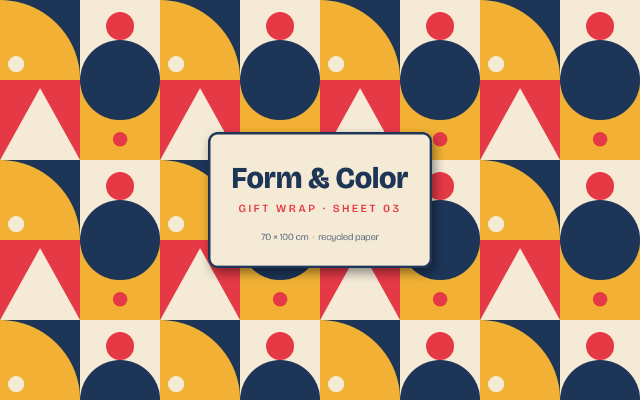

<!-- Generated by tools/gallery.mjs from showcase.yaml and build.json; do not edit. -->
# Geometric Gift Wrap Pattern

[Photo](../README.md) › [Shapes & Illustration](../README.md#shapes--illustration) · `shapes` `patterns` `illustration` `print`

Four mid-century motifs drawn as shapes, saved with Define Pattern and repeated across the sheet by a pattern fill layer.



| | |
|---|---|
| Document | [geometric-pattern-wrap.psd](geometric-pattern-wrap.psd) (784 KB) |
| Contents | 1600 × 1000 px; 6 layers; 3 type layers; 1 shape layer; 1 fill layer; 1 styled layer; 1 mask |
| Features | `photo.path.shapes`, `photo.edit.define`, `photo.layer.solid-fill`, `photo.type.point-text` |
| Built by | `kition-photo` @ `7abaa42e9a`: 23 commands in 257 ms |

## About

A repeat for wrapping paper. One 400 px tile holds four cells: a quarter disc, a sun over a half
disc, a triangle and a half moon with a dot, in navy, mustard, tomato and cream. Built from live
shapes (Bézier arcs where a quarter circle is needed), the tile is captured with Define Pattern,
the source shapes are deleted, and a Pattern fill layer tiles it across the sheet. A label card
and a hang tag sit on top.

## Checks

- `inspect.layers`: `{"count":6,"none":{"name":{"matches":"^Tile"}}}`
- `inspect.layers.3`: `{"name":"Label Card","kind":"Shape","effects":{"items":{"any":{"kind":"Drop Shadow"}}}}`
- `inspect.layers.4`: `{"name":"Wrap Pattern","kind":"Fill"}`
- `results.repeat.pattern`: `{"matches":"^[0-9a-f-]+$"}`
- `results.repeatA.0`: `{"approx":0.949,"tol":0.02}`
- `results.repeatA.1`: `{"approx":0.694,"tol":0.02}`
- `results.repeatD.0`: `{"approx":0.114,"tol":0.02}`
- `results.repeatD.2`: `{"approx":0.341,"tol":0.02}`
- diagnostics: none (the kit's check finds nothing wrong)
- the saved document opens again; the thumbnail matches `thumb.png` within the `render` tolerance

## Steps

<details><summary>23 commands (from <a href="showcase.yaml">showcase.yaml</a>)</summary>

```yaml
- command: shape.create
  params:
    kind: rect
    rect:
      - 0
      - 0
      - 200
      - 200
    fill: "#1d3557"
    name: Tile A
  as: tA
- command: shape.create
  params:
    kind: path
    name: Tile A Quarter
    fill: "#f2b134"
    path:
      subpaths:
        - knots:
            - - 0
              - 200
            - anchor:
                - 0
                - 0
              out:
                - 110.5
                - 0
            - anchor:
                - 200
                - 200
              in:
                - 200
                - 89.5
- command: shape.create
  params:
    kind: ellipse
    rect:
      - 20
      - 140
      - 40
      - 40
    fill: "#f4ead5"
    name: Tile A Dot
- command: shape.create
  params:
    kind: rect
    rect:
      - 200
      - 0
      - 200
      - 200
    fill: "#f4ead5"
    name: Tile B
- command: shape.create
  params:
    kind: path
    name: Tile B Half
    fill: "#1d3557"
    path:
      subpaths:
        - knots:
            - anchor:
                - 200
                - 200
              out:
                - 200
                - 144.8
            - anchor:
                - 300
                - 100
              in:
                - 244.8
                - 100
              out:
                - 355.2
                - 100
            - anchor:
                - 400
                - 200
              in:
                - 400
                - 144.8
- command: shape.create
  params:
    kind: ellipse
    rect:
      - 265
      - 30
      - 70
      - 70
    fill: "#e63946"
    name: Tile B Sun
- command: shape.create
  params:
    kind: rect
    rect:
      - 0
      - 200
      - 200
      - 200
    fill: "#e63946"
    name: Tile C
- command: shape.create
  params:
    kind: path
    name: Tile C Triangle
    fill: "#f4ead5"
    path:
      subpaths:
        - knots:
            - - 0
              - 400
            - - 100
              - 220
            - - 200
              - 400
- command: shape.create
  params:
    kind: rect
    rect:
      - 200
      - 200
      - 200
      - 200
    fill: "#f2b134"
    name: Tile D
- command: shape.create
  params:
    kind: path
    name: Tile D Half Moon
    fill: "#1d3557"
    path:
      subpaths:
        - knots:
            - anchor:
                - 200
                - 200
              out:
                - 200
                - 255.2
            - anchor:
                - 300
                - 300
              in:
                - 244.8
                - 300
              out:
                - 355.2
                - 300
            - anchor:
                - 400
                - 200
              in:
                - 400
                - 255.2
- command: shape.create
  params:
    kind: ellipse
    rect:
      - 282
      - 330
      - 36
      - 36
    fill: "#e63946"
    name: Tile D Dot
- command: edit.definePattern
  params:
    name: Midcentury Repeat
    rect:
      - 0
      - 0
      - 400
      - 400
  as: repeat
- command: select.findLayers
  params:
    name: Tile
- command: layer.delete
- command: layer.newFillLayer.pattern
  params:
    pattern: $repeat.pattern
    scale: 100
  as: wrap
- command: layer.renameLayer
  params:
    layer: $wrap.layer
    name: Wrap Pattern
- command: shape.create
  params:
    kind: roundedRect
    rect:
      - 520
      - 330
      - 560
      - 340
    radii: 24
    fill: "#f4ead5"
    stroke:
      width: 6
      color: "#1d3557"
      align: inside
    name: Label Card
  as: card
- command: layer.layerStyle.dropShadow
  params:
    layer: $card.layer
    color: "#0b1626"
    opacity: 45
    distance: 14
    size: 30
    angle: 110
- command: type.create
  params:
    x: 800
    y: 470
    text: Form & Color
    font: Bricolage Grotesque
    size: 76
    weight: 800
    color: "#1d3557"
    align: center
    name: Collection
- command: type.create
  params:
    x: 800
    y: 530
    text: GIFT WRAP · SHEET 03
    font: Bricolage Grotesque
    size: 28
    weight: 600
    tracking: 250
    color: "#e63946"
    align: center
    name: Sheet
- command: type.create
  params:
    x: 800
    y: 600
    text: 70 × 100 cm  ·  recycled paper
    font: Bricolage Grotesque
    size: 24
    weight: 400
    color: "#5b6b80"
    align: center
    name: Specs
- command: document.sampleColor
  params:
    x: 1300
    y: 860
    size: 5
  as: repeatA
- command: document.sampleColor
  params:
    x: 1500
    y: 260
    size: 5
  as: repeatD
```

</details>
