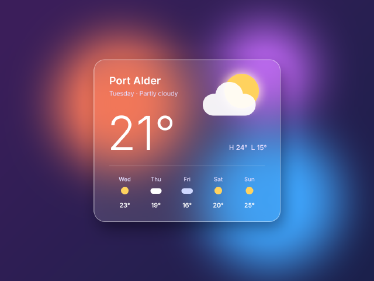

<!-- Generated by tools/gallery.mjs from showcase.yaml and build.json; do not edit. -->
# Glassmorphism Weather Widget

[Photo](../README.md) › [Layer Styles](../README.md#layer-styles) · `layer-styles` `glass` `blur` `ui` `clipping-mask`

A frosted-glass weather card over blurred colour blobs, made with a clipped blur copy, low fill opacity and a hairline stroke.



| | |
|---|---|
| Document | [glassmorphism-weather-widget.psd](glassmorphism-weather-widget.psd) (3.6 MB) |
| Contents | 1200 × 900 px; 28 layers; 14 type layers; 9 shape layers; 2 fill layers; 2 styled layers; 2 masks |
| Features | `photo.layer.styles`, `photo.layer.masks`, `photo.filter.blur`, `photo.layer.basics` |
| Built by | `kition-photo` @ `7abaa42e9a`: 48 commands in 1546 ms |

## About

The blobs are three ellipses merged into one pixel layer and blurred. The glass is a rounded
rectangle with a copy of the blobs clipped to it and blurred further (the frost), a white tint
at low fill opacity, and a Stroke and Drop Shadow layer style. The weather content on top is
type and simple shapes; the big temperature is Inter Light (weight 300) from the Inter variable
font.

## Checks

- `inspect.layers`: `{"any":{"name":"Blobs","kind":"Pixel"}}`
- `inspect.layers.-4`: `{"name":"Glass","kind":"Shape","shape":{"kind":"roundedRect","fill":"#ffffff"},"fill":{"approx":0.14,"tol":0.01},"effects":{"items":{"count":2}}}`
- `inspect.layers.-5`: `{"name":"Frost","kind":"Pixel","clipped":true}`
- `inspect.layers.-6`: `{"name":"Frost Tint","kind":"Fill","clipped":true,"fillContent":"#ffffff"}`
- `results.tempInfo.runs.0.style`: `{"font_family":"Inter","weight":300}`
- diagnostics: none (the kit's check finds nothing wrong)
- the saved document opens again; the thumbnail matches `thumb.png` within the `render` tolerance

## Steps

<details><summary>48 commands (from <a href="showcase.yaml">showcase.yaml</a>)</summary>

```yaml
- command: layer.newFillLayer.gradient
  params:
    from: "#1b1f4b"
    to: "#3b1e5a"
    angle: 135
  as: ground
- command: shape.create
  params:
    kind: ellipse
    rect:
      - 180
      - 120
      - 420
      - 420
    fill: "#ff7a59"
    name: Blob Coral
  as: blobA
- command: shape.create
  params:
    kind: ellipse
    rect:
      - 650
      - 420
      - 440
      - 440
    fill: "#3fa7ff"
    name: Blob Blue
  as: blobB
- command: shape.create
  params:
    kind: ellipse
    rect:
      - 700
      - 80
      - 300
      - 300
    fill: "#c86bff"
    name: Blob Violet
  as: blobC
- command: layer.select
  params:
    layer: $blobA.layer
- command: layer.select
  params:
    layer: $blobB.layer
    mode: add
- command: layer.select
  params:
    layer: $blobC.layer
    mode: add
- command: layer.mergeLayers
  params: {}
  as: merged
- command: layer.setProps
  params:
    name: Blobs
- command: filter.blur.gaussianBlur
  params:
    radius: 70
- command: shape.create
  params:
    kind: roundedRect
    rect:
      - 300
      - 190
      - 600
      - 520
    radii: 36
    fill: "#ffffff"
    name: Glass
  as: glass
- command: layer.setProps
  params:
    layer: $glass.layer
    fill: 0.14
- command: layer.layerStyle.stroke
  params:
    layer: $glass.layer
    size: 2
    position: inside
    color: "#ffffff"
    opacity: 45
- command: layer.layerStyle.dropShadow
  params:
    layer: $glass.layer
    color: "#0b0820"
    opacity: 45
    distance: 24
    size: 60
    angle: 100
- command: layer.duplicate
  params:
    layer: $merged.layer
    name: Frost
  as: frost
- command: layer.moveTo
  params:
    layer: $frost.layer
    target: $glass.layer
    position: above
- command: layer.select
  params:
    layer: $frost.layer
- command: layer.setProps
  params:
    clipped: true
- command: filter.blur.gaussianBlur
  params:
    radius: 40
- command: layer.newFillLayer.solidColor
  params:
    color: "#ffffff"
  as: tint
- command: layer.setProps
  params:
    layer: $tint.layer
    name: Frost Tint
    opacity: 0.16
    clipped: true
- command: type.create
  params:
    x: 350
    y: 270
    text: Port Alder
    font: Inter
    size: 34
    weight: 600
    color: "#ffffff"
    name: City
- command: type.create
  params:
    x: 350
    y: 306
    text: Tuesday · Partly cloudy
    font: Inter
    size: 20
    color: "#e4ddff"
    name: Conditions
- command: shape.create
  params:
    kind: ellipse
    rect:
      - 720
      - 236
      - 110
      - 110
    fill: "#ffd25e"
    name: Sun
  as: sun
- command: layer.layerStyle.outerGlow
  params:
    layer: $sun.layer
    color: "#ffc444"
    opacity: 70
    size: 40
- command: shape.create
  params:
    kind: roundedRect
    rect:
      - 650
      - 300
      - 170
      - 70
    radii: 35
    fill: "#ffffff"
    name: Cloud
  as: cloud
- command: shape.create
  params:
    kind: ellipse
    rect:
      - 690
      - 262
      - 90
      - 90
    fill: "#ffffff"
    addTo: $cloud.layer
    op: combine
- command: layer.setProps
  params:
    layer: $cloud.layer
    opacity: 0.92
- command: type.create
  params:
    x: 344
    y: 480
    text: 21°
    font: Inter
    size: 150
    weight: 300
    color: "#ffffff"
    name: Temperature
  as: temp
- command: type.create
  params:
    x: 856
    y: 480
    text: H 24°  L 15°
    font: Inter
    size: 22
    weight: 500
    color: "#e4ddff"
    align: right
    name: High Low
- command: shape.create
  params:
    kind: line
    from:
      - 350
      - 530
    to:
      - 850
      - 530
    weight: 1
    fill: "#ffffff"
    name: Divider
  as: divider
- command: layer.setProps
  params:
    layer: $divider.layer
    opacity: 0.3
- command: type.create
  params:
    x: 400
    y: 580
    text: Wed
    font: Inter
    size: 18
    weight: 500
    color: "#e4ddff"
    align: center
    name: Day 1
- command: type.create
  params:
    x: 500
    y: 580
    text: Thu
    font: Inter
    size: 18
    weight: 500
    color: "#e4ddff"
    align: center
    name: Day 2
- command: type.create
  params:
    x: 600
    y: 580
    text: Fri
    font: Inter
    size: 18
    weight: 500
    color: "#e4ddff"
    align: center
    name: Day 3
- command: type.create
  params:
    x: 700
    y: 580
    text: Sat
    font: Inter
    size: 18
    weight: 500
    color: "#e4ddff"
    align: center
    name: Day 4
- command: type.create
  params:
    x: 800
    y: 580
    text: Sun
    font: Inter
    size: 18
    weight: 500
    color: "#e4ddff"
    align: center
    name: Day 5
- command: shape.create
  params:
    kind: ellipse
    rect:
      - 388
      - 598
      - 24
      - 24
    fill: "#ffd25e"
    name: Icon 1
- command: shape.create
  params:
    kind: roundedRect
    rect:
      - 482
      - 602
      - 36
      - 18
    radii: 9
    fill: "#ffffff"
    name: Icon 2
- command: shape.create
  params:
    kind: roundedRect
    rect:
      - 582
      - 602
      - 36
      - 18
    radii: 9
    fill: "#cfd8ff"
    name: Icon 3
- command: shape.create
  params:
    kind: ellipse
    rect:
      - 688
      - 598
      - 24
      - 24
    fill: "#ffd25e"
    name: Icon 4
- command: shape.create
  params:
    kind: ellipse
    rect:
      - 788
      - 598
      - 24
      - 24
    fill: "#ffd25e"
    name: Icon 5
- command: type.create
  params:
    x: 400
    y: 664
    text: 23°
    font: Inter
    size: 20
    weight: 600
    color: "#ffffff"
    align: center
    name: Temp 1
- command: type.create
  params:
    x: 500
    y: 664
    text: 19°
    font: Inter
    size: 20
    weight: 600
    color: "#ffffff"
    align: center
    name: Temp 2
- command: type.create
  params:
    x: 600
    y: 664
    text: 16°
    font: Inter
    size: 20
    weight: 600
    color: "#ffffff"
    align: center
    name: Temp 3
- command: type.create
  params:
    x: 700
    y: 664
    text: 20°
    font: Inter
    size: 20
    weight: 600
    color: "#ffffff"
    align: center
    name: Temp 4
- command: type.create
  params:
    x: 800
    y: 664
    text: 25°
    font: Inter
    size: 20
    weight: 600
    color: "#ffffff"
    align: center
    name: Temp 5
- command: type.info
  params:
    layer: $temp.layer
  as: tempInfo
```

</details>
